# Index Global de Recherche & Répertoire des Sources du Laboratoire
## Système d'Indexation Transversale pour l'Ingénierie Boulangère, le Tourage & la Pâtisserie (37 Sources Unifiées)

> **Date de refonte intégrale :** Novembre 2026 (Jalon M3)  
> **Destination :** Mémoire active du laboratoire & Synchronisation Google Drive (`Boulangerie/Recherche/`)  
> **Fonction :** Moteur d'indexation thématique et cartographie documentaire permettant de retrouver instantanément la source primaire, le chapitre, le tableau de données et le protocole exact au sein des 37 ouvrages du laboratoire.

---

## 1. Cartographie d'Accès aux Sources (État des Lieux Réel — 37 Sources)

```mermaid
flowchart TD
    subgraph S1["🟢 NIVEAU 1 : ACCÈS INTÉGRAL (37 Sources Primaires en Mémoire Active)"]
        subgraph G1["📁 diagnostic_et_ingenierie (9 sources)"]
            D1["Bennion, Bamford & Bent (1997)<br/>The Technology of Cake Making 6e Éd."]
            D2["Cauvain (2012)<br/>Breadmaking: Improving Quality 2e Éd."]
            D3["Cauvain & Young (2006)<br/>Baked Products: Science, Technology & Practice"]
            D4["Cauvain & Young (2008)<br/>Bakery Water Control and Effects 2e Éd."]
            D5["Cauvain & Young (2001)<br/>Baking Problems Solved 1re Éd."]
            D6["Cauvain & Young (2017)<br/>Baking Problems Solved 2e Éd."]
            D7["Manley (1998)<br/>Manual 4: Baking & Cooling of Biscuits"]
            D8["Manley (1998)<br/>Manual 6: Biscuit Packaging & Storage"]
            D9["Manley (2000)<br/>Technology of Biscuits, Crackers & Cookies 3e Éd."]
        end

        subgraph G2["📁 grands_createurs (6 sources)"]
            C1["Cédric Grolet (2019)<br/>Opéra Pâtisserie"]
            C2["Christophe Felder & C. Lesecq (2021)<br/>Galettes : 50 Recettes des Rois"]
            C3["Christophe Felder & C. Lesecq (2015)<br/>Gâteaux : 150 Large & Small Cakes"]
            C4["Stéphane Glacier MOF (2014)<br/>Tartes et Gâteaux de Voyage"]
            C5["Johan Martin (2017)<br/>Signature Viennoiseries & Pastries"]
            C6["Jean-Michel Perruchon MOF (2013)<br/>Tentation petits gâteaux"]
        end

        subgraph G3["📁 materiel_et_lignes (4 sources)"]
            M1["RONDO Burgdorf AG (2022)<br/>Catalogue Général Matériel & Lignes"]
            M2["RONDO Burgdorf AG (2022)<br/>Polyline Feingebäcklinie DE"]
            M3["RONDO Burgdorf AG (2023)<br/>Polyline Make-Up Line EN 07.2023"]
            M4["RONDO Burgdorf AG (2023)<br/>Smartline PSS640 Sheeting Concept"]
        end

        subgraph G4["📁 recherche_et_sciences (10 sources)"]
            R1["Deligny & Lucas (2014)<br/>Effect of Fat Layers on Expansion"]
            R2["Deligny, Collewet & Lucas (2017)<br/>Quantitative MRI Study: Layers & Bubbles"]
            R3["William P. Edwards (2007)<br/>The Science of Bakery Products (RSC)"]
            R4["Ann-Charlotte Eliasson (2004)<br/>Starch in Food: Structure & Function 1re Éd."]
            R5["Faridi, Faubion & Menjivar (1990)<br/>Dough Rheology and Baked Product Texture"]
            R6["Kanwal (Indép.)<br/>Learn Baking: Science and Technology"]
            R7["Kumar (Indép.)<br/>Bakery Science: Art and Science of Bakery"]
            R8["Roussel, Onno & Sicard (2020)<br/>La panification au levain naturel (Quæ)"]
            R9["Sjöö & Nilsson (2017)<br/>Starch in Food: Structure & Function 2e Éd."]
            R10["Weibiao Zhou et al. (2014)<br/>Bakery Products Science and Technology 2e Éd."]
        end

        subgraph G5["📁 traites_et_ecoles (8 sources)"]
            T1["Ava Archer (2020)<br/>Cookie Recipes for The Whole Family"]
            T2["Bellouet, Perruchon & Paris (2000)<br/>Apprenez l'art de la viennoiserie & Festival tartes"]
            T3["École FERRANDI Paris (2019)<br/>Boulangerie & Viennoiserie d'Excellence"]
            T4["Jimmy Griffin PhD (2020)<br/>The Art of Lamination"]
            T5["Lanio, Marie MOF & Mitaillé (2017)<br/>Le Grand Livre de la Boulangerie PDF"]
            T6["Iginio Massari & A. Zoia (1999)<br/>Cresci : The Art of Leavened Dough"]
            T7["Thomas Marie MOF (2017)<br/>Le Grand Livre de la Boulangerie AZW3"]
            T8["Marie MOF, Lanio & Magne MOF (2013)<br/>Le Grand Livre de la Viennoiserie"]
        end
    end

    subgraph S2["🔵 NIVEAU 2 : ACCÈS PARTIEL (Données Clés & Études Complémentaires)"]
        P1["Deligny & Lucas (2015) - Cinétique d'expansion en étuve"]
        P2["Bousquières et al. (2014) - Rupture cryogénique sous 15 µm"]
        P3["Mutchadej & Luangsakul (2025) - Ingénierie du croissant optimal"]
        P4["Roussel & Chiron (2002) - Les Pains Français (INRAE)"]
        P5["Samuel A. Matz (1992) - Bakery Technology & Engineering"]
        P6["Lesaffre & Chiron (2018) - Lexique Sensoriel du Croissant"]
    end

    subgraph S3["🔴 NIVEAU 3 : VEILLE & SOUHAITS (Documentation Meunière Périodique)"]
        W1["Enquêtes Annuelles Récoltes Arvalis / LEMPA"]
    end
```

---

## 2. Inventaire Exhaustif par Niveau d'Accès

### 🟢 NIVEAU 1 : ACCÈS INTÉGRAL (37 Sources Primaires Téléchargées, Classées et Exploitables à 100 %)

#### Pôle 1 : Diagnostic & Ingénierie des Procédés (`docs/bibliotheque/diagnostic_et_ingenierie/` — 9 Ouvrages)

1. **Bennion, Bamford & Bent : *The Technology of Cake Making (6e Édition)*** (Edmund Baron Bennion, G. S. T. Bamford, Édité par Alan J. Bent — Blackie Academic & Professional / Chapman & Hall, 1997, 450 pages, PDF) :
   * *Localisation :* `docs/bibliotheque/diagnostic_et_ingenierie/Bennion_Bamford_Bent_The_Technology_of_Cake_Making_6th_Ed.pdf`
   * *Aperçu Thématique :* Ouvrage d'ingénierie absolue sur la physico-chimie des pâtes battues, l'aération colloïdale, la thermodynamique de cuisson et la conservation des cakes de voyage.
   * *Chapitres Clés & Données Techniques Critiques Extraites :*
     * **Émulsions et Aération des Pâtes Battues (Chap. 10 & 21, p. 112–120 & 260–275)** : La pâte à cake est une émulsion huile-dans-eau (o/w). 90 % de l'expansion volumique au four provient de la vaporisation d'eau dans les micro-bulles d'air incorporées au battage (principe de nucléation sans création de nouvelles bulles). Densité relative optimale : $\mathrm{RD} = 0{,}65 - 0{,}90$.
     * **Cinétique Chimique des Poudres à Lever (Chap. 8, p. 100–106)** : ROR (Rate of Reaction) des couples pyrophosphate acide de sodium (SAPP) / bicarbonate de sodium : 20–30 % à froid en cuve, 70–80 % au four au-dessus de 55 °C.
     * **Modélisation Prédictive de l'Activité de l'Eau ($a_w$) et Conservation (Chap. 29, p. 386–397)** : Équation de calcul de Grover (1947) basée sur les Équivalents Sucrose ($\mathrm{SE}$) : Glycérol $\mathrm{SE} = 4{,}0$, Sorbitol $\mathrm{SE} = 2{,}0$, Sel $\mathrm{SE} = 11{,}0$, Poudre de lait $\mathrm{SE} = 1,2$, Farine $\mathrm{SE} = 0,2$. Loi de Seiler : abaissement de l'ERH de 84 % à 75 % ($a_w \le 0{,}75$) prolonge la durée de vie sans moisissure de 13 jours à plus de 45 jours à 21 °C.
   * *Applications Pratiques d'Atelier :* Formulation des cakes de voyage longue conservation, prévention du tranchage au crémage, maîtrise de la texture alvéolée des muffins et madeleines.

2. **Cauvain : *Breadmaking: Improving Quality (2e Édition)*** (Stanley P. Cauvain — Woodhead Publishing / Elsevier, 2012, 804 pages, EPUB) :
   * *Localisation :* `docs/bibliotheque/diagnostic_et_ingenierie/Cauvain_Breadmaking_Improving_Quality.epub`
   * *Aperçu Thématique :* Somme technique sur l'amélioration continue de la panification, le contrôle du volume de pâte, la cinétique de fermentation et la modélisation du rassissement.
   * *Chapitres Clés & Données Techniques Critiques Extraites :*
     * **Développement Mécanique de Pâte (Chap. 11, p. 300–335)** : Consommation d'énergie critique au pétrissage (40–45 kJ/kg de pâte) pour aligner les polymères de gluténines sans rupture oxydative.
     * **Contrôle de la Fermentation & Métabolisme des Levures (Chap. 14, p. 410–445)** : Optimisation de l'osmotolérance et équilibre gazeux $\mathrm{CO_2}$ sous différentes températures de pâte (22 °C vs 28 °C).
     * **Prolongation de la Fraîcheur et Lutte contre le Rassissement (Chap. 22, p. 650–685)** : Utilisation d'amylases maltogènes et d'émulsifiants monoglycérides pour bloquer la recristallisation de l'amylopectine.
   * *Applications Pratiques d'Atelier :* Conduite des détrempes de panification et viennoiserie, étalonnage de l'énergie au pétrin spirale, régulation des temps de pointage.

3. **Cauvain & Young : *Baked Products: Science, Technology and Practice*** (Stanley P. Cauvain & Linda S. Young — Blackwell Publishing, 2006, 243 pages, PDF) :
   * *Localisation :* `docs/bibliotheque/diagnostic_et_ingenierie/Cauvain_Young_Baked_Products_Science_Technology_Practice.pdf`
   * *Aperçu Thématique :* Synthèse transversale reliant la formulation des produits de cuisson (pain, viennoiserie, biscuits, cakes) aux contraintes industrielles et à l'analyse rhéologique.
   * *Chapitres Clés & Données Techniques Critiques Extraites :*
     * **Rôle des Matières Grasses dans les Pâtes (Chap. 3, p. 45–72)** : Fonction de raccourcissement (*shortening*), plastification et enrobage des protéines du gluten ; courbes de solides gras (SFC) adaptées aux saisons.
     * **Structures Alvéolées et Stabilité des Mousses (Chap. 5, p. 95–124)** : Transition d'une mousse liquide/viscoélastique à une éponge solide ouverte lors de la coagulation des protéines et de la gélatinisation de l'amidon.
     * **Formulation et Diagnostic des Défauts (Chap. 8, p. 185–215)** : Arbres de causalité entre déséquilibres sucre/eau/matière grasse et affaissement central ou fissuration.
   * *Applications Pratiques d'Atelier :* Étalonnage des recettes de pâtes courtes, transition texturales des viennoiseries et cakes de voyage.

4. **Cauvain & Young : *Bakery Food Manufacture and Quality: Water Control and Effects (2e Édition)*** (Stanley P. Cauvain & Linda S. Young — Wiley-Blackwell, 2008, 301 pages, PDF) :
   * *Localisation :* `docs/bibliotheque/diagnostic_et_ingenierie/Cauvain_Young_Bakery_Water_Control_and_Effects_2nd_Ed.pdf`
   * *Aperçu Thématique :* Traité de référence sur la thermodynamique de l'eau, les isothermes de sorption, la cryo-cristallisation et la maîtrise de l'activité de l'eau ($a_w$).
   * *Chapitres Clés & Données Techniques Critiques Extraites :*
     * **Cinétique de Cristallisation sous Zéro (Chap. 1 & 4, p. 12–35 & 90–120)** : Capacité thermique massique de l'eau ($4{,}19\text{ kJ/kg/K}$) vs glace ($2{,}09\text{ kJ/kg/K}$). Franchissement de la zone critique de cristallisation (0 °C à -5 °C) à vitesse $> 1\ ^\circ\text{C}/\text{min}$ en cellule cryogénique à -35 °C pour générer des micro-cristaux dendritiques non perforants.
     * **Activité de l'Eau et Durée de Vie (Chap. 6, p. 150–185)** : Cartographie des seuils limites de développement microbien ($a_w > 0{,}85$ bactéries pathogènes, $a_w > 0{,}80$ levures osmotolérantes, $a_w > 0{,}70$ moisissures xerophiles).
     * **Migration d'Humidité Croûte-Mie (Chap. 7, p. 190–225)** : Équilibre hygrométrique et ramollissement de la croûte du pain et des feuilletages sous atmosphère humide.
   * *Applications Pratiques d'Atelier :* Conduite du procédé Poussé Surgelé (PAC), calibrage de la cellule de congélation rapide à -35 °C, calcul de durée de vie des produits en vitrine.

5. **Cauvain & Young : *Baking Problems Solved (1re Édition)*** (Stanley P. Cauvain & Linda S. Young — Woodhead Publishing, 2001, 298 pages, PDF) :
   * *Localisation :* `docs/bibliotheque/diagnostic_et_ingenierie/Cauvain_Young_Baking_Problems_Solved_1st_Ed_2001.pdf`
   * *Aperçu Thématique :* Manuel historique sous forme de questions-réponses couvrant les défaillances de fabrication du pain de mie, des pâtes levées et des pâtes feuilletées.
   * *Chapitres Clés & Données Techniques Critiques Extraites :*
     * **Défauts des Pâtes Fermentées (Section 2, p. 45–95)** : Problèmes de cloquage superficiel, de déchirures de croûte et d'effondrement à la sortie du four.
     * **Défauts de Pâtes Feuilletées et Tourées (Section 4, p. 140–180)** : Causes racines du débeurrage au four et feuilletage irrégulier.
   * *Applications Pratiques d'Atelier :* Dépannage rapide au poste de pétrissage et de façonnage.

6. **Cauvain & Young : *Baking Problems Solved (2e Édition)*** (Stanley P. Cauvain & Linda S. Young — Elsevier / Woodhead Publishing, 2017, 573 pages, PDF) :
   * *Localisation :* `docs/bibliotheque/diagnostic_et_ingenierie/Cauvain_Young_Baking_Problems_Solved_2nd_Ed_2017.pdf`
   * *Aperçu Thématique :* La bible absolue du diagnostic des défauts en boulangerie, viennoiserie, biscuiterie et pâtisserie industrielle.
   * *Chapitres Clés & Données Techniques Critiques Extraites :*
     * **Pâtes Feuilletées et Viennoiserie (Pastry Products, Puff & Danish, Chap. 4, p. 143–210)** : Matrice exhaustive des défaillances de tourage : fuite de beurre en étuve (température $> 28^\circ\mathrm{C}$), cloques de condensation, décollement de feuillets, manque de développement vertical.
     * **Pains et Pâtes Levées (Bread and Fermented Products, Chap. 2 & 3, p. 35–142)** : Causes de croûte terne, déchirures latérales, mie grasse ou cireuse.
     * **Biscuits, Cookies et Crackers (Chap. 5, p. 211–275)** : Causes d'étalement excessif ou insuffisant (*spread*), contrôle du checking, collage sur bandes de four.
     * **Gâteaux et Muffins (Cakes and Sponges, Chap. 6, p. 277–345)** : Affaissement central (*sunken cakes*), tunnelisation de mie, exsudation de matière grasse.
   * *Applications Pratiques d'Atelier :* Matrice de référence pour la section I du présent index, audit des lignes automatisées Polyline/Croissomat.

7. **Duncan Manley : *Biscuit, Cookie and Cracker Manufacturing Manuals — Manual 4: Baking and Cooling of Biscuits*** (Duncan Manley — Woodhead Publishing, 1998, 92 pages, PDF) :
   * *Localisation :* `docs/bibliotheque/diagnostic_et_ingenierie/Manley_Manual_4_Baking_and_Cooling_of_Biscuits.pdf`
   * *Aperçu Thématique :* Thermodynamique industrielle des fours à bandes, profils de température par zones, cinétiques d'évaporation et science du ressuage.
   * *Chapitres Clés & Données Techniques Critiques Extraites :*
     * **Thermique des Fours à Bandes (Chap. 3 & 4, p. 25–48)** : Échanges radiatifs ($T^4$), convection et conduction. Bandes en acier plein (*steel band*) pour fonds plats et pâtes courtes vs toiles métalliques tressées (*wire mesh*) pour évaporation double face des crackers et pâtes dures laminées.
     * **Profil de Cuisson en 3 Zones (p. 32–37)** : Zone 1 (développement d'épaisseur, fonte des graisses, vaporisation eau/$\mathrm{CO_2}$ à 200–260 °C), Zone 2 (fixation de structure, coagulation protéines et gélatinisation amidon à 180–200 °C), Zone 3 (séchage final et coloration Maillard à 140–160 °C, humidité $< 2{,}5\%$).
     * **Phénomène de Checking / Fissuration Différée (Chap. 5, p. 44–58)** : Rupture mécanique spontanée causée par un gradient d'humidité résiduelle entre le centre humide (4–7 %) et les bords secs ($< 1{,}5\%$). Règle d'or de prévention : **durée de ressuage $= 1{,}5\text{ à }2{,}0 \times\text{ le temps de cuisson}$** sous capot fermé sans choc thermique d'air froid.
   * *Applications Pratiques d'Atelier :* Cuisson des biscuits, cookies, sablés et fonds de tartes ; étalonnage du ressuage anti-checking.

8. **Duncan Manley : *Biscuit, Cookie and Cracker Manufacturing Manuals — Manual 6: Biscuit Packaging and Storage*** (Duncan Manley — Woodhead Publishing, 1998, 82 pages, PDF) :
   * *Localisation :* `docs/bibliotheque/diagnostic_et_ingenierie/Manley_Manual_6_Biscuit_Packaging_and_Storage.pdf`
   * *Aperçu Thématique :* Science des matériaux d'emballage, perméabilité aux gaz/vapeur d'eau (WVTR/OTR), rancissement oxydatif et préservation du croustillant.
   * *Chapitres Clés & Données Techniques Critiques Extraites :*
     * **Sorption d'Humidité et Perte de Croustillant (Chap. 2 & 4, p. 15–38)** : Humidité relative d'équilibre (ERH) normale des biscuits : 10 à 25 % ($a_w = 0{,}10 - 0{,}25$). Au franchissement du **seuil critique $a_w = 0{,}35 - 0{,}40$**, la matrice vitreuse d'amidon subit une plastification aqueuse et traverse sa transition vitreuse ($T_g$) à 20 °C, basculant vers l'état mou/caoutchouteux.
     * **Oxydation Lipidique et Rancissement (Chap. 3, p. 28–35)** : Auto-oxydation des acides gras libres catalysée par la lumière UV et l'oxygène moléculaire. Nécessité d'emballages barrières étanches avec atmosphère modifiée (MAP, azote $\mathrm{N_2}$, oxygène résiduel $< 1\%$).
     * **Spécifications des Films Barrières (Chap. 5, p. 45–65)** : Films OPP thermoscellables, Met-OPP (dépôt d'aluminium sous vide) et complexes multi-couches papier/PE/alu. Contrôle de l'intégrité des soudures de flow-pack.
   * *Applications Pratiques d'Atelier :* Conditionnement des cookies, palmiers, sablés et gâteaux de voyage ; sélection des films d'ensachage.

9. **Duncan J.R. Manley : *Technology of Biscuits, Crackers and Cookies (3e Édition)*** (Duncan J.R. Manley — Woodhead Publishing / CRC Press, 2000, 528 pages, PDF) :
   * *Localisation :* `docs/bibliotheque/diagnostic_et_ingenierie/Manley_Technology_of_Biscuits_Crackers_and_Cookies_3rd_Ed.pdf`
   * *Aperçu Thématique :* Le grand traité universel de biscuiterie industrielle : classification des pâtes, rhéologie des matières grasses, laminage continu et fabrication des biscuits feuilletés.
   * *Chapitres Clés & Données Techniques Critiques Extraites :*
     * **Classification Fondamentale des Pâtes (Chap. 18–24, p. 215–310)** : Cartographie basée sur les teneurs en matières grasses et sucre pour 100 unités de farine. Pâtes courtes (*short doughs* : 20–45 % MG, 25–55 % sucre, 10–18 % eau) sans réseau de gluten vs pâtes dures extensibles (*hard sweet* : 10–20 % MG, gluten continu).
     * **Les Puff Biscuits (Biscuits Feuilletés Secs, Chap. 25, p. 315–332)** : Conduite d'un tourage consommé froid : exigence d'une matière grasse à point de fusion net ($37^\circ\mathrm{C}$) sans film gras cireux résiduel en bouche (*waxy tail*). Détrempe froide sans matière grasse pour préserver l'élasticité.
     * **Ingénierie du Laminage Mécanique (Chap. 35, p. 415–440)** : Réduction d'épaisseur maximale par passe : **$\le 40\%$** pour éviter le cisaillement et la rupture des strates internes. Comparatif laminateurs verticaux en accordéon vs empileurs découpeurs à plat (*cut-and-lay*).
   * *Applications Pratiques d'Atelier :* Conduite des lignes de biscuiterie, crackers, cookies et biscuits feuilletés d'atelier.

---

#### Pôle 2 : Traités de Haute Pâtisserie & Grands Créateurs (`docs/bibliotheque/grands_createurs/` — 6 Ouvrages)

10. **Cédric Grolet : *Opéra Pâtisserie*** (Cédric Grolet — Ducasse Édition, 2019, 400 pages, PDF) :
    * *Localisation :* `docs/bibliotheque/grands_createurs/Cedric_Grolet_Opera_Patisserie.pdf`
    * *Aperçu Thématique :* La vision haute couture de la boulangerie-pâtisserie de palace : viennoiseries signatures du matin (7h00), brioches feuilletées, roulés et créations graphiques.
    * *Chapitres Clés & Données Techniques Critiques Extraites :*
      * **Viennoiserie du Matin (p. 18–75)** : Formules de croissants et pains au chocolat enrichis au miel de fleurs, œufs entiers et beurre de tourage AOP ; alvéolage volumineux et régulier.
      * **Brioches Feuilletées et Roulés (p. 80–145)** : Tressages, roulés framboise et palmiers étoilés à caramélisation intense.
      * **Tartes Flan en Brioche Feuilletée (p. 150–190)** : Cuisson combinée pâte briochée tourée et appareil flan vanille bourbon.
    * *Applications Pratiques d'Atelier :* Formats vitrine de prestige, façonnages d'exception, dorures et brillances de palace.

11. **Johan Martin : *Signature Viennoiseries & Pastries*** (Johan Martin — Éditions Bellouet Conseil Paris, 2017, 219 pages, PDF) :
    * *Localisation :* `docs/bibliotheque/grands_createurs/Johan_Martin_Signature_Viennoiseries_Pastries.pdf`
    * *Aperçu Thématique :* L'orfèvrerie graphique contemporaine : géométrie des viennoiseries bicolores, techniques de découpe et de roulage parfait.
    * *Chapitres Clés & Données Techniques Critiques Extraites :*
      * **Formule Étalon Croissant Pur Beurre (p. 12–15)** : Farine T45, 1,5 % Trimoline (15 g), 25 % beurre en cuve (250 g/kg), 50 % beurre de tourage sec 84 %, tourage 1 tour double + 1 tour simple (25 couches).
      * **Dorure Pistolet Émulsionnée (p. 14)** : 125 g blancs d'œufs + 300 g jaunes + 75 g crème fleurette 35 % mixés au Bamix sans bulles et appliqués au pistolet compresseur.
      * **Pièces Graphiques (p. 20–180)** : Fleur de cacao, Fleur de framboise, Chignon, Swirl bicolore, Croissant bicolore rayé.
    * *Applications Pratiques d'Atelier :* Formulations étalons PLF, pulvérisation de dorure haute brillance, décors géométriques.

12. **Christophe Felder & Camille Lesecq : *Galettes : 50 recettes des rois de la pâtisserie*** (Christophe Felder & Camille Lesecq — Éditions de La Martinière, 2021, 123 pages, PDF) :
    * *Localisation :* `docs/bibliotheque/grands_createurs/Felder_Galettes_50_Recettes_des_Rois_de_la_Patisserie.pdf`
    * *Aperçu Thématique :* Le grand livre de référence sur le feuilletage inversé d'orfèvrerie, le bridage thermique de cuisson et l'équilibre des crèmes frangipanes.
    * *Chapitres Clés & Données Techniques Critiques Extraites :*
      * **Feuilletage Inversé au Vinaigre Blanc (p. 14–17)** : Beurre manié extérieur (375 g beurre sec 84 % + 150 g farine T45) ; Détrempe intérieure (350 g farine T55, 115 g beurre fondu froid, 150 g eau, 10 g vinaigre blanc anti-oxydation et relaxant de gluten, 18 g fleur de sel). Tourage : 2 tours doubles + 2 tours simples avec repos frigorifique de 2 h à 5 °C entre chaque séquence.
      * **Protocole de Cuisson Sous Grille à Cales de 4 cm (p. 7)** : Piquage fin du feuilletage ; mise en place dès l'enfournement d'une grille métallique rigide surélevée par **des cales fixes de 4 cm**. Montée uniforme des feuillets jusqu'à la butée, planéité absolue de la surface, zéro déformation en dôme. Cuisson longue à **$150 - 160^\circ\mathrm{C}$ chaleur tournante** pendant 1 h 15.
      * **Formule Étalon Frangipane Équilibrée (p. 23)** : **2/3 (77 %) de crème d'amande** (100 g beurre pommade, 100 g sucre glace, 100 g poudre d'amande, 100 g œufs, 10 g fécule de maïs, 10 g rhum) pour **1/3 (23 %) de crème pâtissière** ferme. Zéro décollement de la croûte supérieure.
    * *Applications Pratiques d'Atelier :* Galettes des rois feuilletées, pithiviers, tartes en feuilletage inversé, tourage de précision.

13. **Christophe Felder & Camille Lesecq : *Gâteaux : 150 Large and Small Cakes, Cookies, and Desserts*** (Christophe Felder & Camille Lesecq — Rizzoli / Éditions de La Martinière, 2015, 392 pages, PDF) :
    * *Localisation :* `docs/bibliotheque/grands_createurs/Felder_Lesecq_Gateaux_150_Cakes_Cookies_Desserts.pdf`
    * *Aperçu Thématique :* Encyclopédie des créations ménagères et de boutique : cakes marbrés, sablés fondants, gâteaux de voyage et brioches traditionnelles alsaciennes.
    * *Chapitres Clés & Données Techniques Critiques Extraites :*
      * **Cakes de Voyage et Marbrés (p. 140–176)** : Émulsion soignée beurre pommade/œufs à 20 °C, incorporation de crème fleurette 35 % et Trimoline. Pochage d'un trait de beurre pommade sur la crête axiale avant enfournement pour guider l'ouverture régulière du cake.
      * **Pâtes Sablées aux Jaunes Cuits (p. 14–60)** : Utilisation de jaunes d'œufs durs tamisés pour supprimer toute cohésion élastique du gluten et obtenir une friabilité maximale (*shortbreads*).
      * **Brioches Alsaciennes et Kouglofs (p. 106–138)** : Conduite sur pâte fermentée, hydratation riche en lait et œufs, imbibage au beurre clarifié et fleur d'oranger.
    * *Applications Pratiques d'Atelier :* Fabrication des cakes marbrés d'atelier, sablés fins, kouglofs et brioches de fête.

14. **Stéphane Glacier MOF : *Tartes et Gâteaux de Voyage "Pâtisserie Boulangère"*** (Stéphane Glacier — Stéphane Glacier Éditions, 2014, 172 pages, PDF) :
    * *Localisation :* `docs/bibliotheque/grands_createurs/Glacier_Tartes_et_Gateaux_de_Voyage_Patisserie_Boulangere.pdf`
    * *Aperçu Thématique :* Traité professionnel dédié à la pâtisserie de boutique boulangère : gâteaux de voyage longue conservation, tartes de tradition et fonçages stables.
    * *Chapitres Clés & Données Techniques Critiques Extraites :*
      * **Conservation des Gâteaux de Voyage sans Conservateur (p. 150–172)** : Substitution de 10 à 15 % du sucre cristallisé par du miel ou sucre inverti (Trimoline) pour lier l'eau libre ; cuisson douce bridée à **$145^\circ\mathrm{C}$ ventilé** pendant 50 minutes sous grille pour géométrie parfaite.
      * **Technique du Beurre Manié de Moulage (p. 198)** : Graissage des moules avec un mélange beurre fondu / farine tamisée (ratio 80/20) refroidi en pommade, assurant un démoulage sans accroc.
      * **Tartes Rustiques et Fonçages (p. 16–65)** : Pâtes sablées aux amandes précuites à blanc, imperméabilisation par chablonnage au beurre de cacao ou dorure cuite avant garnissage.
    * *Applications Pratiques d'Atelier :* Cakes de voyage longue durée (Valencia amande, griotte-pistache, marbré Fabrice), cannelés bordelais, financiers au beurre noisette.

15. **Jean-Michel Perruchon MOF : *Tentation petits gâteaux*** (Jean-Michel Perruchon — École Bellouet Conseil Paris, 2013, 206 pages, PDF) :
    * *Localisation :* `docs/bibliotheque/grands_createurs/Perruchon_Tentation_Petits_Gateaux.pdf`
    * *Aperçu Thématique :* Précis de haute pâtisserie individuelle : standardisation des gélifiants, émulsions miroir parfaites et inserts gélifiés stables au froid négatif.
    * *Chapitres Clés & Données Techniques Critiques Extraites :*
      * **Standardisation de la Masse Gélatine (p. 297)** : Règle Bellouet Conseil : **1 part de gélatine poudre 200 Bloom pour 6 parts d'eau froide** (hydratation 20 min à 4 °C avant usage).
      * **Glaçage Miroir Bellouet Conseil (p. 173, 178, 183)** : 150 g eau, 300 g sucre/vergeoise, 300 g glucose 40 DE cuits à **$103^\circ\mathrm{C}$**, versés sur 200 g lait concentré sucré et 140 g masse gélatine, mixés sur 300 g de chocolat de couverture. Température d'application sur entremets congelés (-18 °C) : **$30 - 32^\circ\mathrm{C}$ (noir) ou $32 - 35^\circ\mathrm{C}$ (ivoire/lait)**.
      * **Inserts Fruits à la Pectine NH (p. 9)** : Utilisation de pectine thermo-réversible portée à ébullition 1 min avec les purées de fruits, résistant à la synérèse post-décongélation.
    * *Applications Pratiques d'Atelier :* Glaçages miroirs ultra-brillants, inserts gélifiés pour entremets et petits gâteaux de vitrine.

---

#### Pôle 3 : Ingénierie des Lignes & Matériel Mécanisé (`docs/bibliotheque/materiel_et_lignes/` — 4 Manuels)

16. **RONDO Burgdorf AG : *RONDO Machine Overview — Catalogue Général Matériel & Lignes 2022*** (RONDO Burgdorf AG, Suisse, 2022, 8 pages, PDF) :
    * *Localisation :* `docs/bibliotheque/materiel_et_lignes/RONDO_Machine_Overview_Catalogue_Complet_2022.pdf`
    * *Aperçu Thématique :* Panorama de la gamme de mécanisation suisse : laminoirs manuels et électroniques (Rondomat, Manomat, Compas 4.0), enrouleurs Croissomat SCM, lignes Polyline et Starline.
    * *Chapitres Clés & Données Techniques Critiques Extraites :*
      * **Conception Hygiénique ASTec (p. 3–5)** : Châssis en acier inoxydable AISI 304, surfaces inclinées auto-égouttantes, démontage sans outils des racleurs et bandes transporteuses.
      * **Cinématique de Laminage Progressif (p. 6–7)** : Réduction d'épaisseur à commande numérique empêchant tout écrasement excessif des pâtons tourés.
    * *Applications Pratiques d'Atelier :* Sélection et maintenance du parc matériel du laboratoire (laminoirs et enrouleurs).

17. **RONDO Burgdorf AG : *RONDO Polyline Feingebäcklinie (Spécifications Techniques DE)*** (RONDO Burgdorf AG, Suisse, 2022, 4 pages, PDF) :
    * *Localisation :* `docs/bibliotheque/materiel_et_lignes/RONDO_Polyline_Feingebacklinie_DE.pdf`
    * *Aperçu Thématique :* Spécifications constructeur détaillées en langue d'origine pour la ligne de découpe et de façonnage modulaire Polyline.
    * *Chapitres Clés & Données Techniques Critiques Extraites :*
      * **Accessoires de Pâtisserie Fine (p. 2–3)** : Doseurs pneumatiques pour crèmes et confitures, guillotine mécanique synchronisée, outils de pliage en triangle et enroulement automatique.
    * *Applications Pratiques d'Atelier :* Réglages fins des outils de façonnage mécanique sur la ligne d'atelier.

18. **RONDO Burgdorf AG : *RONDO Polyline Make-Up Line (Manuel & Fiche Technique EN 07.2023)*** (RONDO Burgdorf AG, Suisse, 2023, 8 pages, PDF) :
    * *Localisation :* `docs/bibliotheque/materiel_et_lignes/RONDO_Polyline_Make_Up_Line_EN_07.2023.pdf`
    * *Aperçu Thématique :* Manuel opérationnel de la ligne Polyline : gestion de la vitesse de bande, synchronisation du calibreur et postes de découpe.
    * *Chapitres Clés & Données Techniques Critiques Extraites :*
      * **Contrôle de Vitesse de Table (p. 3–6)** : Variateur électronique régulé par microprocesseur de **0,5 à 8,0 m/min** (mémorisation de 99 programmes produits).
      * **Calibreur de Tête et Découpe Double (p. 4–5)** : Calibreur pour jonction de bande sans tension mécanique résiduelle ; double station d'outils rotatifs pour couteaux longitudinaux et transversaux.
    * *Applications Pratiques d'Atelier :* Pilotage de la cadence d'atelier (découpe de 1 200 à 3 000 pièces/heure).

19. **RONDO Burgdorf AG : *RONDO Smartline PSS640 Sheeting and Feeding Concept*** (RONDO Burgdorf AG, Suisse, 2023, 12 pages, PDF) :
    * *Localisation :* `docs/bibliotheque/materiel_et_lignes/RONDO_Smartline_PSS640_Sheeting_Feeding_2023.pdf`
    * *Aperçu Thématique :* L'ingénierie du laminage continu basse contrainte (*stress-free*) par satellite multi-rouleaux.
    * *Chapitres Clés & Données Techniques Critiques Extraites :*
      * **Principe Satellite Multi-Rouleaux (p. 6–9)** : Couronne de petits cylindres planétaires en rotation libre autour d'un rotor central. Amincissement progressif de la bande de pâte sans étirement longitudinal destructeur.
      * **Préservation des Micro-Strates de Beurre (p. 7)** : Maintien de l'intégrité des films lipidiques en évitant les surpressions hydrauliques d'entrefer qui provoquent l'extrusion de matière grasse.
    * *Applications Pratiques d'Atelier :* Conduite du laminage haute précision des pâtes levées feuilletées (PLF) et feuilletages inversés.

---

#### Pôle 4 : Recherche Scientifique Fondamentale & Rhéologie (`docs/bibliotheque/recherche_et_sciences/` — 10 Ouvrages)

20. **Deligny & Lucas (2014) : *Effect of fat layers on expansion and structure of Danish pastry during proofing and baking*** (C. Deligny & T. Lucas — *Journal of Food Engineering* / INRAE, 2014, 26 pages, PDF) :
    * *Localisation :* `docs/bibliotheque/recherche_et_sciences/Deligny_Lucas_2014_Effect_of_fat_layers_on_expansion_Danish_pastry.pdf`
    * *Aperçu Thématique :* Étude scientifique fondamentale quantifiant l'effet du nombre de feuillets sur le développement volumique et l'alvéolage de la pâte levée feuilletée.
    * *Chapitres Clés & Données Techniques Critiques Extraites :*
      * **Plafond Critique de Feuillets (p. 113–120)** : Démonstration du seuil maximal d'expansion à **32 à 48 films de matière grasse**. Au-delà de ce plafond, l'épaisseur unitaire des films de beurre devient inférieure à l'épaisseur critique ($< 15\ \mu\mathrm{m}$), provoquant la rupture des strates, la fuite de vapeur d'eau et une texture dense de type mie de pain.
      * **Cinétique en Étuve (p. 115)** : Suivi en direct du gonflement des bulles gazeuses piégées par les films étanches.
    * *Applications Pratiques d'Atelier :* Justification scientifique du choix des tourages courts (1 tour double + 1 tour simple $= 24\text{ à }25$ couches).

21. **Deligny, Collewet & Lucas (2017) : *Quantitative MRI study of fat layers and bubble distribution in Danish pastry during proofing*** (C. Deligny, G. Collewet, T. Lucas — *Journal of Food Engineering* / Irstea, 2017, 27 pages, PDF) :
    * *Localisation :* `docs/bibliotheque/recherche_et_sciences/Deligny_Lucas_2017_Quantitative_MRI_study_layers_bubbles_Danish_pastry.pdf`
    * *Aperçu Thématique :* Imagerie par Résonance Magnétique (IRM) quantitative traquant la genèse et la localisation spatiale des bulles d'air au cours de l'apprêt.
    * *Chapitres Clés & Données Techniques Critiques Extraites :*
      * **Localisation de la Nucléation Gazeuse (p. 11–24)** : Preuve expérimentale que les grandes macro-alvéoles (2 à 15 mm) naissent **exclusivement DANS et le long des strates de beurre**. Le beurre agit comme un réservoir et un guide physique pour l'expansion du gaz carbonique et de la vapeur.
    * *Applications Pratiques d'Atelier :* Maîtrise de la régularité du nid d'abeille dans les croissants du laboratoire.

22. **William P. Edwards : *The Science of Bakery Products*** (William P. Edwards — Royal Society of Chemistry, 2007, 273 pages, PDF) :
    * *Localisation :* `docs/bibliotheque/recherche_et_sciences/Edwards_The_Science_of_Bakery_Products_RSC.pdf`
    * *Aperçu Thématique :* Physique-chimie céréalière : polymorphisme cristallin des triglycérides, réseau de gluten et chimie macromoléculaire des amidons.
    * *Chapitres Clés & Données Techniques Critiques Extraites :*
      * **Polymorphisme Cristallin des Matières Grasses (Chap. 4, p. 65–88)** : Formes cristallines $\alpha$ (instable, bas point de fusion), $\beta'$ (cristaux fins en aiguilles conférant une plasticité et ductilité idéale pour le tourage entre 12 °C et 14 °C), et $\beta$ (gros cristaux stables et cassants, responsables du blanchiment et du déchirement de pâte).
      * **Dénaturation et Rétrogradation (Chap. 6, p. 115–142)** : Gélatinisation de l'amidon à 60–65 °C, coagulation thermique des gliadines et gluténines à 70–80 °C.
    * *Applications Pratiques d'Atelier :* Conditionnement thermique du beurre de tourage (maintien en phase $\beta'$ à 12–14 °C).

23. **Ann-Charlotte Eliasson : *Starch in Food: Structure, Function and Applications (1re Édition)*** (Ann-Charlotte Eliasson — Woodhead Publishing / CRC Press, 2004, 597 pages, PDF) :
    * *Localisation :* `docs/bibliotheque/recherche_et_sciences/Eliasson_Starch_in_Food_Structure_Function_Applications_1st_Ed.pdf`
    * *Aperçu Thématique :* Traité de référence sur la cryobiologie de l'amidon, les isothermes de transition vitreuse et les complexes d'inclusion amylose-lipides.
    * *Chapitres Clés & Données Techniques Critiques Extraites :*
      * **Cryobiologie et Transition Vitreuse sous Zéro (H. Douglas Goff — Chap. 14, p. 445–475)** : Cryo-concentration de la phase non congelée (UFP). Température de transition vitreuse maximale cryo-concentrée **$T_g' \approx -12^\circ\mathrm{C}\text{ à }-15^\circ\mathrm{C}$** avec eau non congelable associée $W_g' \approx 20 - 25\%$. Pour bloquer toute diffusion et recristallisation de glace sur 3 mois en PAC, le stockage doit impérativement être **$< -18^\circ\mathrm{C}$**.
      * **Complexes d'Inclusion Amylose-Lipides (A.-C. Eliasson & M. Wahlgren — Chap. 15, p. 480–510)** : Formation d'hélices simples en V entre l'amylose et les acides gras/monoglycérides. L'amidon complexé ne rétrograde plus, retardant considérablement le rancissement textural de la mie.
    * *Applications Pratiques d'Atelier :* Règles de conservation cryogénique des pâtes crues surgelées (PAC), maintien du moelleux de mie.

24. **Faridi, Faubion & Menjivar : *Dough Rheology and Baked Product Texture*** (Hamed Faridi, Jon M. Faubion & Juan A. Menjivar — Van Nostrand Reinhold / AVI Book, 1990, 608 pages, PDF) :
    * *Localisation :* `docs/bibliotheque/recherche_et_sciences/Faridi_Faubion_Menjivar_Dough_Rheology_and_Baked_Product_Texture.pdf`
    * *Aperçu Thématique :* Le classique mondial de la rhéologie des pâtes céréalières : viscoélasticité dynamique ($G', G''$), modélisation hydrodynamique du laminage mécanique et états vitreux (Levine & Slade).
    * *Chapitres Clés & Données Techniques Critiques Extraites :*
      * **Viscoélasticité Dynamique Fondamentale (Juan A. Menjivar — Chap. 1, p. 1–25)** : Modules $G'$ (stockage élastique), $G''$ (dissipation visqueuse) et facteur de perte $\tan \delta = G''/G' \approx 0{,}35 - 0{,}50$ pour pâtes optimales. Limite de viscoélasticité linéaire (LVR) pour déformation $\gamma < 0{,}2\%$.
      * **Génie du Laminage Mécanique (Leon Levine & Bruce A. Drew — Chap. 14, p. 513–556)** : Équation d'écoulement sous loi de puissance ($\tau = K \dot{\gamma}^n$, $n = 0{,}35$). Pression hydraulique maximale au pincement (*nip*), déflexion des arbres de transmission et flexion des rouleaux (*roll bending*). Nombre de Deborah $De = \lambda / t_{\mathrm{res}}$ : si $De \gg 1$, réponse en solide élastique cassant et rupture des films de beurre. Nécessité de temps de relaxation $\ge 20 - 30\text{ min}$.
      * **Rhéologie en Biscuiterie (Hamed Faridi — Chap. 8, p. 363–384)** : Contrôle du ratio $G'/G''$ pour piloter l'étalement (*spread ratio*) des cookies au four.
    * *Applications Pratiques d'Atelier :* Paramétrage des laminoirs Rondo, calibration des taux de réduction d'abaisse, relaxation des détrempes.

25. **Kanwal : *Learn Baking: Science and Technology*** (Kanwal — Publication Indépendante, 30 pages, PDF) :
    * *Localisation :* `docs/bibliotheque/recherche_et_sciences/Kanwal_Learn_Baking_Science_and_Technology.pdf`
    * *Aperçu Thématique :* Précis concis et opérationnel des fondamentaux scientifiques de meunerie et de cuisson.
    * *Chapitres Clés & Données Techniques Critiques Extraites :*
      * **Paramètres de Meunerie Essentiels (p. 5–18)** : Rôle du taux de cendres, équilibre enzymatique et absorption d'eau.
      * **Fermentation et Levains (p. 19–28)** : Cinétiques levuriennes et production d'acides organiques.
    * *Applications Pratiques d'Atelier :* Aide-mémoire de formation des apprentis et opérateurs de pétrissage.

26. **Kumar : *Bakery Science: The Art and Science of Bakery*** (Kumar — Publication Indépendante, 143 pages, PDF) :
    * *Localisation :* `docs/bibliotheque/recherche_et_sciences/Kumar_Bakery_Science_The_Art_and_Science_of_Bakery.pdf`
    * *Aperçu Thématique :* Traité d'enseignement professionnel sur la chimie des ingrédients boulangers, les poudres levantes et les formulations de pâtisserie.
    * *Chapitres Clés & Données Techniques Critiques Extraites :*
      * **Chimie des Farines et Protéines (Chap. 2, p. 15–38)** : Rôle des fractions albumines, globulines, gliadines et gluténines dans la cohésion du réseau.
      * **Poudres Chimiques et Dégagement Gazeux (Chap. 5, p. 65–82)** : Stœchiométrie des réactions de neutralisation bicarbonate / acides tartrique et pyrophosphates.
      * **Technologie des Pâtes Battues (Chap. 7, p. 95–120)** : Foisonnement mécanique et émulsification du crémage.
    * *Applications Pratiques d'Atelier :* Contrôle de la balance chimique des cakes, madeleines et biscuits d'atelier.

27. **Roussel, Onno & Sicard : *La panification au levain naturel : Glossaire des savoirs*** (Philippe Roussel, Bernard Onno, Delphine Sicard — Éditions Quæ / INRAE, 2020, 103 pages, PDF) :
    * *Localisation :* `docs/bibliotheque/recherche_et_sciences/Roussel_Onno_La_panification_au_levain_naturel_Glossaire.pdf`
    * *Aperçu Thématique :* La synthèse scientifique officielle du projet ANR BAKERY sur la biodiversité microbienne et la conduite instrumentée des levains de panification.
    * *Chapitres Clés & Données Techniques Critiques Extraites :*
      * **Acidité Titrable Totale (ATT / TTA) (p. 14–16)** : Protocole de dosage au fournil (NaOH N/10 et phénolphtaléine). Le pH seul est trompeur en raison du pouvoir tampon des cendres de la farine.
      * **Quotient Fermentaire ($QF$) (p. 13–15)** : Ratio molaire **Acide Lactique / Acide Acétique cible de 3:1 à 4:1** pour un arôme équilibré, doux et beurré sans acidité piquante.
      * **Activation de la Phytase Endogène (p. 13)** : À pH 4,5–5,0, la phytase du blé dégrade l'acide phytique en inositol et phosphates libres, libérant fer, magnésium et zinc chélatés.
      * **Écosystème Microbien (p. 25–45)** : Symbiose métabolique entre levures maltose-négatives (*Kazachstania exigua*) et bactéries lactiques hétérofermentaires (*Fructilactobacillus sanfranciscensis*).
    * *Applications Pratiques d'Atelier :* Conduite et rafraîchis des levains dur et liquide, panification nutritionnelle et digestion optimale.

28. **Sjöö & Nilsson : *Starch in Food: Structure, Function and Applications (2e Édition)*** (Malin Sjöö & Lars Nilsson — Woodhead Publishing / Elsevier, 2017, 888 pages équivalent, 23 chapitres, EPUB) :
    * *Localisation :* `docs/bibliotheque/recherche_et_sciences/Sjoo_Nilsson_Starch_in_Food_Structure_Function_Applications_2nd_Ed.epub`
    * *Aperçu Thématique :* Le traité de référence contemporain sur la physico-chimie des amidons alimentaires : structure granulaire A et B, gélatinisation sous faible eau et cryo-stabilité.
    * *Chapitres Clés & Données Techniques Critiques Extraites :*
      * **Gélatinisation sous Faible Disponibilité en Eau (Chap. 8 & 15)** : Granules A lenticulaires (15–35 µm) vs granules B sphériques (2–10 µm). En présence de saccharose et matières grasses, la gélatinisation de l'amidon de blé est retardée de 58–65 °C jusqu'à **$75 - 90^\circ\mathrm{C}$** (effet antiplastifiant compétitif du sucre immobilisant l'eau libre).
      * **Stabilité en Congélation et Mûrissement d'Ostwald (Chap. 14)** : Lors des fluctuations de température en stockage surgelé, les petits cristaux de glace fondent et alimentent les gros cristaux, perforent le réseau de gluten et provoquent la synérèse à la décongélation.
    * *Applications Pratiques d'Atelier :* Compréhension fine de la tenue à la coupe des flans vanille, stabilité des pâtes crues surgelées (PAC).

29. **Zhou, Hui et al. : *Bakery Products Science and Technology (2e Édition)*** (Weibiao Zhou, Y.H. Hui et al. — Wiley-Blackwell, 2014, 1 237 pages, PDF) :
    * *Localisation :* `docs/bibliotheque/recherche_et_sciences/Zhou_Bakery_Products_Science_and_Technology_1237p.pdf`
    * *Aperçu Thématique :* La grande encyclopédie technique mondiale en 1 237 pages couvrant l'intégralité des procédés de panification, viennoiserie, biscuiterie et cryogénie.
    * *Chapitres Clés & Données Techniques Critiques Extraites :*
      * **Rhéologie Instrumentale (Chap. 2 & 26, p. 25–48 & 510–535)** : Alvéographe Chopin ($W \ge 320$, $P/L \approx 0{,}55 - 0{,}65$), Mixolab (profil complet hydratation, affaiblissement protéique, gélatinisation et rétrogradation amylacée).
      * **Technologies Cryogéniques et Pâtes Congelées (Chap. 30, p. 575–605)** : Lyse cellulaire des levures congelées libérant du glutathion réduit ($GSH$) qui coupe les ponts disulfures du gluten. Nécessité absolue de levures sélectionnées cryorésistantes.
      * **Technologies des Pâtes Tourées (Chap. 34, p. 660–695)** : Thermocinétique de cuisson, profils d'évaporation de la vapeur entre les strates de beurre.
    * *Applications Pratiques d'Atelier :* Référentiel global meunerie, sélection des farines de laboratoire, conduite industrielle PAC.

---

#### Pôle 5 : Traités d'Écoles & Pédagogie de Boulangerie-Viennoiserie (`docs/bibliotheque/traites_et_ecoles/` — 8 Ouvrages)

30. **Ava Archer : *Cookie Recipes for The Whole Family: Quick and Easy to Make Cookie Recipes*** (Ava Archer — Auto-édition, 2020, 71 pages, PDF) :
    * *Localisation :* `docs/bibliotheque/traites_et_ecoles/Archer_Cookie_Recipes_for_The_Whole_Family.pdf`
    * *Aperçu Thématique :* Recueil pratique de formulations familiales et artisanales de cookies : équilibre d'étalement (*spread*), texture moelleuse (*chewy*) vs croustillante (*crispy*).
    * *Chapitres Clés & Données Techniques Critiques Extraites :*
      * **Équilibre Matières Grasses / Sucres & Rhéologie de Pâte (p. 5–15)** : Sucre blanc raffiné favorisant l'étalement et le croustillant en périphérie vs vergeoise/sucre brun retenant l'humidité pour un cœur moelleux dense (*chewy*).
      * **Différentiel Chimique Bicarbonate vs Levure Chimique (p. 8)** : $\mathrm{NaHCO_3}$ seul alcalinisant la pâte, affaiblissant le réseau protéique et accentuant la coloration de Maillard vs levure chimique créant une expansion verticale sans étalement.
      * **Blocage au Froid Préalable (p. 10)** : Repos obligatoire à **$4^\circ\mathrm{C}$ pendant 1 à 24 h** figeant la matière grasse pour empêcher la liquéfaction précoce au four.
    * *Applications Pratiques d'Atelier :* Formulations de cookies artisanaux (chunks chocolat, peanut butter, snickerdoodles).

31. **Bellouet, Perruchon & Paris : *Apprenez l'art de la viennoiserie et Festival de tartes*** (G.J. Bellouet MOF, J.-M. Perruchon MOF & J.-M. Paris — Éditions Bellouet Conseil Paris, 2000, 290 pages, PDF) :
    * *Localisation :* `docs/bibliotheque/traites_et_ecoles/Bellouet_Perruchon_Paris_Apprenez_Art_Viennoiserie_Festival_Tartes.pdf`
    * *Aperçu Thématique :* Le grand traité pédagogique de l'école Bellouet : viennoiserie artisanale d'excellence, feuilletage inversé d'école, pâte feuilletée chocolat et répertoire des tartes de tradition.
    * *Chapitres Clés & Données Techniques Critiques Extraites :*
      * **Formule Croissant Bellouet Conseil (p. 18–21)** : Farine T55 panifiable 1 000 g, 200 g beurre doux de détrempe en cuve (20 %) pour assouplir le pâton et éviter toute rétraction au laminage, 500 g beurre de tourage sec 84 % (50 %). Température de base : **52 °C**.
      * **Cinétique de Pointage et Blocage Froid Négatif (p. 18)** : Pointage 45 min à 25 °C, rabat, passage en cellule négative **45 min à $-18^\circ\mathrm{C}$ avec retournement impératif à 20 min** pour homogénéiser la pénétration thermique.
      * **Pâtes Feuilletées d'École (p. 102–106)** : Feuilletage inversé (beurre manié 800 g beurre + 350 g farine ; détrempe 700 g gruau T45, 350 g eau, 30 g sel, 200 g beurre) et Feuilletage Chocolat au cacao pur 100 % (800 g beurre + 200 g cacao poudre pour le tourage).
      * **Festival de Tartes (p. 13–160)** : Pâtes sablées bretonnes, fonçages anti-rétraction, tartes aux fruits cuits.
    * *Applications Pratiques d'Atelier :* Conduite thermique du tourage, fabrication des pâtes levées feuilletées d'artisan et tartes de boutique.

32. **École FERRANDI Paris : *FERRANDI Paris : Boulangerie & Viennoiserie d'Excellence*** (Collectif Enseignants FERRANDI Paris — Éditions Flammarion, 2019, 306 pages, PDF) :
    * *Localisation :* `docs/bibliotheque/traites_et_ecoles/FERRANDI_Paris_Boulangerie_Viennoiserie_Excellence.pdf`
    * *Aperçu Thématique :* Le grand traité de transmission de l'école FERRANDI Paris : rigueur de formulation, détrempes composites, Tangzhong et formats contemporains.
    * *Chapitres Clés & Données Techniques Critiques Extraites :*
      * **Détrempe Composite PLF (p. 74)** : Assemblage 50 % Farine de Gruau T45 et 50 % Farine de Meule T65, apportant extensibilité et tenue enzymatique.
      * **Méthode Tangzhong (p. 184)** : Pré-gélatinisation d'une fraction de farine et d'eau (ratio 1:5 chauffé à 65 °C), fixant l'eau sous forme de gel amorphe pour préserver le moelleux 5 à 7 jours sans additifs.
      * **Viennoiseries Tendances (p. 212–226)** : Croissant bicolore rayé chocolat, Cruffin fendu en moule tulipe, New York Roll cuit en cercle inox fermé.
    * *Applications Pratiques d'Atelier :* Formats vitrines modernes, pains de mie ultra-moelleux au Tangzhong.

33. **Jimmy Griffin : *The Art of Lamination: Advanced Laminated Pastry*** (Jimmy Griffin, Master Baker, PhD — Griffin Bakery Training, 2020, 189 pages, PDF) :
    * *Localisation :* `docs/bibliotheque/traites_et_ecoles/Jimmy_Griffin_The_Art_of_Lamination_2020.pdf`
    * *Aperçu Thématique :* Le traité d'ingénierie internationale du tourage : modélisation mathématique des strates, orientation directionnelle et couvertures eutectiques.
    * *Chapitres Clés & Données Techniques Critiques Extraites :*
      * **Systèmes de Pliage 3-4-3 vs 3-4-4 (p. 52 & 125)** : Système 3-4-3 (1S + 1D + 1S) pour croissants légers et aériens vs Système 3-4-4 (1S + 2D, 36 couches de beurre) conférant une rigidité structurelle supérieure capable de supporter des bâtons de chocolat sans effondrement central (formule Médaille d'Argent Coupe du Monde Chocolatine 2019).
      * **Rotation Obligatoire à 90° (p. 33)** : Rotation à angle droit à chaque tour pour croiser les réseaux de gluten étirés et supprimer le phénomène d'effet ressort (*snapback*).
      * **Couvertures Eutectiques (*Ice Blankets*) (p. 45)** : Maintien thermique strict de la pâte à 4 °C en cours de laminage d'atelier.
    * *Applications Pratiques d'Atelier :* Conduite du tourage sur laminoir, suppression des rétractions d'abaisse, choix de pliage par produit.

34. **Jean-Marie Lanio, Thomas Marie MOF & Patrice Mitaillé : *Le Grand Livre de la Boulangerie*** (Jean-Marie Lanio, Thomas Marie MOF, Patrice Mitaillé — Alain Ducasse Édition, 2017, 246 pages, PDF) :
    * *Localisation :* `docs/bibliotheque/traites_et_ecoles/Marie_Lanio_Mitaille_Le_Grand_Livre_de_la_Boulangerie.pdf`
    * *Aperçu Thématique :* La bible moderne de la boulangerie française par 3 MOF/formateurs : conduite précise des levains naturels, autolyses longues et pains de tradition.
    * *Chapitres Clés & Données Techniques Critiques Extraites :*
      * **Conduite Instrumentée des Levains Naturels (p. 18–23)** : Protocoles précis de levain dur (50 % d'eau) sur base seigle T170 et levain liquide (100 % d'eau) sur T65, rafraîchis en 3 étapes thermorégulées.
      * **Baguette de Tradition Française Décret 1993 (p. 41)** : Farine T65, 65 % eau, 1,9 % sel, 0,7 % levure, 10 % levain liquide. Température de base 56–60 °C. **Autolyse farine + eau de 1 heure minimum**. Pétrissage très lent : **8 min en 1re vitesse, 1 min en 2e vitesse** (protection des caroténoïdes). Blocage 12 h à 3 °C.
      * **Croissant sur Pâte Fermentée Viennoise (p. 168)** : Incorporation de 20 % de pâte fermentée de la veille au frasage ; pointage bloqué 12 h à 3 °C ; tourage 1D + 1S (24 couches).
    * *Applications Pratiques d'Atelier :* Panification de tradition française au levain, gestion de l'autolyse, fermentation lente au froid positif.

35. **Iginio Massari & Achille Zoia : *Cresci: The Art of Leavened Dough*** (Iginio Massari & Achille Zoia — Italian Gourmet, 1999, 400 pages, PDF) :
    * *Localisation :* `docs/bibliotheque/traites_et_ecoles/Massari_Zoia_Cresci_The_Art_of_Leavened_Dough.pdf`
    * *Aperçu Thématique :* Le monument mondial de la grande fermentation italienne : science de la *Pasta Madre* (levain dur panettone), double empâtement et grandes brioches.
    * *Chapitres Clés & Données Techniques Critiques Extraites :*
      * **Conduite de la Pasta Madre (p. 8–15 & 390–400)** : Levain dur à 45–50 % d'hydratation, conservé sous toile serrée (*legatura*), subissant 3 rafraîchis successifs de 3 h à 28 °C avant empâtement, bain d'eau sucrée (*bagnetto*) pour extraire l'acidité acétique volatile en excès.
      * **Double Empâtement (*Primo e Secondo Impasto*)** : Premier pétrissage nocturne (farine, levain, sucre, eau, beurre) poussant 12 h à 26 °C jusqu'à triplement de volume ; deuxième pétrissage au matin intégrant les jaunes, le beurre restant et les arômes.
      * **Glaçage Ghiaccia et Ressuage Tête en Bas (p. 399)** : Glaçage amande/cacao/maïs ; embrochage sur aiguilles à la sortie du four et ressuage suspendu tête en bas (*spillatura*) pendant 10 à 12 h pour éviter l'affaissement de la voûte.
    * *Applications Pratiques d'Atelier :* Fabrication des panettones, pandoros, colombes et brioches royales du laboratoire.

36. **Thomas Marie MOF : *Le Grand Livre de la Boulangerie (Édition Numérique Enrichie)*** (Thomas Marie MOF — Alain Ducasse Édition, 2017, Format Kindle AZW3, 246 pages équivalent, AZW3) :
    * *Localisation :* `docs/bibliotheque/traites_et_ecoles/Thomas_Marie_MOF_Le_Grand_Livre_de_la_Boulangerie.azw3`
    * *Aperçu Thématique :* Version numérique originale sanctuarisant les formulations des pains régionaux, des tourtes de seigle au levain acide et des viennoiseries de concours.
    * *Chapitres Clés & Données Techniques Critiques Extraites :*
      * **Pains Spéciaux et Régionaux** : Tourte de seigle au levain dur (p. 137), pain de méteil, couronne bordelaise et fougasses salées.
    * *Applications Pratiques d'Atelier :* Consultation mobile et backup numérique des protocoles de boulangerie.

37. **Thomas Marie MOF, Jean-Marie Lanio & Olivier Magne MOF : *Le Grand Livre de la Viennoiserie*** (Thomas Marie MOF, Jean-Marie Lanio, Olivier Magne MOF — Alain Ducasse Édition, 2013, 280 pages, PDF) :
    * *Localisation :* `docs/bibliotheque/traites_et_ecoles/Thomas_Marie_MOF_Le_Grand_Livre_de_la_Viennoiserie.pdf`
    * *Aperçu Thématique :* Le chef-d'œuvre canonique de la viennoiserie française professionnelle : abaques mathématiques de tourage, répertoires classiques et feuilletages d'excellence.
    * *Chapitres Clés & Données Techniques Critiques Extraites :*
      * **Abaques des Tourages et Nombre de Couches (p. 18–29)** :
        * *2 tours simples :* 9 couches de pâte / 8 films de beurre.
        * *1 tour simple + 1 tour double :* 25 couches de pâte / 12 films de beurre (ratio d'excellence).
        * *2 tours doubles :* 33 couches de pâte / 16 films de beurre.
        * *3 tours simples :* 27 films de beurre.
      * **Grands Classiques et Viennoiseries d'Auteur (p. 30–180)** : Croissant d'excellence (p. 34), Pain au chocolat (p. 46), Brioche feuilletée cappuccino/chocolat (p. 100–102), Cruffin vanille (p. 114), Cube feuilleté (p. 116), Kouign-amann aux pommes caramélisées (p. 118).
      * **Feuilletages et Tartes (p. 240–263)** : Feuilletage classique (p. 240), feuilletage inversé (p. 242), pâte à flan vanille bourbon (p. 254).
    * *Applications Pratiques d'Atelier :* Référentiel premier pour l'ensemble des 10 viennoiseries feuilletées du cahier de recettes d'atelier.

---

### 🔵 NIVEAU 2 : ACCÈS PARTIEL (Résumés Officiels, Équations, Abaques & Données Extraites)

1. **Deligny C. & Lucas T. (2015)** (*Journal of Food Engineering*, 158: 113–120) : Modélisation cinétique de l'expansion volumique en étuve et suivi de la déformation viscoélastique sous contrainte gazeuse.
2. **Bousquières et al. (2014)** (*Journal of Cereal Science*, 60: 488–495) : Microscopie cryogénique et rupture des films de beurre sous 15 µm sous l'effet des macro-cristaux de glace hexagonale.
3. **Mutchadej & Luangsakul (2025)** (*Engineering the perfect croissant*, Elsevier) : Optimisation du pétrissage (10 min à 200 rpm), tourage 1D+1S (25 couches) et cinétique d'apprêt à 27 °C pendant 2 h.
4. **P. Roussel & H. Chiron (2002)** (*Les pains français : évolution, qualité, production*, INRAE) : Abaques Chopin historiques, correction de température de base et hydrolyse enzymatique lors de l'autolyse.
5. **Samuel A. Matz (1992)** (*Bakery Technology and Engineering*, 3e Édition, 850 p.) : Thermodynamique des fours industriels, mécanismes d'enrouleurs et de diviseuses volumétriques.
6. **Hubert Chiron & Lesaffre (2018)** (*Lexique Sensoriel du Croissant*, Lesaffre / INRAE) : Évaluation sensorielle normalisée en 5 dimensions (Aspect, Odeur, Son, Texture en bouche, Goût).

---

### 🔴 NIVEAU 3 : VEILLE & SOUHAITS (Documentation Périodique Résiduelle)

1. **Enquêtes Techniques Annuelles Arvalis / LEMPA** : Bulletins annuels de la qualité des récoltes meunières françaises (suivi des $W$, $P/L$, temps de chute Hagberg par bassin céréalier).

---

## 3. Index Thématique Transversal de Recherche (9 Pôles d'Ingénierie A à I)

Cet index permet de trouver instantanément la réponse technique, la source associée, le chapitre précis et la recommandation d'atelier pour l'ensemble des 37 sources documentaires du laboratoire.

### A. Rhéologie Fondamentale, Farines, Amidon & Pétrissage

| Sujet / Mot-clé | Problématique Atelier | Source de Référence | Chapitre / Emplacement | Recommandation Clé / Règle d'Or |
| :--- | :--- | :--- | :--- | :--- |
| **Alvéographe Chopin ($W$ et $P/L$)** | Sélection farine pour PLF / PAC | Weibiao Zhou / Philippe Roussel | Zhou Chap. 2 (p. 28) & Quæ | Viser $W \ge 320$, $P/L \approx 0{,}55 - 0{,}65$ pour assurer extensibilité sans déchirement au laminage. |
| **Temps de chute Hagberg** | Activité alpha-amylasique de la farine | Weibiao Zhou / Stanley Cauvain | Zhou Chap. 2 (p. 35) & Breadmaking | Indice optimal $> 250\text{ s}$. En dessous : excès d'amylases, liquéfaction d'amidon, pâte collante et mie cireuse. |
| **Viscoélasticité dynamique ($G', G'', \tan \delta$)** | Équilibre élasticité / extensibilité de pâte | Faridi, Faubion & Menjivar (Menjivar) | Dough Rheology Chap. 1 (p. 1–25) | Maintenir $\tan \delta = G''/G' \approx 0{,}35 - 0{,}50$. Travailler dans la zone viscoélastique linéaire ($\gamma < 0{,}2\%$). |
| **Pétrissage optimal PLF** | Vitesse et développement du réseau de gluten | Mutchadej & Luangsakul / FERRANDI Paris | Étude Elsevier 2025 / Ferrandi p. 74 | **10 min à 200 rpm**. Sortie de pétrin à **$21 - 23^\circ\mathrm{C}$** pour éviter le pointage précoce en cuve. |
| **Consommation énergétique de pétrissage** | Contrôle du réseau sans sur-oxydation | Stanley P. Cauvain | Breadmaking 2e Éd. Chap. 11 (p. 300) | Apport d'énergie optimal : **40 à 45 kJ/kg de pâte** au pétrin spirale. |
| **Méthode Tangzhong (Pré-gel)** | Rétention d'eau sans conservateur | École FERRANDI Paris (Audrey Janet) | Ferrandi p. 184 | Pré-gélatinisation eau/farine (ratio 5:1) chauffée à **65 °C**. Maintient la fraîcheur et le moelleux 5 à 7 jours. |
| **Gélatinisation sous faible eau** | Température de gélatinisation en pâte enrichie | Malin Sjöö & Lars Nilsson | Starch in Food 2e Éd. Chap. 8 & 15 | En milieu riche en sucre et matières grasses, la gélatinisation de l'amidon de blé est retardée de 58 °C à **$75 - 90^\circ\mathrm{C}$**. |
| **Complexes Amylose-Lipides** | Lutte contre la rétrogradation de l'amidon | Ann-Charlotte Eliasson (Wahlgren) | Starch in Food 1re Éd. Chap. 15 (p. 480) | L'inclusion d'acides gras/monoglycérides dans la cavité hélicoïdale de l'amylose bloque la rétrogradation et le rassissement. |
| **Autolyse en viennoiserie** | Relaxation enzymatique vs tenue de pâte | Thomas Marie MOF / Philippe Roussel | Grand Livre Viennoiserie / Quæ | Autolyse longue déconseillée sur pâtes très enrichies en sucre ; privilégier le pointage retardé au froid positif ($+2^\circ\mathrm{C}$). |
| **Évaluation Mixolab** | Comportement thermo-rhéologique complet | Weibiao Zhou | Zhou Chap. 26 (p. 515) | Suivi de l'affaiblissement protéique, du pic de viscosité amylacée et du taux de rétrogradation en une seule analyse. |
| **Taux de cendres & hydratation** | Influence meunière sur l'absorption de pâte | Kanwal | Learn Baking p. 5–18 | Calibrer l'eau de coulage selon le type de farine (T45 50–55 % vs T65 65–68 %) pour stabiliser la consistance de pâte. |
| **Chimie des protéines & force de pâte** | Rôle des fractions gliadines et gluténines | Kumar | Bakery Science Chap. 2 (p. 15–38) | Équilibre extensibilité (gliadines) et ténacité élastique (gluténines) conditionnant la tenue des pâtes au façonnage. |
| **Comportement des pâtes enrichies** | Effet des matières grasses sur le réseau de gluten | Cauvain & Young | Baked Products Chap. 3 (p. 45–72) | Le shortening et le beurre enrobent les micelles de protéines, limitant la réticulation pour préserver la tendreté. |

---

### B. Science du Tourage, Matières Grasses & Feuilletages

| Sujet / Mot-clé | Problématique Atelier | Source de Référence | Chapitre / Emplacement | Recommandation Clé / Règle d'Or |
| :--- | :--- | :--- | :--- | :--- |
| **Nombre optimal de couches PLF** | Équilibre volume / alvéolage / flaveur | Thomas Marie MOF / Mutchadej 2025 | GLV p. 24 / Étude Elsevier 2025 | **1 Tour Double + 1 Tour Simple (25 couches / 12 films de beurre)** confère le meilleur développement au four (+1,52 %). |
| **Plafond critique de feuillets** | Saturation et perte de feuilletage | Deligny & Lucas (INRAE) | J. Food Eng. 158: 113–120 (2014) | Au-delà de **32 à 48 films de beurre**, les strates se rompent (épaisseur $< 15\ \mu\mathrm{m}$), la vapeur fuit et la mie devient dense comme du pain. |
| **Gestation des bulles à l'IRM** | Localisation physique du nid d'abeille | Deligny, Collewet & Lucas (Irstea) | J. Food Eng. 2017 (IRM quantitative) | Les grandes alvéoles (2–15 mm) naissent **exclusivement DANS et le long des strates de beurre** pendant l'apprêt. |
| **Polymorphisme cristallin du beurre** | Plasticité et ductilité sans rupture | William P. Edwards (RSC) | Science of Bakery Products Chap. 4 | Travailler le beurre de tourage stabilisé sous forme cristalline **$\beta'$ à $12 - 14^\circ\mathrm{C}$** (aiguilles fines étirables sans fissuration). |
| **Système 3-4-3 vs 3-4-4** | Portance des viennoiseries garnies (chocolatines) | Jimmy Griffin PhD | The Art of Lamination p. 52 & 125 | Système 3-4-3 pour croissants aériens ; Système 3-4-4 (1S + 2D, 36 couches) pour supporter les bâtons de chocolat sans affaissement central. |
| **Rotation obligatoire à 90°** | Suppression du snapback / rétraction | Jimmy Griffin PhD | The Art of Lamination p. 33 | Pivoter le pâton de **90° à chaque tour** pour croiser l'orientation des fibrilles de gluten et équilibrer les tensions. |
| **Feuilletage Inversé au Vinaigre** | Friabilité absolue et zéro rétractation | Christophe Felder & Camille Lesecq | Galettes p. 14–17 | Beurre manié extérieur (71 % beurre / 29 % farine) ; détrempe au vinaigre blanc (10 g/kg) et sel marin (18 g/kg). 2 doubles + 2 simples. |
| **Puff Biscuits (Biscuits Feuilletés)** | Tourage pour produits consommés froids | Duncan J.R. Manley | Technology of Biscuits 3e Éd. Chap. 25 | Matière grasse à courbe SFC raide (fondant intégralement à 37 °C) évitant tout dépôt cireux en bouche (*waxy tail*). Pâte froide sans graisse. |
| **Détrempe enrichie en beurre cuve** | Assouplissement et machinabilité | Bellouet, Perruchon & Paris | Apprenez l'art de la viennoiserie p. 18 | Ajouter **100 à 200 g de beurre doux / kg de farine** en cuve au frasage pour assouplir la pâte et éviter déchirements et rétractions au laminoir. |
| **Feuilletage Chocolat au Cacao Pur** | Strates bicolores cacaotées intégrées | Bellouet, Perruchon & Paris | Apprenez l'art de la viennoiserie p. 106 | Matière grasse de tourage constituée de 800 g de beurre sec malaxé avec **200 g de poudre de cacao 100 %**. 6 tours simples. |
| **Formule Croissant Pur Beurre** | Équilibre moelleux, pousse et croustillant | Johan Martin | Signature Viennoiseries p. 12–15 | Farine T45, 1,5 % Trimoline, 25 % beurre en cuve, 50 % beurre de tourage sec 84 %, tourage 1D + 1S. |
| **Viennoiserie de palace au miel** | Alvéolage régulier et flaveur de grand créateur | Cédric Grolet | Opéra Pâtisserie p. 18–75 | Détrempe enrichie d'œufs entiers et miel de fleurs ; tourage au beurre AOP pour un feuilletage brioché fondant et volumineux. |

---

### C. Cryogénie, Poussé Surgelé (PAC), Stabilité de l'Amidon & Fermentation

| Sujet / Mot-clé | Problématique Atelier | Source de Référence | Chapitre / Emplacement | Recommandation Clé / Règle d'Or |
| :--- | :--- | :--- | :--- | :--- |
| **Transition vitreuse sous zéro ($T_g'$)** | Température de stockage PAC critique | Ann-Charlotte Eliasson (H.D. Goff) | Starch in Food 1re Éd. Chap. 14 (p. 445) | Phase maximale cryo-concentrée $T_g' \approx -12^\circ\mathrm{C}\text{ à }-15^\circ\mathrm{C}$. Stockage impératif **strictement $< -18^\circ\mathrm{C}$** pour bloquer toute mobilité moléculaire. |
| **Mûrissement d'Ostwald des cristaux** | Perforation des strates de beurre par la glace | Malin Sjöö & Lars Nilsson | Starch in Food 2e Éd. Chap. 14 | Les fluctuations thermiques font grossir les cristaux de glace qui déchirent le gluten et les films lipidiques. Stabiliser la chambre à $\pm 0{,}5^\circ\mathrm{C}$. |
| **Cinétique de surgélation flash** | Franchissement de la zone de changement d'état | Cauvain & Young / Samuel Matz | Water Control Chap. 1 / Matz Chap. 26 | Cellule à **$-35^\circ\mathrm{C}$** obligatoire pour franchir la zone 0 à -5 °C à vitesse $> 1^\circ\mathrm{C}/\mathrm{min}$ (micro-cristaux sphéroïdaux non blessants). |
| **Glutathion Réduit ($GSH$)** | Ramollissement et affaissement post-décongélation | Weibiao Zhou / Lesaffre R&D | Zhou Chap. 30 (p. 578) | La mort de levures fragiles libère du GSH qui détruit les ponts disulfures. Utilisation obligatoire de **levures cryorésistantes adaptées au froid**. |
| **Arrêt de pousse avant surgélation** | Calibrage volumique des pâtons PAC | Fiche Atelier Laboratoire PAC | `recettes/catalogue/croissant-pac-excellence.md` | Bloquer la pousse à **70–75 % du volume final**. Au-delà, fragilisation de la voûte et effondrement à la cuisson. |
| **Sonde à cœur de fin de surgélation** | Validation de solidification complète | Guide Matériel Croissomat | `docs/synthese-maitre-plf-croissomat.md` | Poursuivre le passage en cellule jusqu'à atteindre **$-10^\circ\mathrm{C}$ à cœur** avant transfert en chambre de stockage à -18 °C. |
| **Retournement au blocage négatif** | Homogénéité thermique des plaques | Bellouet, Perruchon & Paris | Apprenez l'art de la viennoiserie p. 18 | Blocage de la détrempe 45 min à -18 °C avec **retournement obligatoire à 20 min** pour équilibrer la température face supérieure/inférieure. |
| **Osmotolérance en pâte sucrée** | Survie des levures sous pression osmotique | Weibiao Zhou / Stanley Cauvain | Zhou Chap. 14 & Breadmaking | Levures sélectionnées pour accumuler du glycérol et de la tréhalose intracellulaire dans les pâtes à plus de 10 % de sucre. |

---

### D. Conduite Ligne Mécanisée, Laminoirs & Enrouleurs

| Sujet / Mot-clé | Problématique Atelier | Source de Référence | Chapitre / Emplacement | Recommandation Clé / Règle d'Or |
| :--- | :--- | :--- | :--- | :--- |
| **Modèle hydrodynamique du laminage** | Profil de pression hydraulique et forces d'écartement | Leon Levine & Bruce A. Drew (Faridi) | Dough Rheology Chap. 14 (p. 513–556) | La pâte suit une loi de puissance rhéofluidifiante ($\tau = K \dot{\gamma}^n$, $n = 0{,}35$). Pression maximale en amont du pincement (*nip*) fléchissant les rouleaux. |
| **Nombre de Deborah ($De$) et rupture** | Déchirement des couches de pâte et de beurre | Leon Levine & Bruce A. Drew (Faridi) / Menjivar | Dough Rheology Chap. 1 & 14 (p. 1–25, 513–556) | $De = \lambda / t_{\mathrm{res}} \approx 100\text{--}1000 \gg 1$ sous le cylindre (réponse élastique causant le retrait). Modérer la réduction à $\le 30-35\%$ et accorder **20 à 30 min de détente au froid** pour relaxer les contraintes. |
| **Tête satellite multi-rouleaux (Smartline)** | Laminage continu sans contrainte (*stress-free*) | RONDO Burgdorf AG | Smartline PSS640 (p. 6–9) | Amincissement progressif par rouleaux planétaires sans étirement longitudinal ; préserve l'intégrité des micro-strates de beurre. |
| **Laminoir et flexion des cylindres** | Épaisseur variable entre centre et bords | Leon Levine & Bruce A. Drew / Rondo | Dough Rheology Chap. 14 / Catalogue Rondo | La force d'écartement courbe les cylindres longs. Utiliser des rouleaux bombés (*cambered rollers*) ou limiter les réductions à **$\le 35 - 40\%$ par passe**. |
| **Gamme laminoirs & Hygiène ASTec** | Conception sanitaire et sécurité de ligne | RONDO Burgdorf AG | Machine Overview 2022 (p. 3–5) | Châssis acier inox AISI 304, démontage sans outils des racleurs pour nettoyage sans zone de rétention. |
| **Synchronisation de table Polyline** | Continuité de bande et jonction sans traction | RONDO Burgdorf AG | Polyline EN 07.2023 (p. 3–6) | Régulation par microprocesseur de **0,5 à 8,0 m/min** (99 programmes mémorisés). Calibreur de tête synchronisé sans élongation de pâte. |
| **Accessoires formage fin Polyline** | Façonnage précis des pièces fines de pâtisserie | RONDO Burgdorf AG | Polyline Feingebäcklinie DE (p. 2–3) | Guillotine pneumatique synchronisée et doseurs volumétriques pour injection de crèmes et compotes avant pliage. |
| **Détente libre pré-découpe (Snapback)** | Rétraction des pièces découpées au calibrage | RONDO Burgdorf AG / Samuel Matz | Polyline Prospekt / Matz Chap. 26 | Laisser la bande circuler librement sur **tapis détendu pendant $\ge 60\text{ s}$** avant d'engager les couteaux de découpe. |
| **Manettes d'enrouleur Croissomat SCM50** | Régularité du roulage et des spires | Master Guide Atelier Croissomat | `docs/synthese-maitre-plf-croissomat.md` | Réglages calibrés : Manette 1 (5–6 mm), Manette 2 (28–32 mm coin divergent), Manette 3 souple avec clé positionnée à 6 heures. |
| **Farinage inversé d'enrouleur** | Déroulement des croissants en étuve | Audit Atelier Croissomat | `docs/synthese-maitre-plf-croissomat.md` | Débobiner la bande **côté fariné vers le bas** ; la face supérieure reste vierge de farine pour garantir le collage immédiat des spires. |
| **Tolérance poids croissant (75 g)** | Maîtrise de la masse unitaire sur matrice fixe | Master Guide Atelier Croissomat | `docs/synthese-maitre-plf-croissomat.md` | La matrice de découpe triangulaire étant géométriquement fixe, le poids unitaire est asservi à l'épaisseur d'abaisse (**3,5 mm $\pm$ 0,1 mm**). |

---

### E. Biscuiterie Industrielle, Pâtes Sèches & Cookies

| Sujet / Mot-clé | Problématique Atelier | Source de Référence | Chapitre / Emplacement | Recommandation Clé / Règle d'Or |
| :--- | :--- | :--- | :--- | :--- |
| **Phénomène de Checking (Fissuration)** | Rupture mécanique différée post-cuisson | Duncan Manley | Manual 4: Baking & Cooling Chap. 5 | Gradient d'humidité entre centre humide (4–7 %) et bords secs ($< 1{,}5\%$). Prévention : **ressuage $= 1{,}5\text{ à }2{,}0 \times\text{ temps de cuisson}$** sous capot fermé. |
| **Activité de l'eau critique de conservation** | Perte de croustillant des biscuits | Duncan Manley | Manual 6: Packaging & Storage Chap. 2 | Maintenir $a_w \le 0{,}30$. Au franchissement de **$a_w = 0{,}35 - 0{,}40$**, la matrice d'amidon subit une transition vitreuse et devient caoutchouteuse. |
| **Classification des formulations biscuitières** | Dosage matières grasses / sucres / eau | Duncan J.R. Manley | Technology of Biscuits 3e Éd. Chap. 18–24 | Pâtes courtes (*short doughs*) : 20–45 % MG, 25–55 % sucre pour 100 de farine sans réseau de gluten vs pâtes dures extensibles (10–20 % MG, gluten continu). |
| **Rhéologie des matières grasses biscuitières** | Plasticité et température de pâte | Duncan J.R. Manley | Technology of Biscuits 3e Éd. Chap. 11 | Point de fusion glissant (*slip melting point*) et SFI. Pâte trop froide ($< 18^\circ\mathrm{C}$) : friable et cassante ; trop chaude ($> 26^\circ\mathrm{C}$) : dégraissage et étalement incontrôlé. |
| **Bicarbonate de soude vs Levure chimique** | Contrôle de l'étalement (*spread ratio*) | Ava Archer / Duncan Manley | Cookie Recipes p. 8 / Manual 4 | $\mathrm{NaHCO_3}$ seul augmente le pH, affaiblit le gluten et favorise l'étalement horizontal ; la levure chimique favorise le développement vertical. |
| **Ratios texture chewy vs crispy** | Moelleux central vs croustillant périphérique | Ava Archer | Cookie Recipes p. 5–15 | Remplacer une fraction du sucre blanc raffiné par de la vergeoise/sucre brun humide et du beurre crémeux pour maximiser le chewy. |
| **Conditionnement au froid avant cuisson** | Précision géométrique des cookies | Ava Archer | Cookie Recipes p. 10 | Bloquer les pâtons découpés à **$4^\circ\mathrm{C}$ pendant 1 à 24 h** avant enfournement pour retarder la fonte des graisses et calibrer l'épaisseur. |
| **Emballage barrière et inertage gaz** | Protection contre le rancissement oxydatif | Duncan Manley | Manual 6: Packaging & Storage Chap. 3 | Films métallisés (Met-OPP) ou complexes aluminium scellés sous atmosphère modifiée d'azote ($\mathrm{N_2}$, résiduel $\mathrm{O_2} < 1\%$). |
| **Pâtes Sablées aux Jaunes Cuits** | Friabilité maximale des fonds et sablés | Christophe Felder & Camille Lesecq | Gâteaux p. 14–60 | Incorporation de jaunes d'œufs durs passés au tamis fin supprimant toute élasticité et conférant une texture fondante immédiate. |
| **Rhéologie en biscuiterie ($G'/G''$)** | Maîtrise du spread ratio et étalement au four | Hamed Faridi (Faridi & Faubion) | Dough Rheology Chap. 8 (p. 363–384) | Contrôler l'équilibre des modules élastique $G'$ et visqueux $G''$ pour réguler la cinétique d'étalement dimensionnel au four. |
| **Rôle raccourcissant des corps gras** | Isolement des granules sans gluten continu | Stanley P. Cauvain & Linda S. Young | Baked Products Chap. 3 (p. 50–65) | Dosage raisonné des matières grasses pour enrober les farines en biscuiterie sans apparition de cohésion élastique. |

---

### F. Pâtes Battues, Émulsions & Cakes de Voyage

| Sujet / Mot-clé | Problématique Atelier | Source de Référence | Chapitre / Emplacement | Recommandation Clé / Règle d'Or |
| :--- | :--- | :--- | :--- | :--- |
| **Nature colloïdale et émulsion o/w** | Stabilité de l'appareil à cake | E.B. Bennion, G.S.T. Bamford & A.J. Bent | Technology of Cake Making Chap. 10 | Émulsion huile-dans-eau où 90 % de l'expansion finale provient de la vaporisation dans les micro-bulles d'air préexistantes (nucléation). |
| **Densité relative de pâte (RD)** | Contrôle du foisonnement d'air | E.B. Bennion, G.S.T. Bamford & A.J. Bent | Technology of Cake Making Chap. 21 | Viser $\mathrm{RD} = 0{,}65 - 0{,}90$. $\mathrm{RD} < 0{,}65$ : sur-aération et affaissement au four ; $\mathrm{RD} > 0{,}90$ : mie lourde et compacte. |
| **Formule d'Équivalents Sucrose (Grover)** | Calcul prédictif de l'activité de l'eau ($a_w$) | E.B. Bennion, G.S.T. Bamford & A.J. Bent | Technology of Cake Making Chap. 29 | Facteurs SE : **Glycérol $= 4{,}0$**, **Sorbitol $= 2{,}0$**, **Sel $= 11{,}0$**, Sucre $= 1{,}0$, Poudre de lait $= 1{,}2$. |
| **Loi de Seiler ($a_w$ et durée de vie)** | Conservation sans conservateur chimique | E.B. Bennion, G.S.T. Bamford & A.J. Bent | Technology of Cake Making Chap. 29 | Maintenir $a_w \le 0{,}75$ (ERH 75 %) par l'adjonction de 3 à 5 % de glycérol ou sorbitol : **durée de vie sans moisissure $> 45\text{ jours à }21^\circ\mathrm{C}$**. |
| **Cuisson douce sous plaque bridée** | Géométrie parallélépipédique parfaite | Stéphane Glacier MOF | Tartes et Gâteaux de Voyage p. 129 | Cuisson à **$145^\circ\mathrm{C}$ au four ventilé** pendant 50 min avec papier cuisson et grille posée sur les moules pour figer la surface plane. |
| **Beurre manié de moulage** | Démoulage net sans arrachement de croûte | Stéphane Glacier MOF | Tartes et Gâteaux de Voyage p. 198 | Graissage au mélange beurre fondu / farine tamisée (**ratio 80/20**) refroidi en pommade. |
| **Sucres humectants (Miel / Trimoline)** | Moelleux durable sans dessèchement | Stéphane Glacier MOF / Christophe Felder | Tartes & Voyage / Gâteaux | Remplacement systématique de 10 à 15 % du saccharose par du miel ou du sucre inverti fixant l'eau par liaison hydrogène. |
| **Trait de beurre de crête** | Régularité de l'ouverture axiale du cake | Christophe Felder & Camille Lesecq | Gâteaux p. 140–176 | Pocher un fin trait de beurre pommade ou d'huile le long de l'axe central avant enfournement pour canaliser la déchirure de croûte. |
| **Méthode Farine (*Flour Batter Method*)** | Tenue des inclusions de fruits confits | E.B. Bennion, G.S.T. Bamford & A.J. Bent | Technology of Cake Making Chap. 10 | Battage matière grasse + farine en première étape, puis montée œufs + sucre au ruban. Renforce la matrice retenant les inclusions denses. |
| **Chimie des poudres à lever en cake** | Stœchiométrie et cinétique de décomposition | Kumar | Bakery Science Chap. 5 (p. 65–82) | Équilibre molaire bicarbonate de soude et pyrophosphates acides pour un dégagement de $\mathrm{CO_2}$ régulier sans goût alcalin. |

---

### G. Haute Pâtisserie Boulangère, Tartes & Galettes des Rois

| Sujet / Mot-clé | Problématique Atelier | Source de Référence | Chapitre / Emplacement | Recommandation Clé / Règle d'Or |
| :--- | :--- | :--- | :--- | :--- |
| **Cuisson sous grille à cales de 4 cm** | Planéité et régularité des galettes | Christophe Felder & Camille Lesecq | Galettes p. 7 | Poser une grille métallique rigide surélevée par **des cales fixes de 4 cm** dès l'enfournement. Montée homogène, zéro dôme irrégulier. |
| **Ratio frangipane étalon** | Tenue sans décollement de croûte supérieure | Christophe Felder & Camille Lesecq | Galettes p. 23 | **2/3 (77 %) crème d'amande** pour **1/3 (23 %) crème pâtissière** ferme lissée. Humidité équilibrée sans détrempe de la sole. |
| **Masse gélatine standardisée (1:6)** | Répétabilité absolue des textures gélifiées | Jean-Michel Perruchon MOF | Tentation petits gâteaux p. 297 | **1 part gélatine poudre 200 Bloom pour 6 parts d'eau froide**. Hydratation 20 min à 4 °C. Supprime l'aléa des feuilles égouttées. |
| **Glaçage miroir d'orfèvrerie (103 °C)** | Nappage ultra-brillant sans bulles | Jean-Michel Perruchon MOF | Tentation petits gâteaux p. 173–183 | Cuire eau + sucres à **$103^\circ\mathrm{C}$**, émulsionner sur lait concentré, masse gélatine et couverture. Napper sur pièces congelées à **$30 - 32^\circ\mathrm{C}$**. |
| **Chablonnage anti-détrempe des fonds** | Maintien du croustillant des tartes garnies | Stéphane Glacier MOF | Tartes et Gâteaux de Voyage p. 16–65 | Précuire les fonds de tarte sablée à blanc et imperméabiliser à chaud avec un fin film de beurre de cacao ou de dorure cuite 2 min. |
| **Inserts fruits à la Pectine NH** | Résistance à la synérèse après décongélation | Jean-Michel Perruchon MOF | Tentation petits gâteaux p. 9 | Cuire purée de fruits + sucre + pectine NH à ébullition vive pendant 1 minute. Gel thermo-réversible stable au froid négatif. |
| **Garniture Flans Vanille Bourbon** | Ébullition complète pour blocage amylasique | Malin Sjöö & Lars Nilsson / Thomas Marie | Starch in Food / Grand Livre Viennoiserie | Maintenir l'ébullition de l'appareil à flan pendant **2 minutes entières** pour dénaturer l'alpha-amylase résiduelle des jaunes d'œufs. |
| **Chiquetage et dorure double de galette** | Levée guidée et brillance miroir | Christophe Felder / Bellouet | Galettes p. 16–20 / Apprenez l'art | Chiqueter nettement les bordures au couteau d'office ; appliquer une première dorure, repos 30 min au froid, puis seconde dorure avant rayage. |
| **Tartes Flan en Brioche Feuilletée** | Croûte viennoise croustillante et flan vanille | Cédric Grolet | Opéra Pâtisserie p. 150–190 | Fonçage d'une abaisse de pâte briochée feuilletée dorée et caramélisée en cercle haut, garnissage flan vanille bourbon de Madagascar. |

---

### H. Panification de Tradition & Levains

| Sujet / Mot-clé | Problématique Atelier | Source de Référence | Chapitre / Emplacement | Recommandation Clé / Règle d'Or |
| :--- | :--- | :--- | :--- | :--- |
| **Levain dur (50 % hydratation)** | Force de levée et acidité lactique modérée | Lanio, Marie MOF & Mitaillé | Grand Livre Boulangerie p. 18–21 | Base seigle T170, rafraîchis successifs sur farine T65 à ratio 1:1:0,5 à 28 °C. Conservation finale à 3 °C. |
| **Levain liquide (100 % hydratation)** | Alvéolage ouvert et douceur aromatique | Lanio, Marie MOF & Mitaillé | Grand Livre Boulangerie p. 22–23 | Rafraîchis à ratio 1:1:1 à 25 °C. Incorporation à 10–15 % en direct ou pointage retardé. |
| **Pasta Madre (Levain panettone)** | Fermentation pure sans levure ajoutée | Iginio Massari & Achille Zoia | Cresci p. 8–15 & 390–400 | Hydratation 45–50 %, conservation sous lien serré (*legatura*), 3 rafraîchis de 3 h à 28 °C précédés d'un bain tiède sucré (*bagnetto*). |
| **Quotient Fermentaire ($QF$)** | Équilibre aromatique doux sans aigreur | Philippe Roussel & Bernard Onno | Quæ Glossaire du levain p. 13–15 | Viser un ratio molaire **Acide lactique / Acide acétique de 3:1 à 4:1**. Piloté par la température de fermentation (25–28 °C favorise le lactique). |
| **Acidité Titrable Totale (ATT)** | Mesure de l'acidité réelle du fournil | Philippe Roussel & Bernard Onno | Quæ Glossaire du levain p. 14 | Titrage direct par NaOH N/10 en présence de phénolphtaléine (le pH est faussé par l'effet tampon des farines riches en son). |
| **Dégradation de l'acide phytique** | Biodisponibilité des minéraux essentiels | Philippe Roussel & Bernard Onno | Quæ Glossaire du levain p. 13 | L'abaissement du pH à 4,5–5,0 active la phytase végétale native qui hydrolyse le phytate et libère magnésium, zinc et fer. |
| **Baguette Tradition (Décret 1993)** | Alvéolage crème sans blanchiment | Lanio, Marie MOF & Mitaillé | Grand Livre Boulangerie p. 41 | Autolyse $\ge 1\text{ heure}$. Pétrissage ultra-court : **8 min en V1 et 1 min en V2**. Pointage 1 h en cuve puis 12 h à 3 °C. Buée abondante. |
| **Croissant sur Pâte Fermentée Viennoise** | Arôme beurré et extensibilité sans additif | Thomas Marie MOF & Jean-Marie Lanio | Grand Livre Viennoiserie p. 268 | Incorporer **200 g / kg de farine** de pâte fermentée de la veille au frasage. Améliore la force et la tenue au laminage. |
| **Ressuage suspendu tête en bas (*Spillatura*)** | Maintien de la voûte des pâtes levées riches | Iginio Massari & Achille Zoia | Cresci p. 399 | Embrochage sur aiguilles inox dès sortie de four et retournement tête en bas pendant **10 à 12 heures** jusqu'à refroidissement complet. |
| **Pains régionaux et tourte de seigle** | Fermentation sur levain dur de seigle pur | Thomas Marie MOF | Grand Livre Boulangerie AZW3 (p. 137) | Conduite de la tourte de seigle sur levain panaire très acide pour compenser la forte activité amylasique du seigle. |

---

### I. Dépannage Rapide des Défauts d'Atelier (Matrice Croisée Défauts / Causes / Remèdes)

| Symptôme Constaté | Pôle Produit / Domaine | Cause Racine Biochimique ou Mécanique | Source Diagnostique | Chapitre / Emplacement | Action Corrective Immédiate / Règle d'Or |
| :--- | :--- | :--- | :--- | :--- | :--- |
| **Pellicule de cloques sur la croûte** | Viennoiserie feuilletée (PLF) | Condensation excessive en chambre de pousse due à une hygrométrie trop forte ($> 85\%$ HR) | Cauvain & Young / Weibiao Zhou | Cauvain Problems 2e Éd. Chap. 4 / Zhou Tab. 34.4 | Abaisser l'humidité de l'étuve à **$75 - 80\%$ HR** ; aérer les plaques 5 min avant cuisson. |
| **Débeurrage massif à la cuisson** | Viennoiserie / Pâtes tourées | Température de pousse excessive ($> 28^\circ\mathrm{C}$) fondant le beurre ou rupture des films au laminage | Cauvain & Young / Duncan Manley | Cauvain Problems 2e Éd. Chap. 4 / Manley 3rd Chap. 35 | Plafonner la température de pousse à **$26^\circ\mathrm{C}\text{ max}$** ; respecter un taux de réduction d'abaisse $\le 35\%$ par passe. |
| **Effondrement des pièces sortie de four** | Viennoiserie / Pains spéciaux | Sous-cuisson à cœur ou excès de vapeur d'eau résiduelle piégée dans la mie | Stanley Cauvain / Samuel Matz | Cauvain Problems 2e Éd. Chap. 2 / Matz Chap. 31 | **Ouvrir les ouras sur les 4 dernières minutes** de cuisson pour évacuer l'humidité et fixer le réseau de gluten. |
| **Viennoiserie plate, lourde, mie de pain** | Viennoiserie PAC surgelée | Sur-tourage ($> 48$ films) ou lyse des levures libérant du glutathion réduit ($GSH$) | Deligny & Lucas / Weibiao Zhou | Deligny J. Food Eng. 2014 / Zhou Chap. 30 (p. 578) | Revenir à 1 tour double + 1 tour simple (25 couches) ; utiliser impérativement une levure cryorésistante. |
| **Checking / Fissuration post-refroidissement** | Biscuiterie sèche / Crackers | Gradient d'humidité sévère entre centre humide ($> 4\%$) et croûte sèche ($< 1{,}5\%$) | Duncan Manley | Manual 4: Baking & Cooling Chap. 5 (p. 44) | Allonger le ressuage à **$1{,}5 - 2{,}0 \times$ le temps de cuisson** sous capot fermé ; proscrire tout ventilateur froid direct. |
| **Ramollissement prématuré des biscuits** | Biscuiterie / Cookies emballés | Franchissement du seuil critique de sorption d'eau ($a_w > 0{,}35$) par soudure de paquet défaillante | Duncan Manley | Manual 6: Packaging & Storage Chap. 2 & 5 | Vérifier la température des mâchoires de soudure flow-pack ; utiliser des films Met-OPP étanches et ensacher sous azote $\mathrm{N_2}$. |
| **Tranchage / Grainage de l'appareil à cake** | Pâtes battues / Cakes de voyage | Inversion de phase de l'émulsion causée par l'incorporation d'œufs trop froids sur le beurre crémé | E.B. Bennion, G.S.T. Bamford & A.J. Bent | Technology of Cake Making Chap. 10 (p. 115) | Tempérer les œufs à **$18 - 20^\circ\mathrm{C}$** ; incorporer les œufs en 4 fractions lentes en maintenant une vitesse modérée. |
| **Dôme asymétrique et éclatement de galette** | Pâtisserie / Galettes des rois | Cuisson libre sans butée mécanique et dégagement anarchique de vapeur sous pâte | Christophe Felder & Camille Lesecq | Galettes p. 7 | Enfourner impérativement sous **grille métallique rigide surélevée par des cales de 4 cm** ; cuire à $150 - 160^\circ\mathrm{C}$. |
| **Décollement de la croûte de galette** | Pâtisserie / Galettes des rois | Excès de crème pâtissière dans la frangipane vaporisant de l'eau sous le feuilletage supérieur | Christophe Felder & Camille Lesecq | Galettes p. 23 | Réduire la proportion de pâtissière pour respecter le ratio étalon de **2/3 crème d'amande pour 1/3 crème pâtissière**. |
| **Bulles d'air disgracieuses sur glaçage miroir** | Entremets / Petits gâteaux | Émulsionnage vertical au mixeur plongeant incorporant des poches d'air dans le liquide | Jean-Michel Perruchon MOF | Tentation petits gâteaux p. 173 | Mixer au Bamix **incliné à 45° sans jamais sortir la tête du liquide** ; passer au chinois étamine fin ; napper à $30 - 32^\circ\mathrm{C}$. |
| **Synérèse et eau libre sur inserts décongelés** | Entremets / Tartes | Utilisation d'amidon natif ou de gélatine non thermo-réversible instable au froid négatif | Ann-Charlotte Eliasson / J.-M. Perruchon | Starch in Food 1re Éd. / Tentation p. 9 | Utiliser de la **pectine NH thermo-réversible** bouillie 1 min ou des amidons modifiés réticulés acétylés. |
| **Spires de croissants qui se déroulent** | Façonnage mécanisé / Ligne | Présence de farine volante sèche emprisonnée entre les strates de pâte au roulage | Master Guide Atelier Croissomat | `docs/synthese-maitre-plf-croissomat.md` | Appliquer le protocole de **farinage inversé** (brosser énergiquement la face supérieure de la bande avant enroulement). |
| **Variation de masse des croissants ($\ne 75\text{ g}$)** | Découpe mécanisée / Calibreur | Fluctuations de l'épaisseur d'abaisse en amont de la matrice fixe de découpe | Master Guide Atelier Croissomat | `docs/synthese-maitre-plf-croissomat.md` | Asservir le calibreur final pour délivrer une bande rigoureusement étalonnée à **3,5 mm $\pm$ 0,1 mm**. |
| **Affaissement de la voûte du Panettone** | Fermentation au levain naturel | Rétraction des gaz au refroidissement post-cuisson sans soutien structurel suspendu | Iginio Massari & Achille Zoia | Cresci : The Art of Leavened Dough p. 399 | Embrocher sur aiguilles et suspendre **tête en bas (*spillatura*) pendant 10 à 12 h** immédiatement à la sortie du four. |
| **Déchirures latérales de croûte de pain** | Pains spéciaux / Pâtes fermentées | Manque de buée ou croûtage prématuré en étuve limitant l'expansion du pâton | Cauvain & Young | Baking Problems Solved 1re Éd. 2001 (Section 2) | Injecter une buée saturée dès l'enfournement et maintenir les ouvres fermées en phase initiale de cuisson. |

---

## 4. Modalités de Maintenance & Synchronisation

1. **Intégrité Locale :** Toute nouvelle entrée documentaire ajoutée à `docs/bibliotheque/` doit faire l'objet d'un recensement immédiat dans le diagramme Mermaid, d'une fiche d'inventaire normée en Section 2 et d'une ventilation thématique dans les tables de la Section 3.
2. **Synchronisation Miroir Google Drive (`Boulangerie/Recherche/`) :** Ce document constitue la référence maîtresse synchronisée vers le dossier Google Drive distant dès l'activation de l'authentification OAuth Google Workspace (`gcloud auth login` ou outil MCP `start_google_auth`).
