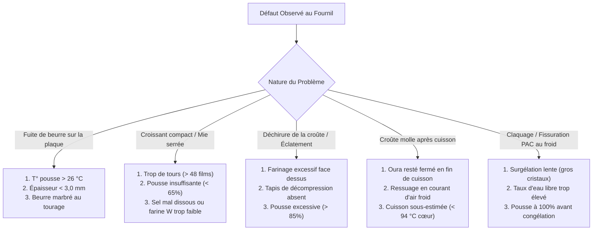

# FICHE DE CONTRÔLE QUALITÉ & AUDIT DE LIGNE EN ATELIER

**Document Référentiel :** `QUAL-ATEL-01`  
**Application :** Postes de Pétrissage, Tourage, Façonnage Polyline, Pousse PAC, Cryogénie & Cuisson Fournil  
**Périodicité :** 1 audit complet par vacation (matin/après-midi) & à chaque changement de lot de farine ou beurre  
**Responsable d'Exécution :** Chef d'Atelier / Conducteur de Ligne R&D  
**Statut :** 🟢 Validé Production — Conforme Standard HACCP & Normes Physico-Chimiques  

---

## 1. GRILLE DE CONTRÔLE RAPIDE DES TOLÉRANCES CRITIQUES

| POSTE OPÉRATOIRE | PARAMÈTRE MESURÉ | INSTRUMENT DE MESURE | CONSIGNE NOMINALE | PLAGE DE TOLÉRANCE | STATUT | ACTION CORRECTIVE IMMÉDIATE SI NON-CONFORME |
| :--- | :--- | :--- | :---: | :---: | :---: | :--- |
| **Pétrissage Cuve** | Température sortie pâte PLF | Thermomètre sonde plongeur | **21,0 °C** | $20,0\text{--}22,0\text{ }^\circ\text{C}$ | [ ] CONFORME | Si $> 22\text{ }^\circ\text{C}$, passer 15 min en cellule à -10 °C ; recalculer TB eau de coulée |
| **Pétrissage Cuve** | Température pâte Viennoise/Brioche | Thermomètre sonde plongeur | **24,5 °C** | $24,0\text{--}25,0\text{ }^\circ\text{C}$ | [ ] CONFORME | Ajuster la température de l'eau ou du lait liquide |
| **Laminage Tourage** | Température beurre sec 84% | Thermomètre à piquer | **13,0 °C** | $12,0\text{--}14,0\text{ }^\circ\text{C}$ | [ ] CONFORME | Si $< 12\text{ }^\circ\text{C}$ (trop dur $\rightarrow$ marbrage), attendre ; si $> 14\text{ }^\circ\text{C}$ (mou), bloquer à +4 °C |
| **Laminage Tourage** | Nombre de films lipidiques | Contrôle fiche recette | **12 films (1D+1S)** ou **47 films (Griffin)** | Max 48 films | [ ] CONFORME | **Interdiction formelle de dépasser 48 films** (Deligny & Lucas INRAE) |
| **Ligne Polyline** | Épaisseur finale d'abaisse | Jauge d'épaisseur / Pied à coulisse | **3,5 mm** | $3,4\text{--}3,6\text{ mm}$ | [ ] CONFORME | Réajuster l'écartement des cylindres de la tête satellite Smartline PSS640 |
| **Ligne Polyline** | Poids pâton croissant brut | Balance de pesée rapide | **75,0 g** | $74,0\text{--}76,0\text{ g}$ | [ ] CONFORME | Si trop lourd/léger, réajuster micrométriquement l'épaisseur finale d'abaisse |
| **Croissomat SCM50** | Position de la clé d'enrouleur | Inspection visuelle | **6 heures (sous le croissant)** | Plein centre dessous | [ ] CONFORME | Corriger le réglage de la Manette 3 souple pour placer la clé sous le corps |
| **Chambre de Pousse** | Température de fermentation | Thermocouple étalonné | **25,5 °C** | **$\le 26,0\text{ }^\circ\text{C}$ STRICT** | [ ] CONFORME | **Plafond critique :** Au-delà de 26 °C, le beurre fond et perle $\rightarrow$ alerte sonore |
| **Chambre de Pousse** | Hygrométrie relative | Hygromètre capacitif | **78 % HR** | $75\text{--}80\text{ \% HR}$ | [ ] CONFORME | Si $< 75\%$, croûtage sec ; si $> 80\%$, condensation et cloquage au four |
| **Volume Pousse PAC** | Expansion volumétrique | Gabarit étalon transparent | **70 à 75 % du volume final** | $\pm 5\text{ \%}$ | [ ] CONFORME | **Arrêt impératif :** Une pousse à 100% éclate à la congélation |
| **Cellule Flash -35 °C**| Franchissement 0 °C à -5 °C | Enregistreur thermométrique | **$< 15\text{ minutes}$** | $> 1\ ^\circ\text{C}/\text{min}$ | [ ] CONFORME | Si trop lent, vérifier la charge de la cellule et la ventilation des évaporateurs |
| **Validation Cœur PAC**| Température à cœur sortie flash | Thermomètre sonde aiguille | **$\le -10,0\text{ }^\circ\text{C}$** | Max $-10\text{ }^\circ\text{C}$ | [ ] CONFORME | Ne jamais transférer en chambre de stockage (-18 °C) si le cœur est $> -10\text{ }^\circ\text{C}$ |
| **Cuisson Four** | Pression de buée initiale | Manomètre d'injection | **3 secondes à saturation** | $\pm 0,5\text{ s}$ | [ ] CONFORME | Purger la rampe de buée si le jet est asymétrique |
| **Cuisson Four** | Ouverture des ouras (PLF) | Minuteur d'atelier | **À 14 min (sur 18 min)** | 4 min avant la fin | [ ] CONFORME | Évacuation obligatoire de l'air saturé pour figer le squelette de gluten |
| **Fin de Cuisson** | Température à cœur produit cuit | Thermomètre sonde rapide | **$94\text{--}96\text{ }^\circ\text{C}$** | $\ge 94\text{ }^\circ\text{C}$ | [ ] CONFORME | Si $< 94\text{ }^\circ\text{C}$, prolonger la cuisson de 2 minutes |

---

## 2. ARBRE DE DÉCISION & DIAGNOSTIC DES DÉFAUTS EN ATELIER

---

## 3. CHECK-LIST QUOTIDIENNE DU CONDUCTEUR DE LIGNE (À SIGNER PAR VACATION)

- [ ] **Propreté et calibrage de la balance de pesée :** Vérification avec la masse étalon de 1 000,0 g.
- [ ] **Contrôle de l'eau de coulée :** Température lue au refroidisseur d'eau = ______ °C.
- [ ] **Examen du beurre de tourage :** Température mesurée au carottage = ______ °C (Cible : 12–14 °C).
- [ ] **Réglage des couteaux de coupe Polyline :** Tranchant affûté, découpe sans arrachement de pâte.
- [ ] **Test des 10 coups de la doseuse volumétrique (Inserts) :** Poids mesuré = ______ g (Cible 600 g $\pm 10\text{ g}$).
- [ ] **Contrôle de la cellule de surgélation rapide :** Température d'air mesurée = ______ °C (Consigne : -35 °C).
- [ ] **Signature du Responsable Qualité / Chef d'Atelier :** _____________________ Date : ___/___/2026.

---
*Fiche de contrôle qualité — Laboratoire R&D Tourage & Boulangerie — Document officiel d'assurance qualité atelier.*
