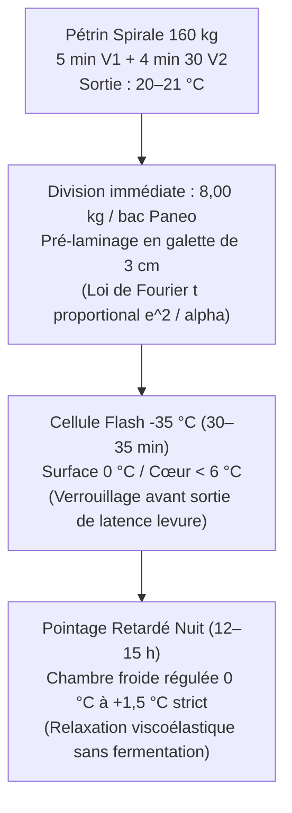

# Master Guide d'Atelier : Le Standard d'Excellence PLF & Croissomat SCM50
## Synthèse Complète des Protocoles, Formulations & Réglages Machines Validés

---

## 1. Diagnostic & Analyse Critique des Réglages Observés sur Vos Vidéos

Sur vos deux vidéos, la cinématique d'ensemble est déjà très propre et bien synchronisée. Voici l'audit précis organe par organe :

### Les Points Forts Constatés (À Conserver Absolument)
1. **Nettoyage et netteté de découpe** : Les arêtes des triangles sont franches, sans effilochage de gluten. L'entaille axiale à la base (10–15 mm) est bien centrée et nette.
2. **Fonctionnement du tandem d'arbres séparateurs** : Le décalage spatial des triangles tête-bêche s'opère instantanément. L'intervalle longitudinal (5 à 8 cm) entre les pièces est régulier, évitant tout chevauchement.
3. **Aspect de surface de la pâte** : Pas d'excès de farine blanche visible sur le dessus, surface mate et saine.

### Les 2 Points de Vigilance & Ajustements Recommandés
1. **L'Étirement Axial (Longueur du Triangle)** :
   * *Observation* : Vos triangles découpés ont un ratio base/hauteur d'environ 120–130 mm pour ~180 mm de hauteur. Après le passage sous les galets bleus, ils ne sont que très peu allongés (environ 190–200 mm).
   * *Conséquence* : Un triangle de 190 mm ne donnera que **2 à 2,5 spires** sous l'enrouleur. Le croissant sera trapu, compact, et le cœur aura du mal à cuire à cœur en cuisson directe congelé.
   * *Ajustement conseillé* : Augmenter très légèrement l'écart de vitesse d'entraînement du tapis aval pour étirer le triangle jusqu'à **240–260 mm** avant l'engagement sous le tablier. Avec notre formule à 30 % de T65 Tradition, cet étirement se fera sans aucune déchirure.
2. **Centrage de la Piste Gauche** :
   * *Observation* : Sur la frame de sortie, la piste de gauche frôle la rive du tapis.
   * *Ajustement* : Vérifier le centrage de la bande sur la rampe amont pour équilibrer parfaitement les 3 pistes par rapport aux 3 galets de guidage.

---

## 2. La Formule Étalon Biochimique (Pâtons de 8,00 kg net / Bac Paneo)

*Base meunière : Farine Totale = 100,0 % (70 % Gruau T45 + 30 % T65 Tradition pure sans E300).*

| Phase | Ingrédient d'Atelier | % Meunier | 1 Bac (8,0 kg) | 10 Bacs (80 kg) | 20 Bacs (160 kg) | Justification & Rôle Biochimique |
| :---: | :--- | :---: | :---: | :---: | :---: | :--- |
| **`[1]` Bleu** | **Farine de Gruau T45** | **70,0 %** | **3 133 g** | **31,33 kg** | **62,65 kg** | $W > 330$, protéines 14 %, armature cryorésistante |
| **`[1]` Bleu** | **Farine T65 Tradition (Décret 93)** | **30,0 %** | **1 342 g** | **13,42 kg** | **26,85 kg** | Sans E300 au moulin ; ramène le $P/L$ vers 0,58–0,62 |
| **`[1]` Bleu** | **Eau glacée (+1 °C) / Glace** | **45,0 %** | **2 014 g** | **20,14 kg** | **40,28 kg** | Eau libre minimisée ; calcul TB selon météo |
| **`[1]` Bleu** | **Sucre cristal semoule** | **8,8 %** | **394 g** | **3,94 kg** | **7,88 kg** | Carburant métabolique et réactions de Maillard |
| **`[1]` Bleu** | **Trimoline (Sucre inverti)** | **3,5 %** | **157 g** | **1,57 kg** | **3,13 kg** | $180\text{ g/mol}$ : abaisse $\Delta T_f$, anti-rétrogradation mie |
| **`[1]` Bleu** | **Levure fraîche L'Hirondelle Or** | **4,2 %** | **188 g** | **1,88 kg** | **3,76 kg** | Osmotolérante, latence de 40 min à 21 °C, anti-lyse GSH |
| **`[1]` Bleu** | **Poudre de lait entier 26 %** | **4,0 %** | **179 g** | **1,79 kg** | **3,58 kg** | Fixation d'eau par les caséines, coloration |
| **`[1]` Bleu** | **Améliorant S500 Kimo Short** | **2,0 %** | **90 g** | **0,90 kg** | **1,79 kg** | **Plafonné à 2,0 %** : compense le GSH sans sur-oxyder |
| **`[1]` Bleu** | **Sel fin d'atelier** | **2,0 %** | **90 g** | **0,90 kg** | **1,79 kg** | Ligne isolée : resserrement ionique du gluten |
| **`[1]` Bleu** | **Vinaigre blanc d'alcool 8°** | **0,8 %** | **36 g** | **0,36 kg** | **0,72 kg** | Tampon pH 5,1–5,3 : inhibe polyphénol oxydase (anti-grisement) |
| **`[2]` Ambre** | **Matière grasse cuve (Opale/Beurre)** | **8,5 %** | **380 g** | **3,80 kg** | **7,60 kg** | Incorporé en V2 : plastifiant et fondant de mie |
| **TOTAL** | **SOUS-TOTAL DÉTREMPE NET** | **178,8 %** | **8 003 g** | **80,03 kg** | **160,06 kg** | **Poids net calibré à 8,00 kg pile / bac Paneo** |
| **`[3]` Vert** | **Beurre sec tourage 84 % (Plaques 2 kg)** | **25,0 % dét.** | **2 000 g** | **20,00 kg** | **40,00 kg** | 1 plaque de 2,00 kg / bac (PF 34–36 °C, SFC optimal) |
| **TOTAL** | **POIDS TOTAL PÂTON TOURÉ** | **223,8 %** | **10 000 g** | **100,00 kg** | **200,00 kg** | **10,00 kg net de pâte prête au façonnage / bac** |

---

## 3. Conduite Thermique J-1 & Loi de Fourier

---

## 4. Tourage & Règle du Déroulage

1. **Architecture de Tourage sur Laminoir Rondo Compas** :
   * **1 Tour Double PUIS 1 Tour Simple (12 films de beurre / 25 couches totales)**.
   * Épaisseur des films de beurre à 3,5 mm d'abaisse : **25 à 30 µm** (compromis parfait entre étanchéité cryogénique et ovenspring).
   * Drossage des 4 chants fermés + détente 45 min à +2 °C.
2. **La Règle d'Or du Déroulage Inversé** :
   * Le laminoir dépose le fleusage automatique sur le dessus.
   * **Dérouler impérativement côté fariné en dessous (contre le tapis)** sur la Croissomat.
   * **Résultat** : La face supérieure reste **vierge de farine volante**, garantissant la soudure parfaite des spires sous l'enrouleur (anti-débobinage en étuve).

---

## 5. Synthèse des Réglages Croissomat SCM50

* **Température de bande** : **10 °C à 12 °C (Sweet Spot à 11 °C)** avec décompression libre $\ge 60\text{ s}$ sur la rampe inox.
* **Texture (Test du pouce)** : Empreinte qui remonte à 50 % en 5 s ; peau mate et sèche sans suintement.
* **Farinage** : "Voile fantôme" T45 tamisée sous la bande, zéro farine sur le dessus.
* **Découpe guillotine** : Butée réglée pour couper 100 % des fibres sans entailler le tapis ; tampons éjecteurs propres.
* **Arbres séparateurs** : Galets blancs centrés sur l'axe médian des triangles, anneaux bleus dégraissés, étirement axial vers **24–26 cm**.
* **Bloc d'enrouleur transversal (3 manettes rouges)** :
  * *Manette 1 (Haut/Av)* : Entrefait d'amorce à **5–6 mm**.
  * *Manette 2 (Haut/Ar)* : Pente en coin divergent vers **28–32 mm**.
  * *Manette 3 (Bas)* : Réglage **souple (3 à 4 spires lâches)** + calage de la **clé sous le croissant (à 6 heures)**.

---

## 6. Protocole Double Congélation PAC & Barème de Cuisson

1. **1ʳᵉ Surgélation (Cru)** : Sortie immédiate de machine sur grilles 60×40 $\rightarrow$ cellule rapide à **-35 °C** pendant 40 min $\rightarrow$ ensachage étanche à -18 °C.
2. **Pousse Contrôlée** :
   * Décongélation lente nocturne 10 h à 12 h à +2 °C / +4 °C.
   * Étuve à **25 °C – 26 °C et 75–80 % HR** pendant 2 h 15 à 2 h 35.
   * **Arrêt de pousse strict à 70–75 % du volume** (pâton élastique et ferme).
3. **Raffermissement & Dorure** : 15 min en froid positif (+4 °C) + pulvérisation pistolet de **Dorure Végétale** en voile fin.
4. **2ᵉ Blocage PAC (Contrôle Sonde à Cœur)** :
   * Sonde thermique témoin piquée au cœur d'un pâton.
   * Cellule à -35 °C $\rightarrow$ **arrêt strict dès que la sonde affiche -10 °C à cœur**.
   * Cartonnage hermétique et stockage à **-18 °C**.
5. **Cuisson Directe Congelé (Zéro Décongélation)** :
   * Four ventilé préchauffé à **185 °C – 190 °C**.
   * Enfournement direct du congélateur avec **3 secondes de buée**.
   * Cuisson régulée à **160 °C – 165 °C pendant 16 à 18 minutes**.
   * **Ouverture des ouras à 13 minutes** pour sécher le feuilletage et fixer le croustillant.
   * Ressuage sur grille inox à température ambiante.
