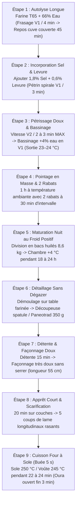

# FICHE TECHNIQUE D'ATELIER : BAGUETTE DE TRADITION FRANÇAISE (AUTOLYSE & POINTAGE RETARDÉ BACS)

* **Code Produit :** `B-TRAD-01`
* **Famille :** Pôle Panification de Tradition Française (Décret n° 93-1074 du 13 septembre 1993)
* **Procédé :** Autolyse longue (45–60 min) $\rightarrow$ Frasage court sans sur-oxydation $\rightarrow$ Bassinage $\rightarrow$ Pointage bacs 18–24 h (+4 °C) $\rightarrow$ Division douce $\rightarrow$ Sole 250 °C
* **Format d'Atelier :** Double Page Vis-à-Vis (Page Gauche : Poste Pesée & Échelles | Page Droite : Thermodynamique TB, Pétrissage, Conduite Froid & Four à Sole)
* **Version :** `v2.0-STANDARD-USINE` | **Statut :** 🟢 Validé Production & Homologué Décret 93

---

<!-- ===================================================================== -->
<!-- PAGE GAUCHE (1/2) : POSTE DE PESÉE & TABLEAUX HAUTE LISIBILITÉ        -->
<!-- ===================================================================== -->

# PAGE GAUCHE — POSTE DE PESÉE (LECTURE À 1,5 MÈTRE)

## 1. INDICATEURS FLASH DE CONDUITE

| PARAMÈTRE CLÉ | VALEUR DE CONSIGNE | TOLÉRANCE ATELIER | OBJECTIF TECHNIQUE |
| :--- | :--- | :--- | :--- |
| **Hydratation Totale** | **70,0 % (66 % autolyse + 4 % bassinage)** | $\pm 0,5\text{ \%}$ | Alvéolage ouvert sauvage et mie crème brillante |
| **Sel Fin ANSES** | **18 g / kg farine (1,8 % strict)** | Strict | Seuil réglementaire et tenue ionique du réseau |
| **Levure Fraîche** | **6 g / kg farine (0,6 %)** | $\pm 0,5\text{ g}$ | Fermentation enzymatique longue à froid positif |
| **Température Sortie** | **23 °C à 24 °C** | $\pm 0,5\text{ }^\circ\text{C}$ | Démarrage optimal de fermentation avant blocage |
| **Calibre Pâton** | **350 g cru $\rightarrow$ 250 g cuit net** | $\pm 5\text{ g}$ | Longueur standard 55 cm sur couches |

---

## 2. FORMULATION MAÎTRESSE & ÉCHELLES DE PESÉE (CHEF D'ATELIER)

*Base meunière : Farine T65 Tradition = 100,0 % (Sans additif, sans acide ascorbique E300, $W \approx 220\text{--}240$, $P/L \approx 0,50\text{--}0,60$, Hagberg $> 260\text{ s}$).*

| Phase & Ordre | Ingrédient d'Atelier | % Meunier | Base 1 kg Farine | Cuve 10 kg (1 Bac) | Cuve 30 kg (3 Bacs) | Cuve 60 kg (6 Bacs) | Cuve 100 kg (10 Bacs) | Rôle Biochimique & Précautions |
| :---: | :--- | :---: | :---: | :---: | :---: | :---: | :---: | :--- |
| **`[0]` Autolyse** | **Farine T65 Tradition pure** | **100,0 %** | **1 000 g** | **10,00 kg** | **30,00 kg** | **60,00 kg** | **100,00 kg** | Décret 93 certifié, caroténoïdes naturels préservés |
| **`[0]` Autolyse** | **Eau de coulage (selon TB)** | **66,0 %** | **660 g** | **6,60 kg** | **19,80 kg** | **39,60 kg** | **66,00 kg** | Solubilisation de l'amidon et relaxation protéolytique |
| *-- SOUS-TOTAL AUTOLYSE --* | — | — | *1 660 g* | *16,60 kg* | *49,80 kg* | *99,60 kg* | *166,00 kg* | *Repos cuve couverte 45 à 60 minutes* |
| **`[1]` Pétrissage** | **Sel fin d'atelier (ANSES)** | **1,8 %** | **18 g** | **180 g** | **540 g** | **1 080 g** | **1 800 g** | Électrolyte de fixation des brins de gluten |
| **`[1]` Pétrissage** | **Levure fraîche L'Hirondelle Bleue** | **0,6 %** | **6 g** | **60 g** | **180 g** | **360 g** | **600 g** | Ensemencement modéré pour longue pousse froide |
| **`[2]` Bassinage** | **Eau fraîche de réserve** | **4,0 %** | **40 g** | **400 g** | **1 200 g** | **2 400 g** | **4 000 g** | Versée en filet en V1 en fin de pétrissage |
| **TOTAL** | **MASSE TOTALE PÂTE FINIE** | **172,4 %** | **1 724 g** | **17,24 kg** | **51,72 kg** | **103,44 kg** | **172,40 kg** | **Division en bacs de 8,62 kg (2 bacs / 10 kg)** |
| *Rendement* | *Baguettes 350 g crues* | — | *~5 baguettes* | *~49 baguettes* | *~147 baguettes* | *~295 baguettes* | *~492 baguettes* | *Rendement net atelier* |

---

## 3. PRÉCAUTIONS INGRÉDIENTS & HYGROMÉTRIE

1. **Calcul de la Température de Base ($TB = 54\text{--}56\text{ }^\circ\text{C}$)** :
   $$T^\circ\text{Eau} = TB - (T^\circ\text{Ambiante} + T^\circ\text{Farine})$$
   *Exemple :* Si local à 22 °C et farine à 20 °C : $T^\circ\text{Eau} = 54 - (22 + 20) = 12\text{ }^\circ\text{C}$.
2. **Qualité de l'Autolyse** : L'autolyse eau + farine seule permet aux protéases natives du blé d'assouplir le réseau de gluten sans contrainte mécanique. Elle réduit le besoin de pétrissage en 2ᵉ vitesse de 50 %, évitant le blanchiment oxydatif de la pâte.
3. **Bassinage en V1** : L'eau de bassinage (4 %) ne doit être ajoutée que lorsque le réseau de gluten est parfaitement formé. Elle dissocie légèrement les feuillets de pâte pour créer les cavernes d'alvéoles sauvages typiques de la Tradition.

---

<!-- ===================================================================== -->
<!-- PAGE DROITE (2/2) : PROTOCOLE PAS À PAS, CONDUITE & FOUR              -->
<!-- ===================================================================== -->

# PAGE DROITE — CONDUITE PÉTRIN, FERMENTATION BACS & FOUR À SOLE

## 1. PROTOCOLE CHRONOLOGIQUE D'ATELIER

---

### DÉTAIL DES PHASES OPÉRATOIRES :

#### 1. Pétrissage & Bassinage en Pétrin Spirale
1. **Frasage de l'Autolyse** : Dans la cuve du pétrin, mélanger la farine T65 et 66 % d'eau tempérée selon la $TB$. Tourner 4 minutes en 1ʳᵉ vitesse jusqu'à absorption complète sans forcer. Couvrir d'une bâche plastique et laisser reposer **45 à 60 minutes**.
2. **Ajout des Actifs** : Disperser le sel fin (18 g/kg) et la levure fraîche émiettée (6 g/kg) sur la pâte autolysée.
3. **Pétrissage Réduit (Pétrissage de Tradition)** :
   * 3 minutes en 1ʳᵉ vitesse pour incorporer sel et levure.
   * **2 à 3 minutes maximum en 2ᵉ vitesse**. La pâte doit se décoller sans devenir élastique ni chauffer.
   * Ralentir en 1ʳᵉ vitesse et verser les 4 % d'eau de bassinage en mince filet. Laisser absorber en 1 minute.
   * **Température cible de sortie** : **23 °C à 24 °C**.

#### 2. Conduite du Pointage en Bacs & Froid Retardé
1. **Pointage Ambiant & Rabats** : Débarrasser la pâte dans des bacs rectangulaires préalablement huilés au colza. Laisser pointer 1 heure au fournil (22–24 °C). Donner **2 rabats vigoureux** (étirer les quatre coins de la pâte vers le haut et rabattre au centre) à 30 min et 60 min. Ces rabats structurent la force sans écraser les gaz.
2. **Maturation Nocturne au Froid (+4 °C)** : Empiler les bacs munis de leurs couvercles étanches et placer en chambre froide à **+4 °C pendant 18 à 24 heures**. La fermentation enzymatique lente développe une explosion d'arômes de noisette et d'esters fruités.

#### 3. Détaillage, Façonnage & Cuisson au Four à Sole
1. **Démoulage Sans Dégazer** : Renverser délicatement le bac de pâte froide sur le tour fariné de farine de seigle ou T65. Ne jamais chasser les bulles d'air.
2. **Division Douce** : À la coupe-pâte ou à la grille hydraulique Paneotrad, découper des rectangles de **350 g**.
3. **Détente** : Laisser reposer 15 minutes sur le tour sous plastique.
4. **Façonnage Léger** : Replier le tiers supérieur, puis le tiers inférieur, et souder délicatement la jointure du plat de la main. Rouler doucement sans serrer pour atteindre 55 cm de longueur.
5. **Couches en Lin & Apprêt** : Déposer la soudure vers le haut (ou vers le bas si enfournement direct) sur des couches de lin farinées. Apprêt très court : **20 à 30 minutes**.
6. **Scarification** : Basculer les baguettes sur tapis d'enfournement. Donner **5 coups de lame longitudinaux** très inclinés (angle de 30° par rapport à la surface, se chevauchant d'un tiers).
7. **Barème Four à Sole** :
   * **Température** : **Voûte 245 °C / Sole 250 °C**.
   * **Injection de Buée** : **5 secondes abondantes** dès l'introduction des baguettes.
   * **Durée de Cuisson** : **22 à 24 minutes**.
   * **Séchage Final** : **Ouvrir les ouras les 3 dernières minutes** pour durcir la croûte, figer les grignes et éviter le ramollissement au ressuage.

---

## 2. CONTRÔLE QUALITÉ & POINTS CRITIQUES HACCP

| POINT DE CONTRÔLE | PARAMÈTRE CRITIQUE | SEUIL TOLÉRANCE | ACTION CORRECTIVE D'URGENCE |
| :--- | :--- | :--- | :--- |
| **Température Eau** | Calcul $TB = 54\text{--}56\text{ }^\circ\text{C}$ | $\pm 1\text{ }^\circ\text{C}$ | Ajuster avec glace écailles si local chaud |
| **Durée Autolyse** | Chronomètre atelier | 45 à 60 minutes | Moins de 30 min = réseau dur, manque d'alvéoles |
| **Temps 2ᵉ Vitesse** | Pétrin spirale | Max 3 minutes | Au-delà : sur-oxydation, mie blanche sans goût |
| **Froid Fermentation** | Température chambre bacs | +3 °C à +4 °C | Si $> 6\text{ }^\circ\text{C}$, sur-fermentation et pâte acide |
| **Buée Four à Sole** | Pression chaudière vapeur | Min 1 bar / 5 s | Sans buée : croûte terne, déchirée et matte |