# Fiche Technique d'Atelier : Brioche Fine Artisanale de Nanterre & Tressée (Pur Beurre 45 % & Tangzhong)

* **Code Produit** : `V-BRI-02`
* **Famille** : Viennoiserie Générale & Pâtes Levées d'Élite (Boulangerie Traditionnelle & Prestige)
* **Calibre Homologué** : **Format 400 g cru** (Nanterre : 8 boules de 50 g en quinconce 2x4 | Tressée : 3 brins de 133 g) $\longrightarrow$ **~365–370 g cuit**
* **Procédé Exclusif** : Double Fermentation Lente (+4 °C pendant 12 à 18 h) avec **Technologie Tangzhong (65 °C)** $\longrightarrow$ Détaillage & Boulage serré à froid (+4 °C) $\longrightarrow$ Montage moules métalliques 22 cm ou tressage $\longrightarrow$ Pousse douce 25 °C MAX (75 % HR) $\longrightarrow$ Double Dorure pinceau $\longrightarrow$ Cuisson Four Ventilé 160 °C (ou Sole 175/180 °C)
* **Équipements Clés** : Pétrin spirale ou batteur mélangeur, Moules métalliques à Nanterre 22x10x8 cm (ou cadres inox), Chambre froide positive +4 °C, Four ventilé / sole
* **Format d'Atelier** : Double Page Vis-à-Vis (Page Gauche : Poste Pesée & Tangzhong | Page Droite : Conduite Pétrissage, Froid, Façonnage Nanterre/Tressée & Cuisson)
* **Version** : `v3.0-CHIRURGICAL-BEURRE` | **Statut** : 🟢 Validé Production & Standard Atelier

---

## PAGE GAUCHE (1/2) • POSTE DE PESÉE & TANGZHONG
*(Affichage Haute Visibilité — Lisible à 1,5 m de distance)*

### Repères Flash Poste de Pesée
| Repère | Paramètre Clé | Spécification Atelier | Justification Scientifique & Rhéologique |
| :--- | :--- | :--- | :--- |
| 🧈 **Taux de Beurre AOP** | **45,0 % rapport farine** | Beurre doux 82 % à **+12 °C** | Incorporé sur réseau parfaitement voilé : émulsion fine, mie ultra-filante |
| 🧪 **Technologie Tangzhong** | **5 % Farine + 25 % Eau à 65 °C** | Pré-gélatinisation de l'amidon | Bloque la rétrogradation de l'amylose : fraîcheur et souplesse garanties 7 jours |
| 🥚 **Hydratation aux Œufs** | **55,0 % œufs entiers froids** | 48 % frasage + 7 % bassinage | Zéro eau libre cuve : couleur jaune intense, texture alvéolaire fine et noble |
| ❄️ **Pointage Bloqué Froid** | **12 h à 18 h à +4 °C strict** | Figeage complet des lipides | Détaillage et boulage parfaits à froid sans coller ni déchirer le gluten |
| ⚖️ **Format Nanterre 400 g** | **8 boules de 50 g en quinconce** | Moule rectangulaire 22 cm | Voûte gonflée en dôme harmonieux sans affaissement latéral |

---

### Préparation du Tangzhong d'Atelier (À préparer à J-1 ou minimum 2 h avant)
*Formule Meunière : 1 part de farine Gruau T45 pour 5 parts d'eau filtrée (Ratio 1:5). Chauffer au batteur-cuiseur ou casserole jusqu'à **65 °C pile** jusqu'à consistance d'empois brillant. Refroidir immédiatement à **+4 °C** en chambre froide.*

| Ingrédient Tangzhong | Ratio | Base 1 000 g Farine | 1 Bac (10 pcs / 4 000 g) | 10 Bacs (100 pcs / 40 000 g) | 20 Bacs (200 pcs / 80 000 g) | Rôle Biochimique & Rhéologique |
| :--- | :---: | :---: | :---: | :---: | :---: | :--- |
| **Farine Gruau Rouge T45** | 16,7 % | **50 g** | **81 g** | **810 g** | **1 620 g** | Amidon haute force gélatinisé à 65 °C |
| **Eau filtrée atelier** | 83,3 % | **250 g** | **404 g** | **4 040 g** | **8 080 g** | Eau immobilisée dans la matrice d'amylose |
| **TOTAL TANGZHONG FROID (+4 °C)**| **100,0 %** | **300 g** | **485 g** | **4 850 g** | **9 700 g** | **Incorporé en Phase `[1]` Frasage dans le pétrin** |

---

### Tableau Chronologique des Pesées en 4 Phases (Unités : GRAMMES)
*Base meunière : Farine Totale = 100,0 % (dont 5 % dans le Tangzhong et 95 % Gruau Rouge T45 cuve) | Tolérance balance : ± 1 g ingrédients critiques / ± 5 g farines.*

| Phase & Ordre | Ingrédient d'Atelier | % Meunier | Base 1 000 g Farine | 1 Bac (10 pcs / 4 000 g) | 10 Bacs (100 pcs / 40 000 g) | 20 Bacs (200 pcs / 80 000 g) | Spécification & Justification Biochimique |
| :---: | :--- | :---: | :---: | :---: | :---: | :---: | :--- |
| **`[1]` Frasage** | **Farine Gruau Rouge T45** | **95,0 %** | **950 g** | **1 536 g** | **15 360 g** | **30 720 g** | $W > 330, P/L \approx 0,60$, réseau puissant résistant au beurre |
| **`[1]` Frasage** | **Tangzhong froid (+4 °C)** | **30,0 %** | **300 g** | **485 g** | **4 850 g** | **9 700 g** | Rétention d'humidité, alvéolage fin filant, anti-rassis 7 jours |
| **`[1]` Frasage** | **Œufs entiers froids (+3 °C)** | **48,0 %** | **480 g** | **776 g** | **7 760 g** | **15 520 g** | Hydratation principale par l'eau des œufs, lécithine |
| **`[1]` Frasage** | **Sucre cristal extra-fin** | **14,0 %** | **140 g** | **226 g** | **2 260 g** | **4 530 g** | Carburant fermentaire doux, abaissement $a_w$, goût brioché |
| **`[1]` Frasage** | **Poudre de lait entier 26 %** | **3,0 %** | **30 g** | **49 g** | **490 g** | **970 g** | Fixation de l'eau par les caséines, finesse de mie |
| **`[1]` Frasage** | **Sel fin d'atelier** | **2,2 %** | **22 g** | **36 g** | **360 g** | **710 g** | Structuration ionique indispensable du gluten face au gras |
| **`[1]` Frasage** | **Trimoline (Sucre inverti)** | **2,5 %** | **25 g** | **40 g** | **400 g** | **810 g** | Hygroscopie, préservation du moelleux à la coupe |
| **`[1]` Frasage** | **Levure fraîche L'Hirondelle Or**| **3,2 %** | **32 g** | **52 g** | **520 g** | **1 040 g** | Fermentation lente maîtrisée, osmotolérance sucre/gras |
| **`[1]` Frasage** | **Améliorant S500 Kimo Short** | **1,0 %** | **10 g** | **16 g** | **160 g** | **320 g** | Tolérance au dégazage, compensation du stress cryo |
| **`[1]` Frasage** | **Arôme naturel Rhum-Vanille** | **1,5 %** | **15 g** | **24 g** | **240 g** | **490 g** | Signature gastronomique authentique du laboratoire |
| **`[2]` Bassinage**| **Œufs entiers froids (+3 °C)** | **7,0 %** | **70 g** | **113 g** | **1 130 g** | **2 260 g** | Assouplissement du réseau avant incorporation du beurre |
| **`[3]` Émulsion** | **Beurre doux 82 % froid (+12 °C)**| **45,0 %** | **450 g** | **728 g** | **7 280 g** | **14 550 g** | Dés froids incorporés par fractions sur voile parfait |
| **TOTAL** | **PÂTE AU BAC AU FROID (+4 °C)**| **247,4 %** | **2 474 g** | **4 000 g** | **40 000 g** | **80 000 g** | **Poids net calibré à 4 000 g pile / bac (10 pièces de 400 g)** |
| **`[4]` Finition** | **Dorure d'Artisan (Œufs + Sel)** | Q.S. | PM | 50 g | 500 g | 1 000 g | 100 % œuf entier pasteurisé + 2 g/kg sel fin |

---

### Cadences & Rendements Nanterre / Tressée (Format 400 g cru $\longrightarrow$ ~365–370 g cuit)
* **Rendement par bac (4,00 kg net)** : **10 brioches Nanterre de 400 g** (soit **80 boules de 50 g**).
* **Rendement 10 bacs (40,0 kg pâte)** : **100 brioches Nanterre 400 g** (~800 boules de 50 g).
* **Rendement 20 bacs (80,0 kg pâte)** : **200 brioches Nanterre 400 g** (~1 600 boules de 50 g).

---

## PAGE DROITE (2/2) • CONDUITE PÉTRISSAGE, BLOCAGE FROID & CUISSON
*(Poste Conduite Thermomécanique, Façonnage & Cuisson)*

```mermaid
flowchart TD
    A["Pétrin Spirale / Batteur\nTangzhong froid (+4 °C) + Farine Gruau + Œufs Frasage (48%)\n+ Sucre + Sel + Lait + Levure Or + Améliorant + Arôme [1]\nFrasage 5 min en 1re vitesse (V1)"]
    --> B["Passage en 2e vitesse (V2) : 8 à 10 min\nPétrir jusqu'au VOILE TRANSLUCIDE PARFAIT\n(La pâte claque et se décolle entièrement des parois)"]
    --> C["Bassinage en 1re vitesse :\nAjouter les 7 % d'œufs restants [2] en filet + lisser 1 min"]
    --> D["Incorporation du Beurre doux 82 % froid (+12 °C) [3] en dés\n2e vitesse par 3 fractions successives jusqu'à réabsorption totale\n(Température sortie pétrin STRICTE : 23 °C à 24 °C max)"]
    --> E["Pointage en Masse : 45 min à température ambiante (20–22 °C)\nsuivi d'un rabat vigoureux en bac plat (épaisseur 4 cm)"]
    --> F["Blocage Froid Positif (+2 °C à +4 °C) pendant 12 h à 18 h\n(Le beurre fige complètement la pâte en un bloc ferme sculptable)"]
    --> G["Détaillage à Froid (+4 °C) :\nOption Nanterre : 8 boules de 50 g pile (boulage serré)\nOption Tressée : 3 brins de 133 g (roulage doux)"]
    --> H["Montage Moule Nanterre beurré 22 cm (8 boules en quinconce 2x4)\n1re Dorure fine au pinceau doux"]
    --> I["Pousse (Apprêt) en Chambre : 2 h à 2 h 30 à 25 °C MAX (75% HR)\n(ATTENTION : Ne jamais franchir 26 °C sous peine de faire suinter le beurre)"]
    --> J["2e Dorure légère au pinceau\n+ Entaille en ciseaux sur chaque dôme (optionnel)"]
    --> K["Cuisson Four Ventilé 160 °C (24–26 min) ou Sole 175/180 °C (25–30 min)\n(Ouras ouverts les 5 dernières minutes pour dorer et fixer la voûte)\nDémoulage immédiat sur grille inox surélevée"]
```

---

### Étape 1 : Pétrissage Haute Précision & Émulsion Lipidique
1. **Frasage & Structuration Initiale** :
   * Verser le Tangzhong froid (+4 °C), la farine de Gruau Rouge T45, les poudres (sucre, poudre de lait 26 %, sel fin), la Trimoline, l'arôme rhum-vanille, la levure Or, l'améliorant et la première pesée d'œufs froids (48 %) `[1]`.
   * Frasage pendant **5 minutes en 1ʳᵉ vitesse** : la pâte s'amalgame en une masse compacte et ferme.
2. **Développement du Réseau Protéique (Le Voile Parfait)** :
   * Passer en **2ᵉ vitesse pendant 8 à 10 minutes**.
   * **Contrôle impératif R&D** : À ce stade, la pâte doit former un **voile translucide ultra-fin**, capable de s'étirer sans se rompre. Elle doit claquer avec force sur les parois et se décoller intégralement. *Interdiction formelle d'incorporer le beurre avant ce stade : le gras enroberait les protéines et empêcherait la formation des ponts disulfures.*
3. **Bassinage aux Œufs** :
   * Repasser en 1ʳᵉ vitesse. Verser les **7 % d'œufs de bassinage `[2]` en filet continu**.
   * Lisser pendant 1 à 2 minutes jusqu'à absorption complète.
4. **Incorporation du Beurre Froid (Émulsion en Fractions)** :
   * Couper le beurre doux 82 % en dés réguliers (température idéale : **+12 °C**, ni dur comme du roc, ni pommade).
   * Passer en 2ᵉ vitesse et incorporer le beurre en **3 apports successifs**, en attendant l'absorption totale de chaque fraction.
   * Pétrir jusqu'à ce que la pâte se décolle à nouveau proprement du fond de cuve.
   * **Température de sortie pétrin** : Consigne absolue entre **23 °C et 24 °C maximum** (au-delà de 25 °C, l'émulsion se brise et la pâte huile).

---

### Étape 2 : Fermentation & Blocage Nocturne au Froid (+4 °C)
1. **Pointage en Masse & Rabat Énergique** :
   * Laisser pointer la pâte en cuve ou bac pendant **45 minutes à température ambiante (20–22 °C)** sous film plastique étanche.
   * Débarrasser sur le tour fariné, replier énergiquement la pâte en portefeuille pour expulser le gaz carbonique (rabat franc).
2. **Maturation Nocturne au Froid Positif (+2 °C à +4 °C)** :
   * Étaler la pâte dans des bacs plats sur une épaisseur uniforme de **4 cm** (bacs pesés à **4,00 kg net pile**).
   * Placer en chambre froide positive régulée entre **+2 °C et +4 °C pendant 12 à 18 heures**.
   * *Effet biochimique et physique* : Le beurre fige complètement. La pâte acquiert une texture ferme et plastique comparable à une pâte sablée, autorisant un détaillage au gramme près sans collage.

---

### Étape 3 : Détaillage, Boulage & Montage (Nanterre ou Tressée)
1. **Détaillage à Froid (+4 °C)** :
   * Sortir le bac froid au fur et à mesure (travailler par pâtons de 2 kg pour éviter tout réchauffement ambiant).
2. **Option A : Montage Nanterre Traditionnel (Moule 400 g)** :
   * Détailler **8 morceaux réguliers de 50 g pile au peson**.
   * Bouler chaque morceau d'un geste circulaire vif et appuyé contre le plan de travail, clé fermée en dessous.
   * Beurrer soigneusement au pinceau (ou spray démoulant) des moules métalliques rectangulaires (longueur 22 cm, largeur 10 cm, hauteur 8 cm).
   * Disposer **8 boules de 50 g par moule en quinconce sur 2 rangées de 4 boules** (soit **400 g net par moule**).
3. **Option B : Déclinaison Tressée 3 Brins (Format 400 g)** :
   * Détailler **3 morceaux de 133 g pile**.
   * Rouler doucement en boudins effilés de 25 cm de longueur.
   * Tresser régulièrement sans serrer excessivement, souder les deux extrémités en dessous et déposer en cadre ou sur plaque.
4. **Première Dorure Légère** :
   * Appliquer un voile très fin de Dorure à l'œuf au pinceau doux sur le dôme avant mise en pousse (évite le croûtage de surface).

---

### Étape 4 : Pousse Douce, Cuisson & Démoulage
1. **Pousse Contrôlée (Règle Thermique Infranchissable : 25 °C MAX)** :
   * Placer les moules en chambre de pousse à **25 °C maximum et 75 % HR pendant 2 h 00 à 2 h 30**.
   * **Avertissement absolu R&D** : À 26 °C ou plus, le beurre commence à fondre et suinte dans le fond du moule, créant une brioche lourde, grasse et huileuse.
   * **Fin de pousse** : La brioche doit dépasser le bord supérieur du moule de 1 à 1,5 cm, avec des dômes bien galbés et fermes.
2. **Seconde Dorure & Finition** :
   * Appliquer une seconde couche très fine de dorure au pinceau doux sans appuyer pour ne pas dégazer les dômes.
   * *Option traditionnelle* : Donner un petit coup de ciseaux au sommet de chaque boule pour libérer la poussée verticale au four.
3. **Barème de Cuisson Four Ventilé & Sole** :
   * **Four Ventilé** : Préchauffage 175 °C, cuisson régulée à **160 °C pendant 24 à 26 minutes**.
   * **Four à Sole** : Sole **175 °C** / Voûte **180 °C**, sans buée, durée **25 à 30 minutes**.
   * **Gestion des Ouras** : Ouvrir les ouras les **5 dernières minutes de cuisson** pour sécher légèrement les parois et fixer la croûte dorée.
4. **Démoulage Immédiat sur Grille** :
   * Démouler immédiatement à la sortie du four sur une grille inox surélevée.
   * *Avertissement atelier* : Ne jamais laisser refroidir la brioche dans son moule métallique, car la condensation détremperait la croûte inférieure et ferait s'affaisser les flancs.
   * Grâce à la technologie Tangzhong et à l'émulsion parfaite du beurre, la brioche développe une mie filante d'une légèreté exceptionnelle qui se conserve sans sécheresse pendant plus de 7 jours.
