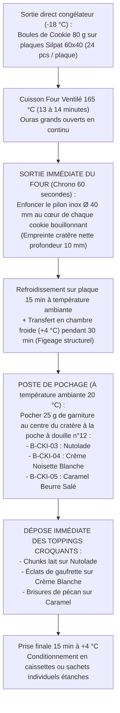

# Fiche Technique d'Atelier : Cookies Gourmets Fourrés à Cœur (Nutolade, Bueno & Pécan Caramel)

* **Code Produit** : `B-CKI-03` (Nutolade Choco-Noisette) / `B-CKI-04` (Style Bueno Crème Blanche) / `B-CKI-05` (Caramel Beurre Salé & Pécan)
* **Famille** : Biscuiterie & Pâtisserie Nomade d'Élite (Cookies Gourmets ~105 g)
* **Procédé** : Base Cookie 80 g Cuite $\rightarrow$ Formation Puits Pilon à Chaud $\rightarrow$ Refroidissement Froid $\rightarrow$ Pochage Fourrage 25 g & Toppings
* **Équipements Clés** : Four ventilé 165 °C, Pilon inox d'atelier à empreinte (Ø 40 mm), Poche à douille lisse n°12, Doseuse volumétrique de pâte à tartiner
* **Format d'Atelier** : Double Page Vis-à-Vis (Page Gauche : Poste Pesée & Préparation des Fourrages | Page Droite : Conduite Cuisson, Empreinte & Finition)
* **Version** : `v2.0-STANDARD-USINE` | **Statut** : 🟢 Validé Production & Standard Atelier

---

## PAGE GAUCHE (1/2) • POSTE DE PESÉE & PRÉPARATION DES FOURRAGES

### Repères Flash Poste de Pesée
| Repère | Paramètre Clé | Spécification Atelier | Justification Scientifique & Rhéologique |
| :--- | :--- | :--- | :--- |
| 🍪 **Base Cookie Cuit** | **80 g brut ($\rightarrow$ ~73 g cuit)** | Pâte Cookie Classique ou Noisette | Structure sablée ferme capable de supporter le fourrage |
| 🕳️ **Empreinte Puits** | **Cratère central Ø 40 mm x H 10 mm** | Pilon inox pressé sur cookie bouillonnant | Crée le réservoir hermétique retenant le fourrage crémeux |
| 🍫 **Dosage Fourrage** | **25 g net par cookie** | Pâte Nutolade, Crème blanche, Caramel | Ratio gourmand parfait : 75 % biscuit / 25 % garniture crémeuse |
| ⚖️ **Poids Brut Total Pièce** | **~105 g fini par pièce** | Portion unitaire sous dôme transparent | Positionnement premium boutique / salon de thé |
| 💧 **Activité de l'Eau ($a_w$)** | **$a_w \le 0,70$ sur le fourrage** | Matières grasses anhydres / sucres concentrés | Zéro migration d'eau vers le biscuit : croquant préservé 21 jours |

---

### Tableau des Pesées des 3 Déclinaisons Gourmets d'Atelier

#### DÉCLINAISON 1 • Cookie Gourmet Nutolade & Chunks Lait (`B-CKI-03`)
*Base : Cookie Classique aux pépites de chocolat noir.*

| Composant | Ratio | 1 Pièce (105 g) | 1 Plaque (24 p.) | 10 Plaques (240 p.) | 20 Plaques (480 p.) | Rôle & Spécification |
| :--- | :---: | :---: | :---: | :---: | :---: | :--- |
| **Base Cookie Classique 80 g crue**| 76,2 % | **80 g** | **1 920 g** | **19,20 kg** | **38,40 kg** | Cuit à 165 °C avec puits central |
| **Pâte à tartiner Nutolade noisette**| 23,8 % | **25 g** | **600 g** | **6,00 kg** | **12,00 kg** | Pochée tempérée (+22 °C) au centre |
| **Chunks chocolat au lait 35 %** | + Topping | **~5 g** | **120 g** | **1,20 kg** | **2,40 kg** | Décor de surface croquant |
| **TOTAL NUTOLADE FINI** | **100 %** | **~105 g** | **2 640 g** | **26,40 kg** | **52,80 kg** | **Rendement produit fini** |

---

#### DÉCLINAISON 2 • Cookie Gourmet Style Bueno (Crème Noisette Blanche) (`B-CKI-04`)
*Base : Cookie Noisette torréfiée.*

| Composant | Ratio | 1 Pièce (105 g) | 1 Plaque (24 p.) | 10 Plaques (240 p.) | 20 Plaques (480 p.) | Rôle & Spécification |
| :--- | :---: | :---: | :---: | :---: | :---: | :--- |
| **Base Cookie Noisette 80 g crue** | 76,2 % | **80 g** | **1 920 g** | **19,20 kg** | **38,40 kg** | Cuit à 165 °C avec puits central |
| **Crème noisette blanche lactée** | 23,8 % | **25 g** | **600 g** | **6,00 kg** | **12,00 kg** | Fourrage style Bueno onctueux |
| **Brisures de gaufrettes chocolatées**| + Topping | **~5 g** | **120 g** | **1,20 kg** | **2,40 kg** | Croustillant gaufrette pralinée |
| **TOTAL STYLE BUENO FINI** | **100 %** | **~105 g** | **2 640 g** | **26,40 kg** | **52,80 kg** | **Rendement produit fini** |

---

#### DÉCLINAISON 3 • Cookie Gourmet Caramel Beurre Salé & Pécan (`B-CKI-05`)
*Base : Cookie Classique pépites noir.*

| Composant | Ratio | 1 Pièce (105 g) | 1 Plaque (24 p.) | 10 Plaques (240 p.) | 20 Plaques (480 p.) | Rôle & Spécification |
| :--- | :---: | :---: | :---: | :---: | :---: | :--- |
| **Base Cookie Classique 80 g crue**| 76,2 % | **80 g** | **1 920 g** | **19,20 kg** | **38,40 kg** | Cuit à 165 °C avec puits central |
| **Caramel beurre salé d'Isigny** | 23,8 % | **25 g** | **600 g** | **6,00 kg** | **12,00 kg** | Caramel onctueux dressé tempéré |
| **Noix de pécan torréfiées concassées**| + Topping | **~5 g** | **120 g** | **1,20 kg** | **2,40 kg** | Contraste torréfié craquant |
| **TOTAL CARAMEL PÉCAN FINI** | **100 %** | **~105 g** | **2 640 g** | **26,40 kg** | **52,80 kg** | **Rendement produit fini** |

---

## PAGE DROITE (2/2) • CONDUITE MACHINE, GESTION DU PUITS & POCHAGE

---

### Étape 1 : Cuisson de la Base & Formation Chirurgicale du Puits
1. **Enfournement Direct Congelé** :
   * Disposer les palets de cookies surgelés de 80 g sur plaques 60×40 (4 rangées de 6 = **24 pièces par plaque**).
   * Cuisson au four ventilé à **165 °C pendant 13 à 14 minutes, ouras ouverts en continu**.
2. **Technique d'Atelier du Pilon à Chaud (Chrono 60 Secondes)** :
   * Dès la sortie immédiate du four, tant que la pâte est bouillonnante et ductile :
   * Saisir le **pilon cylindrique inox d'atelier (Ø 40 mm)** préalablement graissé d'un voile de spray végétal.
   * Enfoncer fermement le pilon au centre exact de chaque cookie jusqu'à mi-hauteur (**profondeur ~10 mm**).
   * *Mécanique de la pâte* : La pâte chaude et souple se tasse sur la sole et remonte sur le pourtour, formant un rempart circulaire régulier d'une étanchéité parfaite.
   * *Avertissement* : Ce geste doit impérativement être réalisé dans les 60 secondes suivant la sortie du four. Au-delà, le sucre commence à cristalliser et la surface se fendrait en éclats.

---

### Étape 2 : Refroidissement & Cristallisation du Cratère
1. **Repos sur Plaque** :
   * Laisser tiédir les cookies sur la plaque pendant **15 minutes**.
2. **Figeage au Froid Positif (+4 °C)** :
   * Placer les chariots **30 minutes en chambre froide à +4 °C**.
   * Le cratère durcit et se rigidifie, créant une barrière croustillante imperméable prête à recevoir le fourrage sans s'effondrer.

---

### Étape 3 : Dosage des Fourrages & Finitions Gourmandes
1. **Conditionnement Thermique des Fourrages** :
   * Les fourrages (Nutolade, crème blanche lactée, caramel beurre salé) doivent être tempérés entre **20 °C et 22 °C** pour garantir une fluidité parfaite à la douille sans couler hors du cratère.
2. **Pochage Calibré à 25 g Net** :
   * À la poche à douille lisse n°12 (ou doseuse pneumatique à piston) :
   * Pocher une spirale régulière de **25 g net de fourrage** au fond de chaque cratère (le fourrage affleure le bord supérieur du cookie).
3. **Incrustation Immédiate des Toppings** :
   * Immédiatement après le pochage (tant que le fourrage est collant) :
     * **Sur Nutolade (`B-CKI-03`)** : Déposer 4 à 5 chunks généreux de chocolat au lait 35 %.
     * **Sur Crème Blanche (`B-CKI-04`)** : Saupoudrer une pincée d'éclats de gaufrettes croustillantes pralinées.
     * **Sur Caramel (`B-CKI-05`)** : Déposer des brisures de noix de pécan torréfiées et une pincée de fleur de sel.
4. **Conservation & Maîtrise de l'Eau ($a_w$)** :
   * Laisser figer 15 minutes au froid (+4 °C) pour figer les toppings.
   * Emballer sous film flowpack ou présenter sous cloche. L'activité de l'eau très faible des fourrages gras ($a_w \le 0,70$) empêche tout transfert d'humidité vers le biscuit : le cookie conserve ses rives croustillantes et son cœur fondant pendant plus de **3 semaines à 18–20 °C**.
