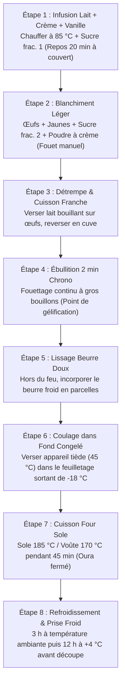

# FLAN PÂTISSIER BOULANGER VANILLE BOURBON — FORMAT DOUBLE-PAGE

**Code Produit :** `P-FLA-01`  
**Destination :** Vitrine Pâtisserie Boulangère Traditionnelle d'Élite, Vente à la Part & Gâteau Entier 6/8 Personnes  
**Conditionnement :** Cercles inox hauts micro-perforés Ø 180 mm x H 45 mm (Poids cuit net : ~900 g / flan)  
**Socle de Fonçage :** Feuilletage Inversé Universel (`recettes/catalogue/feuilletage-inverse-universel.md`) ou Pâte Brisée Fine (3,0 mm)  
**Standardisation :** Formulation au Standard Boulanger (Base 1 000 g Lait Entier / 100,0 %) & Paliers d'Atelier (1 à 20 flans)  
**Statut de Validation :** 🟢 Validé Production — Conforme R&D & Gélatinisation Maîtrisée  

---

<!-- ===================================================================== -->
<!-- PAGE GAUCHE (1/2) : POSTE DE PESÉE & TABLEAUX HAUTE LISIBILITÉ        -->
<!-- ===================================================================== -->

# PAGE GAUCHE — POSTE DE PESÉE (LECTURE À 1,5 MÈTRE)

## 1. INDICATEURS FLASH DE CONDUITE

| PARAMÈTRE CLÉ | VALEUR DE CONSIGNE | TOLÉRANCE ATELIER | OBJECTIF TECHNIQUE |
| :--- | :--- | :--- | :--- |
| **Appareil par Cercle** | **900 g d'appareil tiède** | $\pm 10\text{ g}$ | Remplissage à 5 mm sous le bord supérieur |
| **Infusion Vanille** | **20 min à couvert (85 °C)** | Minimum 15 min | Extraction maximale de la vanilline naturelle |
| **Ébullition Cuisson Crème** | **2 min chrono à gros bouillons** | Strict | Gélatinisation complète de l'amidon & destruction amylases |
| **État Fonçage Enfourné** | **Congelé à -18 °C** | Minimum 1 h congélateur | Choc thermique : feuilletage croustillant anti-détrempe |
| **Barème Cuisson** | **Sole 185 °C / Voûte 170 °C — 45 min** | $\pm 2\text{ min}$ | Caramélisation Maillard léopardée & cœur tremblotant |

---

## 2. FORMULATION MAÎTRESSE & ÉCHELLES DE PESÉE (CHEF D'ATELIER)

### TABLEAU A : APPAREIL À FLAN VANILLE BOURBON D'ÉLITE
*Formule riche au lait entier de ferme et crème fleurette 35%, vanille gousse Bourbon de Madagascar et amidon thermorésistant.*

| INGRÉDIENT | ÉTAPE | % BOULANGER | BASE 1 KG LAIT | 1 FLAN (Ø 18 CM) | 5 FLANS (4,5 KG) | 10 FLANS (9,0 KG) | 20 FLANS (18,0 KG) |
| :--- | :---: | :---: | :---: | :---: | :---: | :---: | :---: |
| **Lait entier pasteurisé 3,5% MG** | 1 | **100,0 %** | **1 000 g** | **650 g** | **3 250 g** | **6 500 g** | **13 000 g** |
| **Crème liquide entière 35% MG** | 1 | 23,1 % | 231 g | 150 g | 750 g | 1 500 g | 3 000 g |
| **Gousses de vanille Bourbon (fendues)** | 1 | 0,3 % | 3 g (1 gousse) | 2 g (1 gousse) | 10 g (5 g.) | 20 g (10 g.) | 40 g (20 g.) |
| **Sucre semoule blanc (fraction 1 lait)** | 1 | 15,4 % | 154 g | 100 g | 500 g | 1 000 g | 2 000 g |
| **Œufs entiers liquides pasteurisés** | 2 | 15,4 % | 154 g | 100 g | 500 g | 1 000 g | 2 000 g |
| **Jaunes d'œufs liquides pasteurisés** | 2 | 7,7 % | 77 g | 50 g | 250 g | 500 g | 1 000 g |
| **Sucre semoule blanc (fraction 2 œufs)** | 2 | 15,4 % | 154 g | 100 g | 500 g | 1 000 g | 2 000 g |
| **Poudre à crème vanillée (Staufim/Maïzena)** | 2 | 13,8 % | 138 g | 90 g | 450 g | 900 g | 1 800 g |
| **Beurre doux 82% (incorporé à chaud)** | 3 | 4,6 % | 46 g | 30 g | 150 g | 300 g | 600 g |
| **MASSE TOTALE CRÈME CUITE PRÊTE** | — | — | **1 907 g** | **1 272 g** | **6 360 g** | **12 720 g** | **25 440 g** |
| **Appareil coulé par cercle Ø 18 cm** | — | — | — | **900 g** | **4 500 g** | **9 000 g** | **18 000 g** |

---

### TABLEAU B : FONÇAGE EN FEUILLETAGE INVERSÉ OU PÂTE BRISÉE
*Découpe disques de fond et bandes de trottoir pour cercles hauts micro-perforés.*

| COMPOSANT | POIDS PAR CERCLE | 5 FLANS | 10 FLANS | 20 FLANS | CONDUITE D'ATELIER |
| :--- | :---: | :---: | :---: | :---: | :--- |
| **Abaisse Feuilletage Inversé (3,0 mm)** | **200 g** | **1 000 g** | **2 000 g** | **4 000 g** | Laminage 3,0 mm, piquer à la brosse |
| - *Disque de fond (Ø 18 cm)* | ~90 g | 450 g | 900 g | 1 800 g | Posé sur toile Silpain |
| - *Bande de tour (58 x 5 cm)* | ~110 g | 550 g | 1 100 g | 2 200 g | Placée contre la paroi du cercle |
| **Blocage Grand Froid (-18 °C)** | — | — | — | — | **1 h minimum avant coulage** |

---

## 3. PRÉCAUTIONS INGRÉDIENTS & SÉCURITÉ MATIÈRE

1. **Rôle de l'ébullition franche (2 minutes) :** L'amidon de maïs modifié de la poudre à crème doit atteindre une température minimale de **85 °C** pour déployer l'intégralité de son réseau de gélification tridimensionnel. De plus, une ébullition prolongée de 2 minutes détruit définitivement les enzymes alpha-amylases naturellement présentes dans le jaune d'œuf qui, sans cette dénaturation thermique, dégraderaient l'amidon pendant le ressuage et provoqueraient un déphasage liquide (synérèse).
2. **Beurre doux en fin de cuisson :** L'incorporation de 30 g de beurre doux par flan après l'ébullition apporte une brillance incomparable et un enrobage lipidique qui assouplit la texture en bouche tout en empêchant le croûtage prématuré lors du refroidissement.
3. **Qualité de la vanille :** Utiliser de vraies gousses de vanille Bourbon grasses et souples. Gratter soigneusement les grains et laisser infuser avec les gousses épuisées dans le lait chaud.

---

<!-- ===================================================================== -->
<!-- PAGE DROITE (2/2) : PROTOCOLE PAS À PAS, CONDUITE & FOUR              -->
<!-- ===================================================================== -->

# PAGE DROITE — CONDUITE MACHINE, POSTE CUISSON & HACCP

## 1. PROTOCOLE CHRONOLOGIQUE AU CUISEUR / FOURNIL

### DÉTAIL DES PHASES OPÉRATOIRES :
1. **Étape 1 — Infusion vanillée :** Dans la casserole ou le cuiseur à crème, réunir le lait entier, la crème fleurette 35%, la première fraction de sucre (100 g / flan) et les gousses de vanille fendues et grattées. Porter à frémissement (85 °C). Couvrir hermétiquement et laisser infuser 20 minutes hors du feu.
2. **Étape 2 — Préparation de la liaison :** Dans un cul-de-poule inox, fouetter les œufs entiers liquides, les jaunes d'œufs et la seconde fraction de sucre sans blanchir excessivement. Ajouter la poudre à crème tamisée et mélanger au fouet jusqu'à obtention d'une crème lisse sans le moindre grumeau.
3. **Étape 3 — Cuisson et gélification :** Retirer les gousses de vanille. Porter le lait vanillé à ébullition vive. Verser un tiers du lait bouillant sur le mélange œufs-poudres en fouettant vivement pour tempérer l'appareil, puis reverser l'ensemble dans la cuve de cuisson. Porter à ébullition à feu moyen sans cesser de fouetter en raclant le fond et les parois. Dès l'épaississement, maintenir **2 minutes d'ébullition franche chrono**.
4. **Étape 4 — Beurre et tempérage :** Retirer du feu. Incorporer immédiatement le beurre doux coupé en dés. Fouetter vivement pour émulsionner. Débarrasser sur une plaque propre, filmer au contact et laisser tiédir à **45–50 °C**.
5. **Étape 5 — Fonçage et coulage (La Règle d'Or thermique) :**
   - Sortir les cercles inox foncés en feuilletage inversé directement de la cellule de congélation à **-18 °C**.
   - Doser exactement **900 g d'appareil à flan tiède** dans chaque cercle à l'aide d'un pichet doseur ou d'un entonnoir à piston.
   - Lisser délicatement la surface à l'aide d'une petite palette coudée.

---

## 2. BARÈME DE CUISSON, RESSUAGE & PRISE AU FROID

### BARÈME THERMIQUE
- **Type de Four :** Four à soles de boulangerie (recommandé pour un fond croustillant) ou four ventilé à sole renforcée.
- **Températures de Consigne :**
  - **Sole :** **185 °C** (assure la cuisson complète du fond feuilleté sans le détremper).
  - **Voûte :** **170 °C** (caramélisation douce sans noircir).
  - *(Si four ventilé rotatif : 175 °C fixe).*
- **Gestion des Ouras :** **Oura fermé** pendant 35 minutes, puis **oura entrouvert** les 10 dernières minutes pour assécher la pellicule superficielle.
- **Temps de Cuisson :** **45 minutes pile**.
- **Aspect Visuel à la Sortie :** Le flan doit former de superbes taches brun doré caractéristiques ("peau de léopard"). Le centre doit rester légèrement tremblotant lorsqu'on secoue doucement la plaque.

### STABILISATION & COUPE D'ATELIER
1. **Ressuage Ambiant :** Laisser reposer sur grille pendant **3 heures à température ambiante du laboratoire** ($18\text{--}20\text{ }^\circ\text{C}$). Ne jamais mettre un flan brûlant au réfrigérateur (condensation sous la pellicule et croûte molle).
2. **Prise au Froid Positif (+4 °C) :** Placer ensuite le flan au froid positif à **+4 °C pendant 6 heures minimum (idéalement 12 à 18 heures)**. Durant ce repos, les chaînes d'amylose et d'amylopectine se réorganisent en un gel ferme, onctueux et soyeux.
3. **Décercelage et Tranchage :** Retirer le cercle inox délicatement. Découper au couteau scie à dents fines tiédi ou à la trancheuse à flan à fil inox. La coupe doit être nette, le flan se tient parfaitement sans s'affaisser et le feuilletage crisse sous la lame.

---

## 3. CONTRÔLE QUALITÉ & POINTS CRITIQUES HACCP

| POINT DE CONTRÔLE | PARAMÈTRE MESURÉ | TOLÉRANCE CRITIQUE | ACTION CORRECTIVE IMMÉDIATE |
| :--- | :--- | :--- | :--- |
| **Temps d'Ébullition** | Chronomètre cuisson crème | 2 min minimum à gros bouillons | Si trop court, risque de déphasage liquide au ressuage |
| **Température Fonçage** | Température pâte au coulage | $\le -10\text{ }^\circ\text{C}$ (congelé) | Ne jamais couler sur fond cru à température ambiante |
| **Poids Coulé** | Balance de dosage | 900 g $\pm 10\text{ g}$ | Ajuster au pichet doseur |
| **Cuisson Sole** | Température sole four | 185 °C $\pm 5\text{ }^\circ\text{C}$ | Si sole trop froide, le feuilletage du fond reste cru |
| **Prise Froid Positif** | Durée à +4 °C | 6 heures minimum | Interdiction formelle de trancher tiède |

---
*Fiche d'atelier normalisée — Laboratoire R&D Tourage & Boulangerie — Usage exclusif opérateurs de production.*
