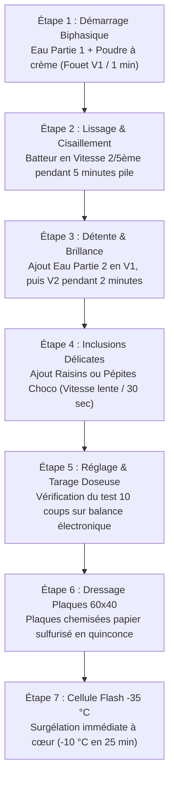

# PRODUCTION INDUSTRIELLE DES INSERTS PÂTISSIERS (500 UNITÉS) — FORMAT DOUBLE-PAGE

**Code Produit :** `P-INS-01` (Gamme Inserts Surgelés Haute Cadence)  
**Déclinaisons :** Insert Pain aux Raisins (60 g) • Insert Pain Suisse Chocolat (60 g) • Insert Oranais Crème-Abricot (45 g)  
**Destination :** Alimentation des Lignes de Façonnage Automatisées (RONDO Polyline / Croissomat SCM50)  
**Conditionnement :** Plaques 60x40 cm chemisées papier sulfurisé (Dressage quinconce calibré $\rightarrow$ Cellule flash -35 °C)  
**Standardisation :** Formulation au Standard Poudres (Base 1 000 g Poudre à Crème / 100,0 %) & Paliers (100, 250 et 500 unités)  
**Statut de Validation :** 🟢 Validé Production — Conforme R&D & Calibrage Doseuse à Piston  

---

<!-- ===================================================================== -->
<!-- PAGE GAUCHE (1/2) : POSTE DE PESÉE & TABLEAUX HAUTE LISIBILITÉ        -->
<!-- ===================================================================== -->

# PAGE GAUCHE — POSTE DE PESÉE (LECTURE À 1,5 MÈTRE)

## 1. INDICATEURS FLASH DE CONDUITE

| PARAMÈTRE CLÉ | VALEUR DE CONSIGNE | TOLÉRANCE ATELIER | OBJECTIF TECHNIQUE |
| :--- | :--- | :--- | :--- |
| **Calibre Insert Raisins** | **60 g net unitaire** | $\pm 1,5\text{ g}$ | Test 10 coups doseuse = **600 g pile** |
| **Calibre Insert Choco** | **60 g net unitaire** | $\pm 1,5\text{ g}$ | Test 10 coups doseuse = **600 g pile** |
| **Calibre Insert Oranais** | **45 g crème + 1 oreillon** | $\pm 1,0\text{ g}$ | Test 10 coups doseuse = **450 g pile** |
| **Outil de Cuve** | **Fouet / Batteur 40L-80L** | Strict | Hydratation biphasique sans grumeaux |
| **Réglage Doseuse** | **Petit piston / Débit 70%** | Strict | Absence de buse anti-goutte (évite broyage inclusions) |
| **Surgélation Flash** | **Cellule -35 °C immédiate** | Cœur $\le -10\text{ }^\circ\text{C}$ | Fige le palet géométrique avant dépose sur pâte |

---

## 2. FORMULATION MAÎTRESSE & ÉCHELLES DE PESÉE (CHEF D'ATELIER)

### TABLEAU A : INSERT RAISINS ESCARGOT — 60 g (RÉF. `P-INS-RAI`)
*Crème pâtissière à froid enrichie en raisins sultanines bruts non réhydratés (tampon hygrométrique).*

| INGRÉDIENT | ÉTAPE | % SUR POUDRE | BASE 1 KG POUDRE | 100 UNITÉS (6,0 KG) | 250 UNITÉS (15,0 KG) | 500 UNITÉS (30,0 KG) |
| :--- | :---: | :---: | :---: | :---: | :---: | :---: |
| **Eau froide purifiée (Partie 1)** | 1 | 228,8 % | 2 288 g | 2 860 g | 7 150 g | 14 300 g |
| **Poudre à crème à froid (Staufim)** | 1 | **100,0 %** | **1 000 g** | **1 250 g** | **3 125 g** | **6 250 g** |
| **Eau froide purifiée (Partie 2 - Détente)** | 2 | 55,2 % | 552 g | 690 g | 1 725 g | 3 450 g |
| **Raisins sultanines calibrés bruts** | 3 | 96,0 % | 960 g | 1 200 g | 3 000 g | 6 000 g |
| **POIDS TOTAL INSERT FINI** | — | — | **4 800 g** | **6 000 g** | **15 000 g** | **30 000 g** |

---

### TABLEAU B : INSERT SUISSE CHOCOLATINE — 60 g (RÉF. `P-INS-CHO`)
*Crème pâtissière ferme garnie de pépites de chocolat noir 50% thermostables.*

| INGRÉDIENT | ÉTAPE | % SUR POUDRE | BASE 1 KG POUDRE | 100 UNITÉS (6,0 KG) | 250 UNITÉS (15,0 KG) | 500 UNITÉS (30,0 KG) |
| :--- | :---: | :---: | :---: | :---: | :---: | :---: |
| **Eau froide purifiée (Partie 1)** | 1 | 214,3 % | 2 143 g | 3 000 g | 7 500 g | 15 000 g |
| **Poudre à crème à froid (Staufim)** | 1 | **100,0 %** | **1 000 g** | **1 400 g** | **3 500 g** | **7 000 g** |
| **Eau froide purifiée (Partie 2 - Détente)** | 2 | 57,1 % | 571 g | 800 g | 2 000 g | 4 000 g |
| **Pépites chocolat noir 50% thermostables** | 3 | 57,1 % | 571 g | 800 g | 2 000 g | 4 000 g |
| **POIDS TOTAL INSERT FINI** | — | — | **4 285 g** | **6 000 g** | **15 000 g** | **30 000 g** |

---

### TABLEAU C : INSERT ORANAIS CRÈME-ABRICOT — 45 g (RÉF. `P-INS-ORA`)
*Crème pâtissière nature calibrée pour recevoir 1 oreillon d'abricot oreillon égoutté.*

| INGRÉDIENT | ÉTAPE | % SUR POUDRE | BASE 1 KG POUDRE | 100 UNITÉS (4,5 KG) | 250 UNITÉS (11,25 KG) | 500 UNITÉS (22,5 KG) |
| :--- | :---: | :---: | :---: | :---: | :---: | :---: |
| **Eau froide purifiée (Partie 1)** | 1 | 229,1 % | 2 291 g | 2 680 g | 6 700 g | 13 400 g |
| **Poudre à crème à froid (Staufim)** | 1 | **100,0 %** | **1 000 g** | **1 170 g** | **2 925 g** | **5 850 g** |
| **Eau froide purifiée (Partie 2 - Détente)** | 2 | 55,6 % | 556 g | 650 g | 1 625 g | 3 250 g |
| **SOUS-TOTAL CRÈME NATURE CUVE** | — | — | **3 847 g** | **4 500 g** | **11 250 g** | **22 500 g** |
| **Oreillons d'abricots égouttés (post-dressage)** | 4 | — | — | + 100 unités | + 250 unités | + 500 unités |

---

## 3. PRÉCAUTIONS INGRÉDIENTS & SÉCURITÉ MATIÈRE

1. **Hydratation biphasique obligatoire (Eau 1 puis Eau 2) :** L'amidon prégélatinisé nécessite une concentration élevée en phase 1 pour dissoudre les particules sous fort cisaillement sans former d'yeux de perdrix (grumeaux). L'ajout de l'eau en phase 2 détend la crème pour lui donner la brillance et la fluidité requises par la doseuse.
2. **Température de l'eau :** Utiliser une eau froide entre **8 °C et 12 °C**. Une eau tiède accélérerait trop vite la prise en masse et bloquerait la doseuse à piston.
3. **Raisins secs bruts (Règle d'Or) :** Les raisins ne doivent **jamais être trempés dans l'eau avant incorporation**. Ils puisent l'eau libre de la crème pendant la surgélation et la décongélation, prévenant la synérèse et maintenant la pâte feuilletée parfaitement sèche et croustillante.

---

<!-- ===================================================================== -->
<!-- PAGE DROITE (2/2) : PROTOCOLE PAS À PAS, CONDUITE & FOUR              -->
<!-- ===================================================================== -->

# PAGE DROITE — CONDUITE MACHINE, POSTE CUISSON & HACCP

## 1. PROTOCOLE CHRONOLOGIQUE AU BATTEUR PLANÉTAIRE

### DÉTAIL DES PHASES OPÉRATOIRES :
1. **Étape 1 — Démarrage et prémélange :** Dans la cuve du batteur industriel de 40 L ou 80 L muni du **Fouet**, verser l'intégralité de l'Eau Partie 1. Mettre le batteur en vitesse 1 et déverser la Poudre à crème en pluie continue.
2. **Étape 2 — Lissage sous fort cisaillement :** Passer immédiatement le batteur en **vitesse 2 (ou 2/5ᵉ de la variateur)** et battre pendant **5 minutes chrono**. La crème monte en viscosité, devient compacte et blanchit légèrement.
3. **Étape 3 — Détente :** Réduire en vitesse 1, verser l'Eau Partie 2 en filet régulier. Ré-accélérer en vitesse 2 pendant 2 minutes. La crème devient souple, parfaitement lisse, brillante et pompable.
4. **Étape 4 — Inclusions :**
   - *Pour Insert Raisins ou Choco :* Remplacer le fouet par la feuille ou régler le batteur en vitesse très lente (vitesse 1). Verser les raisins secs bruts ou les pépites de chocolat. Mélanger pendant **30 secondes maximum** pour éviter d'écraser les inclusions ou de faire saigner le chocolat.
   - *Pour Insert Oranais :* Garder la crème nature. Les oreillons d'abricots sont déposés manuellement sur les dômes après le passage de la doseuse.

---

## 2. CONDUITE DOSEUSE VOLUMÉTRIQUE & SURGÉLATION FLASH

### RÉGLAGES MACHINE DE LA DOSEUSE À PISTON
- **Type de Piston :** **Petit piston volumétrique** (plage 20–100 g).
- **Embout de Sortie :** **Sans clapet anti-goutte à ressort** (le clapet écraserait les pépites de chocolat et bloquerait les raisins secs). Utiliser une buse conique ouverte Ø 25 mm à coupure pneumatique nette.
- **Réglage de Débit / Vitesse :** Régler sur **Gros Débit / Base 70%**.

### TEST DE PESÉE OBLIGATOIRE (AVANT TOUT LANCEMENT DE SÉRIE)
> [!IMPORTANT]
> **Avant de démarrer le dressage de la série de 500 unités, le conducteur de ligne doit impérativement réaliser le Test des 10 Coups :**
> - Déposer une barquette plastique sur la balance électronique et faire la tare (0,0 g).
> - Déclencher 10 cycles successifs de dosage dans la barquette.
> - **Valeurs cibles exigées :**
>   - *Inserts Raisins & Choco :* **600 g pile** ($\pm 10\text{ g}$). Si la pesée affiche hors tolérance, ajuster la vis micrométrique de course du piston.
>   - *Inserts Oranais (Crème seule) :* **450 g pile** ($\pm 8\text{ g}$).
> - Enregistrer la valeur sur la feuille de suivi HACCP de ligne.

### DRESSAGE SUR PLAQUES & PROTOCOLE CRYOGÉNIQUE
1. **Disposition sur Plaques :** Utiliser des plaques aluminium 60x40 cm planes recouvertes d'une feuille de papier sulfurisé siliconé.
2. **Agencement en Quinconce :** Dresser des dômes nets et réguliers selon une matrice quinconce (ex. 5 x 7 = 35 inserts par plaque pour les formats 60 g). Veiller à laisser 3 cm entre chaque insert pour éviter qu'ils ne se soudent pendant le transport.
3. **Cas de l'Oranais :** Déposer immédiatement 1 demi-abricot oreillon (face bombée vers le haut) sur chaque dôme de 45 g de crème nature.
4. **Entrée Immédiate en Cellule Flash (-35 °C) :** Dès qu'une plaque est dressée, l'enfourner directement dans la cellule de surgélation rapide à **-35 °C**.
   - Cinétique requise : La crème doit franchir le palier critique de congélation (0 °C à -5 °C) en moins de 15 minutes.
   - Temps total en cellule : **25 à 30 minutes**.
   - Contrôle thermométrique : Cœur congelé dur à **$\le -10\text{ }^\circ\text{C}$**.
5. **Décollage et Stockage :** Décoller les palets congelés d'un geste sec sur le papier sulfurisé. Conditionner en cartons étanches doublés de housses polyéthylène bleu (sachets de 100 unités). Ranger en chambre négative à **-18 °C**. Utiliser à la demande sur les lignes de laminage Polyline.

---

## 3. CONTRÔLE QUALITÉ & POINTS CRITIQUES HACCP

| POINT DE CONTRÔLE | PARAMÈTRE MESURÉ | TOLÉRANCE CRITIQUE | ACTION CORRECTIVE IMMÉDIATE |
| :--- | :--- | :--- | :--- |
| **Test 10 Coups** | Poids cumulé sur balance | 600 g $\pm 10\text{ g}$ (60g) / 450 g $\pm 8\text{ g}$ (45g) | Réajuster immédiatement la butée mécanique du piston |
| **Température Eau** | Thermomètre sonde cuve | 8 °C à 12 °C | Utiliser l'eau du refroidisseur d'eau de coulée |
| **Broyage Pépites** | Inspection visuelle crème | Zéro traînée brune | Réduire la vitesse d'incorporation à V1 lente |
| **Cinétique Froid** | Température cellule flash | -35 °C régulée | Ne jamais laisser les plaques attendre à température ambiante |
| **Intégrité Stockage** | Température chambre négative | $\le -18\text{ }^\circ\text{C}$ permanent | Alarme sonore si température remonte au-dessus de -15 °C |

---
*Fiche d'atelier normalisée — Laboratoire R&D Tourage & Boulangerie — Usage exclusif opérateurs de production.*
