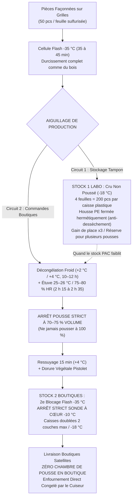

# CAHIER D'ATELIER • ANNEXE 02 : FAÇONNAGES, CALIBRES & CONDITIONNEMENT (GAMME PLF)
**Destination :** Annexe unique du classeur d'atelier — Regroupe les paramètres de détaillage et de façonnage pour **tous les produits issus de la pâte PLF**.

---

## 1. RÈGLES COMMUNES DU POSTE DE FAÇONNAGE (RONDO POLYLINE)
1. **Épaisseur finale d'abaisse** : Toujours **3,5 mm (± 0,1 mm)** sur Rondo Compas / Polyline (sauf Raisins & Cinnamon rolls à 3,0 mm).
2. **Décompression libre anti-snapback** : Laisser impérativement flotter la bande $\ge \mathbf{60\text{ secondes}}$ sur le tapis avant la tête de découpe.
3. **Farinage inversé strict** : Dérouler la bande **FACE FARINÉE EN DESSOUS (contre le tapis)**. La face supérieure reste vierge de farine pour garantir la soudure des spires.
4. **Verrouillage de la clé** : Pour toutes les pièces roulées ou pliées, **la soudure (la clé) doit impérativement être calée EN DESSOUS (à 6 heures)** contre la plaque.

---

## 2. TABLEAU COMPARATIF DES FAÇONNAGES DE LA GAMME FEUILLETÉE

| Produit Feuilleté | Poids Pâte | Garniture & Dosage | Poids Brut Découpé | Outil & Machine | Consigne Opérateur de Façonnage |
| :--- | :---: | :---: | :---: | :---: | :--- |
| **Croissant PAC** | **75 g** | — | **75 g cru** | **Croissomat SCM50** | Matrice triangulaire fixe. Roulage sous tablier texturé (3–4 spires lâches). |
| **Pain au Chocolat Équerre**| **75 g** | **1 Grosse Barre 10 g** (calibre 160) | **85 g brut** | **Polyline** (disques + guillotine) | Refente bandes 85–90 mm. Dépose barre à 2 cm du bord, pliage équerre franc. |
| **Pain aux Raisins Escargot**| **50 g** | 35 g crème pâtissière + 15 g raisins rhum | **~100 g brut** | Laminoir + Couteau / Fil | Abaisse 3,0 mm. Étaler crème + raisins, rouler en boudin serré, tronçonner à 2,5 cm. |
| **Pain Suisse Chocolatine**| **65 g** | 30 g crème pâtissière + 15 g pépites choco | **~110 g brut** | Polyline (guillotine) | Abaisse 3,5 mm. Crème sur moitié, pépites, replier en 2, découpe rectangles 4,5 × 14 cm. |
| **Oranais aux Abricots** | **55 g** | 30 g crème pâtissière + 2 oreillons (30 g)| **~115 g brut** | Polyline (couteaux carrés) | Carrés 10 × 10 cm. Crème en diagonale, 2 oreillons tête-bêche, rabattre les 2 pointes. |
| **Cinnamon Roll Feuilleté** | **60 g** | 25 g beurre pommade cannelle + 15 g sucre | **~100 g brut** | Laminoir + Couteau / Moules | Abaisse 3,0 mm. Roulé en boudin, découpe tronçons 100 g, dépose en moules 60×40. |
| **Cruffin Atelier Tulipé** | **75 g** | 10 g beurre cannelle doux | **~85 g brut** | Moules à muffins tulipés | Lanières de pâte torsadées en nœud, insérées dans caissettes tulipées. |

---

## 3. FOCUS MACHINE : RÉGLAGES VALIDÉS CROISSOMAT SCM50 (POSTE CROISSANT)

```
  ┌────────────────────────────────────────────────────────────────────────────────────────┐
  │ 1. MANETTE HAUT DROITE (Entrée amont)    :  INDEX SUR 2,2 À 2,5                        │
  │    ➔ Amorce douce de la base sans écraser les 12 couches de feuilletage.               │
  │                                                                                        │
  │ 2. MANETTE HAUT GAUCHE (Sortie aval)     :  INDEX SUR 3,0 À 3,2                        │
  │    ➔ Dégagement divergent : le rouleau de 30 mm sort librement sans calandrage.        │
  │                                                                                        │
  │ 3. MANETTE BAS (Cambrure & Clé à 6h)     :  INDEX SUR 7,5 À 8,0 (en bas de coulisse)   │
  │    ➔ Cambrure souple garantissant 3 à 4 spires lâches et le PETIT JOUR AU CŒUR.        │
  └────────────────────────────────────────────────────────────────────────────────────────┘
```
* **Contrôle visuel obligatoire** :
  1. *Petit jour au cœur* : En regardant par les extrémités, on doit voir le jour à travers le canal central (gage d'un croissant aéré qui ne déchirera pas en étuve).
  2. *Position de la pointe* : Doit impérativement être **plaquée en dessous à 6h** sur le tapis de sortie.

---

## 4. LOGISTIQUE DES DEUX CIRCUITS DE CONGÉLATION (LABO & BOUTIQUES)


