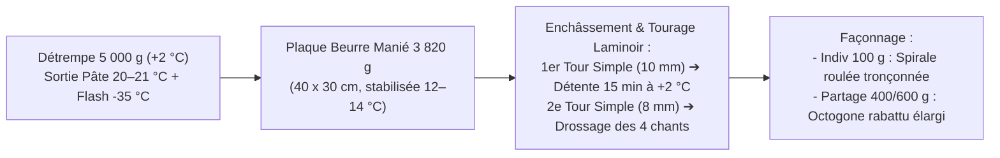

# CAHIER D'ATELIER • FICHE 07 : KOUIGN-AMANN (INDIVIDUEL & PARTAGE)
**Code Produit : `V-KOU-01` (Individuel 100 g) / `V-KOU-02` (Partage 400 g & 600 g)**  
**Poste : Pesée, Pétrin Spirale, Laminoir Rondo Compas / Polyline, Façonnage & Cuisson Caramélisée**  
**Procédé : Cru Surgelé Non Poussé Cryo-Blindé & Beurre Manié au Ratio d'Or (Plaques 3 820 g)**  
**Standard Pesée : TOUT EN GRAMMES (g) • ZÉRO VIRGULE • ARRONDIS NETS**

---

## PAGE GAUCHE (1/2) • POSTE DE PESÉE & CADENCES D'ATELIER

### 1. REPÈRES FLASH POSTE DE PESÉE & RÈGLES CRITIQUES
* 🟢 **Détrempe par Bac Paneo** : **5 000 g pile de pâte / bac** (format étalé en galette de **3 cm d'épaisseur** pour refroidissement rapide à cœur).
* 🧈 **Bloc Beurre Manié Sucré (Ratio d'Or)** : **2 000 g Beurre sec 84 % + 1 800 g Sucre extra-fin + 20 g Fleur de sel = 3 820 g pile**.
* 🌀 **Granulométrie Sucre** : **$\le 200\text{ }\mu\text{m}$ strict (sans amidon)**. Proscrire le sucre glace commercial.
* ❄️ **Formule Cryo-Blindée** : **Hydratation 51,6 %**, **Levure Or à 6,0 %**, **Améliorant Kimo à 2,5 %**, **Vinaigre 15 g** et **Sucre cuve bridé à 50 g**.
* 🌡️ **Thermique Pétrin Réaliste** : **20 °C à 21 °C en sortie cuve** (eau à 0 °C + glace paillette, **zéro pointage au pétrin**, cellule flash immédiate).
* 🔴 **Plafond Thermique Étuve Boutique** : **24 °C maximum strict**. À 25 °C ou plus, le beurre imprégné de sucre fond et coule hors de la pâte.

---

### 2. TABLEAU CHRONOLOGIQUE DES PESÉES AU RATIO D'OR (TOUT EN GRAMMES • ZÉRO VIRGULE)
> **Tolérances balance :** Farine & Eau à $\pm 10\text{ g}$ | Levure, Améliorant, Sel, Vinaigre à **$\pm 1\text{ g}$ pile**.  
> **Base Meunière :** Farine T65 Tradition pure = 100,0 % | Zéro décimale, conversions pré-calculées pour l'équipe.

| Phase & Ordre | Ingrédient d'Atelier | % Meunier | Base 1 000 g Farine | 1 Bac (5 000 g dét.) | 5 Bacs (25 000 g dét.) | 10 Bacs (50 000 g dét.) | Consigne Opérateur Pesée |
| :---: | :--- | :---: | :---: | :---: | :---: | :---: | :--- |
| **`[1]` Bleu** | **Farine T65 Tradition pure** | **100,0 %** | **1 000 g** | **2 750 g** | **13 750 g** | **27 500 g** | Farine T65 force pure, W 280-300. |
| **`[1]` Bleu** | **Eau glacée (+0,5 °C) / Glace** | **51,6 %** | **516 g** | **1 420 g** | **7 100 g** | **14 200 g** | Eau au plus froid, glaçons fondus. |
| **`[1]` Bleu** | **Sucre semoule fin (cuve)** | **1,8 %** | **18 g** | **50 g** | **250 g** | **500 g** | **Bridé à 50 g** (anti-choc osmotique levure). |
| **`[1]` Bleu** | **Poudre de lait entier 26 %** | **2,5 %** | **25 g** | **70 g** | **350 g** | **700 g** | Rétention d'eau libre et fondant de mie. |
| **`[1]` Bleu** | **Améliorant S500 Kimo Short** | **2,5 %** | **25 g** | **70 g** | **350 g** | **700 g** | Cryo-protection renforcée et barrière anti-GSH. |
| **`[1]` Bleu** | **Vinaigre blanc d'alcool (8°)** | **0,5 %** | **5 g** | **15 g** | **75 g** | **150 g** | Tamponne le pH à 5,1, bloque le relâchement. |
| **`[1]` Bleu** | **Sel fin d'atelier** | **1,8 %** | **18 g** | **50 g** | **250 g** | **500 g** | Force ionique et ténacité du réseau protéique. |
| **`[1]` Bleu** | **Levure fraîche L'Hirondelle Or**| **6,0 %** | **60 g** | **165 g** | **825 g** | **1 650 g** | **Surdosage cryo osmotolérant obligatoire**. |
| **`[2]` Ambre** | **Margarine Opal cuve (ou beurre)**| **14,9 %** | **149 g** | **410 g** | **2 050 g** | **4 100 g** | **Incorporer dès le passage en 2e vitesse**. |
| **SOUS-TOTAL** | **DÉTREMPE CRYO AU BAC** | **181,8 %** | **1 818 g** | **5 000 g pile** | **25 000 g pile** | **50 000 g pile** | **Pâton de détrempe net calibré par bac.** |
| **`[3]` Vert** | **Beurre Tourage Debic (plaques 2 kg)**| **72,7 %** | **727 g** | **2 000 g** | **10 000 g** | **20 000 g** | Beurre Debic froid (+4 °C) travaillé en V1. |
| **`[3]` Vert** | **Sucre extra-fin (Ratio d'Or)** | **65,5 %** | **655 g** | **1 800 g** | **9 000 g** | **18 000 g** | **Ratio d'Or 1 800 g** : caramel souple & croustillant. |
| **`[3]` Vert** | **Fleur de sel de Guérande** | **0,7 %** | **7 g** | **20 g** | **100 g** | **200 g** | Cristaux croquants dans le feuilletage. |
| **SOUS-BLOC** | **BLOC BEURRE MANIÉ SUCRÉ** | **138,9 %** | **1 389 g** | **3 820 g pile** | **19 100 g pile** | **38 200 g pile** | **Plaque de beurre manié 40 × 30 cm par bac.** |
| **TOTAL** | **PÂTON COMPLET PRÊT AU FAÇONNAGE** | **320,7 %** | **3 207 g** | **8 820 g pile** | **44 100 g pile** | **88 200 g pile** | **Pâton touré 8 820 g net prêt au découpage / bac.** |
| **`[4]` Finition**| **Mélange Cassonade (80%) + Cristal** | **PM** | **100 g** | **500 g** | **2 500 g** | **5 000 g** | Lit caramélisant au fond des moules silicone. |

---

### 3. RENDEMENTS, RECYCLAGE ROGNURES & CADENCES (1 BAC DE 8 820 g)
* **Format Individuel 100 g (Fiche A)** : **88 pièces de 100 g net par bac** (tronçons en spirale).
* **Format Partage 400 g (Fiche B1)** : **22 pièces de 400 g net par bac** (octogones rabattus en moules Ø 20 cm).
* **Format Partage 600 g (Fiche B2)** : **14 à 15 pièces de 600 g net par bac** (octogones rabattus en moules Ø 24 cm).
* **Filière Biscuits Secs (Arlettes Bretonnes)** : **100 % des rognures finales** étalées à 2 mm, saupoudrées de cassonade, cuites 15 min à 165 °C entre deux tôles $\longrightarrow$ **Conservation 6 semaines garantie en sachet**.

---

## PAGE DROITE (2/2) • CONDUITE MACHINE, FAÇONNAGES & FOUR EN CAPSULE FERMÉE

### 1. PÉTRISSAGE SPIRALE & FABRICATION EN GROS DU BEURRE MANIÉ (J-1)
1. **Pétrissage Cuve Spirale (Détrempe)** :
   * Verser les poudres, le sel, le vinaigre blanc, la levure Or, les 50 g de sucre cuve et l'eau glacée `[1]` Bleu.
   * **Frasage en 1ʳᵉ vitesse : 7 minutes chrono**.
   * Passer en 2ᵉ vitesse, incorporer la margarine Opal `[2]` Ambre : **pétrir 3 à 4 minutes maximum**.
   * ⚠️ **Arrêt dès le décollement net des parois** : ne pas corser excessivement pour préserver l'extensibilité.
   * 🌡️ **Température sortie pétrin : 20 °C à 21 °C** (réaliste et reproductible).
   * **Cellule flash -35 °C pendant 20 minutes** en galette de 3 cm, puis nuit à **+2 °C / +4 °C (12 h)**.
2. **Fabrication en Gros du Beurre Manié au Pétrin (J-1 pour 10 à 20 plaques)** :
   * Utiliser le beurre de tourage Debic froid (+4 °C) coupé en 4 morceaux par plaque.
   * La plasticité exceptionnelle du Debic permet de l'amalgamer directement à froid : la friction mécanique en 1ʳᵉ vitesse le monte naturellement à **10 °C – 12 °C** dès que le sucre est incorporé (température idéale de tourage sans surchauffe).
   * Mettre le beurre Debic, le sucre extra-fin (1 800 g / plaque) et la fleur de sel (20 g / plaque).
   * **Tourner en 1ʳᵉ vitesse lente pendant 2 à 3 minutes maximum** jusqu'à masse homogène.
3. **Calibrage Express des Plaques de 3 820 g (Méthode de l'Enveloppe 40 × 30 cm)** :
   * Peser des portions de **3 820 g pile**.
   * Poser la motte sur une feuille de papier sulfurisé pliée aux dimensions **40 × 30 cm** (ou entre deux feuilles).
   * Donner 3 coups de rouleau : le beurre manié remplit naturellement l'enveloppe rectangulaire sur **2,5 cm d'épaisseur régulière** sans déborder.
   * *Avantage atelier* : **30 secondes chrono par plaque**, épaisseur rigoureusement uniforme, zéro angle vide.
   * Empiler sur grilles 60×40 (2 plaques par grille) et placer une nuit à **+4 °C** pour stabiliser la texture à **12–14 °C**.

---

### 2. TOURAGE & FAÇONNAGES COMPARÉS

* **Tourage (2 Tours Simples = 9 Films)** :
  - Abaisser la détrempe 5 000 g, poser la plaque de beurre manié 3 820 g au centre, rabattre les deux ailes sans chevauchement.
  - **1ᵉʳ Tour Simple** à 10 mm $\rightarrow$ repos 15 min à +2 °C.
  - **2ᵉ Tour Simple** à 8 mm $\rightarrow$ drossage des 4 chants.
  - *Le beurre manié s'étire parfaitement avec la pâte : zéro fuite de sucre, tapis de laminoir 100 % propres.*
* **Façonnage Individuel (100 g)** : Abaisser à **4,0 mm**, rouler en boudin serré, flash 10 min, tronçonner à **100 g pile**. Poser à plat dans les moules silicone chemisés de cassonade.
* **Façonnage Partage (400 g et 600 g)** : Abaisser à **5,0 mm**, découper des carrés élargis (21×21 cm pour 400 g / 25×25 cm pour 600 g), couper les 4 pointes à 45° (octogone), rabattre les pans vers le centre et aplatir au rouleau pour faire un disque rond qui remplit le moule.

---

### 3. CONDUITE CRU SURGELÉ & ROTATION FLASH DES MOULES
1. **Surgélation Flash Immédiate** :
   * Pièces façonnées dans les moules silicone $\rightarrow$ **Cellule flash -35 °C pendant 45 minutes**.
   * **Démoulage flash des palets congelés** : démouler les blocs durs et stocker en cartons sous **housse polyéthylène hermétique à -18 °C**. Vos moules silicone sont lavés et réutilisés aussitôt !
2. **Remise en Œuvre & Pousse Douce en Boutique** :
   * Déposer les palets congelés dans les moules silicone chemisés de cassonade.
   * **Décongélation lente la veille : 12 h à +4 °C** en chambre positive.
   * **Pousse douce le matin : 2 h à 2 h 30 à 23 °C - 24 °C maximum (75 % HR)**.

---

### 4. BARÈME DE CUISSON MOULE SILICONE SOUS GRILLE PERMANENTE
> **Règle d'or :** La feuille de papier sulfurisé et la grille métallique restent **POSÉES PENDANT TOUTE LA CUISSON**.

1. **Préchauffage Four Ventilé** : **200 °C** (absorption de la perte thermique d'enfournement).
2. **Flash Initial** : **1 minute à 200 °C**.
3. **Régulation de Cuisson** : **175 °C régulé constant**.
4. **Durées Totales & Décompression Ouras** :

| Format | Poids Cru Net | Diamètre | Flash 200 °C | Cuisson 175 °C sous Grille Permanente | MINUTE OUVERTURE OURAS | Durée Totale |
| :--- | :---: | :---: | :---: | :---: | :---: | :---: |
| **Individuel (Spirale)** | **100 g** | Ø 80 mm | **1 minute** | **24 minutes (grille permanente)** | **OUVRIR À FOND À 20 MIN** | **25 minutes** |
| **Partage 4-5 pers.** | **400 g** | Ø 20 cm | **1 minute** | **29 minutes (grille permanente)** | **OUVRIR À FOND À 24 MIN** | **30 minutes** |
| **Partage 6-8 pers.** | **600 g** | Ø 24 cm | **1 minute** | **29 minutes (grille permanente)** | **OUVRIR À FOND À 24 MIN** | **30 minutes** |

5. **Démoulage & Retournement Miroir à Tiède** :
   * Laisser tiédir **4 à 6 minutes** sur table après sortie du four.
   * Retirer grille et papier. Démouler d'une pression sous le silicone et **retourner immédiatement sur grille**.
   * La semelle caramélisée devient le sommet : disque miroir ambré, croustillant et net.
