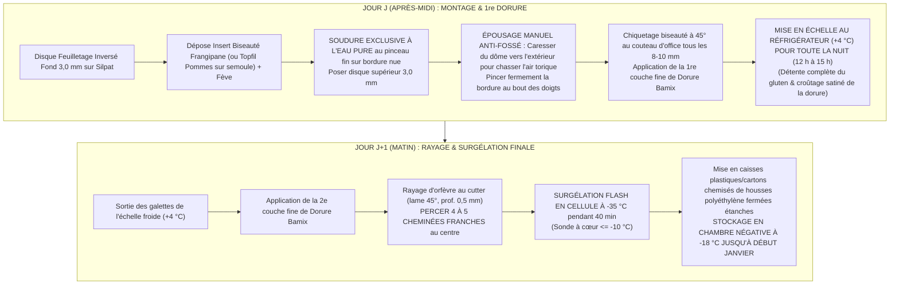

# CAHIER D'ATELIER • FICHE 09 : GAMME DES GALETTES DES ROIS D'ÉPIPHANIE
**Codes Produits : `P-GAL-01` (Frangipane 80/20) • `P-GAL-02` (Pommes Topfil) • `P-GAL-03` (Trio Poire-Nutolade)**  
**Poste : Garnissage, Inserts Biseautés, Soudure, Workflow J/J+1, Cuisson Felder & Finition Miroir**  
**Gamme : Formats Partage 4 Personnes (Ø 20 cm), 6 Personnes (Ø 24 cm) et 8 Personnes (Ø 28 cm)**  
**Standard Pesée : TOUT EN GRAMMES (g) • ZÉRO VIRGULE • ARRONDIS NETS**

---

## PAGE GAUCHE (1/2) • POSTE DE PESÉE & DOSAGES NETS PAR FORMAT

### 1. REPÈRES FLASH POSTE DE PESÉE & RÈGLES D'OR
* 💧 **Soudure Étanchéité Exclusive à l'EAU PURE** : Pinceau doux trempé dans de l'eau claire. **DORURE STRICTEMENT PROSCRITE DANS LE JOINT** (l'œuf coagule dès 65 °C et décolle la soudure au four).
* 🛡️ **Protocole Anti-Fossé (Inserts Biseautés)** : Dresser les inserts de frangipane avec un bord affiné en pente douce (30°–45°). Au montage, caresser la pâte du centre vers le bord pour chasser la poche d'air torique.
* 🧈 **Frangipane 100 % Goût Amande & Sucre Glace** : Margarine Opal cuve souple + Sucre glace tamisé + 100 % Poudre d'amande blanche (**zéro rhum, 100 % goût pur d'amande douce**). Zéro soufflage, ivoire parfait. Dénomination : *« Galette des Rois Maison à la Frangipane »*.
* 🍎 **Pommes du Four (Puratos Topfil 100 %)** : **Sécurité atelier maximale** (zéro déphasage, morceaux fermes thermostables).
* 🌾 **Bouclier Semoule Blé Dur Anti-Détrempe** : **8 g (4p), 12 g (6p), 15 g (8p)**. Éponge thermique invisible absorbant l'eau libre : semelle 100 % croustillante et sèche. *(Si compotée épaisse ajoutée : 10 g / 15 g / 20 g)*.
* 🍫 **Sandwich Barrière Nutolade (Trio)** : Spirale Nutolade au centre strict (diamètre réduit de 50 %) $\rightarrow$ clochée par l'insert frangipane $\rightarrow$ dés de poires égouttés 2 h incrustés au sommet.
* 📏 **Bordure Nue de Soudure** : **2,5 cm minimum sur Frangipane** | **3,0 cm strict sur Pommes et Trio**.
* 🌪️ **Évents Vapeur** : **4 à 5 cheminées franches** au centre du motif de rayage (évite le ballonnement et l'éclatement).
* ✨ **Finition Miroir Sirop 30°B à Chaud** : Badigeon immédiat à la sortie du four sur galette brûlante (> 100 °C).

---

### 2. TABLEAUX DES DOSAGES NETS PAR FORMAT (TOUT EN GRAMMES • ZÉRO VIRGULE)

#### TABLEAU A : GALETTE FRANGIPANE D'ATELIER 80/20 (RÉF. `P-GAL-01`)
*Montage avec Feuilletage Inversé 3,0 mm et Inserts Biseautés surgelés ou raffermis.*

| Paramètre d'Atelier | Format 4 Pers (Ø 20 cm) | Format 6 Pers (Ø 24 cm) | Format 8 Pers (Ø 28 cm) | Spécification & Rôle Opérateur |
| :--- | :---: | :---: | :---: | :--- |
| **Diamètre disques pâte (cru)** | **Ø 20 cm** | **Ø 24 cm** | **Ø 28 cm** | Feuilletage 3,0 mm régulier, repos 1 h +4 °C |
| **Pâte Feuilletée Inversée 3,0 mm** | **200 g** (2 x 100 g) | **280 g** (2 x 140 g) | **400 g** (2 x 200 g) | 1 disque fond + 1 disque dessus |
| **Diamètre Insert Frangipane** | **Ø 15 cm** (bord 5 mm)| **Ø 19 cm** (bord 5 mm)| **Ø 23 cm** (bord 5 mm)| **Palet biseauté anti-fossé (-2 °C à -18 °C)** |
| **Poids Net Insert Frangipane** | **220 g pile** | **350 g pile** | **500 g pile** | Formule TPT Opal / Sucre glace / 100 % Amande blanche |
| **POIDS TOTAL BRUT CRU** | **420 g** | **630 g** | **900 g** | Poids avant cuisson |
| **Marge libre nue de soudure** | **2,5 cm tout autour**| **2,5 cm tout autour**| **2,5 cm tout autour**| Humidifiée au pinceau à l'EAU PURE |
| **Position fève de collection** | À 3 cm du bord | À 3 cm du bord | À 3 cm du bord | Enfoncée dans l'insert (jamais au centre) |

---

#### TABLEAU B : GALETTE POMMES DU FOUR (RÉF. `P-GAL-02`) — OPTION 100 % TOPFIL
*Garniture Puratos Topfil Pommes sur bouclier de semoule de blé dur.*

| Paramètre d'Atelier | Format 4 Pers (Ø 20 cm) | Format 6 Pers (Ø 24 cm) | Format 8 Pers (Ø 28 cm) | Spécification & Rôle Opérateur |
| :--- | :---: | :---: | :---: | :--- |
| **Diamètre disques pâte (cru)** | **Ø 20 cm** | **Ø 24 cm** | **Ø 28 cm** | Feuilletage Inversé 3,0 mm relaxé |
| **Pâte Feuilletée Inversée 3,0 mm** | **200 g** (2 x 100 g) | **280 g** (2 x 140 g) | **400 g** (2 x 200 g) | Disque fond 3,0 mm + disque dessus 3,0 mm |
| **Voile Fond Semoule Blé Dur** | **8 g pile** | **12 g pile** | **15 g pile** | **Éponge thermique invisible anti-détrempe** |
| **Puratos Topfil Pommes 100 %** | **250 g pile** | **380 g pile** | **520 g pile** | Morceaux de pommes façon tatin gélifiés |
| *(Variante 50/50 Compotée)* | *(125 g Topfil + 125 g)* | *(190 g Topfil + 190 g)* | *(260 g Topfil + 260 g)* | *Semoule : 10 g / 15 g / 20 g* |
| **POIDS TOTAL BRUT CRU** | **458 g** | **672 g** | **935 g** | Poids avant cuisson |
| **Marge libre nue de soudure** | **3,0 cm strict** | **3,0 cm strict** | **3,0 cm strict** | Plus large (forte pression vapeur fruits) |
| **Cheminées d'évacuation** | **4 fentes centre** | **4 fentes centre** | **5 fentes centre** | Percées au cutter pour évacuer la vapeur |

---

#### TABLEAU C : GALETTE TRIO POIRE - FRANGIPANE - NUTOLADE (RÉF. `P-GAL-03`)
*Architecture sandwich barrière : la frangipane isole la pâte à tartiner et absorbe le jus de poire.*

| Composant du Sandwich Étagé | Format 4 Pers (Ø 20 cm) | Format 6 Pers (Ø 24 cm) | Format 8 Pers (Ø 28 cm) | Spécification & Rôle Opérateur |
| :--- | :---: | :---: | :---: | :--- |
| **Pâte Feuilletée Inversée 3,0 mm** | **200 g** (2 x 100 g) | **280 g** (2 x 140 g) | **400 g** (2 x 200 g) | Disques fond et dessus |
| **`[1]` Spirale Nutolade fond** | **60 g** (Ø 10 cm) | **90 g** (Ø 12 cm) | **130 g** (Ø 15 cm) | Pochée au centre strict (marge $\ge 4\text{ cm}$) |
| **`[2]` Frangipane 80/20 Biseautée** | **160 g** (Ø 14 cm) | **250 g** (Ø 18 cm) | **340 g** (Ø 22 cm) | Disque cloche biseauté coiffant Nutolade |
| **`[3]` Dés Poires égouttées 2 h** | **60 g** | **90 g** | **130 g** | Égouttées et épongées, incrustées sommet |
| **SOUS-TOTAL GARNITURE NETTE** | **280 g net** | **430 g net** | **600 g net** | Masse totale au cœur |
| **POIDS TOTAL BRUT CRU** | **480 g** | **710 g** | **1 000 g** | Poids avant cuisson |
| **Marge libre nue de soudure** | **3,0 cm strict** | **3,0 cm strict** | **3,0 cm strict** | Humidifiée au pinceau à l'EAU PURE |
| **Cheminées d'évacuation** | **4 fentes centre** | **4 fentes centre** | **4 fentes centre** | Percées au cutter au centre |

---

#### TABLEAU D : COMPOSANTS AUXILIAIRES DE FINITION
* **Dorure d'Élite Palace (2/3 Jaunes + 1/3 Crème 35%) :** **667 g** Jaunes d'œufs + **333 g** Crème liquide 35 % $\longrightarrow$ Émulsionner au fouet ou Bamix vitesse lente (zéro bulle). Couleur ambrée intense, brillance satinée, zéro coulure sur chiquetage.
* **Sirop Miroir 30°B à Chaud :** **500 g** Eau + **600 g** Sucre semoule + **100 g** Sirop de glucose cristal $\longrightarrow$ Ébullition franche 1 min, réserver tiède 40 °C.

---

## PAGE DROITE (2/2) • WORKFLOW ATELIER DÉCEMBRE (J / J+1) & CUISSON BOUTIQUES

### 1. CHRONOLOGIE DU FLUX OPÉRATOIRE DÉCEMBRE (J / J+1)

---

### 2. CHIQUETAGE, DOUBLE DORURE & RAYAGE SANS BAVURE
1. **Chiquetage Biseauté à 45° (Jour J) :**
   * Avec la lame d'un couteau d'office affûté inclinée à **45°**, inciser le bord tous les **8 à 10 mm**. Repousser légèrement le biseau vers l'intérieur avec l'index pour souder mécaniquement les deux disques.
2. **Double Dorure Croisée 2/3 Jaunes + 1/3 Crème (J / J+1) :**
   * Appliquer la 1re couche fine à J au pinceau soies douces (ne jamais faire couler sur le chiquetage).
   * **Nuit au frigo +4 °C en échelle :** La dorure croûte sans coller et le feuilletage perd toute tension.
   * Appliquer la seconde couche fine à J+1.
3. **Rayage & Cheminées (Jour J+1) :**
   * Rayer immédiatement sur la dorure fraîche avec la pointe d'un cutter, sur une profondeur maximale de **0,5 mm** (ne jamais transpercer l'abaisse).
   * Percer **4 à 5 cheminées invisibles** au centre du motif pour évacuer la surpression de vapeur.

---

### 3. CUISSON SOUS CALES FELDER 4 CM & VITRIFICATION MIROIR 30°B
1. **Le Montage sous Cales Felder 4 cm (Planéité Absolue) :**
   * Disposer 4 galettes par plaque 60×40 recouverte de Silpat.
   * Placer **4 cales en acier inoxydable de 40 mm de haut (4 cm)** aux 4 coins de la plaque.
   * Déposer une seconde plaque ou grille inox perforée sur les cales.
   * Le feuilletage inversé monte jusqu'à 40 mm, vient effleurer la grille, se stabilise et conserve une surface parfaitement plane et horizontale.
   * Retirer la grille supérieure **10 minutes avant la fin de cuisson** pour parfaire la coloration dorée.
2. **Barème Thermique Fournil & Boutiques :**
   * *Four ventilé :* Préchauffage **190 °C**, enfournement et régulation à **170–175 °C**.
   * *Four à soles :* Sole **185 °C** / Voûte **170 °C**.
   * *Durées de cuisson selon état d'enfournement :*
     - Format 4 pers : **32 à 35 min** (décongelé +4 °C) | **38 à 42 min** (congelé direct -18 °C).
     - Format 6 pers : **38 à 42 min** (décongelé +4 °C) | **45 à 48 min** (congelé direct -18 °C).
     - Format 8 pers : **45 à 48 min** (décongelé +4 °C) | **52 à 55 min** (congelé direct -18 °C).
   * **Règle impérative des ouras :** **Ouvrir les ouras en grand sur les 12 à 15 dernières minutes** pour évacuer la vapeur saturante et sécher le feuilletage.
3. **Finition Miroir Sirop 30°B à Chaud :**
   * Dès l'extraction du four, passer immédiatement un coup de pinceau large de sirop 30°B tiède sur la calotte brûlante (> 100 °C).
   * L'eau s'évapore instantanément en un nuage de vapeur ; le sucre et le glucose se vitrifient en une laque transparente étincelante qui résiste 48 h sans jamais ramollir le feuilletage.
