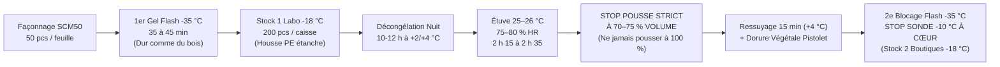

# FICHE OPÉRATEUR ATELIER : CROISSANT PAC (DOUBLE CONGÉLATION)
**Code Produit : `V-PLF-01`** | **Poste : Tourage & Viennoiserie** | **Version Atelier : 1.0 (Plastifiée)**  
**Standard Pesée :** **TOUT EN GRAMMES (g) • ZÉRO VIRGULE • ARRONDIS NETS**.

---

## 📄 RECTO • POSTE DE PESÉE & PÉTRISSAGE

### 1. TABLEAU DES PESÉES D'ATELIER (TOUT EN GRAMMES • ZÉRO CALCUL MENTAL)
> **Règle balance :** Farines/Eau à $\pm 10\text{ g}$ | Petits ingrédients (Levure, S500, Sel, Vinaigre) à **$\pm 1\text{ g}$ pile**.

| Phase & Ordre | Ingrédient d'Atelier | 1 Bac (8 000 g pâte) | 10 Bacs (80 000 g pâte) | 20 Bacs (160 000 g cuve pleine) | Consigne Opérateur |
| :---: | :--- | :---: | :---: | :---: | :--- |
| **`[1]` Bleu** | **Farine Gruau Rouge T45 (Cadillac)** | **3 130 g** | **31 300 g** | **62 600 g** | Verser en premier dans la cuve. |
| **`[1]` Bleu** | **Farine Tradition pure (sans additif)**| **1 340 g** | **13 400 g** | **26 800 g** | Mélanger avec le Gruau. |
| **`[1]` Bleu** | **Eau glacée (+1 °C) / Glace écaille** | **2 015 g** | **20 150 g** | **40 300 g** | Eau au plus froid, glaçons fondus. |
| **`[1]` Bleu** | **Sucre cristal blanc** | **394 g** | **3 940 g** | **7 880 g** | Ajouter sur la farine. |
| **`[1]` Bleu** | **Trimoline (Sucre inverti)** | **157 g** | **1 570 g** | **3 140 g** | Peser avec précision. |
| **`[1]` Bleu** | **Levure fraîche L'Hirondelle Or** | **188 g** | **1 880 g** | **3 760 g** | Émietter sur la farine (pas sur le sel). |
| **`[1]` Bleu** | **Poudre de lait entier 26 %** | **180 g** | **1 800 g** | **3 600 g** | Avec les poudres. |
| **`[1]` Bleu** | **Améliorant S500 Kimo Short** | **90 g** | **900 g** | **1 800 g** | **Plafonné strict** : ne jamais surdoser ! |
| **`[1]` Bleu** | **Sel fin de cuisine** | **90 g** | **900 g** | **1 800 g** | Ne pas mettre au contact direct de la levure. |
| **`[1]` Bleu** | **Vinaigre blanc d'alcool (8°)** | **36 g** | **360 g** | **720 g** | Diluer dans l'eau de coulage. |
| **`[2]` Ambre** | **Margarine Opal cuve (en morceaux 500 g)**| **380 g** | **3 800 g** | **7 600 g** | **Incorporer dès le passage en 2e vitesse**. |
| **SOUS-TOTAL**| **POIDS DÉTREMPE NET EN CUVE** | **8 000 g pile** | **80 000 g pile** | **160 000 g pile** | **Poids calibré par bac Paneo.** |
| **`[3]` Vert** | **Beurre Tourage Debic 82 % (plaques 2 kg)**| **2 000 g (1 plaque)**| **20 000 g (10 pl.)**| **40 000 g (20 plaques)**| **1 plaque de 2 000 g pile par bac de 8 000 g.** |
| **TOTAL** | **PÂTON COMPLET PRÊT AU TOURAGE** | **10 000 g pile**| **100 000 g pile**| **200 000 g pile**| **Rendement : 130 croissants de 75 g / bac.** |

---

### 2. PÉTRISSAGE & CONDUITE THERMIQUE
1. **Frasage (1ʳᵉ vitesse)** : **5 minutes chrono** avec tous les ingrédients `[1]` Bleu.
2. **Pétrissage (2ᵉ vitesse)** : Passer en 2e vitesse et ajouter la margarine `[2]` Ambre. Pétrir pendant **4 min 30 s à 5 min max**.
   * ⚠️ **ARRÊT DÈS LE 1ER DÉCOLLEMENT NET DES PAROIS** : Ne cherchez jamais un voile étiré ! La pâte doit rester souple et nerveuse.
   * 🌡️ **Température sortie cuve** : **20 °C à 21 °C** (obligatoire, vérifier au thermomètre sonde).
3. **Mise en Bac & Règle des 3 cm** :
   * Diviser immédiatement en pâtons de **8 000 g pile**.
   * Étaler et tasser en **galette rectangulaire uniforme de 3 cm d'épaisseur** dans chaque bac Paneo.
4. **Froid Flash & Nuit** :
   * **30 à 35 min en cellule flash à -35 °C** : la surface doit blanchir/durcir (0 °C), le cœur descend sous +6 °C.
   * Stocker 12 h à 15 h en chambre froide positive régulée à **0 °C / +1,5 °C** (proscrire le +4 °C).

---

## 📄 VERSO • TOURAGE, CROISSOMAT SCM50, PAC & CUISSON

### 3. TOURAGE LAMINOIR RONDO COMPAS
1. **Températures matières** : Pâte à **+2 °C / +4 °C** | Beurre assoupli au laminoir à **+12 °C / +14 °C**.
2. **Enchâssement** : Enveloppe simple (beurre au centre, rabattre les deux côtés sans chevauchement).
3. **1ᵉʳ Tour DOUBLE (Grand)** : Allonger à **85–90 cm**, plier en portefeuille (4 plis). Repos 15 min à +2 °C.
4. **2ᵉ Tour SIMPLE (Court)** : Tourner d'un quart de tour (90°), allonger à **60–65 cm**, plier en 3.
5. **Drossage des rives** : Couper au couteau les 4 bordures fermées sur 5 mm.
6. **Détente finale** : **45 minutes à +2 °C** sous plastique étanche.

---

### 4. LIGNE POLYLINE & ENROULEUR CROISSOMAT SCM50

```
                   RÉGLAGES ÉTALONS CROISSOMAT SCM50 (PHOTO ATELIER VALIDÉE)
  ┌────────────────────────────────────────────────────────────────────────────────────────┐
  │ 1. MANETTE HAUT DROITE (Entrée amont)    :  INDEX SUR 2,2 À 2,5                        │
  │    ➔ Amorce douce de la base du triangle sans écraser le feuilletage.                  │
  │                                                                                        │
  │ 2. MANETTE HAUT GAUCHE (Sortie aval)     :  INDEX SUR 3,0 À 3,2                        │
  │    ➔ Dégagement divergent : le rouleau de 30 mm sort sans être écrasé.                 │
  │                                                                                        │
  │ 3. MANETTE BAS (Cambrure & Clé à 6h)     :  INDEX SUR 7,5 À 8,0 (en bas de coulisse)   │
  │    ➔ Roulage souple en 3 à 4 spires lâches avec PETIT JOUR VISIBLE AU CŒUR.            │
  └────────────────────────────────────────────────────────────────────────────────────────┘
```

* **Laminoir Polyline** : Abaisse finale calibrée à **3,5 mm** (poids cru = **75 g pile**).
* **Décompression libre** : Laisser flotter la bande $\ge \mathbf{60\text{ secondes}}$ sur le tapis avant découpe (anti-snapback).
* **Farinage Inversé Strict** : Dérouler la bande **FACE FARINÉE EN DESSOUS** sur la rampe. La face supérieure doit être vierge de farine pour bien coller sous le tablier.
* **Contrôle visuel obligatoire sous la SCM50** :
  - **Le petit jour au cœur** : On doit voir le jour à travers les extrémités du croissant (gage d'un alvéolage ouvert anti-déchirure).
  - **Position de la pointe (clé)** : L'opérateur récupère à la main et pose sur plaque avec la pointe **plaquée dessous, rigoureusement à 6 heures**.

---

### 5. DOUBLE CONGÉLATION PAC & ÉTUVE



---

### 6. CUISSON DIRECTE BOUTIQUE (PAR LE CUISEUR)
* ❄️ **ZÉRO DÉCONGÉLATION** : Enfournement direct du congélateur (-18 °C) sur plaques froides garnies.
* 🌡️ **Préchauffage four** : **185 °C – 190 °C** ventilé.
* 💨 **Buée à l'enfournement** : **3 secondes pile** dès la fermeture de la porte.
* 🔥 **Cuisson** : **160 °C – 165 °C pendant 16 à 18 minutes**.
* 🚪 **RÈGLE CRITIQUE DES OURAS** : **OUVRIR LES OURAS À 13 MINUTES (les 4 dernières minutes)**.
  *(Évacue la buée, sèche les feuillets et élimine totalement l'affaissement au ressuage).*
* 🥖 **Ressuage** : Minimum 20 minutes sur grille inox à l'air libre (jamais sur plaque pleine).
