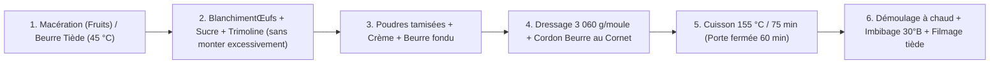

# B-CAK-P00 — CAKES DE VOYAGE PRESTIGE (SANS MIX — BASE FARINE T65 BM)
> **Pôle :** Biscuiterie & Gâteaux de Voyage (Annexe Prestige)  
> **Code :** `B-CAK-P01` (Citron Pavot), `B-CAK-P02` (Marbré Vanille-Cacao), `B-CAK-P03` (Fruits Confits Macérés)  
> **Référence Atelier (Mix Michard) :** Voir la fiche principale [cakes-de-voyage.md](../cakes-de-voyage.md)  
> **Moule Étalon :** Moules Inox `50 × 10 × 10 cm` — Poids cru : **`3 060 g`** / Poids cuit : **`~3 000 g`**  

---

## PAGE GAUCHE — POSTE DE PESÉE (BASE FARINE T65 BM & TRIMOLINE)

### 1. TABLEAU A : CAKE CITRON & PAVOT BLEU PRESTIGE (`B-CAK-P01`)
*Appareil émulsionné beurre fondu tiède / crème liquide UHT, enrichi en Trimoline pour le moelleux longue conservation ($a_w \le 0,77$).*

| Ingrédients | % (Base Farine) | 1 kg Farine | 1 Moule (3 060 g) | 10 Moules (30,6 kg) | 15 Moules (45,9 kg) |
| :--- | :---: | :---: | :---: | :---: | :---: |
| **Farine T65 conventionnelle BM** *(Moulin de Cadillac - FPBMT65)* | 100,0 % | 1 000 g | 750 g | 7 500 g | 11 250 g |
| **Sucre semoule** | 92,0 % | 920 g | 690 g | 6 900 g | 10 350 g |
| **Trimoline / Sucre inverti** *(Disgroup 00021913 / Michard 553)* | 10,0 % | 100 g | 75 g | 750 g | 1 125 g |
| **Œufs entiers liquides pasteurisés** | 90,0 % | 900 g | 675 g | 6 750 g | 10 125 g |
| **Beurre doux 82% MG fondu tiède** *(Michard 92707)* `[1]` | 70,0 % | 700 g | 525 g | 5 250 g | 7 875 g |
| **Crème liquide UHT 35% MG** | 24,0 % | 240 g | 180 g | 1 800 g | 2 700 g |
| **Jus de citron jaune frais** | 12,0 % | 120 g | 90 g | 900 g | 1 350 g |
| **Zestes de citrons jaunes frais** | 2,4 % | 24 g | 18 g | 180 g | 270 g |
| **Graines de pavot bleu** *(Michard 4138)* | 4,0 % | 40 g | 30 g | 300 g | 450 g |
| **Levure chimique** *(Baking Powder Ancel - Disgroup 00021815)* | 2,4 % | 24 g | 18 g | 180 g | 270 g |
| **Sel fin** | 1,2 % | 12 g | 9 g | 90 g | 135 g |
| **TOTAL PÂTE CRUE** | **408,0 %** | **4 080 g** | **3 060 g** | **30 600 g** | **45 900 g** |

> `[1]` Option économique possible : remplacer tout ou partie du beurre doux 82% MG par de la **Margarine OPAL Cake-Cream** *(Michard 3825)* en conservant le même poids.

---

### 2. TABLEAU B : CAKE MARBRÉ VANILLE & CACAO PRESTIGE (`B-CAK-P02`)
*Montage 50/50 en 4 couches : **1 530 g** d'appareil Vanille + **1 530 g** d'appareil Cacao = **3 060 g** par moule.*

#### B1. Appareil Vanille Bourbon (50 % du moule = 1 530 g)
| Ingrédients | % (Base Farine) | 1 kg Farine | 1 Moule (1 530 g) | 10 Moules (15,3 kg) | 15 Moules (22,95 kg) |
| :--- | :---: | :---: | :---: | :---: | :---: |
| **Farine T65 conventionnelle BM** *(Moulin de Cadillac - FPBMT65)* | 100,0 % | 1 000 g | 375 g | 3 750 g | 5 625 g |
| **Sucre semoule** | 96,0 % | 960 g | 360 g | 3 600 g | 5 400 g |
| **Trimoline / Sucre inverti** *(Disgroup 00021913 / Michard 553)* | 12,0 % | 120 g | 45 g | 450 g | 675 g |
| **Œufs entiers liquides pasteurisés** | 96,0 % | 960 g | 360 g | 3 600 g | 5 400 g |
| **Beurre doux 82% MG fondu tiède** *(Michard 92707)* | 72,0 % | 720 g | 270 g | 2 700 g | 4 050 g |
| **Crème liquide UHT 35% MG** | 28,0 % | 280 g | 105 g | 1 050 g | 1 575 g |
| **Levure chimique** *(Baking Powder Ancel - Disgroup 00021815)* | 2,4 % | 24 g | 9 g | 90 g | 135 g |
| **Sel fin** | 0,8 % | 8 g | 3 g | 30 g | 45 g |
| **Extrait / Arôme Vanille Bourbon** | 0,8 % | 8 g | 3 g | 30 g | 45 g |
| **TOTAL APPAREIL VANILLE** | **408,0 %** | **4 080 g** | **1 530 g** | **15 300 g** | **22 950 g** |

#### B2. Appareil Cacao Intense Barry (50 % du moule = 1 530 g)
| Ingrédients | % (Base Farine) | 1 kg Farine | 1 Moule (1 530 g) | 10 Moules (15,3 kg) | 15 Moules (22,95 kg) |
| :--- | :---: | :---: | :---: | :---: | :---: |
| **Farine T65 conventionnelle BM** *(Moulin de Cadillac - FPBMT65)* | 100,0 % | 1 000 g | 375 g | 3 750 g | 5 625 g |
| **Cacao poudre Extra Brute / Plein Arôme Barry** *(Disgroup 00020365 / 00020310)* | 16,0 % | 160 g | 60 g | 600 g | 900 g |
| **Sucre semoule** | 88,0 % | 880 g | 330 g | 3 300 g | 4 950 g |
| **Trimoline / Sucre inverti** *(Disgroup 00021913 / Michard 553)* | 12,0 % | 120 g | 45 g | 450 g | 675 g |
| **Œufs entiers liquides pasteurisés** | 96,0 % | 960 g | 360 g | 3 600 g | 5 400 g |
| **Beurre doux 82% MG fondu tiède** *(Michard 92707)* | 56,0 % | 560 g | 210 g | 2 100 g | 3 150 g |
| **Crème liquide UHT 35% MG** | 36,0 % | 360 g | 135 g | 1 350 g | 2 025 g |
| **Levure chimique** *(Baking Powder Ancel - Disgroup 00021815)* | 2,4 % | 24 g | 9 g | 90 g | 135 g |
| **Sel fin** | 0,8 % | 8 g | 3 g | 30 g | 45 g |
| **Extrait de café pur Trablit** *(exhausteur cacao)* | 0,8 % | 8 g | 3 g | 30 g | 45 g |
| **TOTAL APPAREIL CACAO** | **408,0 %** | **4 080 g** | **1 530 g** | **15 300 g** | **22 950 g** |

---

### 3. TABLEAU C : CAKE AUX FRUITS CONFITS MACÉRÉS PRESTIGE (`B-CAK-P03`)
*Méthode de crémage / émulsion dense pour maintenir les fruits confits en suspension sans chute au fond du moule.*

| Ingrédients | % (Base Farine) | 1 kg Farine | 1 Moule (3 060 g) | 10 Moules (30,6 kg) | 15 Moules (45,9 kg) |
| :--- | :---: | :---: | :---: | :---: | :---: |
| **Farine T65 conventionnelle BM** *(Moulin de Cadillac - FPBMT65)* | 100,0 % | 1 000 g | 750 g | 7 500 g | 11 250 g |
| **Sucre semoule** | 76,0 % | 760 g | 570 g | 5 700 g | 8 550 g |
| **Trimoline / Sucre inverti** *(Disgroup 00021913 / Michard 553)* | 8,0 % | 80 g | 60 g | 600 g | 900 g |
| **Œufs entiers liquides pasteurisés** | 80,0 % | 800 g | 600 g | 6 000 g | 9 000 g |
| **Beurre doux 82% MG pommade (18-20 °C)** *(Michard 92707)* | 64,0 % | 640 g | 480 g | 4 800 g | 7 200 g |
| **Mélange Fruits Confits cubes** *(Puratos 4022820)* | 44,0 % | 440 g | 330 g | 3 300 g | 4 950 g |
| **Raisins secs sultanines** | 20,0 % | 200 g | 150 g | 1 500 g | 2 250 g |
| **Rhum ambré de macération (54°)** | 12,0 % | 120 g | 90 g | 900 g | 1 350 g |
| **Levure chimique** *(Baking Powder Ancel - Disgroup 00021815)* | 2,4 % | 24 g | 18 g | 180 g | 270 g |
| **Sel fin** | 1,6 % | 16 g | 12 g | 120 g | 180 g |
| **TOTAL PÂTE CRUE** | **408,0 %** | **4 080 g** | **3 060 g** | **30 600 g** | **45 900 g** |

---

### 4. TABLEAU D : SIROP D'IMBIBAGE PRESTIGE 30°B (OPTIONNEL AU DÉMOULAGE)
*Pour les cakes Citron (sirop citron) ou Fruits Confits (sirop rhum) afin de sceller l'humidité à cœur.*

| Ingrédients | % (Base Eau) | 1 Moule (150 g) | 10 Moules (1 500 g) | 15 Moules (2 250 g) |
| :--- | :---: | :---: | :---: | :---: |
| **Eau** | 100,0 % | 60 g | 600 g | 900 g |
| **Sucre semoule** | 125,0 % | 75 g | 750 g | 1 125 g |
| **Jus de citron frais** *(Citron)* ou **Rhum ambré** *(Fruits)* | 25,0 % | 15 g | 150 g | 225 g |
| **TOTAL SIROP 30°B** | **250,0 %** | **150 g** | **1 500 g** | **2 250 g** |

---

## PAGE DROITE — CONDUITE, CORNET & CUISSON (PROTOCOLE GLACIER MOF)

### 1. CONDUITE DE FABRICATION
1. **Citron Pavot & Marbré (Méthode pâte à cake fluide émulsionnée) :**
   - Faire fondre le beurre doux à **45 °C** et le maintenir tiède.
   - Dans la cuve du batteur muni de la **feuille** (pas au fouet pour éviter l'alvéolage grossier), mélanger en 1ʳᵉ vitesse les œufs entiers, le sucre semoule, la Trimoline et le sel pendant **2 minutes** (dissolution du sucre sans incorporer d'air excessif).
   - Ajouter les poudres préalablement tamisées (Farine T65 BM + levure chimique + cacao pour le Marbré noir). Mélanger **1 minute en V1**.
   - Incorporer la crème liquide UHT et le jus/zestes de citron (ou extrait vanille/café), puis verser le beurre fondu tiède en filet en **V1**. Terminer par **30 secondes en V2** pour lisser l'émulsion.
   - Incorporer les graines de pavot bleu en fin de mélange (**15 secondes en V1**).
2. **Fruits Confits (Méthode crémage / densité maximale) :**
   - Faire macérer la veille les raisins secs et les fruits confits dans le rhum ambré. Prélever **10 % de la farine T65 BM** de la recette pour enrober les fruits égouttés juste avant incorporation (empêche la sédimentation au fond du moule).
   - Crémer le beurre pommade (**18–20 °C**) avec le sucre, le sel et la Trimoline à la feuille (**V2, 3 minutes**).
   - Incorporer les œufs tempérés en 3 fois, puis le reste de farine tamisée avec la levure chimique (**V1, 45 secondes**), et enfin les fruits farinés.

### 2. TECHNIQUE D'OUVERTURE & CUISSON
1. **Chemise du moule :** Graisser au beurre manié (80 % beurre / 20 % farine) ou chemiser de papier sulfurisé.
2. **Cordon de Beurre au Cornet (Méthode Stéphane Glacier MOF) :**
   - Après dressage des **3 060 g** par moule (`4 couches × 765 g` pour le Marbré), dresser à l'aide d'un cornet un **fin cordon de beurre doux pommade (ou d'Opal) de 3 à 4 mm** en ligne droite au centre sur toute la longueur du moule (alternative supérieure à la corne huilée pour une croûte développée et régulière).
3. **Barème de cuisson :**
   - **Température :** **155 °C** (four ventilé) ou **165 °C** (four à soles), oura fermé.
   - **Durée :** **75 minutes** pour les moules `50 × 10 × 10 cm`.
   - **Règle absolue des 60 minutes :** Ne jamais ouvrir la porte du four durant les **60 premières minutes** pour éviter l'affaissement central. Vérifier la cuisson à la sonde ou au couteau sec à 75 minutes.
4. **Imbibage & Conservation :**
   - Démouler à chaud dès la sortie du four sur grille.
   - Si imbibage choisi (Tableau D), badigeonner au pinceau le cake encore chaud avec le sirop tiède (`30°B`).
   - Laisser refroidir **1 heure** puis filmer au contact (encore très légèrement tiède à `~30 °C` si non imbibé, ou froid si imbibé) pour conserver le moelleux **10 à 14 jours** à température ambiante.
