# Fiche Technique d'Atelier : Petite Brioche Individuelle au Sucre PAC (Calibre 75 g & Huile de Colza)

* **Code Produit** : `V-BRI-01`
* **Famille** : Viennoiserie Générale & Pâtes Levées Riches (Procédé PAC)
* **Calibre Homologué** : **75 g pâte crue** (+ 7 g Sucre Grain n°10 = 82 g brut) $\longrightarrow$ **~75 g fini cuit**
* **Procédé Exclusif** : **Poussé-Surgelé PAC avec Huile de Colza Neutre & Complexe Soft'r (1,5 %) / Kimo (1,5 %)** $\longrightarrow$ Division Hydraulique Optimisée sur **Bacs de 6 000 g pile** (20 pâtons de 300 g coupés en 4 = 80 boules de 75 g) $\longrightarrow$ Boulage serré $\longrightarrow$ Pousse étuve 26 °C (75 % vol.) $\longrightarrow$ Dorure Spéciale Bamix $\longrightarrow$ Blocage PAC sous sonde -10 °C à cœur $\longrightarrow$ Grainage express Sucre Grain n°10 sur pièce congelée $\longrightarrow$ Cuisson directe 165 °C four ventilé (Ouras ouverts)
* **Équipements Clés** : Pétrin spirale, Diviseuse hydraulique 20 parts (bacs 6 000 g), Émulsionneur Bamix, Cellule flash -35 °C, Four ventilé
* **Format d'Atelier** : Double Page Vis-à-Vis (Page Gauche : Poste Pesée Tout en Grammes | Page Droite : Division 20x4, Boulage, PAC & Grainage Sucre)
* **Version** : `v3.2-SOFTR-COLZA-75G` | **Statut** : 🟢 Validé Production & Standard Atelier

---

## PAGE GAUCHE (1/2) • POSTE DE PESÉE (EXCLUSIVEMENT EN GRAMMES)
*(Affichage Haute Visibilité — Gros Caractères Lisibles à 1,5 m — Zéro Décimale en kg)*

### Repères Flash Poste de Pesée
| Repère | Paramètre Clé | Spécification Atelier | Justification Scientifique & Rhéologique |
| :--- | :--- | :--- | :--- |
| 🌻 **Huile de Colza Neutre** | **18,0 % rapport farine** | Huile liquide neutre désodorisée | Zéro cristallisation au froid : mie cotonneuse et souplesse exceptionnelle 7 jours |
| 🧬 **Complexe Bio-Enzymatique**| **1,5 % Soft'r + 1,5 % Kimo** | Amylase maltogénique + E300/DATEM | Zéro Tangzhong à cuire : clive l'amylopectine au four, moelleux prolongé |
| 🟢 **Détrempe / Bac 6 000 g** | **6 000 g pile / bac** | 20 pâtons de 300 g $\rightarrow$ coupe en 4 | Épaisseur en cuve de **3,0 cm** : tassage hydraulique parfait, **80 pièces de 75 g / bac** |
| 🟠 **Pétrissage & Sortie** | **Programme [BRIOCHE]** | Température sortie pétrin : **22 °C à 24 °C** | Huile versée en filet V2 sur réseau formé : émulsion fine sans glissage |
| 🔴 **Cryoprotection & PAC** | **Levure Or 4,8 % / Kimo 1,5 %** | Trimoline 3,0 % + Lait 26 % 4,0 % | Osmotolérance face au sucre (14 %) et zéro affaissement au gel PAC |
| 🍚 **Grainage Finition** | **Sucre Grain n°10 (7 g/pièce)** | 560 g / bac de 80 pièces | Déposé sur pâte congelée dorée : croquant immaculé sans fondre au four |
| 🥚 **Dorure Spéciale Bamix** | **Émulsion fine au Bamix** | Œufs entiers + jaunes + crème + sel | Émulsion sans bulles : vernis miroir profond et accroche maximale du grain |

---

### Tableau Chronologique des Pesées en 4 Phases (Unités : GRAMMES)
*Base meunière : Farine Totale = 100,0 % (100 % Farine Gruau Rouge T45) | Tolérance balance : ± 1 g ingrédients critiques / ± 5 g farines.*

| Phase & Ordre | Ingrédient d'Atelier | % Meunier | Base 1 000 g Farine | 1 Bac (80 pcs 75g / 6 000 g) | 10 Bacs (800 pcs / 60 000 g) | 20 Bacs (1600 pcs / 120 000 g) | 30 Bacs (2400 pcs / 180 000 g) | Rôle Biochimique |
| :---: | :--- | :---: | :---: | :---: | :---: | :---: | :---: | :--- |
| **`[1]` Bleu** | **Farine Gruau Rouge T45** | **100,0 %** | **1 000 g** | **2 953 g** | **29 530 g** | **59 050 g** | **88 580 g** | $W > 330, P/L \approx 0,60$, volume brioché |
| **`[1]` Bleu** | **Eau très froide (+1 °C)** | **26,0 %** | **260 g** | **768 g** | **7 680 g** | **15 350 g** | **23 030 g** | Hydratation directe régulatrice |
| **`[1]` Bleu** | **Œufs entiers liquides past.**| **28,0 %** | **280 g** | **827 g** | **8 270 g** | **16 540 g** | **24 800 g** | Émulsion riche, couleur dorée, filant |
| **`[1]` Bleu** | **Sucre cristal semoule** | **14,0 %** | **140 g** | **413 g** | **4 130 g** | **8 270 g** | **12 400 g** | Goût brioché classique et caramélisation |
| **`[1]` Bleu** | **Trimoline (Sucre inverti)** | **3,0 %** | **30 g** | **89 g** | **890 g** | **1 770 g** | **2 660 g** | Abaisseur cryoscopique $\Delta T_f$, anti-dessèchement |
| **`[1]` Bleu** | **Poudre de lait entier 26 %** | **4,0 %** | **40 g** | **118 g** | **1 180 g** | **2 360 g** | **3 540 g** | Rétention d'eau par les caséines, finesse mie |
| **`[1]` Bleu** | **Sel fin d'atelier** | **2,1 %** | **21 g** | **62 g** | **620 g** | **1 240 g** | **1 860 g** | Resserrement ionique indispensable du gluten |
| **`[1]` Bleu** | **Levure fraîche L'Hirondelle Or**| **4,8 %** | **48 g** | **142 g** | **1 420 g** | **2 830 g** | **4 250 g** | Levure osmotolérante cryoprotectrice tréhalose |
| **`[1]` Bleu** | **Améliorant S500 Kimo Short** | **1,5 %** | **15 g** | **44 g** | **440 g** | **890 g** | **1 330 g** | Résistance au choc cryogénique négatif PAC |
| **`[1]` Bleu** | **Améliorant Puratos Soft'r** | **1,5 %** | **15 g** | **44 g** | **440 g** | **890 g** | **1 330 g** | Clivage enzymatique anti-staling 7 jours |
| **`[1]` Bleu** | **Extrait de vanille liquide** | **0,3 %** | **3 g** | **9 g** | **90 g** | **180 g** | **270 g** | Note vanillée douce et signature pâtissière |
| **`[2]` Ambre** | **Huile de colza neutre** | **18,0 %** | **180 g** | **531 g** | **5 310 g** | **10 630 g** | **15 950 g** | Incorp. V2 en filet lent : souplesse infinie |
| **SOUS-TOTAL**| **PÂTE AU BAC (75 G CRU)** | **203,2 %** | **2 032 g** | **6 000 g pile** | **60 000 g pile** | **120 000 g pile** | **180 000 g pile** | **Poids net calibré à 6 000 g pile / bac (80 pièces)** |
| **`[3]` Décor** | **Sucre Grain n°10 (Perlé)** | **18,7 %** | **187 g** | **560 g** | **5 600 g** | **11 200 g** | **16 800 g** | Déposé sur pâte congelée dorée (~7 g / pièce) |
| **`[4]` Dorure** | **Dorure Spéciale Bamix** | Q.S. | PM | 100 g | 1 000 g | 2 000 g | 3 000 g | Émulsion Bamix : œufs + jaunes + crème + sel |

---

### Cadences & Rendements Brioches au Sucre (Calibre 75 g cru $\longrightarrow$ ~75 g fini cuit avec sucre)
* **Rendement par bac (6 000 g net)** : **80 briochettes de 75 g cru** (soit 20 pâtons de 300 g coupés en 4).
* **Rendement 10 bacs (60 000 g pâte)** : **800 pièces** (~34 plaques de 24 pièces).
* **Rendement 20 bacs (120 000 g pâte)** : **1 600 pièces** (~67 plaques de 24 pièces).
* **Rendement 30 bacs (180 000 g pâte)** : **2 400 pièces** (~100 plaques de 24 pièces) — *Pleine pétrissée cuve 200 kg*.

---

## PAGE DROITE (2/2) • CONDUITE MACHINE, DIVISION 20x4, PAC & FOUR
*(Poste Conduite Thermomécanique, Pousse PAC & Cuisson)*

```mermaid
flowchart TD
    A["Pétrin Spirale 200 kg\nFarine Gruau + Eau glacée (+1 °C) + Œufs + Sucre + Lait + Sel\n+ Levure Or + Kimo Short (1,5%) + Soft'r Puratos (1,5%) [1]\nFrasage 5 min en 1re vitesse (V1)"]
    --> B["Passage en 2e vitesse (V2) :\nPétrir 4 min jusqu'à amorce de voile\nVerser Huile de Colza neutre [2] en filet continu très lent\nPétrir 6 à 7 min jusqu'au VOILE PARFAIT et DÉCOLLEMENT NET\n(Température sortie pétrin : 22 °C à 24 °C)"]
    --> C["Pesée des bacs plats à 6 000 g pile\nPointage court 20 min à 20–22 °C sous film étanche\n+ Raffermissement flash 25 min au froid (+4 °C)"]
    --> D["Diviseuse Hydraulique 20 parts (Épaisseur idéale 3,0 cm) :\nMachine délivre 20 pâtons de 300 g pile\nDécoupe immédiate en 4 au coupe-pâte (en croix) -> 80 pièces de 75 g"]
    --> E["Boulage régulier à la main (clé bien fermée en dessous)\nDisposition sur plaques 60x40 siliconées (24 pcs / plaque)"]
    --> F["Pousse Contrôlée en Étuve 26 °C / 80% HR\nArrêt strict aux 3/4 de développement (70–75% vol., ~1 h 45)"]
    --> G["Raffermissement 10 min (+4 °C)\n+ 1re Application Dorure Spéciale Bamix au pinceau doux\n+ Blocage PAC Sonde -10 °C à cœur -> Stock 2 PAC (-18 °C)"]
    --> H["Sortie direct congélateur en boutique :\nVoile humidifiant Dorure Bamix\n+ Saupoudrage généreux Sucre Grain n°10 (7 g/pc)"]
    --> I["Cuisson Directe Congelé 165 °C Four Ventilé\n11 à 13 min, OURAS OUVERTS EN CONTINU\n(Dôme doré éclatant, perles de sucre immaculées et croquantes)"]
```

---

### Étape 1 : Pétrissage & Réseau Élastique
1. **Frasage Biphasique avec Couple Kimo / Soft'r** :
   * Verser l'eau très froide (+1 °C), la farine Gruau Rouge T45, les œufs, le sucre, la Trimoline, la poudre de lait 26 %, le sel, la levure Or, le Kimo Short (1,5 %), le Soft'r Puratos (1,5 %) et la vanille `[1]` Bleu dans la cuve.
   * Frasage pendant **5 minutes en 1ʳᵉ vitesse**.
2. **Incorporation Huile de Colza en Filet & Voile Translucide** :
   * Passer en **2ᵉ vitesse pendant 4 minutes**.
   * Verser l'huile de colza neutre `[2]` Ambre en un **filet régulier très lent** pour permettre aux protéines de l'absorber sans glisser sur la cuve.
   * Pétrir pendant **6 à 7 minutes en 2ᵉ vitesse**.
   * **Critère visuel** : Voile translucide élastique sans déchirure, décollement intégral.
   * **Température de sortie pétrin** : **22 °C à 24 °C**.
3. **Mise en Bacs Plats & Raffermissement au Froid** :
   * Peser des bacs plats à **6 000 g net pile** (gabarit 80 pièces de 75 g).
   * Laisser pointer **20 minutes à température ambiante (20–22 °C)** sous film plastique étanche.
   * Passer **25 minutes en chambre froide positive (+4 °C)** : fige la pâte, la rend ferme et évite tout collage à la diviseuse.

---

### Étape 2 : Division Optimisée 20x4, Boulage & Plaquage
1. **Division Hydraulique 20 Parts (Épaisseur Parfaite de 3,0 cm)** :
   * Déposer le pâton de 6 000 g dans la cuve de diviseuse (remplit parfaitement les 4 coins).
   * Actionner le cycle : la machine découpe **20 pâtons allongés pesant exactement 300 g**.
2. **Découpe en Quatre au Coupe-Pâte (Format 75 g)** :
   * D'un double coup net de coupe-pâte inox en croix (un trait longitudinal, un trait transversal), diviser chaque rectangle de 300 g en **4 carrés égaux de 75 g** (soit **80 morceaux de 75 g par bac**).
3. **Boulage & Plaquage** :
   * Bouler rapidement chaque morceau de 75 g sous la paume de la main en rotation vive, clé fermée en dessous.
   * Disposer sur plaques 60×40 garnies de toiles Silpat ou papier cuisson : **24 pièces par plaque** (4 rangées de 6).

---

### Étape 3 : Pousse Contrôlée, Dorure Bamix & Blocage PAC
1. **Pousse en Étuve Régulée** :
   * Transférer en étuve à **26 °C et 80 % HR pendant 1 h 45 à 2 h 00**.
   * **Arrêt de pousse strict à 70–75 % du volume maximal**.
2. **Raffermissement & Préparation Dorure Bamix** :
   * Passer les chariots **10 minutes en froid positif (+4 °C)** pour raffermir la membrane.
   * **Dorure Spéciale Bamix** : Émulsionner au Bamix 200 g œufs + 40 g jaunes + 40 g crème 35 % + 3 g sel + 5 g sucre, filtrer au chinois.
   * Appliquer un voile très léger au pinceau doux ou pistolet basse pression.
3. **Blocage PAC (Sonde à Cœur -10 °C)** :
   * Piquer la sonde au centre d'une briochette témoin.
   * Cellule flash à -35 °C $\longrightarrow$ **ARRÊT STRICT DÈS QUE LA SONDE ATTEINT -10 °C À CŒUR**.
   * Transférer en cartons étanches sous sache PE et stocker à **-18 °C (Stock 2 PAC)**.

---

### Étape 4 : Grainage Express & Cuisson Directe Four Ventilé
* **Départ four** : Directement du congélateur (-18 °C), **ZÉRO DÉCONGÉLATION PRÉALABLE**.
* **Grainage Express au Poste d'Enfournement** :
  * Sortir les plaques congelées (-18 °C).
  * Appliquer un très léger voile humidifiant de Dorure Bamix.
  * Saupoudrer généreusement le **Sucre Grain n°10** sur chaque pièce (**~7 g de sucre par briochette**).
* **Barème de Cuisson Four Ventilé** :
  * **Préchauffage Four** : **180 °C** | **Température de Cuisson Régulée** : **165 °C en continu**.
  * **Durée de Cuisson** : **11 à 13 minutes**.
  * **OURAS GRANDS OUVERTS EN CONTINU** : Évacuation immédiate de l'humidité pour sécher le dôme et empêcher la fonte des perles de sucre.
* **Ressuage** : Refroidir sur grille inox. Grâce à l'huile de colza et au Soft'r, la mie est d'un moelleux cotonneux incomparable et ne rassit jamais.
