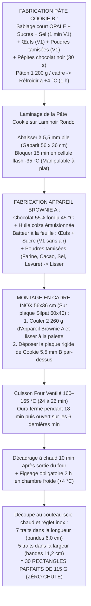

# Fiche Technique d'Atelier : Brookie en Cadres Inox 60x40 (56x36 cm)

* **Code Produit** : `B-BRK-01`
* **Famille** : Biscuiterie, Gâteaux de Voyage & Pâtisserie Nomade (Cadres 60x40)
* **Procédé** : Bicolore Superposé (Appareil Brownie Fondant coulé + Abaisse Cookie Pépites laminée 5,5 mm) $\rightarrow$ Cuisson 160–165 °C $\rightarrow$ Figeage +4 °C $\rightarrow$ Découpe 30 parts (11,2 x 6,0 cm)
* **Équipements Clés** : Batteur mélangeur à feuille, Laminoir Rondo (abaisse cookie congelée), Cadres inox 56x36 cm x H 4 cm, Toiles Silpat 60x40, Règle coupe-pâte
* **Format d'Atelier** : Double Page Vis-à-Vis (Page Gauche : Poste Pesée Brownie & Cookie | Page Droite : Montage Cadres, Cuisson & Découpe Sans Chute)
* **Version** : `v2.0-STANDARD-USINE` | **Statut** : 🟢 Validé Production & Standard Atelier

---

## PAGE GAUCHE (1/2) • POSTE DE PESÉE (BROWNIE & COOKIE)

### Repères Flash Poste de Pesée
| Repère | Paramètre Clé | Spécification Atelier | Justification Scientifique & Rhéologique |
| :--- | :--- | :--- | :--- |
| 🍫 **Appareil A • Brownie** | **2 260 g net / cadre** | Chocolat noir 55 % + Huile colza | Émulsion sans foisonnement : densité fudgy fondante |
| 🍪 **Abaisse B • Cookie** | **1 200 g net / cadre** | Laminée froide à **5,5 mm d'épaisseur** | Contraste croustillant sur fondant sans s'enfoncer |
| ⚖️ **Masse Totale / Cadre** | **3 460 g net par cadre** | Cadre inox 56 × 36 cm utile | 30 portions de **115 g brut unitaire** (cuite ~108 g) |
| 💧 **Maîtrise de l'Eau ($a_w$)** | **$a_w \le 0,72\text{--}0,75$** | Cauvain & Young (*Baking Problems Solved*) | Haute concentration en saccharose : conservation 15 jours à 18 °C |
| 📐 **Calibre Portion** | **Rectangles 11,2 × 6,0 cm** | 5 bandes x 6 bandes = 30 parts | Grille géométrique rigoureuse : zéro chute d'atelier |

---

### Tableau Chronologique des Pesées en 2 Blocs

#### BLOC A • Appareil Brownie Fondant (Fond de Cadre)
*Base meunière Brownie : Farine T55 = 100,0 % (180 g / cadre) | Tolérance : ± 1 g ingrédients critiques.*

| Phase & Ordre | Ingrédient d'Atelier | % Farine | 1 Cadre (30 p.) | 5 Cadres (150 p.) | 10 Cadres (300 p.) | 15 Cadres (450 p.) | Rôle & Spécification Biochimique |
| :---: | :--- | :---: | :---: | :---: | :---: | :---: | :--- |
| **`[1]` Fonte** | **Chocolat noir 55 % de couverture**| **250,0 %** | **450 g** | **2 250 g** | **4 500 g** | **6 750 g** | Beurre de cacao : prise texturale fondante |
| **`[1]` Fonte** | **Huile de colza raffinée** | **250,0 %** | **450 g** | **2 250 g** | **4 500 g** | **6 750 g** | Lipides fluides : moelleux persistant à froid |
| **`[2]` Fouet** | **Œufs entiers liquides** | **277,8 %** | **500 g** | **2 500 g** | **5 000 g** | **7 500 g** | Coagulation thermique et liaison |
| **`[2]` Fouet** | **Sucre semoule extra-fin** | **333,3 %** | **600 g** | **3 000 g** | **6 000 g** | **9 000 g** | Abaissement $a_w$ et croûte satinée craquelée |
| **`[3]` Poudres**| **Farine T55 pâtissière** | **100,0 %** | **180 g** | **900 g** | **1 800 g** | **2 700 g** | Faible gluten : texture dense sans élasticité |
| **`[3]` Poudres**| **Cacao pur 100 % en poudre** | **38,9 %** | **70 g** | **350 g** | **700 g** | **1 050 g** | Amertume, intensité aromatique et couleur |
| **`[3]` Poudres**| **Sel fin d'atelier** | **2,8 %** | **5 g** | **25 g** | **50 g** | **75 g** | Exhausteur de goût chocolat |
| **`[3]` Poudres**| **Levure chimique (Baking powder)**| **2,8 %** | **5 g** | **25 g** | **50 g** | **75 g** | Légère aération évitant l'effet bloc compact |
| **SOUS-TOTAL**| **TOTAL APPAREIL A (BROWNIE)** | **1 255,6 %** | **2 260 g** | **11 300 g** | **22 600 g** | **33 900 g** | **Coulé au fond du cadre 56x36 cm** |

---

#### BLOC B • Pâte Cookie Pépites (Abaisse Supérieure Laminée)
*Base meunière Cookie : Farine T55 = 100,0 % (330 g / cadre) | Tolérance : ± 1 g ingrédients critiques.*

| Phase & Ordre | Ingrédient d'Atelier | % Farine | 1 Cadre (30 p.) | 5 Cadres (150 p.) | 10 Cadres (300 p.) | 15 Cadres (450 p.) | Rôle & Spécification Biochimique |
| :---: | :--- | :---: | :---: | :---: | :---: | :---: | :--- |
| **`[1]` Sablage**| **Margarine OPALE cuve (ou Beurre)**| **66,7 %** | **220 g** | **1 100 g** | **2 200 g** | **3 300 g** | Crémage court sans foisonnement excessif |
| **`[1]` Sablage**| **Sucre roux Cassonade** | **45,5 %** | **150 g** | **750 g** | **1 500 g** | **2 250 g** | Saveur caramel, croquant et couleur ambrée |
| **`[1]` Sablage**| **Sucre blanc semoule** | **21,2 %** | **70 g** | **350 g** | **700 g** | **1 050 g** | Croquant périphérique et étalement |
| **`[1]` Sablage**| **Gros sel de Guérande** | **3,0 %** | **10 g** | **50 g** | **100 g** | **150 g** | Cristaux salés croquants en dégustation |
| **`[2]` Liaison**| **Œufs entiers liquides** | **30,3 %** | **100 g** | **500 g** | **1 000 g** | **1 500 g** | Émulsion avec la matière grasse |
| **`[3]` Poudres**| **Farine T55 pâtissière** | **100,0 %** | **330 g** | **1 650 g** | **3 300 g** | **4 950 g** | Armature croustillante sablée |
| **`[3]` Poudres**| **Poudre à crème vanillée** | **9,1 %** | **30 g** | **150 g** | **300 g** | **450 g** | Amidon de maïs : friabilité et texture sablée |
| **`[3]` Poudres**| **Levure chimique** | **3,0 %** | **10 g** | **50 g** | **100 g** | **150 g** | Soulèvement de l'abaisse cookie |
| **`[4]` Inclusions**| **Pépites de chocolat noir 50 %** | **84,8 %** | **280 g** | **1 400 g** | **2 800 g** | **4 200 g** | Inclusions thermorésistantes |
| **SOUS-TOTAL**| **TOTAL APPAREIL B (COOKIE)** | **363,6 %** | **1 200 g** | **6 000 g** | **12 000 g** | **18 000 g** | **Laminé à 5,5 mm (rectangle 56x36 cm)** |
| **TOTAL GÉN.** | **MASSE TOTALE BROOKIE (A + B)** | - | **3 460 g** | **17 300 g** | **34 600 g** | **51 900 g** | **3 460 g net / cadre inox 56x36 cm** |

---

## PAGE DROITE (2/2) • CONDUITE MACHINE, MONTAGE EN CADRE & DÉCOUPE

---

### Étape 1 : Préparation & Laminage du Cookie (J-1 ou Avant-Service)
1. **Pétrissage Sablé au Batteur (Feuille)** :
   * Mettre la matière grasse Opale (ou beurre doux), la cassonade, le sucre blanc et le gros sel `[1]` dans la cuve du batteur muni de la feuille.
   * Lancer en 1ʳᵉ vitesse pendant **1 minute** : sabler la matière sans jamais blanchir ni incorporer d'air (un foisonnement excessif ferait gonfler le cookie comme un cake et détruirait le contraste brooky).
   * Verser les œufs liquides `[2]` en 1ʳᵉ vitesse.
   * Ajouter la farine T55, la poudre à crème et la levure chimique tamisées `[3]`. Mélanger en 1ʳᵉ vitesse jusqu'à disparition de la farine libre.
   * Verser les pépites de chocolat noir `[4]` et tourner **30 secondes** pour les répartir.
2. **Laminage Étalon à 5,5 mm & Durcissement au Froid** :
   * Peser des pâtons de **1 200 g pile**.
   * Abaisser sur le laminoir Rondo par passes douces jusqu'à l'épaisseur exacte de **5,5 mm**.
   * Découper au gabarit rectangulaire de **56 × 36 cm** (dimensions intérieures exactes du cadre inox).
   * Glisser sur une feuille de papier cuisson et passer **15 à 20 minutes en cellule flash à -35 °C** : l'abaisse devient rigide comme une planche, permettant un transfert d'un seul bloc sans se déformer ni se déchirer.

---

### Étape 2 : Préparation du Brownie & Assemblage en Cadre
1. **Émulsion Chocolat-Colza** :
   * Faire fondre le chocolat noir 55 % au bain-marie ou en étuve entre **45 °C et 50 °C**.
   * Verser l'huile de colza tempérée sur le chocolat fondu en mélangeant au fouet jusqu'à obtenir une émulsion fluide, lisse et brillante.
2. **Liaison des Masses** :
   * Dans la cuve du batteur (feuille), réunir les œufs entiers et le sucre semoule `[2]`. Faire tourner en 1ʳᵉ vitesse pendant **1 à 2 minutes** pour dissoudre le sucre sans mousser.
   * Verser le mélange chocolat/huile tiède.
   * Ajouter la farine T55, le cacao en poudre, le sel fin et la levure chimique `[3]` préalablement tamisés ensemble.
   * Mélanger en 1ʳᵉ vitesse jusqu'à parfaite homogénéité.
3. **Montage Séquentiel en Cadre 60×40** :
   * Poser un cadre inox d'atelier (**56 × 36 cm, hauteur 4,0 cm**) sur une plaque de cuisson 60×40 garnie d'une toile Silpat propre.
   * Couler **2 260 g net d'appareil brownie A** au fond du cadre. Égaliser la surface à la palette coudée.
   * Déposer délicatement l'abaisse de cookie congelée de **1 200 g B (5,5 mm)** sur le lit de brownie.
   * Appuyer très légèrement avec le plat des mains pour assurer l'adhérence intime entre les deux masses sans enfoncer le cookie dans le brownie.

---

### Étape 3 : Barème de Cuisson & Conduite Thermique
* **Type de four** : Four ventilé préchauffé à **175 °C**.
* **Consigne de cuisson** : **160 °C à 165 °C régulé**.
* **Durée de cuisson** : **24 à 26 minutes**.
* **Gestion des Ouras** :
  * **Ouras FERMÉS pendant les 18 premières minutes** : préserve l'humidité du brownie pour garantir le cœur fondant.
  * **Ouras OUVERTS sur les 6 à 8 dernières minutes** : évacue l'humidité superficielle pour dorer et croustiller l'abaisse de cookie supérieure.
* **Test de cuisson de l'ingénieur** : Une lame piquée au centre doit ressortir couverte de miettes humides brillantes chocolatées, tandis que la croûte cookie est dorée et ferme au toucher.

---

### Étape 4 : Décadrage, Figeage & Découpe Chirurgicale (30 Parts)
1. **Décadrage à Chaud** :
   * Laisser tiédir la plaque **10 minutes** à température ambiante.
   * Passer une fine lame de couteau le long des parois intérieures du cadre et retirer le cadre inox verticalement.
2. **Figeage Obligatoire au Froid Positif (+4 °C)** :
   * Transférer la plaque pendant **2 heures en chambre froide à +4 °C**.
   * *Justification biochimique* : À chaud, le beurre de cacao et les lipides du brownie sont liquides ; tenter de couper à ce stade écraserait le gâteau en bouillie. À +4 °C, les graisses se cristallisent, permettant une découpe aux arêtes vives et nettes.
3. **Protocole de Découpe Étalon (Zéro Chute d'Atelier)** :
   * À l'aide d'un grand couteau-scie à génoise (ou lame chaude essuyée) et d'un réglet inox :
     * **Dans la longueur (56 cm)** : Tracer et couper **5 bandes égales de 11,2 cm**.
     * **Dans la largeur (36 cm)** : Tracer et couper **6 bandes égales de 6,0 cm**.
   * **Résultat d'Atelier** : **30 rectangles parfaits de 11,2 × 6,0 cm**, pesant exactement **115 g brut unitaire**, présentant une coupe bicolore d'une netteté parfaite (socle noir intense surmonté du cookie doré incrusté de pépites).
