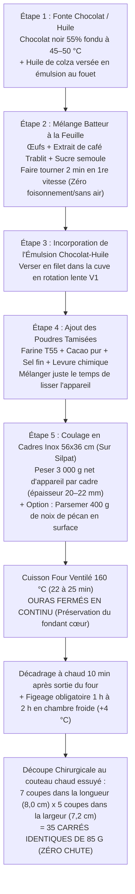

# Fiche Technique d'Atelier : Brownie Fondant Intense Chocolat (Cadres 56x36 cm)

* **Code Produit** : `B-BRW-01`
* **Famille** : Biscuiterie, Gâteaux de Voyage & Pâtisserie Nomade (Cadres 60x40)
* **Procédé** : Émulsion Chocolat Noir 55% / Colza & Extrait de Café Trablit $\rightarrow$ Coulage en Cadre Inox 56x36 cm $\rightarrow$ Cuisson Douce 160 °C (Ouras fermés) $\rightarrow$ Figeage +4 °C $\rightarrow$ Découpe 35 carrés sans chute (8,0 x 7,2 cm)
* **Équipements Clés** : Batteur avec feuille (sans foisonnement), Cadres inox 56x36 cm x H 4 cm, Toiles Silpat 60x40, Lame chaude et réglet inox
* **Format d'Atelier** : Double Page Vis-à-Vis (Page Gauche : Poste Pesée & Ingrédients | Page Droite : Conduite Cuisson, Figeage & Découpe 35 Carrés)
* **Version** : `v2.0-STANDARD-USINE` | **Statut** : 🟢 Validé Production & Standard Atelier

---

## PAGE GAUCHE (1/2) • POSTE DE PESÉE

### Repères Flash Poste de Pesée
| Repère | Paramètre Clé | Spécification Atelier | Justification Scientifique & Rhéologique |
| :--- | :--- | :--- | :--- |
| 🍫 **Chocolat Noir 55 %** | **600 g / cadre (20,0 % masse)** | Couverture pure beurre de cacao | Structure fondante dense (*fudgy*), richesse polyphénolique |
| ☕ **Extrait de Café Trablit**| **5 g / cadre (1,7 g / kg appareil)**| Véritable extrait pur de café liquide | Signature aromatique : exhausteur sans note de café perceptible |
| 🛢️ **Matière Grasse Fluide** | **Huile de colza 600 g / cadre** | Ratio 1:1 avec le chocolat noir | Maintient le fondant à cœur à température ambiante ($18\text{ }^\circ\text{C}$) |
| ⚖️ **Masse Coulée / Cadre** | **3 000 g net par cadre** | Cadre inox 56 × 36 cm (ép. 20–22 mm) | 35 portions carrées de **85 g brut** (nature) ou **97 g** (pécan) |
| 💧 **Maîtrise de l'Eau ($a_w$)** | **$a_w \approx 0,70\text{--}0,73$** | Cauvain & Young (*Baking Problems*) | Faible eau libre : conservation longue 21 jours sous cloche/flowpack |

---

### Tableau Chronologique des Pesées en 4 Phases
*Base meunière Brownie : Farine T55 = 100,0 % (235 g / cadre) | Tolérance balance : ± 1 g ingrédients critiques / ± 5 g farines.*

| Phase & Ordre | Ingrédient d'Atelier | % Farine | 1 Cadre (35 p.) | 5 Cadres (175 p.) | 10 Cadres (350 p.) | 15 Cadres (525 p.) | Rôle & Spécification Biochimique |
| :---: | :--- | :---: | :---: | :---: | :---: | :---: | :--- |
| **`[1]` Fonte** | **Chocolat noir 55 % de couverture**| **255,3 %** | **600 g** | **3 000 g** | **6 000 g** | **9 000 g** | Base aromatique et cristallisation texturale |
| **`[1]` Fonte** | **Huile de colza raffinée** | **255,3 %** | **600 g** | **3 000 g** | **6 000 g** | **9 000 g** | Lipides insaturés : fondant persistant à froid |
| **`[2]` Fouet** | **Œufs entiers liquides** | **280,9 %** | **660 g** | **3 300 g** | **6 600 g** | **9 900 g** | Émulsion avec les lipides, prise de coagulum |
| **`[2]` Fouet** | **Extrait de café pur Trablit** | **2,1 %** | **5 g** | **25 g** | **50 g** | **75 g** | **Signature d'atelier** : booste les arômes cacao |
| **`[2]` Fouet** | **Sucre cristal semoule** | **340,4 %** | **800 g** | **4 000 g** | **8 000 g** | **12 000 g** | Dissolution partielle : croûte craquelée satinée |
| **`[3]` Poudres**| **Farine T55 pâtissière** | **100,0 %** | **235 g** | **1 175 g** | **2 350 g** | **3 525 g** | Dosage très faible : texture fondante non cake |
| **`[3]` Poudres**| **Cacao pur 100 % en poudre** | **38,3 %** | **90 g** | **450 g** | **900 g** | **1 350 g** | Coloration noir ébène et amertume noble |
| **`[3]` Poudres**| **Sel fin d'atelier** | **2,1 %** | **5 g** | **25 g** | **50 g** | **75 g** | Renforce le profil chocolat et contraste sucré |
| **`[3]` Poudres**| **Levure chimique (Baking powder)**| **2,1 %** | **5 g** | **25 g** | **50 g** | **75 g** | Micro-aération empêchant l'effet élastique |
| **SOUS-TOTAL**| **TOTAL BROWNIE NATURE COULÉ** | **1 276,6 %** | **3 000 g** | **15 000 g** | **30 000 g** | **45 000 g** | **3,00 kg net / cadre 56x36 cm** |
| **`[4]` Option** | **Noix de pécan demi-cerneaux** | **170,2 %** | **+ 400 g** | **+ 2 000 g** | **+ 4 000 g** | **+ 6 000 g** | Dispersées en surface avant enfournement |
| **TOTAL PÉCAN**| **TOTAL AVEC NOIX DE PÉCAN** | **1 446,8 %** | **3 400 g** | **17 000 g** | **34 000 g** | **51 000 g** | **Version Pécan Gourmande** |

---

### Cadences & Rendements Brownies (Base Cadre 56x36 cm)
* **Découpe standard géométrique** : 7 bandes de 8,0 cm (longueur 56 cm) × 5 bandes de 7,2 cm (largeur 36 cm).
* **Rendement par cadre (3,0 kg net)** : **35 carrés parfaits de 85 g brut** (sans aucune chute de rive).
* **Rendement 5 cadres (15,0 kg net)** : **175 carrés individuels**.
* **Rendement 10 cadres (30,0 kg net)** : **350 carrés individuels**.
* **Rendement 15 cadres (45,0 kg net)** : **525 carrés individuels**.

---

## PAGE DROITE (2/2) • CONDUITE MACHINE, CUISSON DOUCE & DÉCOUPE 35 PARTS

---

### Étape 1 : Préparation de l'Appareil au Batteur (Feuille)
1. **Émulsion Fondante Chocolat Noir & Huile de Colza** :
   * Faire fondre le chocolat noir 55 % au bain-marie ou étuve entre **45 °C et 50 °C**.
   * Verser l'huile de colza à température ambiante sur le chocolat fondu en mélangeant vivement au fouet. L'émulsion doit être lisse, brillante et tiède (~35 °C).
2. **Dissolution du Sucre & Signature Trablit** :
   * Mettre les œufs entiers liquides, le sucre semoule et l'**extrait de café pur Trablit** `[2]` dans la cuve du batteur muni de la feuille.
   * Tourner pendant **1 à 2 minutes en 1ʳᵉ vitesse**.
   * *Règle d'or de texture* : **Ne jamais fouetter ni blanchir la masse**. Tout apport d'air ferait gonfler le gâteau en génoise sèche à la cuisson, anéantissant la texture dense et fondante recherchée.
3. **Mélange & Tamisage des Poudres** :
   * Verser l'émulsion chocolat/huile tiède dans la cuve.
   * Tamiser ensemble la farine T55, la poudre de cacao pur 100 %, le sel fin et la levure chimique `[3]`.
   * Verser les poudres en une seule fois dans la cuve et faire tourner en 1ʳᵉ vitesse pendant **45 secondes à 1 minute** seulement, jusqu'à disparition de la farine libre.

---

### Étape 2 : Coulage en Cadres Inox 56x36 cm & Grainage Pécan
1. **Mise en Place des Cadres d'Atelier** :
   * Disposer des cadres inox rectangulaires (**dimensions intérieures 56 × 36 cm, hauteur 4,0 cm**) sur des plaques de cuisson 60×40 garnies d'une toile Silpat parfaitement plane et dégraissée.
2. **Coulage Pesé à 3 000 g Net** :
   * Poser la plaque avec le cadre sur une balance plateforme tarée.
   * Verser exactement **3 000 g net d'appareil brownie par cadre**.
   * Étaler délicatement à la spatule coudée inox pour obtenir une épaisseur constante de **20 à 22 mm** sur toute la surface.
3. **Option Noix de Pécan** :
   * Pour la version Pécan, parsemer **400 g de demi-cerneaux de noix de pécan** (préalablement torréfiés 10 min à 150 °C et refroidis) de façon homogène sur toute la surface de la pâte crue. Enfoncer très légèrement les fruits à fleur de pâte.

---

### Étape 3 : Barème de Cuisson Douce (Ouras Fermés)
* **Type de four** : Four ventilé préchauffé à **170 °C**.
* **Consigne de température** : **160 °C régulé**.
* **Durée de cuisson** : **22 à 25 minutes** (adapter selon la charge du four).
* **Gestion des Ouras** :
  * **Ouras rigoureusement FERMÉS tout au long de la cuisson**.
  * *Justification thermodynamique* : L'oura fermé maintient une atmosphère saturée d'humidité issue de l'évaporation de l'eau des œufs. Cette vapeur empêche le dessèchement superficiel précoce et permet la formation de la fine pellicule craquelée satinée caractéristique du véritable brownie américain tout en figeant le cœur à l'état de crème chocolatée.
* **Contrôle de fin de cuisson** : Le centre du cadre doit rester légèrement tremblotant sous une légère pression du doigt.

---

### Étape 4 : Décadrage, Figeage & Découpe Étalon (35 Carrés)
1. **Décadrage à Chaud (10 minutes)** :
   * Dès la sortie du four, laisser reposer le cadre **10 minutes à température d'atelier**.
   * Glisser un couteau fin le long des parois intérieures et soulever le cadre inox délicatement.
2. **Figeage au Froid Positif (+4 °C)** :
   * Glisser la plaque au réfrigérateur ou en chambre froide à **+4 °C pendant 1 heure minimum (idéalement 2 heures)**.
   * Les matières grasses (beurre de cacao et lipides des œufs) cristallisent, transformant l'appareil en un bloc ferme et régulier.
3. **Découpe Sans Chute (Grille 7 × 5 = 35 Carrés)** :
   * Utiliser une lame longue et fine chauffée dans l'eau chaude et essuyée à chaque trait (ou couteau pneumatique d'atelier) :
     * **Dans la longueur (56 cm)** : Réaliser 6 traits espacés de **8,0 cm** $\rightarrow$ **7 bandes longitudinales**.
     * **Dans la largeur (36 cm)** : Réaliser 4 traits espacés de **7,2 cm** $\rightarrow$ **5 bandes transversales**.
   * **Bilan Atelier** : **35 carrés rigoureusement identiques de 8,0 × 7,2 cm**, pesant **85 g brut** (nature) ou **97 g** (pécan), zéro chute, arêtes nettes sans bavure.
