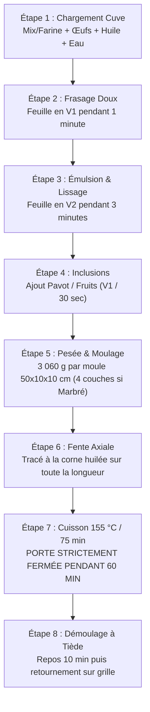

# CAKES DE VOYAGE FORMAT ATELIER (3 KG) — FORMAT DOUBLE-PAGE

**Codes Produits :** `B-CAK-01` (Citron d'Isigny & Pavot Bleu) • `B-CAK-02` (Marbré Vanille & Cacao 50/50) • `B-CAK-03` (Fruits Confits Tradition)  
**Destination :** Vente au Poids / Tranches Épaisses en Pâtisserie Boulangère, Salons de Thé & Buffets Traiteur  
**Conditionnement :** Moules rectangulaires inox grand format 50 x 10 x 10 cm (Poids cru : 3 060 g $\rightarrow$ Poids cuit net : 3,0 kg)  
**Standardisation :** Formulation au Standard Meunier (Base 1 000 g de Mix/Farine / 100,0 %) & Paliers d'Atelier (1, 10 et 15 moules)  
**Statut de Validation :** 🟢 Validé Production — Conforme R&D & Maîtrise Hygrométrique  

---

<!-- ===================================================================== -->
<!-- PAGE GAUCHE (1/2) : POSTE DE PESÉE & TABLEAUX HAUTE LISIBILITÉ        -->
<!-- ===================================================================== -->

# PAGE GAUCHE — POSTE DE PESÉE (LECTURE À 1,5 MÈTRE)

## 1. INDICATEURS FLASH DE CONDUITE

| PARAMÈTRE CLÉ | VALEUR DE CONSIGNE | TOLÉRANCE ATELIER | OBJECTIF TECHNIQUE |
| :--- | :--- | :--- | :--- |
| **Poids Cru par Moule** | **3 060 g d'appareil** | $\pm 15\text{ g}$ | Poids cuit net 3 000 g après évaporation (-2%) |
| **Outil de Cuve** | **Feuille Batteur** | Strict | Émulsion lisse sans incorporer de grosses bulles d'air |
| **Programme Batteur** | **Prog. [CAKES]** | 4 min 30 s total | 1 min V1 + 3 min V2 + 30 s V1 (inclusions) |
| **Cheminée de Développement** | **Corne huilée axiale** | Centre exact | Guide la fente d'expansion au cœur du dôme |
| **Barème Cuisson** | **155 °C ventilé — 75 min** | $\pm 2\text{ min}$ | Cuisson à cœur lente sans dessécher la croûte |
| **RÈGLE D'OR FOUR** | **PORTE FERMÉE 60 MIN** | **ZÉRO OUVERTURE** | Choc thermique = affaissement irréversible du dôme |

---

## 2. FORMULATION MAÎTRESSE & ÉCHELLES DE PESÉE (CHEF D'ATELIER)

### TABLEAU A : CAKE CITRON D'ISIGNY & GRAINES DE PAVOT (RÉF. `B-CAK-01`)
*Formule onctueuse à haute teneur en œufs et huile végétale, parfumée aux zestes de citron naturel et pavot bleu.*

| INGRÉDIENT | ÉTAPE | % MEUNIER | BASE 1 KG MIX/FARINE | 1 MOULE (3 KG) | 10 MOULES (30 KG) | 15 MOULES (45 KG) |
| :--- | :---: | :---: | :---: | :---: | :---: | :---: |
| **Mix Cake Citron IREKS (ou Farine T55 + Sucre)** | 1 | **100,0 %** | **1 000 g** | **1 600 g** | **16 000 g** | **24 000 g** |
| **Œufs entiers liquides** | 1 | 35,0 % | 350 g | 560 g | 5 600 g | 8 400 g |
| **Huile végétale neutre (colza/tournesol)** | 1 | 30,0 % | 300 g | 480 g | 4 800 g | 7 200 g |
| **Eau tempérée (20 °C)** | 1 | 22,5 % | 225 g | 360 g | 3 600 g | 5 400 g |
| **Graines de pavot bleu nettoyées** | 2 | 3,75 % | 38 g | 60 g | 600 g | 900 g |
| **MASSE TOTALE CRUE ENFOURNÉE** | — | — | **1 913 g** | **3 060 g** | **30 600 g** | **45 900 g** |
| **POIDS NET APRÈS CUISSON (RESSUAGE)** | — | — | — | **~3 000 g** | **~30 000 g** | **~45 000 g** |

---

### TABLEAU B : CAKE MARBRÉ PRESTIGE 50/50 (RÉF. `B-CAK-02`)
*Architecture 4 couches alternées : 1 530 g d'appareil Golden Vanille + 1 530 g d'appareil Choc Cacao par moule.*

| INGRÉDIENT | ÉTAPE | % MEUNIER | BASE 1 KG MIX/FARINE | PAR PÂTE (1 MOULE) | PAR PÂTE (10 MOULES) | PAR PÂTE (15 MOULES) |
| :--- | :---: | :---: | :---: | :---: | :---: | :---: |
| **Mix Mella Golden OU Mella Choc** | 1 | **100,0 %** | **1 000 g** | **735 g** | **7 350 g** | **11 000 g** |
| **Huile végétale neutre** | 1 | 48,3 % | 483 g | 355 g | 3 550 g | 5 350 g |
| **Œufs entiers liquides** | 1 | 40,1 % | 401 g | 295 g | 2 950 g | 4 400 g |
| **Eau tempérée (20 °C)** | 1 | 19,7 % | 197 g | 145 g | 1 450 g | 2 200 g |
| **SOUS-TOTAL PAR COULEUR DE PÂTE** | — | — | **2 081 g** | **1 530 g** | **15 300 g** | **22 950 g** |
| **TOTAL DRESSAGE PAR MOULE (GOLDEN + CHOC)** | — | — | — | **3 060 g** | **30 600 g** | **45 900 g** |

---

### TABLEAU C : DÉCLINAISON AUX FRUITS CONFITS TRADITION (RÉF. `B-CAK-03`)
*Fruits confits égouttés et enrobés pour suspension homogène dans la masse.*
- **Mix Golden / Base T55 :** 12 350 g (10 moules) • 18 500 g (15 moules).
- **Œufs liquides :** 5 900 g (10 moules) • 8 850 g (15 moules).
- **Huile végétale :** 4 950 g (10 moules) • 7 400 g (15 moules).
- **Eau tempérée :** 2 450 g (10 moules) • 3 700 g (15 moules).
- **Macédoine de fruits confits égouttés & macérés :** 4 950 g (10 moules) • 7 450 g (15 moules).
- **Total cru :** 30 600 g (10 moules) • 45 900 g (15 moules).

---

## 3. PRÉCAUTIONS INGRÉDIENTS & SÉCURITÉ MATIÈRE

1. **Graissage et chemisage des moules :** Pour les moules grand format de 3 kg, utiliser un agent de démoulage haute performance à base de cire végétale ou chemiser d'une bande de papier sulfurisé siliconé au fond et sur les 2 grands côtés.
2. **Homogénéité de la suspension :** Pour les fruits confits, égoutter le sirop excédentaire 2 heures avant pesée et fariner très légèrement les cubes avant de les introduire dans la cuve pour éviter leur sédimentation au fond du moule pendant les premières minutes de cuisson.
3. **Température des ingrédients :** Les œufs et l'eau doivent impérativement être tempérés entre 18 °C et 20 °C. Des liquides froids ($< 10\text{ }^\circ\text{C}$) figeraient l'émulsion lipidique et augmenteraient la viscosité de l'appareil, gênant le mélange à la feuille.

---

<!-- ===================================================================== -->
<!-- PAGE DROITE (2/2) : PROTOCOLE PAS À PAS, CONDUITE & FOUR              -->
<!-- ===================================================================== -->

# PAGE DROITE — CONDUITE MACHINE, POSTE CUISSON & HACCP

## 1. PROTOCOLE CHRONOLOGIQUE AU BATTEUR PLANÉTAIRE

### DÉTAIL DES PHASES OPÉRATOIRES :
1. **Étape 1 — Frasage et émulsion au batteur :** Dans la cuve du batteur de 40 L ou 80 L équipé de la **Feuille**, verser simultanément le Mix (ou la farine avec sucre et levure), les œufs entiers liquides, l'huile de colza et l'eau tempérée. Démarrer en 1ʳᵉ vitesse pendant 1 minute pour agglomérer les poudres sans projection, puis passer en 2ᵉ vitesse pendant 3 minutes chrono. L'appareil devient brillant, soyeux et parfaitement homogène.
2. **Étape 2 — Inclusions :** Verser les graines de pavot bleu (ou les fruits confits farinés). Faire tourner en vitesse 1 pendant 30 secondes pour répartir les graines uniformément sans abîmer les particules.
3. **Cas du Marbré 50/50 :** Préparer deux cuves distinctes (une pour la pâte Golden parfumée à la vanille bourbon, une pour la pâte Choc enrichie en cacao 100%).
4. **Étape 3 — Moulage calibré :** Poser le moule inox sur la balance électronique tarée. Couler exactement **3 060 g d'appareil**.
   - *Pour le Marbré :* Déposer au fond une 1ʳᵉ couche de pâte Golden (765 g), recouvrir d'une couche de pâte Choc (765 g), répéter une couche Golden (765 g) et terminer par la couche Choc (765 g). Passer éventuellement une spatule en zigzag pour créer un motif calligraphique à la coupe.
5. **Étape 4 — Fente axiale à la corne huilée (Point Technique Majeur) :** Tremper le fil d'une corne de pâtissier rigide dans de l'huile de colza. Enfoncer la corne sur 15 à 20 mm de profondeur et fendre la surface du cake sur toute sa longueur médiane d'un bord à l'autre. L'huile déposée crée une ligne de moindre résistance thermique et mécanique : le cake s'ouvrira harmonieusement en son milieu en formant une belle cheminée d'écorce dorée au lieu d'éclater de manière asymétrique sur les côtés.

---

## 2. BARÈME DE CUISSON, RÈGLE DES 60 MINUTES & RESSUAGE

### BARÈME THERMIQUE
- **Type de Four :** Four à chariot ventilé ou four à soles de boulangerie.
- **Température de Consigne :** **155 °C régulée**.
- **Gestion des Ouras :** **Oura fermé**.
- **Temps de Cuisson :** **75 minutes (1 h 15 min)**.

### LA RÈGLE D'OR SCIENTIFIQUE : PORTE FERMÉE PENDANT 60 MINUTES
> [!IMPORTANT]
> **Interdiction absolue d'ouvrir la porte du four avant 60 minutes de cuisson !**  
> Durant la première heure, la structure du gâteau repose sur la pression de gaz emprisonné dans un gel d'amidon et d'œufs en cours de coagulation. Ouvrir la porte crée :
> 1. Une dépression barométrique brutale ;
> 2. Une entrée d'air froid qui condense la vapeur superficielle.  
> La voûte du cake s'effondre alors instantanément en son centre (*cake collapse*), créant une ligne dense et crue irrécupérable.

### VÉRIFICATION DE FIN DE CUISSON, DÉMOULAGE & RESSUAGE
1. **Contrôle Sonde :** À 75 minutes, enfoncer une sonde thermométrique ou une fine lame inox au centre du cake. La sonde doit ressortir sèche et propre, température cœur $\ge 96\text{ }^\circ\text{C}$.
2. **Démoulage à Tiède (10 minutes) :** Laisser reposer le moule 10 minutes sur marbre pour que la croûte se rétracte légèrement des parois inox. Démouler délicatement sur une grille inox recouverte d'un papier absorbant.
3. **Ressuage :** Laisser refroidir complètement pendant 3 heures sur grille. L'eau libre superficielle s'évapore harmonieusement, stabilisant l'activité de l'eau ($a_w \le 0,78$).
4. **Conservation & Conditionnement :** Une fois froid ($< 25\text{ }^\circ\text{C}$), emballer sous film alimentaire étirable ou sous cloche. Les cakes de voyage se conservent 10 à 14 jours à température ambiante ($18\text{--}20\text{ }^\circ\text{C}$) sans aucune altération de leur moelleux grâce au pouvoir hygroscopique des lipides végétaux.

---

## 3. CONTRÔLE QUALITÉ & POINTS CRITIQUES HACCP

| POINT DE CONTRÔLE | PARAMÈTRE MESURÉ | TOLÉRANCE CRITIQUE | ACTION CORRECTIVE IMMÉDIATE |
| :--- | :--- | :--- | :--- |
| **Pesée par Moule** | Poids cru sur balance | 3 060 g $\pm 15\text{ g}$ | Ajuster immédiatement à la spatule avant enfournement |
| **Fente Axiale** | Profondeur et centrage | 15–20 mm plein axe | Huiler systématiquement la corne pour empêcher l'adhérence |
| **Ouverture Four** | Temps de blocage porte | 60 min minimum | Verrouiller l'accès et afficher le minuteur atelier |
| **Cuisson à Cœur** | Thermomètre sonde | $\ge 96\text{ }^\circ\text{C}$ au centre | Si $< 96\text{ }^\circ\text{C}$, prolonger la cuisson par paliers de 5 min |
| **Démoulage** | Temps après sortie four | 10 minutes $\pm 2\text{ min}$ | Ne pas démouler brûlant (casse) ni froid (condensation) |

---
*Fiche d'atelier normalisée — Laboratoire R&D Tourage & Boulangerie — Usage exclusif opérateurs de production.*
