# Fiche Technique d'Atelier : Cinnamon Roll Feuilleté PAC (75 g)

* **Code Produit** : `V-PLF-06`
* **Famille** : Viennoiserie Feuilletée & Pâtes Tourées (PLF Semi-Industrielle)
* **Procédé** : Double Congélation PAC (Cru Surgelé -35 °C $\rightarrow$ Pousse Étuvée en Caissette $\rightarrow$ Blocage PAC Sonde -10 °C à cœur)
* **Ligne de Façonnage** : Ligne Rondo Polyline (Doseuse d'appareil cannelle + Racleur + Enrouleur automatique boudin + Guillotine + Dépose en Caissettes)
* **Format d'Atelier** : Double Page Vis-à-Vis (Page Gauche : Poste Pesée & Appareil Cannelle | Page Droite : Conduite Polyline, Caissettes & Cuisson)
* **Version** : `v2.0-STANDARD-USINE` | **Statut** : 🟢 Validé Production & Standard Atelier

---

## PAGE GAUCHE (1/2) • POSTE DE PESÉE & APPAREIL CANNELLE

### Repères Flash Poste de Pesée
| Repère | Paramètre Clé | Spécification Atelier | Justification Scientifique & Rhéologique |
| :--- | :--- | :--- | :--- |
| 🟢 **Détrempe / Bac** | **8,00 kg pile / bac** | Format Paneo pré-laminé sur **3 cm d'épaisseur** | Loi de Fourier ($t \propto e^2/\alpha$) : descente flash sous 6 °C en 30 min |
| 🟡 **Pâte Crue Tourée / Pièce**| **55 g de pâte nette** | Abaisse laminoir à **2,8–3,0 mm** | Nombreuses spires serrées créant le feuilletage caramélisé |
| 🍯 **Appareil Cannelle Cassonade**| **20 g / pièce** | **Beurre pommade + Cassonade + Cannelle** | Fond à la cuisson pour confire la pâte sans brûler |
| 🧁 **Conditionnement Cuisson** | **Caissettes papier plissées** | **Ø fond ~50 mm / H 35 mm** | **Obligatoire** : canalise le caramel et force la pousse verticale |
| 🔴 **Poids Brut Total Pièce** | **75 g brut unitaire** | Tranche de boudin calibrée à **~18 mm** | Poids cuit final visé : **~66–68 g** |

---

### Tableau Chronologique des Pesées en 4 Phases
*Détrempe Étalon PLF Universelle (Base Farine 100,0 % : 70 % Gruau T45 + 30 % T65 Tradition pure) | Tolérance : ± 1 g ingrédients critiques.*

| Phase & Ordre | Ingrédient d'Atelier | % Meunier | Base 1 kg Farine | 1 Bac (8,0 kg) | 10 Bacs (80 kg) | 20 Bacs (160 kg) | Spécification & Rôle Biochimique |
| :---: | :--- | :---: | :---: | :---: | :---: | :---: | :--- |
| **`[1]` Bleu** | **Farine de Gruau T45** | **70,0 %** | **700 g** | **3 133 g** | **31,33 kg** | **62,65 kg** | $W > 330$, protéines 14 %, armature cryorésistante |
| **`[1]` Bleu** | **Farine T65 Tradition (Décret 93)** | **30,0 %** | **300 g** | **1 342 g** | **13,42 kg** | **26,85 kg** | Sans E300 au moulin ; extensibilité ($L$), $P/L \approx 0,60$ |
| **`[1]` Bleu** | **Eau glacée (+1 °C) / Glace** | **45,0 %** | **450 g** | **2 014 g** | **20,14 kg** | **40,28 kg** | $a_w$ maîtrisée, fraction d'eau libre minimisée |
| **`[1]` Bleu** | **Sucre cristal semoule** | **8,8 %** | **88 g** | **394 g** | **3,94 kg** | **7,88 kg** | Substrat fermentaire et réactions de Maillard |
| **`[1]` Bleu** | **Trimoline (Sucre inverti)** | **3,5 %** | **35 g** | **157 g** | **1,57 kg** | **3,13 kg** | $180\text{ g/mol}$ : abaisse $\Delta T_f$, anti-rétrogradation mie |
| **`[1]` Bleu** | **Levure fraîche L'Hirondelle Or** | **4,2 %** | **42 g** | **188 g** | **1,88 kg** | **3,76 kg** | Osmotolérante, 40 min de latence à 21 °C, anti-lyse GSH |
| **`[1]` Bleu** | **Poudre de lait entier 26 %** | **4,0 %** | **40 g** | **179 g** | **1,79 kg** | **3,58 kg** | Fixation de l'eau libre par les caséines, moelleux |
| **`[1]` Bleu** | **Améliorant S500 Kimo Short** | **2,0 %** | **20 g** | **90 g** | **0,90 kg** | **1,79 kg** | **Plafonné à 2,0 %** : compense le GSH sans sur-oxyder |
| **`[1]` Bleu** | **Sel fin d'atelier** | **2,0 %** | **20 g** | **90 g** | **0,90 kg** | **1,79 kg** | Ligne isolée : renforcement ionique du réseau |
| **`[1]` Bleu** | **Vinaigre blanc d'alcool 8°** | **0,8 %** | **8 g** | **36 g** | **0,36 kg** | **0,72 kg** | Tampon pH 5,1–5,3 : inhibe polyphénol oxydase (anti-grisement) |
| **`[2]` Ambre** | **Matière grasse cuve (Opale/Beurre)** | **8,5 %** | **85 g** | **380 g** | **3,80 kg** | **7,60 kg** | Incorporé en V2 : plastifiant et fondant de mie |
| **TOTAL** | **SOUS-TOTAL DÉTREMPE NET** | **178,8 %** | **1 788 g** | **8 003 g** | **80,03 kg** | **160,06 kg** | **Poids net calibré à 8,00 kg pile / bac Paneo** |
| **`[3]` Vert** | **Beurre sec tourage 84 % (Plaques 2 kg)** | **25,0 % dét.** | **447 g** | **2 000 g** | **20,00 kg** | **40,00 kg** | 1 plaque de 2,00 kg / bac (PF 34–36 °C, 12 films) |
| **TOTAL** | **POIDS TOTAL PÂTON TOURÉ** | **223,8 %** | **2 235 g** | **10 000 g** | **100,00 kg** | **200,00 kg** | **10,00 kg net de pâte prête au façonnage / bac** |

---

### Préparation de l'Appareil Beurre Cannelle Cassonade (Par Fournée)

| Ingrédient Appareil | Ratio | 1 Bac (178 pcs) | 10 Bacs (1 780 pcs) | 20 Bacs (3 560 pcs) | Protocole Atelier |
| :--- | :---: | :---: | :---: | :---: | :--- |
| **Beurre doux pommade (+20 °C)** | 40,0 % | **1 425 g** | **14,25 kg** | **28,50 kg** | Crémer le beurre pommade à la feuille au batteur. |
| **Cassonade brune (ou Vergeoise)** | 50,0 % | **1 780 g** | **17,80 kg** | **35,60 kg** | Ajouter la cassonade et la cannelle. |
| **Cannelle pure de Ceylan moulue** | 10,0 % | **355 g** | **3,55 kg** | **7,10 kg** | Mélanger en V1 jusqu'à pâte lisse et souple. |
| **TOTAL APPAREIL CANNELLE** | **100 %** | **3 560 g (3,56 kg)**| **35,60 kg** | **71,20 kg** | Charger dans la trémie tempérée (+20 °C). |

---

### Cadences & Rendements Cinnamon Rolls (Base 75 g brut : 55 g pâte + 20 g appareil)
* **Rendement brut par bac (pâton 10 kg avec 2 % parage = 9,80 kg pâte utile)** : **~178 pièces**.
* **Rendement fournée 10 bacs (100 kg touré)** : **~1 780 pièces**.
* **Rendement plein pétrin 20 bacs (200 kg touré)** : **~3 560 pièces**.

---

## PAGE DROITE (2/2) • CONDUITE POLYLINE, PAC & CUISSON EN CAISSETTES

```mermaid
flowchart TD
    A["Pâton PLF Touré 10,0 kg (12 films)\nAbaisse Laminoir 2,8–3,0 mm (Bande ~40 cm)\nEnroulement sur rouleau de transfert"] 
    --> B["Déroulage sur Tapis Rondo Polyline\nFace farinée en DESSOUS (glisse tapis)\nFace supérieure NUE (soudure et étalement parfaits)"]
    --> C["Décompression libre de la bande >= 60 s\n(Annulation du retrait élastique snapback)"]
    --> D["Poste 1 : Doseuse Polyline\n(Dépose continue de l'appareil beurre cannelle cassonade)"]
    --> E["Poste 2 : Racleur d'égalisation\n(Film ~1 mm + RÉSERVE NUE 35 mm au bord de fuite)"]
    --> F["Poste 3 : Enrouleur automatique Polyline\n(Roulage boudin très serré diam. ~42–44 mm / Clé dessous)"]
    --> G["Poste 4 : Guillotine transversale Polyline\n(Cadence ~18 mm -> Tranches de 75 g pile)"]
    --> H["Mise en Caissettes Papier Plissées Ø 50 mm\n(Indispensable pour canaliser le caramel fondant)"]
    --> I["Plaquage 60x40 (20 à 24 caissettes / plaque)\n1re Surgélation Cellule Flash -35 °C (40 min)"]
    --> J["Décongélation Froid (10–12 h à +2/+4 °C)\n+ Pousse Étuve 25–26 °C / 75–80% HR (70–75% vol.)"]
    --> K["Raffermissement 15 min (+4 °C)\n(Aucune dorure requise : caramélisation naturelle)"]
    --> L["2e Blocage PAC (Cellule -35 °C / Sonde -10 °C à cœur)\nStockage cartons étanches -18 °C"]
    --> M["Cuisson Directe Congelé 160–165 °C ventilé (15–17 min)\nFinition optionnelle : Glaçage royal au sucre glace à tiède"]
```

---

### Étape 1 : Laminage & Déroulage Inversé sur Polyline
1. **Laminage fin sur Rondo Compas** :
   * Abaisser progressivement jusqu'à **2,8 à 3,0 mm (± 0,1 mm)**. Largeur de bande : **~40 cm**.
   * *Raison technique* : Une abaisse mince permet d'obtenir un boudin compact avec 4 à 5 spires très fines, maximisant le contact entre le feuilletage et le caramel de cannelle.
2. **Déroulage Inversé sur Polyline** :
   * **Côté fariné impérativement en dessous (contre le tapis)**.
   * **Face supérieure rigoureusement nue, mate et sans farine volante**.
3. **Décompression libre ($\ge 60\text{ s}$)** :
   * Stabiliser la bande avant l'application de la matière grasse cannelle.

---

### Étape 2 : Conduite Automatisée sur la Ligne Rondo Polyline
1. **Poste 1 & 2 • Dépose & Racleur d'Appareil Cannelle** :
   * L'appareil beurre cannelle cassonade doit être à température d'atelier (**+20 °C**) pour avoir une consistance pommade facilement pompable et tartinable.
   * Le racleur étale un film fin et uniforme d'environ **1 mm d'épaisseur** (soit **20 g d'appareil par tranche de 75 g**).
   * **RÈGLE CRITIQUE D'ATELIER : La Rive Nue de Soudure** :
     * Conserver impérativement une **bandelette de 35 à 40 mm totalement nue sur le bord de fuite latéral**.
     * Si du beurre sucré bave sur la rive finale, le boudin glisse sur lui-même et s'ouvre sous la guillotine.
2. **Poste 3 • Enrouleur automatique de boudin** :
   * Régler le tablier/filet pour rouler la bande de façon **très serrée**.
   * Diamètre cylindrique visé : **~42 à 44 mm**, avec la clé nue plaquée sous le dessous.
3. **Poste 4 • Guillotine transversale Polyline** :
   * Régler l'avance tapis pour couper des tranches régulières de **~18 mm d'épaisseur**, correspondant à **75 g brut pile** au peson.
4. **Mise en Caissettes Papier Plissées (Étape Fondamentale)** :
   * Déposer immédiatement chaque rondelle à plat au fond d'une **caissette papier plissée résistante aux graisses (fond Ø 50 mm / hauteur 35 mm)**.
   * *Pourquoi la caissette est obligatoire ?* : À la cuisson, le sucre cassonade et le beurre fondent instantanément en un caramel liquide bouillonnant. Sans caissette, le caramel s'échappe sur la plaque, brûle, et le roll s'effondre en galette plate. Dans la caissette, le caramel reste prisonnier sous le pâton, confit la sole de la brioche et force la pousse verticale en dôme.

---

### Étape 3 : Double Congélation PAC & Pousse Contrôlée
1. **Plaquage & 1ʳᵉ Surgélation Flash** :
   * Poser les caissettes sur plaques 60×40 (4 rangées de 5 ou 6 = **20 à 24 pièces par plaque**).
   * Passage immédiat en cellule flash à **-35 °C pendant 40 minutes**.
   * Stockage tampon en cartons hermétiques à **-18 °C**.
2. **Pousse Contrôlée (Après décongélation)** :
   * Décongélation lente en froid positif (+2 °C à +4 °C) pendant 10 h à 12 h.
   * Transfert en étuve à **25 °C – 26 °C et 75–80 % HR** pendant **2 h 00 à 2 h 15**.
   * **Arrêt de pousse strict à 70–75 % du volume** : Le roll doit remplir la caissette aux trois quarts sans déborder.
3. **Raffermissement & 2ᵉ Blocage PAC** :
   * Passer les chariots **15 minutes à +4 °C** pour figer les graisses. (Aucune dorure requise).
   * Passage en cellule flash -35 °C $\rightarrow$ **arrêt strict dès que la sonde atteint -10 °C à cœur**.
   * Stockage définitif à **-18 °C**.

---

### Étape 4 : Cuisson Directe Surgelée & Finition
* **Enfournement** : Directement du congélateur (-18 °C) en caissettes sur plaques de cuisson.
* **Préchauffage four ventilé** : Préchauffer à **185 °C – 190 °C**.
* **Enfournement & Buée** : Enfourner la charge et injecter **2 à 3 secondes de buée**.
* **Conduite de Cuisson** :
  * Consigne de température : **160 °C à 165 °C**.
  * Durée : **15 à 17 minutes**.
  * **Ouverture des ouras à 12–13 minutes** pour sécher le feuilletage et caraméliser la surface.
* **Finition (Optionnelle selon standard boutique)** :
  * *Option A (Glaçage Américain)* : Filet de glaçage royal blanc (sucre glace + pointe de jus de citron et eau) au cornet à tiède.
  * *Option B (Brillant Traditionnel)* : Léger coup de Sirop 44° Brix à chaud à la sortie du four.