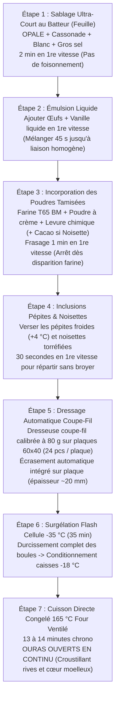

# Fiche Technique d'Atelier : Cookies Classiques & Noisette (Calibre 80 g)

* **Code Produit** : `B-CKI-01` (Classique Chunks Noir) / `B-CKI-02` (Noisettes Torréfiées & Chocolat)
* **Famille** : Biscuiterie, Gâteaux de Voyage & Pâtisserie Nomade (Dressage 80 g)
* **Procédé** : Sablage Court sans Foisonnement $\rightarrow$ Dressage Dresseuse/Portionneur 80 g $\rightarrow$ Surgélation Flash -35 °C $\rightarrow$ Cuisson Directe Congelé 165 °C (Ouras ouverts)
* **Équipements Clés** : Batteur mélangeur 80 L ou 160 L à feuille, Dresseuse à pâte ferme ou portionneur à glace mécanique, Plaques Silpat 60x40, Cellule flash -35 °C
* **Format d'Atelier** : Double Page Vis-à-Vis (Page Gauche : Poste Pesée Cuves 80 & 160 kg | Page Droite : Conduite Machine, Dressage & Cuisson Directe)
* **Version** : `v2.0-STANDARD-USINE` | **Statut** : 🟢 Validé Production & Standard Atelier

---

## PAGE GAUCHE (1/2) • POSTE DE PESÉE

### Repères Flash Poste de Pesée
| Repère | Paramètre Clé | Spécification Atelier | Justification Scientifique & Rhéologique |
| :--- | :--- | :--- | :--- |
| ⚖️ **Ratio des Sucres** | **68 % Cassonade / 32 % Sucre blanc** | Poids total sucres : 67,3 % / farine | Cassonade = cœur moelleux (*chewy*) / Blanc = croustillant des rives |
| 🧂 **Gros Sel de Guérande** | **2,7 % rapport farine (Gros grains)** | Incorporé au crémage avec les sucres | Explosion salée croquante en bouche contrastant le chocolat |
| 🌽 **Poudre à Crème** | **8,6 % rapport farine** | Amidon modifié de maïs vanillé | Bloque le durcissement de l'amidon de blé : cœur souple persistant |
| 🍫 **Taux d'Inclusions** | **86,8 % rapport farine** | Chunks noir 50 % ou mix Noisettes | Richesse gourmande généreuse à chaque bouchée |
| 🔴 **Règle Anti-Foisonnement** | **Sablage 2 min V1 strict** | Ne jamais faire monter la masse en crème | Évite le gonflement en génoise : garantit l'étalement régulier (*spread*) |

---

### Tableau Chronologique des Pesées en 4 Phases
*Base meunière : Farine T65 conventionnelle BM (Moulin de Cadillac — F. T.65 BM) = 100,0 % | Tolérance balance : ± 1 g ingrédients critiques / ± 10 g poudres et farines.*

| Phase & Ordre | Ingrédient d'Atelier | % Meunier | Base 1 kg Farine | Cuve 80 kg (1 000 p.) | Cuve 160 kg (2 000 p.) | Rôle & Spécification Biochimique |
| :---: | :--- | :---: | :---: | :---: | :---: | :--- |
| **`[1]` Sablage**| **Matière Grasse OPALE (ou Beurre)**| **65,9 %** | **659 g** | **14 500 g** | **29 000 g** | Sabler 2 min sans foisonner, plasticité |
| **`[1]` Sablage**| **Sucre roux Cassonade (68% sucres)**| **45,5 %** | **455 g** | **10 000 g** | **20 000 g** | Sucre humide brun : rétention d'eau et moelleux |
| **`[1]` Sablage**| **Sucre blanc semoule (32% sucres)**| **21,8 %** | **218 g** | **4 800 g** | **9 600 g** | Dissolution rapide : croustillant périphérique |
| **`[1]` Sablage**| **Gros sel de Guérande** | **2,7 %** | **27 g** | **600 g** | **1 200 g** | Contraste salin pur sans fondre dans la pâte |
| **`[2]` Émulsion**| **Œufs entiers liquides** | **29,1 %** | **291 g** | **6 400 g** | **12 800 g** | Liaison liquide, lécithine émulsifiante |
| **`[2]` Émulsion**| **Extrait naturel de vanille liquide**| **1,1 %** | **11 g** | **250 g** | **500 g** | Signature aromatique pâtissière |
| **`[3]` Poudres**| **Farine T65 conventionnelle BM (Moulin de Cadillac)** | **100,0 %** | **1 000 g** | **22 000 g** | **44 000 g** | Frasage court strict (évite le corse du gluten T65) |
| **`[3]` Poudres**| **Poudre à crème vanillée** | **8,6 %** | **86 g** | **1 900 g** | **3 800 g** | Amidon de maïs : texturant cœur tendre |
| **`[3]` Poudres**| **Levure chimique (Baking powder)**| **3,2 %** | **32 g** | **700 g** | **1 400 g** | Soulèvement initial à la cuisson |
| **`[4]` Déclinaison A**| **Pépites chocolat noir 50 %** | **86,8 %** | **868 g** | **19 100 g** | **38 200 g** | **Inclusions Version Classique Chunks** |
| **TOTAL A** | **TOTAL MASSE CUVE CLASSIQUE** | **364,7 %** | **3 647 g** | **80 250 g (1 000 p.)**| **160 500 g (2 000 p.)**| **Poids brut unitaire calibré à 80 g pile** |
| **`[4]` Déclinaison B**| **Pépites chocolat + Noisettes** | **86,8 %** | **641g + 227g** | **14 100g + 5 000g**| **28 200g + 10 000g**| **Inclusions Version Noisette (14,1kg Choc + 5kg Noisettes)** |
| **`[3]` Repère B**| **Poudre de cacao pur 100 %** | **1,4 %** | **14 g** | **300 g** | **600 g** | Ajouté aux poudres `[3]` pour teinte ambrée repère |
| **TOTAL B** | **TOTAL MASSE CUVE NOISETTE** | **366,1 %** | **3 661 g** | **80 550 g (1 000 p.)**| **161 100 g (2 000 p.)**| **Poids brut unitaire calibré à 80 g pile** |

---

### Cadences & Rendements Gamme Cookies (Portions 80 g)
* **Cuve 80 kg (pétrin 80 L)** : **1 000 cookies calibrés de 80 g** (soit ~42 plaques de 24 pièces).
* **Cuve 160 kg (pétrin 160 L)** : **2 000 cookies calibrés de 80 g** (soit ~84 plaques de 24 pièces).
* **Poids cuit final visé** : **~72 à 74 g** (perte d'eau à la cuisson : 7 à 9 %).

---

## PAGE DROITE (2/2) • CONDUITE MACHINE, DRESSAGE, PAC & CUISSON

---

### Étape 1 : Protocole de Mélange au Batteur Industriel (Feuille)
1. **Sablage Court des Corps Gras et des Sucres** :
   * Déposer la matière grasse Opale (ou beurre doux assoupli à 16 °C), le sucre cassonade brune, le sucre semoule blanc et le gros sel de Guérande `[1]` dans la cuve du batteur muni de la feuille.
   * Lancer en **1ʳᵉ vitesse pendant 2 minutes maximum**.
   * **Règle absolue d'atelier** : Ne jamais passer en 2ᵉ vitesse et ne jamais faire mousser. L'objectif est uniquement d'enrober les cristaux de sucre de matière grasse. L'incorporation d'air est le facteur n°1 d'échec du cookie (il ferait lever la pâte verticalement au lieu de provoquer l'étalement régulier en galette plate croustillante).
2. **Liaison des Liquides** :
   * Verser les œufs entiers froids et l'extrait de vanille `[2]` en filet régulier.
   * Faire tourner **45 secondes à 1 minute en 1ʳᵉ vitesse** pour émulsionner les liquides.
3. **Frasage des Poudres Tamisées** :
   * Tamiser ensemble la farine T65 conventionnelle BM, la poudre à crème et la levure chimique `[3]` (ajouter les 300 g de cacao pur pour la version Noisette).
   * Verser l'ensemble des poudres dans la cuve.
   * Mélanger en 1ʳᵉ vitesse pendant **1 minute seulement**, jusqu'à ce que la farine soit absorbée. Stopper immédiatement pour ne pas corser la pâte ni développer le gluten.
4. **Distribution des Inclusions** :
   * Verser les pépites de chocolat noir `[4]` (et les noisettes concassées torréfiées pour la version Noisette) bien froides.
   * Tourner **30 secondes en 1ʳᵉ vitesse** pour répartir les inclusions dans la masse sans les frictionner.

---

### Étape 2 : Dressage Automatique (Coupe-Fil), Calibrage 80 g & Surgélation Flash
1. **Dressage & Écrasement Automatique à la Dresseuse Coupe-Fil** :
   * Charger la pâte dans la trémie de la **dresseuse automatique équipée du module coupe-fil**.
   * Régler la machine pour façonner, trancher au fil et déposer des palets calibrés à **80 g brut** avec **écrasement automatique intégré sur la plaque** (épaisseur régulière visée **~20 mm**).
   * **Plaquage 60×40** : Disposer **24 pièces par plaque** (4 rangées de 6 pièces) sur toiles Silpat ou papier siliconé.
   * *Objectif physique* : L'écrasement automatique assure une surface supérieure plane et garantit une cuisson homogène entre le centre et la périphérie.
3. **Surgélation Flash Cellule -35 °C** :
   * Enfourner directement les chariots de plaques en cellule flash à **-35 °C pendant 35 minutes**.
   * Les palets durcissent comme de la pierre.
   * Décoller et emballer en caisses plastiques ou cartons doublés d'une housse hermétique étanche. Stocker à **-18 °C**.

---

### Étape 3 : Barème de Cuisson Directe Congelé (Zéro Décongélation)
* **Départ four** : Directement du congélateur (-18 °C) sur plaques de cuisson nues garnies de Silpat.
* **Préchauffage four ventilé** : Préchauffer à **180 °C**.
* **Consigne de cuisson** : **165 °C régulé**.
* **Durée de cuisson** : **13 à 14 minutes chrono**.
* **Gestion des Ouras** :
  * **Ouras rigoureusement OUVERTS EN CONTINU tout au long de la cuisson**.
  * *Justification scientifique (Cauvain & Young)* : L'évacuation immédiate de la vapeur d'eau permet aux sucres périphériques de caraméliser et croustiller instantanément, tandis que l'amidon de maïs et la cassonade centrale conservent une humidité résiduelle ($a_w \approx 0,72$), créant le contraste textural parfait (*crispy outside, chewy inside*).
* **Sortie de Four & Ressuage** :
  * Sortir les plaques dès que le pourtour est d'un blond ambré doré et que le cœur reste souple sous une légère pression.
  * **Ne jamais toucher les cookies chauds** : les laisser figer **15 minutes sur plaque** avant tout transfert sur grille ou mise en barquette.
