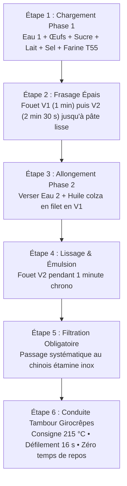

# CRÊPES DE FROMENT SUR CARROUSEL GIROCRÊPES — FORMAT DOUBLE-PAGE

**Code Produit :** `C-CRP-01` (Crêpes Sucrées Traditionnelles de Bretagne)  
**Destination :** Conditionnement en Paquets Frais Sous Atmosphère Protectrice, Rayon Traiteur & Restauration Collective  
**Ligne Mécanisée :** Machine Continue à Tambour Rotatif Chauffant GIROCRÊPES (Pesée biphasique : Frasage $\rightarrow$ Allongement)  
**Standardisation :** Formulation au Standard Meunier (Base 1 000 g Farine T55 / 100,0 %) & Paliers (12 à 100 paquets)  
**Statut de Validation :** 🟢 Validé Production — Conforme R&D & Régulation Tambour 215 °C  

---

<!-- ===================================================================== -->
<!-- PAGE GAUCHE (1/2) : POSTE DE PESÉE & TABLEAUX HAUTE LISIBILITÉ        -->
<!-- ===================================================================== -->

# PAGE GAUCHE — POSTE DE PESÉE (LECTURE À 1,5 MÈTRE)

## 1. INDICATEURS FLASH DE CONDUITE

| PARAMÈTRE CLÉ | VALEUR DE CONSIGNE | TOLÉRANCE ATELIER | OBJECTIF TECHNIQUE |
| :--- | :--- | :--- | :--- |
| **Température Tambour** | **215 °C régulée** | $\pm 3\text{ }^\circ\text{C}$ | Saisie instantanée sans cloquage ni brûlure |
| **Temps de Passage** | **16 secondes** | 16 à 18 s | Coloration blonde dorée et souplesse de pliage |
| **Outil de Cuve** | **Fouet Batteur 40L-80L** | Strict | Frasage pâte épaisse puis détente fluide |
| **Filtration Pâte** | **Chinois étamine inox** | Strict | Zéro grumeau ; protection de la raclette tambour |
| **Temps de Repos** | **0 minute (Usage direct)** | Immédiat | Le procédé biphasique évite le cordage du gluten |

---

## 2. FORMULATION MAÎTRESSE & ÉCHELLES DE PESÉE (CHEF D'ATELIER)

### TABLEAU A : APPAREIL CRÊPES FROMENT GIROCRÊPES (RÉF. `C-CRP-01`)
*Pesée en 2 temps : Phase 1 Frasage serré anti-grumeaux $\rightarrow$ Phase 2 Allongement & émulsion lipidique.*

| INGRÉDIENT | ÉTAPE | % BOULANGER | BASE 1 KG FARINE | 12 PQTS (2 KG) | 25 PQTS (4 KG) | 50 PQTS (8 KG) | 75 PQTS (12 KG) | 100 PQTS (16 KG) |
| :--- | :---: | :---: | :---: | :---: | :---: | :---: | :---: | :---: |
| **Eau purifiée (1ʳᵉ partie)** | 1 | 82,5 % | 825 g | 1 650 g | 2 900 g | 5 800 g | 8 750 g | 11 650 g |
| **Œufs entiers liquides** | 1 | 65,0 % | 650 g | 1 300 g | 2 600 g | 5 200 g | 7 800 g | 10 400 g |
| **Sucre semoule blanc** | 1 | 30,0 % | 300 g | 600 g | 1 200 g | 2 400 g | 3 600 g | 4 800 g |
| **Poudre de lait entier 26%** | 1 | 15,0 % | 150 g | 300 g | 600 g | 1 200 g | 1 800 g | 2 400 g |
| **Sel fin purifié** | 1 | 1,5 % | 15 g | 30 g | 55 g | 110 g | 165 g | 220 g |
| **Farine T55 meunière standard** | 1 | **100,0 %** | **1 000 g** | **2 000 g** | **4 000 g** | **8 000 g** | **12 000 g** | **16 000 g** |
| *-- SOUS-TOTAL PHASE 1 (PÂTE MÈRE) --* | — | — | *2 940 g* | *5 880 g* | *11 355 g* | *22 710 g* | *34 115 g* | *45 470 g* |
| **Eau purifiée (2ᵉ partie - Allongement)**| 2 | 52,5 % | 525 g | 1 050 g | 2 100 g | 4 200 g | 6 300 g | 8 400 g |
| **Huile de colza raffinée** | 2 | 10,5 % | 105 g | 210 g | 420 g | 840 g | 1 260 g | 1 680 g |
| **MASSE TOTALE APPAREIL HOMOGÈNE** | — | — | **3 570 g** | **7 140 g** | **13 875 g** | **27 750 g** | **41 675 g** | **55 550 g** |

---

## 3. PRÉCAUTIONS INGRÉDIENTS & SÉCURITÉ MATIÈRE

1. **Mécanisme du Frasage Biphasique (Anti-Grumeaux) :**
   En mélangeant d'abord la farine avec seulement 60% du liquide total (Eau 1 + Œufs), on forme une pâte dense soumise à un cisaillement mécanique maximal sous le fouet. Ce frottement intense pulvérise instantanément les agglomérats de farine et de poudre de lait en moins de 2 minutes. L'ajout ultérieur de l'Eau 2 et de l'huile détend la pâte sans créer aucun grumeau.
2. **Poudre de lait entier 26% MG :** Elle apporte les protéines laitières (caséines) et le lactose nécessaires à la caramélisation rapide sur le tambour en 16 secondes par réaction de Maillard, tout en donnant du moelleux à la mastication.
3. **Huile de colza :** Incorporée en fin de mélange, elle joue le rôle d'agent démoulant interne : le film de pâte n'adhère pas au tambour en fonte d'acier et se décolle net sous la raclette sans nécessiter de graissage extérieur polluant.

---

<!-- ===================================================================== -->
<!-- PAGE DROITE (2/2) : PROTOCOLE PAS À PAS, CONDUITE & FOUR              -->
<!-- ===================================================================== -->

# PAGE DROITE — CONDUITE MACHINE, POSTE CUISSON & HACCP

## 1. PROTOCOLE CHRONOLOGIQUE AU BATTEUR PLANÉTAIRE

### DÉTAIL DES PHASES OPÉRATOIRES :
1. **Étape 1 — Frasage de la pâte mère (Point Clé) :** Dans la cuve du batteur de 40 L ou 80 L muni du **Fouet**, introduire dans l'ordre : l'Eau Partie 1, les œufs liquides, le sucre semoule, la poudre de lait entier, le sel fin et enfin la totalité de la farine T55. Démarrer en vitesse 1 pendant 1 minute pour mouiller la farine sans projection, puis passer en vitesse 2 pendant 2 minutes 30 secondes. La pâte est épaisse, brillante et exempte de tout grumeau.
2. **Étape 2 — Allongement et émulsion :** Ramener le batteur en vitesse 1. Verser en filet l'Eau Partie 2 puis l'huile de colza. Ré-accélérer en vitesse 2 pendant 1 minute pour parfaire l'émulsion.
3. **Étape 3 — Filtration sur chinois étamine :** Verser l'appareil à travers un grand chinois étamine ou une passoire conique en maille inox fine (0,5 mm) dans le bac tampon de transfert. Cette étape élimine les micro-impuretés ou chalazes d'œufs qui risqueraient d'obstruer la rampe d'injection ou de rayer la lame de raclage du tambour.

---

## 2. CONDUITE MÉCANIQUE DU TAMBOUR ROTATIF GIROCRÊPES

### PARAMÈTRES CRITIQUES DE LA GIROCRÊPES
- **Température de Régulation :** **215 °C régulée** ($\pm 3\text{ }^\circ\text{C}$).
- **Vitesse de Rotation / Temps de Cuisson :** **16 secondes pile** (réglage potentiomètre de vitesse tambour pour une rotation complète de dépose à raclage). Plage tolérée : 16 à 18 s.
- **Épaisseur de Dépose :** Pilotée par la distance du rouleau applicateur ou la pression de pompe. Le ruban doit être continu, homogène et sans dentelle périphérique.

### RÈGLES DE CONDUITE EN CONTINU
1. **Zéro Temps de Repos :** Contrairement aux pâtes artisanales faites au fouet main qui incorporent beaucoup de bulles et cordent, la pâte Girocrêpes formulée avec sa balance d'huile et son frasage court doit être **utilisée immédiatement sans repos**. Un repos prolongé favoriserait la sédimentation de l'amidon au fond de la trémie.
2. **Homogénéisation en Trémie :** Si la machine est arrêtée plus de 10 minutes, brasser la pâte dans le bac d'alimentation à l'aide d'un fouet manuel pour remettre l'émulsion en suspension homogène.
3. **Pliage et Empilage :** À la sortie de la lame de décollement, les crêpes chaudes sont récupérées sur le tapis d'empilage automatique ou pliées en demi-lune puis en triangle.
4. **Conditionnement & Refroidissement :** Refroidir sous flux d'air filtré avant ensachage sous atmosphère modifiée ($N_2 / CO_2$) pour garantir une DLC de 21 jours à +4 °C.

---

## 3. CONTRÔLE QUALITÉ & POINTS CRITIQUES HACCP

| POINT DE CONTRÔLE | PARAMÈTRE MESURÉ | TOLÉRANCE CRITIQUE | ACTION CORRECTIVE IMMÉDIATE |
| :--- | :--- | :--- | :--- |
| **Filtration Chinois** | Présence d'impuretés | Zéro particule $> 0,5\text{ mm}$ | Filtrer systématiquement ; laver le filtre entre chaque cuve |
| **Température Tambour** | Pyromètre optique | 215 °C $\pm 3\text{ }^\circ\text{C}$ | Ajuster le thermostat de chauffe électrique/gaz |
| **Temps de Passage** | Chronomètre rotation | 16 à 18 secondes | Ajuster le variateur de vitesse du tambour |
| **Épaisseur / Poids Crêpe** | Pesée 10 crêpes empilées | Poids moyen unitaire conforme | Modifier la hauteur du rouleau trempeur |
| **Contrôle Microbiologique** | Flore aérobie & Salmonelles | Conforme critères FCD | Nettoyage & désinfection NEP de la cuve et trémie quotidien |

---
*Fiche d'atelier normalisée — Laboratoire R&D Tourage & Boulangerie — Usage exclusif opérateurs de production.*
