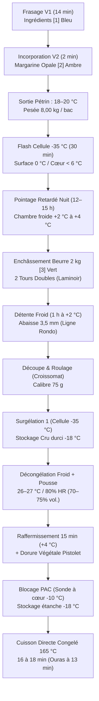

# Fiche Technique d'Atelier : Croissant d'Excellence PAC (Double Congélation)

* **Code Produit** : `V-PLF-01`
* **Famille** : Viennoiserie Feuilletée & Pâtes Tourées (PLF)
* **Procédé** : Poussé Surgelé PAC (Double surgélation / Blocage à la sonde à -10 °C à cœur)
* **Équipements Clés** : Pétrin spirale 20 bacs (160 kg), Laminoir automatique, Ligne Rondo Polyline, Cellule rapide -35 °C, Four ventilé
* **Format d'Atelier** : Double Page Vis-à-Vis (Page Gauche : Poste Pesée | Page Droite : Poste Tourage, Façonnage & Cuisson)
* **Version** : `v1.1-PROD` | **Statut** : 🔵 En cours d'audit & normalisation

---

## PAGE GAUCHE (1/2) • POSTE DE PESÉE

### Repères Flash Poste de Pesée
| Repère | Paramètre Clé | Spécification Atelier |
| :--- | :--- | :--- |
| 🟢 **Détrempe / Bac** | **8,00 kg pile / bac** | Format standard bac Paneo (8 kg détrempe + 2 kg plaque beurre = 10 kg pâton) |
| 🟠 **Programme Pétrin** | **Programme [PLF]** | 14 min V1 (frasage) + 2 min V2 (incorporation Opale) — Sortie : **18 °C à 20 °C** |
| 🔵 **Dorure Recommandée** | **Dorure Végétale (1 L)** | Pulvérisation pistolet sur pièces raffermies à froid (+4 °C) |
| 🔴 **Barème Cuisson PAC** | **160 °C – 165 °C direct** | 16 à 18 min sans décongélation préalable (Ouras ouverts à 13 min) |

### Tableau Chronologique des Pesées en 4 Phases
*Base meunière : Farine de Gruau T45 = 100,0 % | Tolérance balance : ± 1 g ingrédients critiques / ± 5 g farine.*

| Phase & Ordre | Ingrédient d'Atelier | % Meunier | 1 Bac (8,0 kg) | 10 Bacs (80 kg) | 20 Bacs (160 kg) | Rôle Technique & Spécification |
| :---: | :--- | :---: | :---: | :---: | :---: | :--- |
| **`[1]` Bleu** | **Farine de Gruau T45** | **100,0 %** | **4 400 g** | **44,00 kg** | **88,00 kg** | $W \ge 330$, protéines 13,5–14,5 %, armature cryogénique du réseau |
| **`[1]` Bleu** | **Eau froide (+1 °C)** | **44,32 %** | **1 950 g** | **19,50 kg** | **39,00 kg** | Hydratation serrée pour tenue au laminage ; glace selon TB |
| **`[1]` Bleu** | **Sucre semoule** | **9,09 %** | **400 g** | **4,00 kg** | **8,00 kg** | Substrat fermentaire et coloration Réactions de Maillard |
| **`[1]` Bleu** | **Poudre de lait entier 26 %** | **4,09 %** | **180 g** | **1,80 kg** | **3,60 kg** | Fixation de l'eau par les caséines, moelleux et couleur |
| **`[1]` Bleu** | **Trimoline (Sucre inverti)** | **3,64 %** | **160 g** | **1,60 kg** | **3,20 kg** | Abaissement cryoscopique (antigel) et rétention d'humidité |
| **`[1]` Bleu** | **Améliorant Kimo Short (Puratos)** | **2,95 %** | **130 g** | **1,30 kg** | **2,60 kg** | Émulsifiant & plastifiant cryo (maintien des ponts disulfures) |
| **`[1]` Bleu** | **Sel fin d'atelier** | **2,05 %** | **90 g** | **0,90 kg** | **1,80 kg** | Rigoureusement isolé sur sa balance dédiée ; ténacité du gluten |
| **`[1]` Bleu** | **Vinaigre d'alcool blanc (8°)** | **0,91 %** | **40 g** | **0,40 kg** | **0,80 kg** | Acidification tampon (pH 5,0–5,2), inhibe le brunissement PPO |
| **`[1]` Bleu** | **Levure fraîche Or (L'Hirondelle)** | **5,68 %** | **250 g** | **2,50 kg** | **5,00 kg** | Souche osmotolérante pour pâtes sucrées et pousse contrôlée |
| **`[2]` Ambre** | **Margarine OPALE (Cuve V2)** | **9,09 %** | **400 g** | **4,00 kg** | **8,00 kg** | Incorporation en début de 2ᵉ vitesse ; extensibilité et fondant |
| **TOTAL** | **SOUS-TOTAL DÉTREMPE CUVE** | **181,82 %** | **8 000 g** | **80,00 kg** | **160,00 kg** | **Poids net calibré à 8,00 kg pile par bac Paneo** |
| **`[3]` Vert** | **Beurre de tourage sec 84 % (Plaques 2 kg)** | **25,0 % dét.** | **2 000 g** | **20,00 kg** | **40,00 kg** | 1 plaque de 2 kg / bac (point de fusion 34–36 °C) |
| **TOTAL** | **POIDS TOTAL PÂTON TOURÉ** | **227,27 %** | **10 000 g** | **100,00 kg** | **200,00 kg** | **10,00 kg net de pâte prête au façonnage / bac** |
| **`[4]` Finition** | **Dorure Végétale au pistolet** | PM | 50 g / plaque | 500 g | 1 000 g | Pulvérisation fine uniforme à froid (+4 °C) |

### Rendement & Calibrage d'Atelier
* **Calibre cru découpé** : **75 g** (ou 70 g selon cahier des charges client).
* **Rendement brut par bac (pâton 10 kg)** : **130 à 133 croissants** (après parage des pointes et rives).
* **Rendement pour 10 bacs (100 kg)** : **~1 320 croissants**.
* **Rendement plein pétrin 20 bacs (200 kg)** : **~2 640 croissants**.

---

## PAGE DROITE (2/2) • CONDUITE MACHINE, TOURAGE & CUISSON

---

### Étape 1 : Pétrissage & Conduite Thermique J-1
1. **Règle de Température de Base ($TB = 50\text{ à }52$)** :
   $$T_{\text{eau}} = TB - (T_{\text{ambiant}} + T_{\text{farine}} + \Delta T_{\text{pétrin}})$$
   *Avec $\Delta T_{\text{pétrin}} \approx 12\text{ }^\circ\text{C}$ sur pétrin spirale plein volume.* Remplacer une fraction d'eau par de la glace paillette dès que $T_{\text{eau}} < 3\text{ }^\circ\text{C}$.
2. **Frasage (14 min en 1ʳᵉ vitesse)** : Verser tous les ingrédients `[1]` Bleu dans la cuve. Pétrir en 1ʳᵉ vitesse lente pour amalgamer sans cisailler.
3. **Incorporation Matière Grasse (2 min en 2ᵉ vitesse)** : Ajouter la Margarine Opale `[2]` Ambre dès le passage en 2ᵉ vitesse. Stopper dès que la margarine est parfaitement fondue dans la masse et que le bassin est net.
4. **Température cible sortie pétrin** : **18 °C à 20 °C impératif** (ne jamais dépasser 21 °C pour éviter tout démarrage fermentaire).
5. **Conditionnement & Flash Froid** :
   - Peser des pâtons de **8,00 kg net** par bac Paneo.
   - Étaler la pâte de niveau à la main sur toute la surface du bac.
   - Passer **30 à 35 minutes en cellule à -35 °C** pour bloquer immédiatement la fermentation et descendre le cœur sous 6 °C.
6. **Pointage retardé de nuit** : Stocker 12 h à 15 h en chambre froide régulée à **+2 °C / +4 °C**.

---

### Étape 2 : Tourage & Façonnage sur Ligne Rondo J
1. **Équilibre Thermique Pâte / Beurre** :
   - Détrempe sortie chambre froide : **+2 °C à +4 °C**.
   - Plaque de beurre de tourage (2 kg) assouplie au laminoir : **+12 °C à +14 °C**.
   - L'élasticité de la pâte et la plasticité du beurre doivent être rigoureusement identiques sous la pression du pouce.
2. **Architecture du Feuilletage (2 Tours Doubles = 16 films de beurre)** :
   - **Enchâssement** : Déposer la plaque de beurre de 2 kg au centre de la détrempe allongée, refermer les deux rabats bord à bord sans chevauchement.
   - **1ᵉʳ Tour Double** : Allonger progressivement au laminoir jusqu'à 8–9 mm. Plier en portefeuille (4 plis).
   - **2ᵉ Tour Double** : Tourner le pâton d'un quart de tour, allonger à nouveau à 8–9 mm et donner le second pliage double.
   - **Détente obligatoire** : Filmer hermétiquement et laisser reposer **1 heure au froid (+2 °C à +4 °C)** pour relâcher toute tension élastique.
3. **Façonnage Ligne Automatique Rondo Polyline** :
   - Descendre l'abaisse finale à **3,5 mm** (± 0,1 mm).
   - **Décompression libre** : Laisser flotter la bande sur le tapis pendant au moins 60 secondes avant les rouleaux découpeurs (évite la rétractation dimensionnelle).
   - Passage au Croissomat : Réglage tablier souple pour rouler 3 à 4 spires régulières sans écraser le feuilletage. Poids cible cru : **75 g**.

---

### Étape 3 : Protocole Double Congélation & Pousse PAC
1. **1ʳᵉ Surgélation (Cru durci)** : Sortie immédiate du Croissomat sur grilles 60×40 $\rightarrow$ cellule rapide à **-35 °C** pendant 40 min. Ensachage étanche à -18 °C (stock tampon).
2. **Pousse Contrôlée** :
   - Décongélation lente sous bâche étanche à +2 °C / +4 °C pendant 10 h à 12 h.
   - Enfournement en chambre de pousse à **26 °C – 27 °C et 80–85 % HR** pendant 2 h 15 à 2 h 35.
   - **Point d'arrêt critique du PAC** : **Stopper impérativement à 70–75 % du volume final** (le pâton doit garder une fermeté élastique pour résister à la seconde surgélation).
3. **Raffermissement & Dorure** :
   - Passer les chariots **15 minutes en froid positif (+4 °C)** pour figer la surface.
   - Pulvériser la **Dorure Végétale** en couche ultra-fine et uniforme au pistolet.
4. **2ᵉ Blocage PAC (Contrôle Sonde à Cœur)** :
   - Placer une sonde thermique piquée au cœur géométrique d'un pâton témoin.
   - Lancer la cellule à -35 °C.
   - **Arrêt strict du cycle dès que la sonde atteint -10 °C à cœur**.
   - Houssage hermétique immédiat et transfert en chambre de stockage à **-18 °C**.

---

### Étape 4 : Barème de Cuisson Direct Congelé (Zéro Décongélation)
* **Principe d'exploitation** : Les pièces partent directement du carton congélateur (-18 °C) sur les plaques de cuisson sans aucun tempérage.
* **Préchauffage du Four (Four ventilé rotatif ou à sole)** : Préchauffer à **185 °C – 190 °C**.
* **Enfournement & Buée** : Enfourner immédiatement la plaque congelée et injecter **3 secondes de buée** (ou léger coup de buée d'accueil pour glacer la croûte et éviter le cloquage).
* **Conduite de Cuisson** :
  - Température de consigne : **160 °C à 165 °C**.
  - Durée totale : **16 à 18 minutes**.
  - **Ouverture des ouras à 13 minutes** de cuisson pour sécher le feuilletage et garantir le croustillant des ailettes.
* **Fin de Cuisson & Ressuage** : Débarrasser immédiatement les plaques sur échelles à température ambiante pour ressuage sur grille (évite le ramollissement de la sole par condensation).
