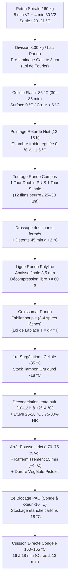

# Fiche Technique d'Atelier : Croissant d'Excellence PAC (Double Congélation)

* **Code Produit** : `V-PLF-01`
* **Famille** : Viennoiserie Feuilletée & Pâtes Tourées (PLF Semi-Industrielle)
* **Procédé** : Double Congélation (Cru Surgelé -35 °C $\rightarrow$ Pousse Étuvée $\rightarrow$ Blocage PAC Sonde -10 °C à cœur)
* **Équipements Clés** : Pétrin spirale 160 kg (20 bacs), Laminoir Rondo Compas, Ligne Rondo Polyline, Enrouleur Croissomat, Cellules flash -35 °C, Bacs Paneo
* **Format d'Atelier** : Double Page Vis-à-Vis (Page Gauche : Poste Pesée | Page Droite : Conduite Laminoir, Croissomat & Cuisson)
* **Version** : `v2.0-STANDARD-USINE` | **Statut** : 🟢 Validé Production & Standard Atelier

---

## PAGE GAUCHE (1/2) • POSTE DE PESÉE

### Repères Flash Poste de Pesée
| Repère | Paramètre Clé | Spécification Atelier | Justification Scientifique & Rhéologique |
| :--- | :--- | :--- | :--- |
| 🟢 **Détrempe / Bac** | **8,00 kg pile / bac** | Format Paneo pré-laminé sur **3 cm d'épaisseur** | Loi de Fourier ($t \propto e^2/\alpha$) : division par 9 du temps de refroidissement à cœur |
| 🟠 **Pétrissage & Sortie** | **5 min V1 + 4 min 30 V2** | Température sortie pétrin : **20 °C à 21 °C** | Pas de voile étiré ; premier décollement net pour préserver l'élasticité ($L$) |
| 🔵 **Coupage Meunier** | **70 % Gruau / 30 % T65 Trad** | T65 Tradition pure (zéro E300 au moulin) | Ratio $P/L \approx 0,58\text{--}0,62$ ; neutralise le déchirement des croissants au roulage |
| 🔴 **Cryoprotection & Sel** | **4,2 % Levure Or / 2,0 % Sel** | Trimoline 3,5 % + S500 Kimo Short **2,0 % strict** | Latence de 40 min à 21 °C sans fermentation nocturne précoce (anti-GSH) |

### Tableau Chronologique des Pesées en 4 Phases
*Base meunière : Farine Totale = 100,0 % (70 % Gruau T45 + 30 % T65 Tradition) | Balance tolérance : ± 1 g ingrédients critiques / ± 5 g farines.*

| Phase & Ordre | Ingrédient d'Atelier | % Meunier | 1 Bac (8,0 kg) | 10 Bacs (80 kg) | 20 Bacs (160 kg) | Spécification & Rôle Biochimique |
| :---: | :--- | :---: | :---: | :---: | :---: | :--- |
| **`[1]` Bleu** | **Farine de Gruau T45** | **70,0 %** | **3 133 g** | **31,33 kg** | **62,65 kg** | $W > 330$, protéines ~14 %, armature cryorésistante |
| **`[1]` Bleu** | **Farine T65 Tradition (Décret 93)** | **30,0 %** | **1 342 g** | **13,42 kg** | **26,85 kg** | Sans E300 ajouté ; apporte souplesse et goût |
| **`[1]` Bleu** | **Eau glacée (+1 °C) / Glace** | **45,0 %** | **2 014 g** | **20,14 kg** | **40,28 kg** | $a_w$ maîtrisée, fraction congelable minimisée |
| **`[1]` Bleu** | **Sucre cristal** | **8,8 %** | **394 g** | **3,94 kg** | **7,88 kg** | Osmotolérance et réactions de Maillard |
| **`[1]` Bleu** | **Trimoline (Sucre inverti)** | **3,5 %** | **157 g** | **1,57 kg** | **3,13 kg** | $180\text{ g/mol}$ : abaisse $\Delta T_f$, anti-rétrogradation |
| **`[1]` Bleu** | **Levure fraîche L'Hirondelle Or** | **4,2 %** | **188 g** | **1,88 kg** | **3,76 kg** | Osmotolérante, latence prolongée, anti-lyse |
| **`[1]` Bleu** | **Poudre de lait entier 26 %** | **4,0 %** | **179 g** | **1,79 kg** | **3,58 kg** | Fixation d'eau libre par les caséines, coloration |
| **`[1]` Bleu** | **Améliorant S500 Kimo Short** | **2,0 %** | **90 g** | **0,90 kg** | **1,79 kg** | **Plafonné à 2,0 %** : compense le GSH sans sur-oxyder |
| **`[1]` Bleu** | **Sel fin d'atelier** | **2,0 %** | **90 g** | **0,90 kg** | **1,79 kg** | Ligne isolée : resserrement ionique du gluten |
| **`[1]` Bleu** | **Vinaigre blanc d'alcool (8°)** | **0,8 %** | **36 g** | **0,36 kg** | **0,72 kg** | Tampon pH 5,1–5,3 : inhibe polyphénol oxydase (anti-grisement) |
| **`[2]` Ambre** | **Matière grasse cuve (Opale/Beurre)** | **8,5 %** | **380 g** | **3,80 kg** | **7,60 kg** | Incorporé en V2 : plastifiant et fondant de mie |
| **TOTAL** | **SOUS-TOTAL DÉTREMPE NET** | **178,8 %** | **8 003 g** | **80,03 kg** | **160,06 kg** | **Poids net calibré à 8,00 kg pile / bac Paneo** |
| **`[3]` Vert** | **Beurre sec tourage 84 % (Plaques 2 kg)** | **25,0 % dét.** | **2 000 g** | **20,00 kg** | **40,00 kg** | 1 plaque de 2,00 kg / bac (PF 34–36 °C, SFC optimal) |
| **TOTAL** | **POIDS TOTAL PÂTON TOURÉ** | **223,8 %** | **10 000 g** | **100,00 kg** | **200,00 kg** | **10,00 kg net de pâte prête au façonnage / bac** |
| **`[4]` Finition** | **Dorure Végétale au pistolet** | PM | 50 g / plaque | 500 g | 1 000 g | Pulvérisation fine uniforme à froid (+4 °C) |

### Cadence & Rendements d'Atelier (Journée 40 Bacs / 400 kg)
* **Calibre cru unitaire découpé** : **75 g** (Croissant) / **85 g** (Pain au chocolat 2 barres).
* **Rendement brut par bac (pâton 10 kg)** : **130 à 133 croissants** ou **115 pains au chocolat** (après parage des pointes).
* **Rendement fournée 20 bacs (200 kg touré)** : **~2 600 croissants 75 g**.
* **Volume quotidien global (40 bacs / 3 opérateurs)** : **~5 000 à 5 200 pièces façonnées et stockées**.

---

## PAGE DROITE (2/2) • CONDUITE MACHINE, CROISSOMAT & CUISSON

---

### Étape 1 : Pétrissage & Conduite Thermique J-1 (10h55 – 12h30)
1. **Frasage & Pétrissage Maîtrisé** :
   - Verser les ingrédients `[1]` Bleu. 5 minutes en 1ʳᵉ vitesse pour amalgamer sans échauffer.
   - Passer en 2ᵉ vitesse, incorporer la matière grasse cuve `[2]` Ambre. Pétrir pendant **4 min 30 à 5 minutes maximum**.
   - **Arrêt impératif au premier décollement de cuve** : Ne jamais chercher le voile tendu. La pâte doit conserver sa réserve d'extensibilité ($L$) pour le laminage.
   - **Température réelle de sortie** : **20 °C à 21 °C**.
2. **Pré-laminage en Galette de 3 cm (Application de la Loi de Fourier)** :
   - Diviser immédiatement la pâte en pâtons de **8,00 kg net** par bac Paneo (délai pétrin $\rightarrow$ cellule $< 15\text{ min}$).
   - Abaisser au rouleau ou laminoir en une galette rectangulaire uniforme de **3 cm d'épaisseur**.
   - *Règle physique ($t \propto e^2/\alpha$)* : Diviser l'épaisseur par 3 divise par ~9 le temps requis pour atteindre la zone de sécurité thermique sous 6 °C.
3. **Descente Flash & Pointage Retardé de Nuit** :
   - Passer **30 à 35 minutes en cellule à -35 °C** : la surface atteint 0 °C, le cœur passe sous 6 °C, bloquant toute cinétique fermentaire.
   - Stocker 12 h à 15 h en chambre froide positive régulée strictement entre **0 °C et +1,5 °C** (proscrire le +4 °C qui relance la fermentation et libère du glutathion GSH).

---

### Étape 2 : Tourage au Rondo Compas J (05h00 – 07h30)
1. **Équilibre Thermique Pâte / Beurre ($\Delta T \le 3\text{ }^\circ\text{C}$)** :
   - Pâte sortie chambre froide : **+2 °C à +4 °C**.
   - Plaque de beurre de tourage 84 % (2,00 kg) assouplie au laminoir : **+12 °C à +14 °C** (fenêtre de plasticité SFC optimale).
2. **Plan de Tourage : 1 Tour Double PUIS 1 Tour Simple (12 films de beurre / 25 couches totales)** :
   - *Justification physique (Lucas & Deligny 2015, Mutchadej 2025)* : À 3,5 mm d'abaisse, 12 films produisent une épaisseur lipidique de **25 à 30 µm**. Ce calibre offre une étanchéité cryogénique maximale face aux micro-cristaux de glace et un ovenspring supérieur (+1,52 %) sans fuite de beurre.
   - **1ᵉʳ Tour Double (Grand Allongement)** : Allonger à 85–90 cm sur un gluten détendu, plier en portefeuille (4 plis). Ce pliage structure l'équerrage initial à 90°. Détente 15 min à +2 °C.
   - **2ᵉ Tour Simple (Allongement Court)** : Tourner d'un quart de tour, allonger à 60–65 cm, plier en 3.
   - **Drossage des Chants Fermés** : Couper impérativement au couteau les 4 bordures fermées pour libérer les tensions internes avant laminage final.
   - **Détente Finale** : **45 minutes à +2 °C** sous film étanche.

---

### Étape 3 : Façonnage Ligne Rondo Polyline & Croissomat J (07h30 – 10h30)
1. **Laminage Progressif & Anti-Snapback** :
   - Pas de réduction Rondo $\le 20\text{--}25\text{ }\%$ par passe. Abaisse finale calibrée à **3,5 mm** (± 0,1 mm). Température de bande : **10 °C à 12 °C**.
   - **Zone de décompression libre ($\ge 60\text{ secondes}$)** : Laisser flotter la bande sur le tapis convoyeur avant les couteaux rotatifs pour dissiper la mémoire élastique résiduelle.
2. **Découpe & Enroulement Croissomat (Loi de Laplace $T = \Delta P \cdot r$)** :
   - Réglage des couteaux rotatifs : Nettoyage et humidification nulle des lames pour éviter tout cisaillement ou micro-amorce de déchirure.
   - **Réglage tablier Croissomat : Souple (3 à 4 spires lâches)**. Un serrage excessif augmente le rayon et la tension circonférentielle ($T$), provoquant l'éclatement de la spire externe en étuve de pousse.
   - Poids cru cible : **75 g**. Pains au chocolat sur Polyline : **85 g**.

---

### Étape 4 : Double Congélation PAC, Pousse & Cuisson Directe
1. **1ʳᵉ Surgélation (Cru)** : Sortie immédiate de machine $\rightarrow$ cellule rapide à **-35 °C** pendant 40 min. Ensachage hermétique à -18 °C.
2. **Pousse Contrôlée** :
   - Décongélation lente nocturne 10 h à 12 h à +2 °C / +4 °C.
   - Étuve à **25 °C – 26 °C et 75–80 % HR** pendant 2 h 15 à 2 h 35.
   - **Arrêt de pousse strict à 70–75 % du volume** : Ne jamais pousser à 100 %. Le pâton doit garder sa fermeté élastique pour encaisser le second cycle négatif.
3. **Raffermissement & Dorure** : 15 min en froid positif (+4 °C) pour figer la surface, puis pulvérisation fine de la **Dorure Végétale** au pistolet.
4. **2ᵉ Blocage PAC (Contrôle Sonde à Cœur)** :
   - Sonde thermique témoin piquée au cœur géométrique d'un pâton.
   - Lancement cellule à -35 °C $\rightarrow$ **arrêt strict dès que la sonde affiche -10 °C à cœur**.
   - Cartonnage hermétique immédiat et stockage en chambre à **-18 °C**.
5. **Barème de Cuisson Direct Congelé (Zéro Décongélation)** :
   - Four ventilé préchauffé à **185 °C – 190 °C**.
   - Enfournement direct sans tempérage + injection de **3 secondes de buée**.
   - Cuisson régulée à **160 °C – 165 °C pendant 16 à 18 min**.
   - **Ouverture des ouras à 13 min** de cuisson pour sécher la croûte et fixer le croustillant.
   - Ressuage obligatoire sur grille inox à l'air libre.
