# Fiche Technique d'Atelier : Croissant d'Excellence PAC (Double Congélation)

* **Code Produit** : `V-PLF-01`
* **Famille** : Viennoiserie Feuilletée & Pâtes Tourées (PLF Semi-Industrielle d'Élite)
* **Procédé** : Double Congélation Hub & Spoke (Cru Surgelé -35 °C $\rightarrow$ Décongélation lente $\rightarrow$ Pousse Étuvée 70–75 % $\rightarrow$ Blocage PAC Sonde -10 °C à cœur $\rightarrow$ Stockage -18 °C $\rightarrow$ Cuisson Directe Congelée en Boutique)
* **Équipements Clés** : Pétrin spirale 160 kg (bacs de 8 kg), Laminoir Rondo Compas, Ligne Rondo Polyline, Enrouleur Rondo Croissomat SCM50 (rampe & matrice fixe, 3 manettes), Cellules flash -35 °C, Bacs Paneo
* **Format d'Atelier** : Double Page Vis-à-Vis (Page Gauche : Formulation & Pesées | Page Droite : Conduite Laminoir, SCM50, Cryogénie & Cuisson Directe)
* **Version** : `v3.0-BLINDAGE-SCIENTIFIQUE-DEFINITIF` | **Statut** : 🟢 Standard Maître Tourrier Validé

---

## PAGE GAUCHE (1/2) • POSTE DE PESÉE & FORMULATION MAÎTRESSE

### Repères Flash Opérateur Poste de Pesée
| Repère Flash | Paramètre Clé | Spécification Atelier | Justification Biochimique & Rhéologique |
| :---: | :--- | :--- | :--- |
| 🟢 **Détrempe / Bac** | **8,00 kg pile / bac** | Format Paneo pré-laminé sur **3 cm d'épaisseur** | Loi de Fourier ($t \propto e^2/\alpha$) : division par 11 du temps de descente à cœur sous 6 °C |
| 🟠 **Pétrissage & Sortie** | **5 min V1 + 4 min 30 V2** | Température sortie pétrin : **20 °C à 21 °C** | Arrêt strict au 1er décollement (zéro voile étiré) : réserve d'extensibilité ($L$) préservée |
| 🔵 **Coupage Meunier** | **70 % Gruau / 30 % T65 Trad** | T65 Tradition pure (zéro E300 meunier) | Équilibre $P/L \approx 0,58\text{--}0,62$, $W \approx 280\text{--}300$ : armature cryo + souplesse anti-snapback |
| 🔴 **Cryoprotection & Sel** | **4,2 % Levure Or / 2,0 % Sel** | Trimoline 3,5 % + S500 Kimo Short **2,0 % max** | Maintien phase de latence 40 min, piège à GSH oxydatif, neutralisation de la lyse cellulaire |

---

### Tableau Chronologique des Pesées en 4 Phases
*Base meunière : Farine Totale = 100,0 % (70,0 % Farine Gruau Rouge T45 + 30,0 % Farine T65 Tradition pure sans additifs).*  
*Tolérances balance : $\pm 1\text{ g}$ sur ingrédients critiques (Levure, S500, Sel, Vinaigre) / $\pm 5\text{ g}$ sur farines et eau.*

| Phase & Ordre | Ingrédient d'Atelier | % Meunier | Base 1 000 g Farine | 1 Bac (8 000 g détrempe) | 10 Bacs (80 000 g détrempe) | 20 Bacs (160 000 g cuve pleine) | Spécification & Rôle Biochimique Critique |
| :---: | :--- | :---: | :---: | :---: | :---: | :---: | :--- |
| **`[1]` Bleu** | **Farine Gruau Rouge T45 (Cadillac)** | **70 %** | **700 g** | **3 130 g** | **31 300 g** | **62 600 g** | $W \ge 330$, protéines 13,8–14,2 % : armature gluténique HMW cryorésistante |
| **`[1]` Bleu** | **Farine Tradition pure (Décret 93)** | **30 %** | **300 g** | **1 340 g** | **13 400 g** | **26 800 g** | Zéro E300, zéro fève/soja : apporte gliadines fluides ($L$), abaisse le $P/L$ |
| **`[1]` Bleu** | **Eau glacée (+1 °C) / Glace écaille** | **45 %** | **450 g** | **2 015 g** | **20 150 g** | **40 300 g** | Hydratation basse : minimise l'eau libre congelable ($a_w$), anti-Ostwald |
| **`[1]` Bleu** | **Sucre cristal blanc** | **8,8 %** | **88 g** | **394 g** | **3 940 g** | **7 880 g** | Carburant fermentaire étuve, osmolarité régulée, couleur Maillard |
| **`[1]` Bleu** | **Trimoline (Sucre inverti)** | **3,5 %** | **35 g** | **157 g** | **1 570 g** | **3 140 g** | Monosaccharides ($180\text{ g/mol}$) : abaissement cryoscopique $\Delta T_f$, anti-staling |
| **`[1]` Bleu** | **Levure fraîche L'Hirondelle Or** | **4,2 %** | **42 g** | **188 g** | **1 880 g** | **3 760 g** | Souche osmotolérante : stocke tréhalose intracellulaire cryoprotecteur |
| **`[1]` Bleu** | **Poudre de lait entier 26 % MG** | **4 %** | **40 g** | **180 g** | **1 800 g** | **3 600 g** | Caséines fixatrices d'eau libre, lactose non fermentescible (brunissement) |
| **`[1]` Bleu** | **Améliorant S500 Kimo Short** | **2 %** | **20 g** | **90 g** | **900 g** | **1 800 g** | **Plafonné à 2 %** : DHAA piège le glutathion réduit ($GSH$), DATEM renforce bulles |
| **`[1]` Bleu** | **Sel fin de panification** | **2 %** | **20 g** | **90 g** | **900 g** | **1 800 g** | Resserrement ionique des chaînes de gluten, frein enzymatique |
| **`[1]` Bleu** | **Vinaigre blanc d'alcool (8°)** | **0,8 %** | **8 g** | **36 g** | **360 g** | **720 g** | Tampon pH 5,0–5,2 : bloque polyphénol oxydase (anti-grisement) & amylases |
| **`[2]` Ambre** | **Margarine Opal cuve (Michard 3825)** | **8,5 %** | **85 g** | **380 g** | **3 800 g** | **7 600 g** | Incorporé dès le passage en V2 (pains 500 g) : plastifiant cryo et souplesse |
| **TOTAL** | **SOUS-TOTAL DÉTREMPE NETTE** | **178,8 %** | **1 788 g** | **8 000 g pile** | **80 000 g pile** | **160 000 g pile** | **Poids calibré à 8 000 g net / bac Paneo (Base farine : 4 470 g/bac)** |
| **`[3]` Vert** | **Beurre Debic Croissant 82 % (Michard 6191)**| **25 % dét.** | **447 g** | **2 000 g** | **20 000 g** | **40 000 g** | **1 plaque étalon de 2 000 g pile / bac** (PF 34–36 °C, conditionné à 12–14 °C) |
| **TOTAL** | **POIDS TOTAL PÂTON TOURÉ** | **223,5 %** | **2 235 g** | **10 000 g pile** | **100 000 g pile** | **200 000 g pile** | **Pâton touré 10 000 g net prêt au détaillage / bac** |
| **`[4]` Finition**| **Dorure Végétale au pistolet** | PM | PM | 50 g / plaque | 500 g | 1 000 g | Pulvérisation fine uniforme à froid (+4 °C) après ressuyage étuve |

---

### Cadences, Rendements & Économie d'Atelier (Journée 40 Bacs / 400 kg)
* **Calibre cru unitaire découpé** : **75 g (± 1 g)** cru sur matrice SCM50 (abaisse 3,5 mm).
* **Rendement net par bac (pâton 10,00 kg)** : **130 croissants étalons de 75 g** (après parage des rives d'ébarbage 2,5 % réintégrées ou pesées).
* **Rendement fournée 20 bacs (200 kg touré / 1 pétrin plein 160 kg détrempe)** : **2 600 croissants 75 g**.
* **Volume quotidien global (40 bacs / 2 pétrissages / 3 opérateurs)** : **5 200 croissants façonnés, bloqués et stockés**.

---

## PAGE DROITE (2/2) • CONDUITE MACHINE, CROISSOMAT SCM50 & CUISSON

```mermaid
flowchart TD
    A["Pétrin Spirale 160 kg\n5 min V1 + 4 min 30 V2\nSortie : 20–21 °C (Arrêt 1er décollement)"] --> B["Division 8,00 kg / bac Paneo\nPré-laminage Galette 3 cm\n(Loi de Fourier e² / alpha)"]
    B --> C["Cellule Flash -35 °C (30–35 min)\nSurface 0 °C / Cœur < 6 °C"]
    C --> D["Pointage Retardé Nuit (12–15 h)\nChambre froide régulée 0 °C à +1,5 °C"]
    D --> E["Tourage Rondo Compas\n1 Tour Double (90 cm) PUIS 1 Tour Simple (65 cm)\n(12 films beurre / 25–30 µm)"]
    E --> F["Drossage des 4 chants fermés au couteau\n+ Détente 45 min à +2 °C étanche"]
    F --> G["Ligne Rondo Polyline\nAbaisse finale 3,5 mm (Sweet Spot 11 °C)\nDécompression libre >= 60 s anti-snapback"]
    G --> H["Croissomat SCM50 (Sens Droite -> Gauche)\nDéroulage Farinage Inversé (Farine en bas)\nGalets bleus = Séparation pure\nTablier 3 manettes : Amorce 5-6 mm / Dégagement 28-32 mm / 3-4 spires lâches clé 6h"]
    H --> I["Stock 1 Labo : 1re Surgélation Cru -35 °C\n(Mise en caisses PE étanches 200 pcs / -18 °C)"]
    I --> J["Décongélation lente nuit (+2 °C / +4 °C, 10–12 h)\n+ Étuve 25–26 °C / 75–80 % HR (2 h 15–2 h 30)"]
    J --> K["Arrêt Pousse strict à 70–75 % volume\n+ Ressuyage 15 min (+4 °C) + Dorure Végétale Pistolet"]
    K --> L["Stock 2 Boutiques : 2e Blocage PAC Flash -35 °C\nArrêt strict Sonde à Cœur -10 °C\n(Caisses doublées 2 couches max / -18 °C)"]
    L --> M["Boutiques : Cuisson Directe Congelé (Zéro Décongélation)\nFour 160–165 °C / Buée 3 s / 16–18 min\nOURAS OUVERTS À 13 MIN (anti-affaissement ressuage)"]
```

---

### Protocole Opératoire Détaillé en 4 Étapes

#### 1. Pétrissage & Conduite Thermique J-1 (10h55 – 12h30)
1. **Frasage & Pétrissage Contrôlé** :
   - Verser les poudres et liquides `[1]` Bleu dans la cuve du pétrin spirale 160 kg.
   - Tourner **5 minutes en 1ʳᵉ vitesse** pour amalgamer les composants sans échauffer la masse.
   - Passer en 2ᵉ vitesse en incorporant immédiatement la margarine cuve `[2]` Ambre en morceaux de 500 g.
   - Pétrir pendant **4 min 30 s à 5 minutes maximum**.
   - **Arrêt impératif au premier décollement net des parois** : Ne jamais chercher le voile étiré. Le réseau de gluten doit rester "court" pour encaisser les contraintes mécaniques du laminage et du roulage sans sur-pétrissage.
   - **Température réelle de sortie** : **20 °C à 21 °C** (Sweet spot : 20,5 °C).
2. **Pré-laminage en Galette de 3 cm (Loi de Fourier)** :
   - Diviser immédiatement la pâte en pâtons de **8,00 kg pile** par bac Paneo (délai pétrin $\rightarrow$ cellule $< 15\text{ min}$).
   - Abaisser au rouleau ou laminoir en une galette rectangulaire uniforme de **3 cm d'épaisseur**.
   - *Règle physique ($t \propto e^2/\alpha$)* : Diviser l'épaisseur par 3,3 divise par 11 le temps requis pour atteindre la zone de sécurité thermique sous 6 °C.
3. **Descente Flash & Pointage Retardé de Nuit** :
   - Passer **30 à 35 minutes en cellule flash à -35 °C pulsé** : la surface atteint 0 °C, le cœur passe sous +6 °C, bloquant instantanément le réveil de la levure.
   - Stocker 12 h à 15 h en chambre froide positive régulée strictement entre **0 °C et +1,5 °C** (proscrire le +4 °C qui déclenche une micro-fermentation acide et fragilise le gluten).

---

#### 2. Tourage au Laminoir Rondo Compas J (05h00 – 07h30)
1. **Équilibre Rhéologique Pâte / Beurre ($\Delta T \le 3\text{ }^\circ\text{C}$ de plasticité)** :
   - Pâte sortie chambre froide : **+2 °C à +4 °C**.
   - Plaque de beurre Debic Croissant 82 % (2,00 kg) assouplie au laminoir : **+12 °C à +14 °C** (forme polymorphe $\beta'$ ductile, SFC 35–40 %).
2. **Schéma de Tourage : 1 Tour Double PUIS 1 Tour Simple (12 films de beurre / 25 couches totales)** :
   - *Justification physique* : À 3,5 mm d'abaisse finale, 12 films lipidiques génèrent une épaisseur de **25 à 30 µm** par film. Ce calibre garantit l'étanchéité cryogénique face aux micro-cristaux de glace sans rupture et offre un ovenspring maximal (+1,52 %) sans fuite de beurre sur plaque.
   - **1ᵉʳ Tour Double (Grand Allongement)** : Réaliser l'enveloppe simple (beurre au centre, rabattre les deux ailes). Allonger à 85–90 cm sur un gluten frais et détendu. Plier en portefeuille (4 plis). Détente 15 min à +2 °C.
   - **2ᵉ Tour Simple (Allongement Court)** : Pivoter de 90° (croisement des fibrilles), allonger à 60–65 cm sur pâte plus nerveuse. Plier en 3.
   - **Drossage obligatoire des 4 chants fermés** : Couper au couteau les 4 bordures fermées sur 5 mm pour relâcher les tensions élastiques internes et éviter le plissement au laminage final.
   - **Détente Finale** : **45 minutes à +2 °C** sous film plastique étanche.

---

#### 3. Façonnage Polyline & Croissomat SCM50 (07h30 – 10h30)
1. **Laminage Progressif & Décompression Anti-Snapback** :
   - Paliers de réduction Rondo Compas $\le 20\text{--}25\text{ }\%$ par passe. Abaisse finale calibrée à **3,5 mm (± 0,1 mm)**.
   - Température de bande : **10 °C à 12 °C (Sweet spot 11 °C)**.
   - **Zone de décompression libre ($\ge 60\text{ secondes}$)** : Laisser flotter la bande sur le tapis convoyeur avant la tête de découpe. Ce repos dissipe l'énergie élastique résiduelle et neutralise le retrait dimensionnel (*snapback*).
2. **Découpe & Géométrie Étalon SCM50 (Calibre 75 g)** :
   - Matrice triangulaire fixe : Base 120–130 mm, Hauteur brute 180–200 mm $\rightarrow$ Poids net cru : **75 g (± 1 g)** verrouillé par l'épaisseur de 3,5 mm.
   - Arbres à galets bleus médians : **Fonction exclusive de déphasage / séparation tête-bêche (zéro étirement mécanique)**. Pression neutre centrée sur chaque piste.
3. **Règle du Farinage Inversé Strict** :
   - La face farinée au laminoir est déroulée **en DESSOUS (contre le tapis de la rampe)**.
   - La face supérieure entrant sous le tablier reste vierge de farine pour garantir l'adhérence intime des spires lors du roulage (zéro débobinage en étuve).
4. **Réglage Précis de l'Enrouleur Transversal SCM50 (Sens Droite $\rightarrow$ Gauche)** :
   - **Manette Supérieure DROITE (Entrée / Amorce Amont)** : Réglée à **5,0 – 6,0 mm** (environ 1/3 bas de coulisse). Happement doux de la base sans laminage des 12 couches.
   - **Manette Supérieure GAUCHE (Sortie / Dégagement Aval)** : Réglée à **28 – 32 mm** (position **haute** sur coulisse). Profil divergent libérant le croissant formé (~30 mm) sans écrasement de la pointe à l'éjection.
   - **Manette INFÉRIEURE (Cambrure & Clé à 6h)** : Position **souple (1/3 gauche)** garantissant **3 à 4 spires lâches** (Loi de Laplace $\sigma_\theta = \frac{\Delta P \cdot r}{e}$, espace d'expansion central anti-déchirure). Ajuster millimétriquement pour que **la pointe termine rigoureusement plaquée sous le croissant (à 6 heures)** contre la sole.

---

#### 4. Double Congélation PAC, Pousse & Cuisson Directe
1. **1ʳᵉ Surgélation (Stock 1 Labo - Cru façonné) & Conditionnement Lean** :
   - Dépose en sortie de Croissomat sur grilles nues garnies de papier sulfurisé (gabarit 54 × 34 cm : **50 croissants par feuille**).
   - Descente flash immédiate en cellule à **-35 °C pulsé** pendant 35 à 45 min.
   - Dès la sortie (pièces dures), glisser par traction 4 feuilles directement dans une caisse plastique inclinée doublée d'une housse PE alimentaire : **200 pièces par caisse** (le papier sert d'intercalaire anti-collage).
   - Rabattement hermétique croisé de la housse (écran total anti-sublimation de glace) et stockage à **-18 °C**.
2. **Pousse Contrôlée (Fractionnée selon commandes magasins)** :
   - Décongélation lente nocturne 10 h à 12 h en chambre froide positive (+2 °C / +4 °C).
   - Transfert en étuve régulée à **25 °C – 26 °C et 75–80 % HR** pendant 2 h 15 à 2 h 35.
   - **Arrêt de pousse strict à 70–75 % du volume** : Ne jamais pousser à 100 %. Le réseau de gluten doit conserver une réserve d'élasticité pour encaisser le second choc thermique.
3. **Ressuyage & Dorure Végétale** :
   - Passage de **15 min en froid positif (+4 °C)** pour figer la surface et sécher la condensation d'étuve (anti-cloques).
   - Pulvérisation fine de la dorure végétale au pistolet basse pression.
4. **2ᵉ Blocage PAC (Stock 2 Boutiques - Juge de Paix Sonde à Cœur)** :
   - Piquer la sonde thermique étalonnée au centre géométrique d'un pâton témoin placé au cœur du chariot.
   - Lancement de la cellule flash à -35 °C pulsé.
   - **Arrêt strict et immédiat dès que la sonde affiche -10 °C à cœur**.
   - Conditionnement immédiat en caisses plastiques doublées d'une housse PE étanche (**2 couches maximum en quinconce**, sans tasser) et stockage tampon à **-18 °C**.
5. **Cuisson Directe Congelée en Boutique (Zéro Décongélation)** :
   - Sortie directe du congélateur boutique à -18 °C $\rightarrow$ dépose sur plaques froides avec papier siliconé.
   - Préchauffage du four ventilé à **185 °C – 190 °C**.
   - Enfournement direct sans aucun tempérage + injection immédiate de **3 secondes de buée**.
   - Régulation de cuisson : **160 °C – 165 °C pendant 16 à 18 minutes**.
   - **OUVERTURE DES OURAS OBLIGATOIRE À 13 MINUTES** (les 4 à 5 dernières minutes de cuisson) : Évacuation massive de la vapeur d'eau d'enceinte, séchage des micro-feuillets superficiels, vitrification croustillante et élimination définitive de l'affaissement au ressuage.
   - Ressuage obligatoire de 20 minutes sur grilles inox à l'air libre.
