# Fiche Technique d'Atelier : Cruffin Feuilleté Atelier PAC (80 g)

* **Code Produit** : `V-PLF-07`
* **Famille** : Viennoiserie Feuilletée & Pâtes Tourées (PLF Semi-Industrielle)
* **Procédé** : Double Congélation PAC (Cru Surgelé -35 °C $\rightarrow$ Pousse Étuvée en Alvéoles $\rightarrow$ Blocage PAC Sonde -10 °C à cœur)
* **Ligne de Façonnage** : Laminoir Rondo Compas + Polyline (Disques de découpe bandelettes + Fente axiale + Façonnage en turban + Moules muffins)
* **Format d'Atelier** : Double Page Vis-à-Vis (Page Gauche : Poste Pesée & Pâton | Page Droite : Conduite Moules Muffins, PAC & Finition Sucre)
* **Version** : `v1.0-STANDBY` | **Statut** : 🔵 En R&D / Standby Atelier (Régularité à stabiliser)

---

## PAGE GAUCHE (1/2) • POSTE DE PESÉE & PARAMÈTRES PÂTON

### Repères Flash Poste de Pesée
| Repère | Paramètre Clé | Spécification Atelier | Justification Scientifique & Rhéologique |
| :--- | :--- | :--- | :--- |
| 🟢 **Détrempe / Bac** | **8,00 kg pile / bac** | Format Paneo pré-laminé sur **3 cm d'épaisseur** | Loi de Fourier ($t \propto e^2/\alpha$) : descente flash sous 6 °C en 30 min |
| 🟡 **Pâte Crue Tourée / Pièce**| **80 g de pâte nette** | Bandelette **~25 x 4 cm** (abaisse à **2,5 mm**) | Fente axiale dévoilant les 12 feuillets de beurre vers l'extérieur |
| 🧁 **Support de Cuisson** | **Plaques 24 alvéoles muffins** | **Alvéoles métal antiadhésif Ø 65 mm** | **Obligatoire** : contrainte latérale forçant l'expansion verticale en champignon |
| 🧈 **Graissage des Moules** | **Bombe spray démoulante** | Cire végétale / huile de colza | Démoulage instantané à chaud sans briser le feuilletage |
| 🔴 **Poids Brut Total Pièce** | **80 g brut unitaire** | Pâton 100 % PLF tourée pure | Poids cuit final visé : **~70–72 g** |

---

### Tableau Chronologique des Pesées en 4 Phases
*Détrempe Étalon PLF Universelle (Base Farine 100,0 % : 70 % Gruau T45 + 30 % T65 Tradition pure).*

| Phase & Ordre | Ingrédient d'Atelier | % Meunier | 1 Bac (8,0 kg) | 10 Bacs (80 kg) | 20 Bacs (160 kg) | Spécification & Rôle Biochimique |
| :---: | :--- | :---: | :---: | :---: | :---: | :--- |
| **`[1]` Bleu** | **Farine de Gruau T45** | **70,0 %** | **3 133 g** | **31,33 kg** | **62,65 kg** | $W > 330$, protéines 14 %, armature cryorésistante |
| **`[1]` Bleu** | **Farine T65 Tradition (Décret 93)** | **30,0 %** | **1 342 g** | **13,42 kg** | **26,85 kg** | Sans E300 au moulin ; extensibilité ($L$), $P/L \approx 0,60$ |
| **`[1]` Bleu** | **Eau glacée (+1 °C) / Glace** | **45,0 %** | **2 014 g** | **20,14 kg** | **40,28 kg** | $a_w$ maîtrisée, fraction d'eau libre minimisée |
| **`[1]` Bleu** | **Sucre cristal semoule** | **8,8 %** | **394 g** | **3,94 kg** | **7,88 kg** | Substrat fermentaire et réactions de Maillard |
| **`[1]` Bleu** | **Trimoline (Sucre inverti)** | **3,5 %** | **157 g** | **1,57 kg** | **3,13 kg** | $180\text{ g/mol}$ : abaisse $\Delta T_f$, anti-rétrogradation mie |
| **`[1]` Bleu** | **Levure fraîche L'Hirondelle Or** | **4,2 %** | **188 g** | **1,88 kg** | **3,76 kg** | Osmotolérante, 40 min de latence à 21 °C, anti-lyse GSH |
| **`[1]` Bleu** | **Poudre de lait entier 26 %** | **4,0 %** | **179 g** | **1,79 kg** | **3,58 kg** | Fixation de l'eau libre par les caséines, moelleux |
| **`[1]` Bleu** | **Améliorant S500 Kimo Short** | **2,0 %** | **90 g** | **0,90 kg** | **1,79 kg** | **Plafonné à 2,0 %** : compense le GSH sans sur-oxyder |
| **`[1]` Bleu** | **Sel fin d'atelier** | **2,0 %** | **90 g** | **0,90 kg** | **1,79 kg** | Ligne isolée : renforcement ionique du réseau |
| **`[1]` Bleu** | **Vinaigre blanc d'alcool 8°** | **0,8 %** | **36 g** | **0,36 kg** | **0,72 kg** | Tampon pH 5,1–5,3 : inhibe polyphénol oxydase (anti-grisement) |
| **`[2]` Ambre** | **Matière grasse cuve (Opale/Beurre)** | **8,5 %** | **380 g** | **3,80 kg** | **7,60 kg** | Incorporé en V2 : plastifiant et fondant de mie |
| **TOTAL** | **SOUS-TOTAL DÉTREMPE NET** | **178,8 %** | **8 003 g** | **80,03 kg** | **160,06 kg** | **Poids net calibré à 8,00 kg pile / bac Paneo** |
| **`[3]` Vert** | **Beurre sec tourage 84 % (Plaques 2 kg)** | **25,0 % dét.** | **2 000 g** | **20,00 kg** | **40,00 kg** | 1 plaque de 2,00 kg / bac (PF 34–36 °C, 12 films) |
| **TOTAL** | **POIDS TOTAL PÂTON TOURÉ** | **223,8 %** | **10 000 g** | **100,00 kg** | **200,00 kg** | **10,00 kg net de pâte prête au façonnage / bac** |

---

### Préparation des Finitions d'Atelier (Par Fournée)

#### Sucre d'Enrobage Cristal Vanillé
* **Formule** : **1 000 g de sucre cristal n°2 + 10 g de vanille naturelle en poudre** (ou cannelle).
* **Consommation estimée** : ~5 g de sucre d'enrobage par cruffin roulé à chaud.
* **Besoin 1 bac (122 pcs)** : **~600 g** de sucre vanillé.
* **Besoin 10 bacs (1 225 pcs)** : **~6,00 kg** de sucre vanillé.
* **Besoin 20 bacs (2 450 pcs)** : **~12,00 kg** de sucre vanillé.

---

### Cadences & Rendements Cruffins (Base 80 g brut de pâte tourée pure)
* **Rendement brut par bac (pâton 10 kg avec 2 % parage = 9,80 kg pâte utile)** : **~122 à 125 pièces**.
* **Rendement fournée 10 bacs (100 kg touré)** : **~1 225 pièces**.
* **Rendement plein pétrin 20 bacs (200 kg touré)** : **~2 450 pièces**.

---

## PAGE DROITE (2/2) • CONDUITE FAÇONNAGE EN NOEUD, PAC & CUISSON

```mermaid
flowchart TD
    A["Pâton PLF Touré 10,0 kg (12 films)\nAbaisse Laminoir 2,5 mm (Bande ~48–50 cm)\nEnroulement sur rouleau de transfert"] 
    --> B["Déroulage sur Tapis Rondo Polyline\nFace farinée en DESSOUS (glisse tapis)\nFace supérieure NUE"]
    --> C["Décompression libre de la bande >= 60 s\n(Annulation du retrait élastique snapback)"]
    --> D["Disques de refente Polyline + Guillotine\n(Découpe de bandes de 25 cm x 4 cm = 80 g pile)"]
    --> E["Fente axiale au couteau/roulette\n(Fente au centre sur 20 cm en laissant les bouts attachés)"]
    --> F["Façonnage manuel en Nœud / Turban\n(Torsion des brins -> Feuilletage tourné vers l'extérieur)"]
    --> G["Dépose en Plaques 24 Moules Muffins Métal graissés\n(Feuilletage tranché orienté vers le haut)"]
    --> H["1re Surgélation Cellule Flash -35 °C (40 min)\nStockage tampon -18 °C"]
    --> I["Décongélation Froid (10–12 h à +2/+4 °C)\n+ Pousse Étuve 25–26 °C / 75–80% HR (70–75% vol.)"]
    --> J["Raffermissement 15 min (+4 °C)\n(Aucune dorure requise)"]
    --> K["2e Blocage PAC (Cellule -35 °C / Sonde -10 °C à cœur)\nStockage cartons étanches -18 °C"]
    --> L["Cuisson Directe Congelé 160–165 °C ventilé (17–19 min)\n(Ouras ouverts à 14 min pour croustillant alvéolaire)"]
    --> M["Démoulage immédiat à chaud + Roulage dans le Sucre Vanillé\n(Le sucre cristallise sur le beurre chaud de surface)"]
```

---

### Étape 1 : Laminage Fin & Découpe sur Polyline
1. **Laminage fin sur Rondo Compas** :
   * Abaisser progressivement jusqu'à **2,5 mm (± 0,1 mm)**. Largeur de bande : **~48 à 50 cm**.
   * *Raison technique* : Une pâte fine à 2,5 mm permet d'exposer un maximum de feuillets sans créer de point lourd à la cuisson dans l'alvéole métallique.
2. **Déroulage Inversé & Décompression** :
   * Face farinée en dessous, face supérieure nue.
   * Décompression libre $\ge 60\text{ s}$ sur tapis.
3. **Découpe des Bandelettes (Polyline)** :
   * Les disques de refente longitudinaux débitent des bandes de **4 cm de large**.
   * La guillotine coupe des longueurs de **25 cm** $\rightarrow$ bandelettes de **25 × 4 cm pesant exactement 80 g**.

---

### Étape 2 : Façonnage en Nœud Turban (Signature Cruffin)
1. **Fente Longitudinale** :
   * Fendre chaque bandelette en deux dans la longueur avec une roulette ou lame nette, en laissant 1 cm attaché à chaque extrémité.
2. **Torsion & Roulage en Turban** :
   * Écarter les deux brins et les vriller sur eux-mêmes pour orienter **les tranches de feuilletage coupées vers l'extérieur**.
   * Enrouler la bandelette vrillée autour de deux doigts en formant un nœud serré (turban).
   * Glisser l'extrémité finale sous le nœud pour former le culot.
3. **Mise en Alvéoles Muffins** :
   * Pulvériser un voile de spray démoulant dans les plaques de **24 alvéoles à muffins métalliques antiadhésives**.
   * Déposer chaque turban au fond d'une alvéole, **les tranches de feuilletage pointant vers le haut**.

---

### Étape 3 : Double Congélation PAC & Pousse Contrôlée
1. **1ʳᵉ Surgélation Flash** :
   * Chariots de plaques muffins passés en cellule flash à **-35 °C pendant 40 minutes**.
   * Stockage tampon en cartons hermétiques étanches à **-18 °C**.
2. **Pousse Contrôlée (Après décongélation nocturne)** :
   * Décongélation lente en chambre positive à +2 °C / +4 °C pendant 10 h à 12 h.
   * Transfert en étuve à **25 °C – 26 °C et 75–80 % HR** pendant **2 h 15 à 2 h 30**.
   * **Arrêt de pousse strict à 70–75 % du volume** : Le pâton doit atteindre le rebord supérieur de l'alvéole sans déborder sur les côtés.
3. **Raffermissement & 2ᵉ Blocage PAC** :
   * Passer les chariots **15 minutes à +4 °C** pour figer les graisses. (Zéro dorure : le sucre d'enrobage final assure le visuel).
   * Cellule flash -35 °C $\rightarrow$ **arrêt strict dès que la sonde atteint -10 °C à cœur**.
   * Stockage définitif à **-18 °C**.

---

### Étape 4 : Cuisson Directe Surgelée & Enrobage à Chaud
* **Enfournement** : Directement du congélateur (-18 °C) en plaques muffins au four ventilé.
* **Préchauffage four** : Préchauffer à **185 °C – 190 °C**.
* **Enfournement & Buée** : Enfourner la charge et injecter **3 secondes de buée**.
* **Conduite de Cuisson** :
  * Consigne de température : **160 °C à 165 °C**.
  * Durée : **17 à 19 minutes** (l'alvéole métallique retarde légèrement la montée en température à cœur).
  * **Ouverture des ouras à 14 minutes** pour sécher le feuilletage et évaporer l'humidité de fond d'alvéole.
* **Démoulage & Enrobage Immédiat à Chaud (Règle d'Or)** :
  * Dès la sortie du four, retourner la plaque pour démouler les cruffins brûlants sur grille.
  * **Tant qu'ils sont bouillonnants (graisse fondue en surface), rouler chaque cruffin dans un bac de Sucre Cristal Vanillé**.
  * *Effet physique* : Le beurre chaud de surface fait fondre superficiellement les cristaux de sucre qui adhèrent fermement sans humidifier la croûte.
  * *Option gourmande boutique* : Après complet refroidissement, pocher 20 g de ganache, praliné ou Nutolade par le sommet à la douille cannelée.