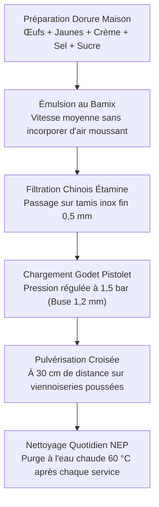

# RÉFÉRENTIEL GÉNÉRAL : DORURES D'ATELIER & SIROPS DE LUSTRAGE — FORMAT DOUBLE-PAGE

**Codes Produits :** `R-DOR-01` (Gamme Dorures d'Atelier) • `R-SIR-01` (Sirop de Lustrage 44° Brix)  
**Destination :** Finition, Brillance, Caramélisation Maillard & Préservation Hygrométrique de l'ensemble du Catalogue  
**Matériel d'Application :** Pistolet pneumatique basse pression (1,5 bar), Pinceaux soie naturelle, Pulvérisateur airless  
**Standardisation :** Formulation au Standard Atelier (Base 1 L et 3 L) & Protocoles de Pulvérisation  
**Statut de Validation :** 🟢 Validé Production — Conforme R&D & Recommandations INBP / MOF  

---

<!-- ===================================================================== -->
<!-- PAGE GAUCHE (1/2) : POSTE DE PESÉE & TABLEAUX HAUTE LISIBILITÉ        -->
<!-- ===================================================================== -->

# PAGE GAUCHE — POSTE DE PESÉE (LECTURE À 1,5 MÈTRE)

## 1. INDICATEURS FLASH DE CONDUITE

| PARAMÈTRE CLÉ | VALEUR DE CONSIGNE | TOLÉRANCE ATELIER | OBJECTIF TECHNIQUE |
| :--- | :--- | :--- | :--- |
| **Dorure Standard Viennoiserie (Production)** | **Dorure Végétale Prête à l'Emploi** | Pure (Bidon 1 L) | Remplace l'ancienne dorure œufs ; zéro risque allergène & brillance satinée |
| **Dorure Spéciale Maison (Archive R&D)** | **Œufs + Jaunes + Crème 35% + Sel + Sucre** | Strict au Bamix | Ancienne recette conservée en réserve au référentiel |
| **Dorure Feuilletage Inversé** | **67 % Jaunes d'œufs / 33 % Crème 35%** | $\pm 1\text{ \%}$ | Épaisseur couvrante sans écoulement sur les tranches |
| **Lustrage Sirop 44° Brix** | **800 g sucre / 1 000 g eau** | Ébullition 1 min | Froid ($< 20\text{ }^\circ\text{C}$) sur viennoiserie brûlante sortie four |
| **Conservation Hygiène** | **Chambre froide +4 °C datée** | Max 48 h (Dorures crues) | Rincer le pistolet à l'eau chaude après chaque service |

---

## 2. FORMULATION MAÎTRESSE & ÉCHELLES DE PESÉE (CHEF D'ATELIER)

### TABLEAU A : DORURE SPÉCIALE VIENNOISERIE MAISON AU PISTOLET (RÉF. `R-DOR-01A` — ARCHIVE CONSERVÉE)
*Ancienne recette de dorure atelier conservée en référence (remplacée en production courante par la Dorure Végétale prête à l'emploi) : le sel fluidifie les protéines d'œufs et le sucre amplifie la réaction de Maillard.*

| INGRÉDIENT | ÉTAPE | % RELATIF | BASE 1 LITRE (~930 g) | BASE 3 LITRES (~2 790 g) | BASE 5 LITRES (~4 650 g) |
| :--- | :---: | :---: | :---: | :---: | :---: |
| **Œufs entiers liquides pasteurisés** | 1 | 32,3 % | 300 g | 900 g | 1 500 g |
| **Jaunes d'œufs liquides pasteurisés** | 1 | 32,3 % | 300 g | 900 g | 1 500 g |
| **Crème liquide entière 35 % MG** | 1 | 32,3 % | 300 g | 900 g | 1 500 g |
| **Sucre semoule blanc fin** | 1 | 2,15 % | 20 g | 60 g | 100 g |
| **Sel fin purifié** | 1 | 1,07 % | 10 g | 30 g | 50 g |
| **MASSE TOTALE DORURE SPÉCIALE** | — | **100,0 %** | **930 g** | **2 790 g** | **4 650 g** |
| *-- Option Standard Atelier Ligne --* | — | — | *Dorure Végétale Pure (1 L)* | *Dorure Végétale Pure (3 L)* | *Dorure Végétale Pure (5 L)* |

---

### TABLEAU B : DORURE SPÉCIALE FEUILLETAGE AU PINCEAU (RÉF. `R-DOR-01B`)
*Spécifique Galettes des Rois, Pithiviers et Chaussons aux Pommes (tenue au rayage à la lame sans bavure).*

| INGRÉDIENT | ÉTAPE | % RELATIF | BASE 1 KG | BASE 2 KG | BASE 3 KG |
| :--- | :---: | :---: | :---: | :---: | :---: |
| **Jaunes d'œufs liquides pasteurisés** | 1 | 67,0 % | 670 g | 1 340 g | 2 010 g |
| **Crème liquide entière 35 % MG** | 1 | 33,0 % | 330 g | 660 g | 990 g |
| **MASSE TOTALE DORURE PINCEAU** | — | **100,0 %** | **1 000 g** | **2 000 g** | **3 000 g** |
| *Protocole d'application* | — | — | *2 couches fines espacées de 15 min à +4 °C* | *Rayage sur la 2ᵉ couche sèche* | *Zéro coulure sur les tranches* |

---

### TABLEAU C : SIROP DE LUSTRAGE 44° BRIX (RÉF. `R-SIR-01`)
*Sirop concentré à chaud : confère un éclat brillant miroir et bloque l'évaporation de la mie au ressuage.*

| INGRÉDIENT | ÉTAPE | % RELATIF | PETIT LOT (1,8 KG) | LOT STANDARD (5,4 KG) | GRAND LOT (10,8 KG) |
| :--- | :---: | :---: | :---: | :---: | :---: |
| **Eau purifiée du réseau** | 1 | 55,6 % | 1 000 g | 3 000 g | 6 000 g |
| **Sucre semoule blanc purifié** | 1 | 44,4 % | 800 g | 2 400 g | 4 800 g |
| **MASSE TOTALE SIROP 44° BRIX** | — | **100,0 %** | **1 800 g** | **5 400 g** | **10 800 g** |
| *Règle d'application obligatoire* | — | — | *Application à froid (< 20 °C) au pinceau sur viennoiseries sortant du four* | — | — |

---

## 3. PRÉCAUTIONS INGRÉDIENTS & SÉCURITÉ MATIÈRE

1. **Rôle biochimique du sel et du sucre dans la dorure :**  
   - Le **sel fin** (10 g/L) déstructure la mucine et fluidifie l'ovalbumine des œufs. La dorure devient parfaitement fluide et passe au pistolet sans colmater la buse de 1,2 mm.
   - Le **sucre semoule** (20 g/L) apporte les glucides réducteurs qui réagissent avec les acides aminés de la surface de la pâte à $160\text{--}180\text{ }^\circ\text{C}$ (réaction de Maillard), créant une couleur noisette dorée sans avoir besoin de surcuire la viennoiserie.
2. **Filtration chinoise étamine indispensable :**  
   Toute dorure préparée en cuve doit impérativement être passée au chinois étamine fin après mixage au mixeur plongeant (type Bamix) pour éliminer les micro-chalazes ou fibres d'œufs qui bloqueraient le pointeau du pistolet.
3. **Le principe du Sirop Froid sur Produit Chaud :**  
   Le sirop 44° Brix doit toujours être appliqué **froid sur viennoiserie sortant immédiatement du four**. La chaleur résiduelle de la croûte ($> 100\text{ }^\circ\text{C}$) évapore instantanément l'eau du sirop en quelques secondes, ne laissant qu'un film protecteur de saccharose pur qui vitrifie en surface sans jamais détremper le feuilletage.

---

<!-- ===================================================================== -->
<!-- PAGE DROITE (2/2) : PROTOCOLE PAS À PAS, CONDUITE & FOUR              -->
<!-- ===================================================================== -->

# PAGE DROITE — CONDUITE MACHINE, POSTE CUISSON & HACCP

## 1. PROTOCOLE DE PRÉPARATION & UTILISATION DES PISTOLETS

### CONDUITE DU POSTE DE DORURE AU PISTOLET (LIGNE VIENNOISERIE)
1. **Réglage Pneumatique :** Régler le mano-détendeur d'air comprimé à **1,5 bar**. Un débit d'air trop violent ($> 2\text{ bars}$) dégonflerait les croissants en fin de pousse.
2. **Technique de Balayage :** Tenir le pistolet à une distance de **25 à 30 cm** des plaques. Effectuer un balayage croisé régulier et rapide (une passe horizontale, une passe verticale). On doit obtenir un voile fin et scintillant, **sans jamais créer de flaques au fond de la plaque**.
3. **Option Dorure Végétale :** Verser directement le bidon de dorure végétale dans le godet du pistolet. Ne nécessite aucune dilution.

### TECHNIQUE DU PINCEAU POUR FEUILLETAGE INVERSÉ (GALETTES & PITHIVIERS)
1. **Première Couche :** Appliquer une première couche très fine de dorure au jaune et crème à l'aide d'un pinceau plat en soie naturelle.
2. **Séchage au Froid :** Placer la galette pendant **15 minutes au froid positif (+4 °C)**. La dorure fige et forme une pellicule sèche au toucher.
3. **Seconde Couche & Rayage :** Passer une seconde couche ultra-fine. Réfrigérer à nouveau 10 minutes. Réaliser le rayage décoratif à l'aide de la pointe d'un couteau d'office tenu incliné, sans jamais percer la pâte jusqu'à la frangipane.
4. **Règle d'or absolue :** Ne jamais laisser couler de dorure sur la tranche coupée du feuilletage. Les protéines coagulées à la cuisson colleraient les feuillets entre eux, empêchant le développement vertical des micro-strates.

---

## 2. PROTOCOLE DU SIROP DE LUSTRAGE 44° BRIX & DÉCOR

### CUISSON DU SIROP
1. Dans une casserole en inox, peser l'eau purifiée (1 000 g) et le sucre semoule blanc (800 g).
2. Porter à ébullition franche à feu vif en remuant pour dissoudre complètement les cristaux.
3. Dès les premiers gros bouillons, maintenir l'ébullition pendant **1 minute chrono**.
4. Retirer du feu et laisser refroidir totalement jusqu'à température ambiante ($< 20\text{ }^\circ\text{C}$). Stocker en pichets ou flacons pulvérisateurs étiquetés.

### APPLICATION POST-CUISSON SUR PRODUITS MAÎTRES
- **Pains aux Raisins Escargot (`recettes/catalogue/pain-raisins-escargot-pac.md`) :** Passer un coup de pinceau généreux de sirop froid sur chaque escargot dès la sortie du four. La viennoiserie grésille, absorbe le sirop et se pare d'un éclat miroir immédiat.
- **Oranais aux Abricots (`recettes/catalogue/oranais-abricots-pac.md`) :** Lustrer au sirop froid pour réhydrater la surface des oreillons d'abricots et vitrifier le feuilletage périphérique.
- **Cinnamon Rolls Feuilletés (`recettes/catalogue/cinnamon-roll-feuillete-pac.md`) :** Napper au sirop dès sortie du four avant l'éventuel glaçage cream cheese.

---

## 3. CONTRÔLE QUALITÉ & POINTS CRITIQUES HACCP

| POINT DE CONTRÔLE | PARAMÈTRE MESURÉ | TOLÉRANCE CRITIQUE | ACTION CORRECTIVE IMMÉDIATE |
| :--- | :--- | :--- | :--- |
| **Filtration Dorure** | Présence d'impuretés | Zéro résidu | Filtrer systématiquement au chinois étamine |
| **Pression Pistolet** | Manomètre d'air | 1,5 bar $\pm 0,2\text{ bar}$ | Ajuster le régulateur d'air atelier |
| **Conservation Dorure** | Froid positif (+4 °C) | Max 48 h (Dorure œufs) | Jeter tout reste de dorure crue après 48 heures |
| **Nettoyage Pistolet** | Rinçage quotidien | Eau chaude 60 °C | Démonter la buse et l'aiguille chaque soir |
| **Densité Sirop** | Réfractomètre | 44° Brix $\pm 1^\circ\text{ Brix}$ | Si trop dense, ajouter 5% d'eau bouillante |

---
*Fiche d'atelier normalisée — Laboratoire R&D Tourage & Boulangerie — Usage exclusif opérateurs de production.*
