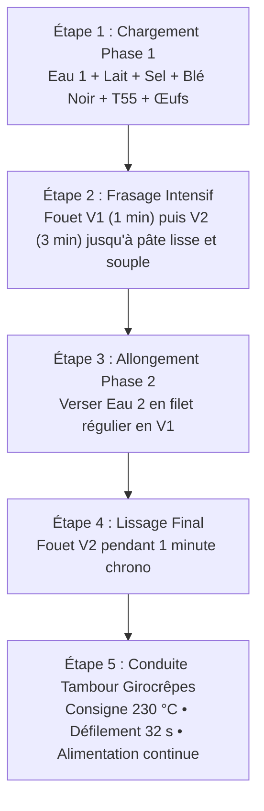

# GALETTES DE BLÉ NOIR SUR CARROUSEL GIROCRÊPES — FORMAT DOUBLE-PAGE

**Code Produit :** `C-GAL-01` (Galettes Pur Sarrasin Tradition Bretagne)  
**Destination :** Conditionnement en Sachets Frais Sous Atmosphère Protectrice, Rayon Traiteur & Restauration Rapide  
**Ligne Mécanisée :** Machine Continue à Tambour Rotatif GIROCRÊPES (Pesée biphasique : Frasage $\rightarrow$ Allongement)  
**Standardisation :** Formulation au Standard Meunier (Base 1 000 g Blé Noir / 100,0 %) & Paliers (10 à 50 paquets)  
**Statut de Validation :** 🟢 Validé Production — Conforme R&D & Régulation Tambour 230 °C  

---

<!-- ===================================================================== -->
<!-- PAGE GAUCHE (1/2) : POSTE DE PESÉE & TABLEAUX HAUTE LISIBILITÉ        -->
<!-- ===================================================================== -->

# PAGE GAUCHE — POSTE DE PESÉE (LECTURE À 1,5 MÈTRE)

## 1. INDICATEURS FLASH DE CONDUITE

| PARAMÈTRE CLÉ | VALEUR DE CONSIGNE | TOLÉRANCE ATELIER | OBJECTIF TECHNIQUE |
| :--- | :--- | :--- | :--- |
| **Température Tambour** | **230 °C régulée** | $\pm 3\text{ }^\circ\text{C}$ | Choc thermique élevé indispensable au sarrasin |
| **Temps de Passage** | **32 secondes** | 30 à 34 s | Cuisson à cœur de l'amidon & croûtage kraz croustillant |
| **Outil de Cuve** | **Fouet Batteur 40L-80L** | Strict | Émulsion sans grumeaux ; cisaillement fort |
| **Renfort Cohésion** | **27,5 % Farine T55 & Œufs** | Strict | Confère l'élasticité nécessaire au décollement raclette |
| **Mention Allergènes** | **Gluten & Lait Entier** | Obligatoire HACCP | Présence de froment (T55) et poudre de lait entier |

---

## 2. FORMULATION MAÎTRESSE & ÉCHELLES DE PESÉE (CHEF D'ATELIER)

### TABLEAU A : APPAREIL GALETTES SARRASIN GIROCRÊPES (RÉF. `C-GAL-01`)
*Pesée en 2 temps : Phase 1 Frasage serré $\rightarrow$ Phase 2 Allongement progressif pour viscosité constante.*

| INGRÉDIENT | ÉTAPE | % BOULANGER | BASE 1 KG BLÉ NOIR | 10 PQTS (2 KG) | 20 PQTS (4 KG) | 30 PQTS (6 KG) | 40 PQTS (8 KG) | 50 PQTS (10 KG) |
| :--- | :---: | :---: | :---: | :---: | :---: | :---: | :---: | :---: |
| **Eau purifiée (1ʳᵉ partie)** | 1 | 137,5 % | 1 375 g | 2 750 g | 5 500 g | 8 250 g | 11 000 g | 13 750 g |
| **Poudre de lait entier 26%** | 1 | 12,5 % | 125 g | 250 g | 500 g | 750 g | 1 000 g | 1 250 g |
| **Sel fin purifié** | 1 | 3,25 % | 33 g | 65 g | 130 g | 195 g | 260 g | 325 g |
| **Farine de blé noir (Sarrasin breton)** | 1 | **100,0 %** | **1 000 g** | **2 000 g** | **4 000 g** | **6 000 g** | **8 000 g** | **10 000 g** |
| **Farine T55 (liant d'accroche mécanique)** | 1 | 27,5 % | 275 g | 550 g | 1 100 g | 1 650 g | 2 200 g | 2 750 g |
| **Œufs entiers liquides** | 1 | 27,5 % | 275 g | 550 g | 1 100 g | 1 650 g | 2 200 g | 2 750 g |
| *-- SOUS-TOTAL PHASE 1 (BASE SERRÉE) --* | — | — | *3 083 g* | *6 165 g* | *12 330 g* | *18 495 g* | *24 660 g* | *30 825 g* |
| **Eau purifiée (2ᵉ partie - Allongement)**| 2 | 50,0 % | 500 g | 1 000 g | 2 000 g | 3 000 g | 4 000 g | 5 000 g |
| **MASSE TOTALE APPAREIL HOMOGÈNE** | — | — | **3 583 g** | **7 165 g** | **14 330 g** | **21 495 g** | **28 660 g** | **35 825 g** |

---

## 3. PRÉCAUTIONS INGRÉDIENTS & SÉCURITÉ MATIÈRE

1. **Rôle biochimique de la farine T55 et des œufs :**
   Le sarrasin (*Fagopyrum esculentum*) est une polygonacée totalement dépourvue de gluten. Sur une crêpière manuelle en fonte rugueuse, l'eau et le sarrasin pur suffisent. Mais sur un tambour industriel tournant à grande vitesse, une pâte 100% sarrasin se pulvérise en miettes friables au contact de la raclette de décollement. L'apport précis de 27,5 % de farine T55 et d'œufs apporte les liaisons peptidiques et la cohésion d'albumine indispensables pour permettre à la galette d'être pelée sans aucune déchirure.
2. **Poudre de lait entier et coloration :**
   Le sarrasin n'a que peu de sucres réducteurs libres. Les protéines et le lactose du lait entier catalysent la réaction de Maillard à 230 °C, donnant aux galettes leurs fameuses alvéoles brunes et croustillantes (*yeux de la galette*).
3. **Épaississement thixotropique du blé noir :**
   Le sarrasin absorbe l'eau de façon continue. Si une cuve de pâte patiente plus de 30 minutes au poste de travail, redonner systématiquement un coup de fouet vigoureux pour rompre la gélification superficielle avant de recharger la trémie.

---

<!-- ===================================================================== -->
<!-- PAGE DROITE (2/2) : PROTOCOLE PAS À PAS, CONDUITE & FOUR              -->
<!-- ===================================================================== -->

# PAGE DROITE — CONDUITE MACHINE, POSTE CUISSON & HACCP

## 1. PROTOCOLE CHRONOLOGIQUE AU BATTEUR PLANÉTAIRE

### DÉTAIL DES PHASES OPÉRATOIRES :
1. **Étape 1 — Frasage de la base serrée :** Dans la cuve du batteur muni du **Fouet**, introduire dans l'ordre : l'Eau Partie 1, la poudre de lait entier, le sel fin purifié, la farine de blé noir breton, la farine T55 et les œufs entiers liquides. Démarrer en vitesse 1 pendant 1 minute, puis passer en vitesse 2 pendant 3 minutes chrono. On obtient une texture dense, onctueuse et sans grumeaux.
2. **Étape 2 — Allongement :** Ramener le batteur en vitesse 1. Verser en filet l'Eau Partie 2 (environ 500 g par kg de blé noir). Battre en vitesse 2 pendant 1 minute pour uniformiser la densité de coulée.
3. **Étape 3 — Contrôle de fluidité :** La pâte doit présenter un écoulement continu au viscosimètre ou à la louche sans faire de rupture filandreuse.

---

## 2. CONDUITE MÉCANIQUE DU TAMBOUR ROTATIF GIROCRÊPES

### PARAMÈTRES CRITIQUES DE LA GIROCRÊPES
- **Température de Régulation :** **230 °C régulée** ($\pm 3\text{ }^\circ\text{C}$).
- **Vitesse de Rotation / Temps de Cuisson :** **32 secondes pile** (temps double par rapport au froment en raison de l'épaisseur et de l'énergie nécessaire à la coagulation de la fécule de sarrasin). Plage tolérée : 30 à 34 s.
- **Réglage du Rouleau Applicateur :** Régler l'entrefer pour déposer un film d'épaisseur uniforme (environ 0,8 à 1,0 mm d'épaisseur cuite).

### RÈGLES DE CONDUITE EN CONTINU
1. **Surveillance du Décollement :** La lame racleuse doit être affûtée et parfaitement parallèle au cylindre. Une température trop basse ($< 220\text{ }^\circ\text{C}$) ou un temps de passage trop court ($< 30\text{ s}$) empêche la formation de la croûte sèche : la galette reste collée au métal et s'enroule sur elle-même.
2. **Maintien en Suspension :** Brasser la pâte toutes les 20 minutes dans la cuve réceptrice de la trémie à l'aide d'un fouet manuel pour éviter que le sarrasin plus lourd ne sédimente au fond.
3. **Pliage & Refroidissement :** À l'éjection, plier les galettes en 2 (demi-lune) ou en 4 (triangle). Transférer sur tapis refroidisseur à 15 °C avant conditionnement.
4. **Conditionnement Protecteur :** Mise sous film protecteur étanche par paquets de 6 ou 10 galettes avec injection de gaz neutre ($N_2$). Stockage entre 0 °C et +4 °C.

---

## 3. CONTRÔLE QUALITÉ & POINTS CRITIQUES HACCP

| POINT DE CONTRÔLE | PARAMÈTRE MESURÉ | TOLÉRANCE CRITIQUE | ACTION CORRECTIVE IMMÉDIATE |
| :--- | :--- | :--- | :--- |
| **Allergènes** | Présence T55 et Lait | Étiquetage obligatoire | Contrôle de non-contamination croisée sans gluten |
| **Température Tambour** | Pyromètre optique | 230 °C $\pm 3\text{ }^\circ\text{C}$ | Ajuster le thermostat de chauffe |
| **Temps de Passage** | Chronomètre rotation | 30 à 34 secondes | Régler le potentiomètre d'entraînement |
| **Homogénéité Pâte** | Viscosité en trémie | Absence de déphasage | Battre manuellement toutes les 20 min |
| **DLC & Fraîcheur** | Froid positif (+4 °C) | DLC 21 jours sous atmosphère | Vérifier l'herméticité de thermosoudure des sachets |

---
*Fiche d'atelier normalisée — Laboratoire R&D Tourage & Boulangerie — Usage exclusif opérateurs de production.*
