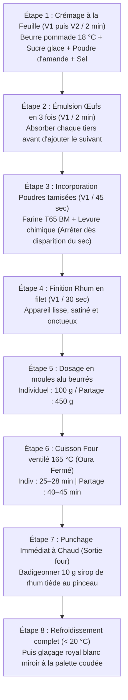

# FICHE TECHNIQUE D'ATELIER : GÂTEAU NANTAIS DE VOYAGE (PUR FONDANT & RHUM 45°)

* **Codes Produits :** `P-NAN-01` (Individuel 100 g) • `P-NAN-02` (Partage 4-5 pers. 450 g)  
* **Famille :** Gâteaux de Voyage & Pâtisserie Traditionnelle Nantaise (Longue Conservation 3 semaines)  
* **Procédé :** Appareil émulsionné sans crème pâtissière $\rightarrow$ Cuisson douce 165 °C $\rightarrow$ Punchage sirop de rhum à chaud $\rightarrow$ Glaçage miroir royal cryorésistant  
* **Format d'Atelier :** Double Page Vis-à-Vis (Page Gauche : Poste Pesée | Page Droite : Conduite Batteur, Cuisson, Punchage & Glaçage)  
* **Version :** `v2.0-STANDARD-USINE` | **Statut :** 🟢 Validé Production & Optimisation Rentabilité

---

## PAGE GAUCHE (1/2) • POSTE DE PESÉE

### Repères Flash Poste de Pesée
| Repère | Paramètre Clé | Spécification Atelier | Justification Scientifique & Rhéologique |
| :--- | :--- | :--- | :--- |
| 🧈 **Matière Grasse** | **Beurre doux 82% pommade (18 °C)** | Émulsionné au sucre glace | Texture sablée fondante (proscrire la crème pâtissière qui gélifie la mie) |
| 🌰 **Amande Pure** | **Poudre d'amande blanche standard** | 22,5 % de la pâte totale | Richesse lipidique aromatique et densité moelleuse |
| 🥃 **Rhum des Antilles** | **Rhum ambré agricole 45° ou 54°** | Double apport : Pâte (8%) + Sirop (imbibage) | Signature aromatique et conservation bactériostatique naturelle |
| 🍯 **Conservation** | **Punchage sirop à chaud + Sucre inverti** | Sortie de four immédiate | $a_w \le 0,75$ : moelleux permanent garanti 21 jours |
| ⚖️ **Calibres Moules** | **Indiv 100 g / Partage 450 g** | Moules aluminium chemisés | Cuisson homogène et démoulage net |

---

### Tableau Chronologique des Pesées d'Atelier
*Base meunière : Farine Totale = 100,0 % (Farine T65 conventionnelle BM — Moulin de Cadillac, réf. FPBMT65) | Tolérance : ± 1 g ingrédients critiques / ± 5 g farines.*

| Phase & Ordre | Ingrédient d'Atelier | % Meunier | Base 1 kg Farine | Petit Lot (10 Indiv / 1 kg) | Lot Atelier (50 Indiv / 5 kg) | Grand Lot (150 Indiv / 15 kg) | Rôle Biochimique & Précautions |
| :---: | :--- | :---: | :---: | :---: | :---: | :---: | :--- |
| **`[1]` Crémage** | **Beurre doux 82% pommade (18 °C)** | **175,0 %** | **1 750 g** | **230 g** | **1 150 g** | **3 450 g** | Texture ultra-fondante, enrobage des amidons |
| **`[1]` Crémage** | **Sucre glace tamisé** | **175,0 %** | **1 750 g** | **230 g** | **1 150 g** | **3 450 g** | Finesse de grain ; dissout immédiatement dans le beurre |
| **`[1]` Crémage** | **Poudre d'amande blanche** | **175,0 %** | **1 750 g** | **230 g** | **1 150 g** | **3 450 g** | Corps et goût amande intense |
| **`[1]` Crémage** | **Sel fin d'atelier** | **3,0 %** | **30 g** | **4 g** | **20 g** | **60 g** | Exhausteur de goût indispensable |
| **`[2]` Émulsion** | **Œufs entiers liquides pasteurisés** | **150,0 %** | **1 500 g** | **200 g** | **1 000 g** | **3 000 g** | Liant protéique, émulsion eau-dans-huile progressive |
| **`[3]` Poudres** | **Farine T65 conventionnelle BM (Moulin de Cadillac)** | **100,0 %** | **1 000 g** | **130 g** | **650 g** | **1 950 g** | Incorporation courte V1 : structure sans élasticité |
| **`[3]` Poudres** | **Levure chimique (Baking powder)** | **4,0 %** | **40 g** | **5 g** | **25 g** | **75 g** | Poussée fine régulière |
| **`[4]` Arôme** | **Rhum ambré agricole 45° ou 54°** | **60,0 %** | **600 g** | **80 g** | **400 g** | **1 200 g** | Solvant aromatique vanillé de mélasse |
| **TOTAL** | **POIDS TOTAL APPAREIL CRU** | **842,0 %** | **8 420 g** | **1 109 g** | **5 545 g** | **16 635 g** | **Appareil prêt à dresser** |
| *Rendement* | *Moules individuels aluminium 100 g* | — | *~83 pièces* | *11 pièces* | *55 pièces* | *165 pièces* | *Dresseuse volumétrique* |
| *Rendement* | *Moules partage aluminium 450 g* | — | *~18 pièces* | *2 pièces* | *12 pièces* | *36 pièces* | *Format familial 4–5 parts* |

---

### Ingrédients Complémentaires de Finition (Post-Cuisson)

#### A. Sirop d'Imbibage au Rhum (Punchage à chaud)
* **Eau purifiée** : 500 g  
* **Sucre semoule blanc** : 400 g  
* **Rhum ambré agricole 45°** : 150 g (incorporé hors du feu après ébullition)  
* *Consigne* : Porter eau + sucre à ébullition 1 min, couper le feu, verser le rhum. Utiliser tiède (~40 °C).

#### B. Glaçage Royal Cryorésistant au Rhum (Blanc Miroir Souple)
* **Sucre glace tamisé extra-fin** : 500 g (100 %)  
* **Rhum ambré agricole 45°** : 80 g (16 %)  
* **Trimoline (sucre inverti)** : 50 g (10 %) — *Bloque la cristallisation cassante*  
* **Gélatine feuille Or (hydratée)** : 4 g (0,8 %) — *Empêche le faïençage en froid négatif*  

---

## PAGE DROITE (2/2) • CONDUITE MACHINE, POSTE CUISSON & FINITIONS

---

### Étape 1 : Préparation & Conduite au Batteur Planétaire
1. **Crémage Amande & Beurre (Point Clé de la Texture)** :
   * Dans la cuve du batteur équipé de la **Feuille**, placer le beurre pommade à 18 °C (jamais fondu), le sucre glace, la poudre d'amande et le sel.
   * Tourner en vitesse 1 pendant 1 minute, puis en vitesse 2 pendant 2 minutes. On obtient une texture sableuse crémeuse homogène sans incorporer d'air excessif.
2. **Émulsion des Œufs Liquides** :
   * Réduire en 1ʳᵉ vitesse.
   * Verser les œufs liquides tempérés en **3 fractions égales**. Laisser la matière grasse émulsionner chaque fraction pendant 30 à 45 secondes avant d'ajouter la suivante.
3. **Poudres & Rhum** :
   * Verser la farine T65 conventionnelle BM et la levure chimique tamisées ensemble. Mélanger en vitesse 1 pendant **40 secondes maximum**. Ne pas corser pour garantir un gâteau ultra-fondant.
   * Verser enfin le rhum ambré en filet lent. Dès que la pâte est lisse et satinée, stopper immédiatement la cuve.

---

### Étape 2 : Dosage, Cuisson & Punchage au Sirop de Rhum
1. **Dosage en Moules Aluminium** :
   * Pulvériser un agent de démoulage cireux dans les moules aluminium.
   * Doser à la poche ou dresseuse : **100 g pile** pour les individuels (Ø 85 mm) / **450 g pile** pour le format familial (Ø 180 mm).
2. **Barème de Cuisson (Moelleux Préservé)** :
   * **Four ventilé** : Consigne **165 °C**, **oura fermé**.
   * **Durée** :
     * Individuels 100 g : **25 à 28 minutes**.
     * Partage 450 g : **40 à 45 minutes**.
   * Surface dorée ambrée uniforme, bord légèrement rétracté du moule.
3. **Punchage Immédiat à Chaud (Le Secret R&D du Moelleux 3 Semaines)** :
   * Dès l'extraction du four, pendant que les gâteaux sont brûlants ($> 85\text{ }^\circ\text{C}$), imbiber la surface au pinceau avec le **sirop de rhum tiède** :
     * **10 g de sirop par gâteau individuel**.
     * **35 g de sirop par gâteau familial**.
   * Le choc thermique fait aspirer le sirop au cœur de la mie sans détremper la structure.
   * Laisser refroidir complètement à température ambiante sur grille.

---

### Étape 3 : Glaçage Royal Blanc Miroir Cryorésistant
1. **Préparation du Glaçage** :
   * Tiédir le rhum et la trimoline à 45 °C, dissoudre la feuille de gélatine essorée.
   * Verser sur le sucre glace tamisé. Mélanger doucement à la spatule sans incorporer de bulles d'air.
2. **Application & Figeage** :
   * Déposer une noisette de glaçage au centre du gâteau froid ($< 20\text{ }^\circ\text{C}$).
   * Lisser en un voile blanc régulier de 1 mm d'épaisseur à la palette coudée.
   * Laisser figer 25 minutes à l'air libre.
3. **Conservation & Logistique Multi-Boutiques** :
   * Stockage ambiant sous cloche ou film : **21 jours à 18–20 °C**.
   * Compatible surgélation négative (-18 °C) : la trimoline et la gélatine évitent tout craquellement ou opacification terne lors de la remise à température en boutique.