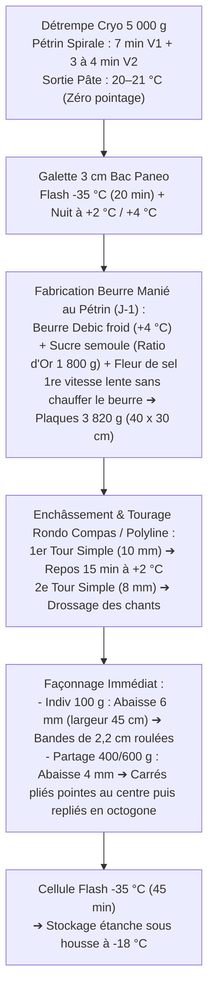

# Cahier de Laboratoire R&D • Kouign-Amann d'Atelier (Individuel & Partage)
**Code Produit : `V-KOU-01` (Individuel 100 g) / `V-KOU-02` (Partage 400 g & 600 g)**  
**Famille : Pâtes Tourées Sucro-Lipidiques Bretonnes & Viennoiseries Feuilletées Spéciales**  
**Destination : Laboratoire Central alimentant 2 à 3 boutiques | Équipe : 3 touriers + 1 cuiseur**  
**Procédé : Cru Surgelé Non Poussé Cryo-Blindé & Beurre Manié au Ratio d'Or (Plaques 3 820 g)**  
**Statut : 🟢 Standard R&D Validé & Blindage Industriel Anti-Plasmolyse**

---

## 1. AUTOPSIE SCIENTIFIQUE SANS COMPLAISANCE DES DEUX ÉCHECS DU FOURNIL

### 1.1 Échec N°1 : La Congélation en Cru à -18 °C (Autopsie Cryoscopique & Plasmolyse)

#### A. Le Piège de la Transition Vitreuse ($T_g'$) et l'Abaissement Cryoscopique ($\Delta T_f$)
La détrempe et le tourage du kouign-amann introduisent une concentration massive de saccharose ($\text{C}_{12}\text{H}_{22}\text{O}_{11}$, $M = 342,3\text{ g/mol}$) représentant **65,5 % du poids de farine**, soit près de **22 % de la masse totale de la pâte**.

Selon la loi de Raoult sur l'abaissement cryoscopique :
$$\Delta T_f = K_f \cdot m \cdot i$$
*avec $K_f = 1,86\text{ K}\cdot\text{kg/mol}$ pour l'eau, $m$ la molalité du soluté et $i = 1$ pour le saccharose.*

Dès que la pâte commence à refroidir, l'eau libre congèle sous forme de cristaux de glace pure. Cette séparation de phase liquide/solide exclut le saccharose de la glace et provoque une **cryo-concentration maximale (*freeze concentration*)** de la solution interstitielle non congelée.

La température de transition vitreuse de cette phase liquide ultra-concentrée est :
$$T_g' \approx -32\text{ }^\circ\text{C}\text{ à } -35\text{ }^\circ\text{C}$$

> [!CAUTION]
> **Le diagnostic thermodynamique implacable :**  
> Un conservateur négatif d'atelier fonctionne à **$-18\text{ }^\circ\text{C}$**.  
> Comme $T_{\text{stockage}} (-18\text{ }^\circ\text{C}) \gg T_g' (-34\text{ }^\circ\text{C})$, le kouign-amann cru n'atteint **JAMAIS l'état vitreux** (*glassy state*).  
> À $-18\text{ }^\circ\text{C}$, le pâton se trouve dans l'état **caoutchouteux (*rubbery state*)** : **20 à 30 % de l'eau totale reste liquide**, formant une saumure de saccharose hyper-visqueuse mais chimiquement mobile !

#### B. Pression Osmotique de van 't Hoff ($\Pi$) & Plasmolyse de *Saccharomyces cerevisiae*
La pression osmotique régnant dans la phase liquide interstitielle s'exprime selon l'équation de van 't Hoff :
$$\Pi = i \cdot C \cdot R \cdot T$$
À $-18\text{ }^\circ\text{C}$, avec la concentration cryogénique, la pression osmotique externe dépasse **50 à 80 bars**.

La cellule de levure de panification (*Saccharomyces cerevisiae*) possède une pression osmotique interne d'équilibre d'environ **12 à 15 bars**. Face à un gradient de pression osmotique externe $\Delta \Pi > 40\text{ bars}$ :
1. **Choc hyperosmotique brutal & Plasmolyse** : L'eau intracellulaire est littéralement aspirée hors de la cellule par osmose. La membrane plasmique se décolle violemment de la paroi pectocellulosique rigide.
2. **Lyse membranaire** : Sous l'effet combiné de la déshydratation extrême et du cisaillement par les micro-cristaux de glace résiduels, la membrane cellulaire se déchire : **80 à 95 % des levures meurent en quelques jours de stockage si la formule n'est pas cryo-blindée**.

#### C. L'Attaque Chimique du Réseau de Gluten par le Glutathion Réduit (GSH)
En éclatant, les cellules de levure déversent dans la pâte leur contenu cytoplasmique, hautement enrichi en **glutathion réduit (GSH)**.  
Le glutathion est un tripeptide ($\gamma\text{-L-glutamyl-L-cystéinylglycine}$) porteur d'une fonction thiol libre ($-\text{SH}$).

Le GSH réagit par échange thiol-disulfure avec les liaisons covalentes du réseau de gluten :
$$\text{Gluten-S-S-Gluten} + 2\text{ GSH} \rightleftharpoons 2\text{ Gluten-SH} + \text{GSSG}$$

* **Conséquences au fournil :**
  - Les ponts disulfures inter-chaînes de gluténines sont hydrolysés et réduits.
  - Le réseau de gluten se liquéfie chimiquement : il perd son élasticité et sa capacité de rétention d'eau.
  - L'eau et le sucre exsudés forment un sirop poisseux qui **suinte au fond des bacs et des cartons à $-18\text{ }^\circ\text{C}$**.
  - À la décongélation, la pâte est morte, collante, incapable de retenir le moindre gaz carbonique (**perte totale de force fermentaire**).

---

### 1.2 Échec N°2 : L'Hérésie Thermique du Moule en Silicone & le Pliage Carré

#### A. Hérésie Thermodynamique du Silicone ($\lambda_{\text{silicone}}$ vs Métaux)
La loi de Fourier régit le flux thermique conductif au travers de la paroi du moule :
$$q = -\lambda \nabla T, \quad \text{avec la diffusivité thermique } \alpha = \frac{\lambda}{\rho \cdot c_p}$$

Comparatif des conductivités thermiques des matériaux en atelier :

| Matériau du Moule | Conductivité Thermique $\lambda$ | Facteur vs Silicone | Comportement Thermique au Fournil |
| :--- | :---: | :---: | :--- |
| **Silicone alimentaire injecté** | **$0,16\text{ W}/(\text{m}\cdot\text{K})$** | **$1\times$ (Isolant)** | Bouclier thermique. Retarde la montée en température de 15 minutes. |
| **Acier inoxydable (Inox 304)** | **$16\text{ W}/(\text{m}\cdot\text{K})$** | **$\times 100$** | Montée en température rapide, excellente rigidité géométrique. |
| **Tôle d'acier noir / tôle bleuie** | **$45\text{--}50\text{ W}/(\text{m}\cdot\text{K})$** | **$\times 300$** | Rayonnement infra-rouge intense, caramélisation très vive. |
| **Aluminium pâtissier (Alu 3003)** | **$205\text{--}220\text{ W}/(\text{m}\cdot\text{K})$** | **$\times 1 350$** | **Conductivité flash maximale** : caramélisation instantanée au contact. |

#### B. Pourquoi la Cuisson en Moule Silicone sous Grille Permanente (200 °C Flash $\rightarrow$ 175 °C) Fonctionne
1. **Flash d'enfournement à 200 °C (1 min)** : compense la chute thermique massive de la chambre lors de l'enfournement de plaques froides et amorce la pénétration de la chaleur dans le silicone.
2. **Couverture continue par papier sulfurisé et grille métallique** : cette couverture forme un **bouclier radiatif et convectif** qui empêche le rayonnement direct de la voûte et l'air pulsé du ventilateur de carboniser le sucre supérieur. Le moule devient une **capsule fermée étanche** où la vapeur maintient l'humidité des feuillets pendant que le fond caramélise.
3. **Ouverture des ouras à fond sur les 5–6 dernières minutes** : évacue l'eau résiduelle pour faire cristalliser le caramel au contact du silicone.

---

## 2. FORMULATION AU RATIO D'OR (BASE 100,0 % FARINE)

### Les 5 Leviers Scientifiques du Blindage Cryogénique
1. **Assainissement du Sucre de Cuve (50 g / 1,8 %)** : Suppression du sucre de cuve excessif (qui fragilisait les levures par osmose).
2. **Surdosage de Levure Osmotolérante (6,0 %)** : L'Hirondelle Or dosée à 60 g / kg de farine (165 g par bac de 5 000 g) pour compenser mathématiquement la perte de viabilité cellulaire sur 4 semaines à -18 °C.
3. **Blindage Anti-GSH & Maintien des Ponts Disulfures** :
   - Améliorant S500 Kimo Short dosé à **2,5 %** (70 g / bac) : apport d'oxydants qui recombinent les liaisons $-\text{S}-\text{S}-$ attaquées par le glutathion.
   - Vinaigre blanc d'alcool (8°) à **0,5 %** (15 g / bac) : tamponne le pH de pâte à **5,1**, ce qui inhibe l'activité protéolytique et stabilise la ténacité du gluten.
4. **Beurre Manié au Ratio d'Or (3 820 g par bac)** :
   - **2 000 g Beurre sec 84 % + 1 800 g Sucre semoule + 20 g Fleur de sel**.
   - Départ beurre Debic froid (**+4 °C**) travaillé en **1ʳᵉ vitesse sans chauffer le beurre**, puis incorporation du sucre semoule et de la fleur de sel : chaque grain de sucre est gainé de matière grasse hydrophobe, éliminant tout déchirement de pâte au laminoir.
5. **Thermique Réaliste de Pétrin (20 °C à 21 °C) & Zéro Pointage** :
   - Frasage 7 min V1 + pétrissage 3 à 4 min V2 avec eau glacée et glace fondue.
   - Division immédiate en galette de 3 cm $\rightarrow$ **Cellule flash à -35 °C pendant 20 minutes** pour bloquer la pâte à cœur sous 4 °C.

---

### Tableau Chronologique des Pesées en 4 Phases (100 % en Grammes • Zéro Virgule)

| Phase & Ordre | Ingrédient d'Atelier | % Meunier | Base 1 000 g Farine | 1 Bac (5 000 g dét.) | 5 Bacs (25 000 g dét.) | 10 Bacs (50 000 g dét.) | Rôle & Justification Rhéologique |
| :---: | :--- | :---: | :---: | :---: | :---: | :---: | :--- |
| **`[1]` Bleu** | **Farine T65 Tradition pure** | **100,0 %** | **1 000 g** | **2 750 g** | **13 750 g** | **27 500 g** | Farine T65 de force, W 280-300, sans E300 |
| **`[1]` Bleu** | **Eau glacée (+0,5 °C) / Glace** | **51,6 %** | **516 g** | **1 420 g** | **7 100 g** | **14 200 g** | Eau ajustée limitant l'eau libre cryogénique |
| **`[1]` Bleu** | **Sucre semoule cuve** | **1,8 %** | **18 g** | **50 g** | **250 g** | **500 g** | **Bridé à 50 g** (anti-choc osmotique levure) |
| **`[1]` Bleu** | **Poudre de lait entier 26 %** | **2,5 %** | **25 g** | **70 g** | **350 g** | **700 g** | Fixation de l'eau libre et fondant |
| **`[1]` Bleu** | **Améliorant S500 Kimo Short** | **2,5 %** | **25 g** | **70 g** | **350 g** | **700 g** | Cryo-protection renforcée et barrière anti-GSH |
| **`[1]` Bleu** | **Vinaigre blanc d'alcool (8°)** | **0,5 %** | **5 g** | **15 g** | **75 g** | **150 g** | Tamponne pH à 5,1, stoppe le relâchement |
| **`[1]` Bleu** | **Sel fin d'atelier** | **1,8 %** | **18 g** | **50 g** | **250 g** | **500 g** | Force ionique et ténacité du gluten |
| **`[1]` Bleu** | **Levure fraîche L'Hirondelle Or**| **6,0 %** | **60 g** | **165 g** | **825 g** | **1 650 g** | **Levure Or osmo-résistante renforcée** |
| **`[2]` Ambre** | **Margarine Opal cuve (ou beurre)**| **14,9 %** | **149 g** | **410 g** | **2 050 g** | **4 100 g** | Extensibilité plastique au laminage |
| **SOUS-TOTAL** | **DÉTREMPE CRYO AU BAC** | **181,6 %** | **1 816 g** | **5 000 g pile** | **25 000 g pile** | **50 000 g pile** | **Pâton de détrempe étalon calibré par bac** |
| **`[3]` Vert** | **Beurre Tourage Debic (plaques 2 kg)**| **72,7 %** | **727 g** | **2 000 g** | **10 000 g** | **20 000 g** | Beurre Debic froid (+4 °C) travaillé en V1 sans chauffer |
| **`[3]` Vert** | **Sucre semoule (Ratio d'Or)** | **65,5 %** | **655 g** | **1 800 g** | **9 000 g** | **18 000 g** | **Ratio d'Or 1 800 g** : caramel souple & croquant |
| **`[3]` Vert** | **Fleur de sel de Guérande** | **0,7 %** | **7 g** | **20 g** | **100 g** | **200 g** | Cristaux croquants dans le feuilletage |
| **SOUS-BLOC** | **BLOC BEURRE MANIÉ SUCRÉ** | **138,9 %** | **1 389 g** | **3 820 g pile** | **19 100 g pile** | **38 200 g pile** | **Plaque de beurre manié 40 × 30 cm par bac** |
| **TOTAL** | **PÂTON COMPLET PRÊT AU TOURAGE** | **320,5 %** | **3 205 g** | **8 820 g pile** | **44 100 g pile** | **88 200 g pile** | **Pâton touré 8 820 g net prêt au découpage** |
| **`[4]` Finition**| **Cassonade (fond de moule)** | **PM** | **PM** | **PM** | **PM** | **PM** | Un peu de cassonade au fond du moule silicone avant dépose (caramélisation) |

---

## 3. PROTOCOLE THERMIQUE DE TOURAGE : 2 TOURS SIMPLES (9 FILMS)

### 3.1 Méthode de l'Enveloppe Express pour les Plaques de 3 820 g
* **Pesée** : Peser des portions de **3 820 g** de beurre manié.
* **Calibrage** : Placer la motte sur une feuille de papier sulfurisé pliée aux dimensions **40 × 30 cm** (fermer les 4 côtés comme une enveloppe).
* **Aplatissage** : Donner 3 coups de rouleau : le beurre manié remplit naturellement l'enveloppe rectangulaire sur **2,5 cm d'épaisseur régulière** sans déborder.
* **Gain d'Atelier** : **30 secondes chrono par plaque**, épaisseur constante, zéro coin vide lors de l'enchâssement.
* Empiler sur grilles 60×40 (2 plaques par grille) et stocker une nuit à **+4 °C** (consistance 12–14 °C).

---

### 3.2 Paramètres de Façonnage, Calcul Géométrique de l'Octogone (Abaisse 4 mm) & Rendements

> [!NOTE]
> **Référentiel de masse surfacique mesuré à l'atelier :**
> À l'ouverture **`6 mm`** du laminoir, la pâte tourée présente une masse surfacique d'environ **$\sigma_{6\text{ mm}} \approx 1,00\text{ g/cm}^2$** (cohérente avec vos trois calibres à 6 mm : bande $45 \times 2,2\text{ cm} = 99\text{ cm}^2 \approx 100\text{ g}$ ; carré 4 pers. $20 \times 20\text{ cm} = 400\text{ cm}^2 \approx 400\text{ g}$ ; carré 6 pers. $24 \times 24\text{ cm} = 576\text{ cm}^2 \approx 580\text{--}600\text{ g}$).

1. **Format Individuel (`V-KOU-01` — 100 g cru, moule silicone $\varnothing 80\text{ mm}$) :**
   * **Abaisse laminoir :** **`6 mm`**, largeur du pâton coupée net à **`45 cm`**.
   * **Détaillage & roulage :** Couper des **bandes d'environ `2,2 cm` de large** ($\approx 100\text{ g}$ pièce) et les rouler en spirale serrée avant mise en moule silicone.
   * **Rendement par bac (`8 820 g`) :** **88 pièces de 100 g**.

2. **Formats à Partager (`V-KOU-02` — 4 pers. `400 g` en moule $\varnothing 20\text{ cm}$ & 6 pers. `600 g` en moule $\varnothing 24\text{ cm}$) :**
   * **Pourquoi passer de l'abaisse `6 mm` à `4 mm` avec double pliage en octogone :**
     Avec l'ancien pliage carré simple à `6 mm` ($20 \times 20\text{ cm}$ et $24 \times 24\text{ cm}$), ramener une seule fois les 4 pointes au centre produit un carré dont les 4 arêtes restent plus fines que le cœur et comblent mal la circonférence du moule rond.
     En passant à **`4 mm`**, la masse surfacique devient $\sigma_{4\text{ mm}} = \frac{4}{6} \times 1,00 = 0,667\text{ g/cm}^2$. À poids égal, le côté du carré doit augmenter d'un facteur $\sqrt{6/4} \approx 1,225$ :
     * **Format 4 personnes (`400 g`, moule $\varnothing 20\text{ cm}$) :**
       - **Taille calculée à `4 mm` :** Carré de **`24,5 × 24,5 cm`** (soit **24 à 25 cm** de côté, surface $600\text{ cm}^2 = 400\text{ g}$) *[à confirmer avec la cote exacte du labo]*.
       - **Pliage :** Ramener les 4 pointes au centre pour former un carré intermédiaire (côté $\approx 17,3\text{ cm}$, diagonale $24,5\text{ cm}$), puis **replier les 4 nouvelles pointes vers le centre** pour obtenir un **octogone de $\varnothing 19\text{--}20\text{ cm}$** qui remplit le moule $\varnothing 20\text{ cm}$ avec une épaisseur périphérique régulière.
       - **Rendement par bac (`8 820 g`) :** **22 pièces de 400 g**.
     * **Format 6 personnes (`600 g`, moule $\varnothing 24\text{ cm}$) :**
       - **Taille calculée à `4 mm` :** Carré de **`29,5 × 29,5 cm` à `30 × 30 cm`** ($24 \times \sqrt{1,5} = 29,4\text{ cm}$, surface $865\text{ à }900\text{ cm}^2 \approx 580\text{--}600\text{ g}$) *[à confirmer avec la cote exacte du labo]*.
       - **Pliage :** Ramener les 4 pointes au centre (carré intermédiaire $\approx 21\text{ cm}$ de côté, diagonale $29,5\text{--}30\text{ cm}$), puis **replier les 4 pointes** pour former un **octogone de $\varnothing 23\text{--}24\text{ cm}$** ajusté au moule $\varnothing 24\text{ cm}$.
       - **Rendement par bac (`8 820 g`) :** **14 pièces de 600 g** (`8 400 g`) + **420 g de parures** (valorisables en Arlettes ou en individuels).

---

## 4. CONDUITE DU CRU SURGELÉ EN BOUTIQUE & CUISSON SOUS GRILLE PERMANENTE

### 4.1 Remise en Œuvre & Pousse Douce en Boutique
1. **Démoulage Flash au Laboratoire (Rotation des Moules)** :
   * Les kouign-amanns sont façonnés dans les moules silicone et flashés à **-35 °C pendant 45 minutes**.
   * Dès qu'ils sont durs comme du bois, **démouler les palets congelés et les stocker en cartons étanches sous housse à -18 °C**.
   * Les moules silicone sont immédiatement lavés et réutilisés au laboratoire.
2. **Décongélation Lente Nocturne en Boutique (+4 °C, 12 h)** :
   * Mettre un peu de cassonade dans le fond des moules silicone avant d'y déposer les kouign-amanns pour accentuer la caramélisation.
   * Déposer les palets congelés dans les empreintes (ils s'insèrent parfaitement).
   * Laisser décongeler **12 heures à +4 °C** en chambre froide positive.
3. **Pousse Douce Contrôlée (23–24 °C Maximum)** :
   * Sortir du froid positif et transférer en étuve à **23 °C - 24 °C maximum (75 % HR) pendant 2 h à 2 h 30**.
   * *Avertissement* : Ne jamais forcer la pousse à 26 °C ou plus.

---

### 4.2 Barème de Cuisson sous Grille Permanente (Four Ventilé 175 °C)
1. **Mise sous Grille Permanente & Papier** :
   * Poser une feuille de papier sulfurisé sur le dessus du moule silicone garni.
   * Poser une grille inox par-dessus pour plaquer la feuille et clore le moule.
   * **La grille et le papier restent posés pendant TOUTE la durée de la cuisson** (maintien d'une surface plane et protection anti-brûlage du sommet).
2. **Cuisson Four Ventilé (Préchauffage 200 °C / Flash 1 min / Régulation 175 °C)** :

| Format | Poids Cru Net | Diamètre | Flash 200 °C | Cuisson 175 °C sous Grille Permanente | MINUTE OUVERTURE OURAS | Durée Totale |
| :--- | :---: | :---: | :---: | :---: | :---: | :---: |
| **Individuel (Spirale)** | **100 g** | Ø 80 mm | **1 minute** | **24 minutes (grille permanente)** | **OUVRIR À FOND À 20 MIN** | **25 minutes** |
| **Partage 4-5 pers.** | **400 g** | Ø 20 cm | **1 minute** | **29 minutes (grille permanente)** | **OUVRIR À FOND À 24 MIN** | **30 minutes** |
| **Partage 6-8 pers.** | **600 g** | Ø 24 cm | **1 minute** | **29 minutes (grille permanente)** | **OUVRIR À FOND À 24 MIN** | **30 minutes** |

*Note Thermodynamique : Les formats 400 g et 600 g ont le **même temps de cuisson (30 min)** car la hauteur sous grille (l'épaisseur axiale $e$) est identique ($t \propto e^2$).*

3. **Démoulage & Retournement Miroir** :
   * Laisser reposer **4 à 6 minutes** après la sortie du four.
   * Retirer la grille et le papier. Démouler d'une pression souple sous le silicone et retourner d'un geste vif sur grille inox ou cartonnette dorée.
   * La semelle caramélisée devient la face supérieure : **miroir ambré étincelant, croustillant et sans amertume**.
