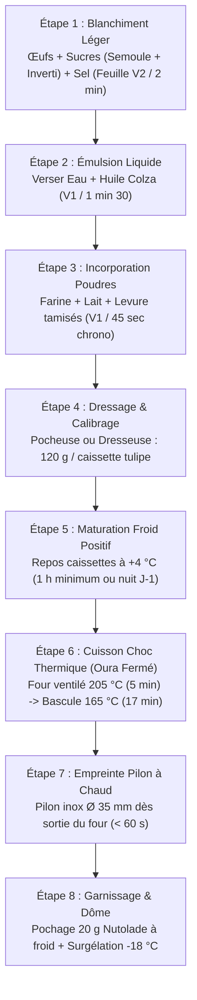

# GAMME MUFFINS ATELIER (120 g) — FORMAT DOUBLE-PAGE

**Codes Produits :** `B-MUF-01` (Chocolat & Cœur Nutolade) • `B-MUF-02` (Noisette & Cœur Pâte à Tartiner)  
**Destination :** Vitrine Pâtisserie Boulangère, Vente à emporter & Snacking d'Élite  
**Conditionnement :** Plaques d'atelier 24 moules (Caissettes tulipes plissées 120 g)  
**Standardisation :** Formulation au Standard Boulanger (Base 1 000 g de Farine / 100,0 %) & Paliers d'Atelier (1 à 15 plaques)  
**Statut de Validation :** 🟢 Validé Production — Conforme R&D & Sécurité Microbiologique  

---

<!-- ===================================================================== -->
<!-- PAGE GAUCHE (1/2) : POSTE DE PESÉE & TABLEAUX HAUTE LISIBILITÉ        -->
<!-- ===================================================================== -->

# PAGE GAUCHE — POSTE DE PESÉE (LECTURE À 1,5 MÈTRE)

## 1. INDICATEURS FLASH DE CONDUITE

| PARAMÈTRE CLÉ | VALEUR DE CONSIGNE | TOLÉRANCE ATELIER | OBJECTIF TECHNIQUE |
| :--- | :--- | :--- | :--- |
| **Calibre Unitaire Cru** | **120 g / caissette tulipe** | $\pm 2\text{ g}$ | Poids cuit net 115 g + 20 g fourrage |
| **Outil de Cuve** | **Feuille Batteur** | Strict | Émulsion sans foisonnement d'air excessif |
| **Maturation Pâte Crue** | **Repos au froid (+4 °C, $\ge 1\text{ h}$ ou nuit)** | Recommandé | Viscosité accrue & choc thermique dôme géant |
| **Garnissage Apparent** | **Nutolade 20 g / pièce** | $\pm 2\text{ g}$ | Dôme brillant et visible au centre |
| **Cuisson Choc Thermique** | **205 °C (5 min) puis 165 °C (17 min)** | $\pm 1\text{ min}$ | Éruption verticale dôme Coffee Shop ; oura fermé |

---

## 2. FORMULATION MAÎTRESSE & ÉCHELLES DE PESÉE (CHEF D'ATELIER)

### TABLEAU A : MUFFINS PÉPITES CHOCOLAT & CŒUR NUTOLADE (RÉF. `B-MUF-01`)
*Formule à base d'huile de colza et sucre inverti garantissant un moelleux permanent (conservation 7 jours sans dessèchement).*

> **Note d'atelier (Marge de freinte cuve & doseuse) :** Le dosage en caissettes tulipes est de **24 × 120 g = 2 880 g utiles coulés par plaque**. Le sous-total cuve de **3 450 g pour 1 plaque** (et **15 570 g pour 5 plaques**, soit 3 114 g/plaque) intègre volontairement la **marge technique de freinte (400 à 570 g)** liée à l'amorçage de la doseuse/poche et à la rétention sur la feuille et les parois de cuve.

| INGRÉDIENT | ÉTAPE | % BOULANGER | BASE 1 KG FARINE | 1 PLAQUE (24 P.) | 5 PLAQUES (120 P.) | 10 PLAQUES (240 P.) | 15 PLAQUES (360 P.) |
| :--- | :---: | :---: | :---: | :---: | :---: | :---: | :---: |
| **Œufs entiers liquides** | 1 | 38,5 % | 385 g | 400 g | 1 800 g | 3 550 g | 5 350 g |
| **Sucre semoule blanc** | 1 | 40,0 % | 400 g | 415 g | 1 860 g | 3 720 g | 5 580 g |
| **Sucre inverti (Trimoline) ou miel** | 1 | 6,2 % | 62 g | 65 g | 290 g | 580 g | 870 g |
| **Sel fin purifié** | 1 | 1,4 % | 14 g | 15 g | 70 g | 135 g | 200 g |
| **Eau tempérée (20 °C)** | 2 | 67,3 % | 673 g | 700 g | 3 150 g | 6 200 g | 9 350 g |
| **Huile de colza raffinée** | 2 | 48,1 % | 481 g | 500 g | 2 250 g | 4 450 g | 6 700 g |
| **Farine T65 conventionnelle BM (Moulin de Cadillac)** | 3 | **100,0 %** | **1 000 g** | **1 040 g** | **4 700 g** | **9 250 g** | **13 950 g** |
| **Poudre de lait entier 26%**| 3 | 9,6 % | 96 g | 100 g | 450 g | 900 g | 1 350 g |
| **Levure chimique (Baking powder)** | 3 | 5,3 % | 53 g | 55 g | 250 g | 500 g | 750 g |
| **Pépites chocolat noir 50% (décor)** | 4 | 15,4 % | 154 g | 160 g | 750 g | 1 500 g | 2 200 g |
| **SOUS-TOTAL PÂTE EN CUVE** | — | — | **3 318 g** | **3 450 g** | **15 570 g** | **30 785 g** | **46 300 g** |
| **Fourrage Nutolade apparent (post-cuisson)** | 4 | 48,1 % | 481 g | + 500 g | + 2 500 g | + 5 000 g | + 7 500 g |
| **MASSE TOTALE FINIE SORTIE ATELIER** | — | — | **3 799 g** | **3 950 g** | **18 070 g** | **35 785 g** | **53 800 g** |

---

### TABLEAU B : MUFFINS NOISETTE & CŒUR TARTINER (RÉF. `B-MUF-02`)
*Remplacement partiel de la farine par de la poudre de noisettes et apport de sucre inverti pour un moelleux boisé persistant.*

| INGRÉDIENT | ÉTAPE | % BOULANGER | BASE 1 KG FARINE | 1 PLAQUE (24 P.) | 5 PLAQUES (120 P.) | 10 PLAQUES (240 P.) | 15 PLAQUES (360 P.) |
| :--- | :---: | :---: | :---: | :---: | :---: | :---: | :---: |
| **Œufs entiers liquides** | 1 | 51,3 % | 513 g | 400 g | 1 800 g | 3 550 g | 5 350 g |
| **Sucre semoule blanc** | 1 | 55,0 % | 550 g | 430 g | 1 920 g | 3 850 g | 5 770 g |
| **Sucre inverti (Trimoline) ou miel** | 1 | 6,5 % | 65 g | 50 g | 230 g | 450 g | 680 g |
| **Sel fin purifié** | 1 | 1,9 % | 19 g | 15 g | 70 g | 135 g | 200 g |
| **Eau tempérée (20 °C)** | 2 | 89,7 % | 897 g | 700 g | 3 150 g | 6 200 g | 9 350 g |
| **Huile de colza raffinée** | 2 | 64,1 % | 641 g | 500 g | 2 250 g | 4 450 g | 6 700 g |
| **Farine T65 conventionnelle BM (Moulin de Cadillac)** | 3 | **100,0 %** | **1 000 g** | **780 g** | **3 500 g** | **6 950 g** | **10 450 g** |
| **Poudre de noisettes torréfiée** | 3 | 33,3 % | 333 g | 260 g | 1 200 g | 2 300 g | 3 500 g |
| **Poudre de lait entier 26%**| 3 | 12,8 % | 128 g | 100 g | 450 g | 900 g | 1 350 g |
| **Levure chimique (Baking powder)** | 3 | 7,1 % | 71 g | 55 g | 250 g | 500 g | 750 g |
| **Noisettes concassées (décor)**| 4 | 20,5 % | 205 g | 160 g | 750 g | 1 500 g | 2 200 g |
| **SOUS-TOTAL PÂTE EN CUVE** | — | — | **4 422 g** | **3 450 g** | **15 570 g** | **30 785 g** | **46 300 g** |
| **Fourrage Nutolade / Praliné (post-cuisson)** | 4 | 64,1 % | 641 g | + 500 g | + 2 500 g | + 5 000 g | + 7 500 g |
| **MASSE TOTALE FINIE SORTIE ATELIER** | — | — | **5 063 g** | **3 950 g** | **18 070 g** | **35 785 g** | **53 800 g** |

---

## 3. PRÉCAUTIONS INGRÉDIENTS & SÉCURITÉ MATIÈRE

1. **Rôle de l'huile de colza :** L'huile fluide à température ambiante (et même à +4 °C) ne cristallise pas contrairement aux graisses concrètes (beurre). Elle entoure les granules d'amidon gélatinisés, maintenant une souplesse extrême et limitant drastiquement le rancissement oxydatif.
2. **Poudres de lait et levure chimique :** Le mélange farine + poudre de lait + levure chimique doit être tamisé ensemble pour éviter les grumeaux de phosphate et assurer un développement alvéolaire parfaitement régulier sans poches de gaz asymétriques.
3. **Pépites et inclusions :** Ne jamais mélanger les pépites de chocolat dans la pâte chaude ; elles doivent être incorporées au dernier moment ou déposées en surfaçage pour ne pas fondre dans l'appareil.

---

<!-- ===================================================================== -->
<!-- PAGE DROITE (2/2) : PROTOCOLE PAS À PAS, CONDUITE & FOUR              -->
<!-- ===================================================================== -->

# PAGE DROITE — CONDUITE MACHINE, POSTE CUISSON & HACCP

## 1. PROTOCOLE CHRONOLOGIQUE AU BATTEUR PLANÉTAIRE

### DÉTAIL DES PHASES OPÉRATOIRES :
1. **Étape 1 — Blanchiment partiel :** Dans la cuve du batteur muni de la **Feuille**, introduire les œufs liquides, le sucre semoule et le sel fin. Tourner en vitesse 2 pendant 2 minutes. On cherche une légère dissolution du sucre sans monter l'appareil en ruban (éviter d'incorporer trop d'air qui ferait retomber le muffin après cuisson).
2. **Étape 2 — Émulsion des liquides :** Réduire en vitesse 1. Verser l'eau tempérée et l'huile de colza en filet régulier. Mélanger pendant 1 min 30 s jusqu'à émulsion lactescente homogène.
3. **Étape 3 — Incorporation des poudres (Point Critique) :** Verser l'ensemble Farine + Poudre de lait + Levure chimique tamisées (et poudre de noisettes pour la formule Noisette). Mélanger en vitesse 1 pendant **45 secondes à 1 minute maximum**. **Arrêter impérativement dès disparition de la farine sèche**. Un corsage au batteur développerait le réseau de gluten, rendant le muffin élastique et caoutchouteux au lieu d'être friable et fondant (*short texture*).
4. **Étape 4 — Dressage en caissettes tulipes :** Disposer 24 caissettes tulipes dans les empreintes de la plaque alvéolée 60x40 cm. À l'aide de la dresseuse volumétrique ou à la poche à douille lisse n°14, doser exactement **120 g de pâte crue** par moule. Parsemer le surfaçage de pépites de chocolat noir ou d'éclats de noisettes torréfiées.

---

## 2. BARÈME DE CUISSON, TECHNIQUE DU PILON & CONDITIONNEMENT

### BARÈME THERMIQUE & EFFET "DÔME COFFEE SHOP" (THERMAL BLAST)
- **Type de Four :** Four ventilé à chariot rotatif ou four à soles ventilées.
- **Principe Rhéologique du Dôme Géant :** La pâte froide (+4 °C) subit un choc thermique vif. La périphérie saisie se fige immédiatement contre la caissette tandis que le cœur liquide monte en cheminée sous la libération de $CO_2$.
- **Protocole Thermique à Deux Paliers :**
  1. **Palier 1 (Choc Thermique Initial) :** Enfourner à **205 °C – 210 °C** pendant **5 minutes pile**. Oura strictement FERMÉ.
  2. **Palier 2 (Cuisson à Cœur Fondante) :** Dès la 5ᵉ minute, abaisser la consigne à **165 °C** et poursuivre la cuisson pendant **17 minutes** (durée totale : 22 minutes).
- **Gestion des Ouras :** **Oura strictement FERMÉ** pendant toute la durée. L'humidité dégagée par l'appareil forme un chapeau de vapeur qui favorise l'expansion verticale du dôme sans croûtage prématuré.
- **Contrôle à Cœur :** À cœur, la pointe d'un thermomètre doit afficher 94 °C à 96 °C.

### TECHNIQUE DU PILON À CHAUD (CRÉATION DU PUITS NET SANS MIETTES)
1. **Sortie de Four Immédiate :** Dès l'extraction du four, déposer la plaque sur le marbre.
2. **Action Mécanique dans les 60 Secondes :** Pendant que la mie est encore malléable et au-dessus de 85 °C, enfoncer au centre exact de chaque muffin un pilon cylindrique en inox (diamètre 35 mm, profondeur 30 mm) préalablement tiédi ou légèrement huilé.
3. **Tassement Propre :** Une simple pression axiale compacte la mie du fond sans déchirer la tulipe extérieure, créant un puits étanche de 20 à 25 ml.
4. **Refroidissement :** Laisser refroidir complètement sur grille (température à cœur $< 25\text{ }^\circ\text{C}$).

### GARNISSAGE DU CŒUR & CRYOGÉNIE
1. **Fourrage à la Poche :** À l'aide d'une poche munie d'une douille cannelée ou lisse, pocher **20 g de Nutolade** (pâte à tartiner noisette-cacao fluide) ou de crème de praliné directement dans le puits. Laisser le fourrage déborder d'un dôme généreux et brillant.
2. **Activité de l'eau ($a_w$) :** Le fourrage gras anhydre possède une activité de l'eau $a_w \le 0,65$, bloquant tout transfert d'humidité vers la mie du muffin ($a_w \approx 0,80$).
3. **Stockage & Surgélation :** Disposer les plaques en cellule de surgélation rapide (-35 °C pendant 25 min) pour figer le décor, puis emballer en caisses carton étanches munies d'un sachet polyéthylène bleu agroalimentaire. Stocker à **-18 °C**. Décongélation en 45 minutes à température ambiante sous cloche.

---

## 3. CONTRÔLE QUALITÉ & POINTS CRITIQUES HACCP

| POINT DE CONTRÔLE | PARAMÈTRE MESURÉ | TOLÉRANCE CRITIQUE | ACTION CORRECTIVE IMMÉDIATE |
| :--- | :--- | :--- | :--- |
| **Mélange Poudres** | Temps vitesse 1 | Max 60 secondes | Arrêter immédiatement pour éviter l'élasticité |
| **Poids Cru** | Dresseuse volumétrique | 120 g $\pm 2\text{ g}$ | Tarer et réétalonner les pistons de la doseuse |
| **Enfoncement Pilon** | Température de pâte | $> 80\text{ }^\circ\text{C}$ (sortie four immédiate) | Si refroidi, le pilon brise la croûte ; agir sous 60 s |
| **Température Cuisson** | Thermocouple d'ambiance | 165 °C $\pm 3\text{ }^\circ\text{C}$ | Si coloration trop rapide, baisser à 160 °C et ajuster 24 min |
| **Étanchéité Stockage** | Sachet polyéthylène | Hermétique à -18 °C | Empêche le givrage et le dessèchement de surface |

---
*Fiche d'atelier normalisée — Laboratoire R&D Tourage & Boulangerie — Usage exclusif opérateurs de production.*
