# Fiche Technique d'Atelier : Oranais aux Abricots PAC (100 g)

* **Code Produit** : `V-PLF-05`
* **Famille** : Viennoiserie Feuilletée & Pâtes Tourées (PLF Semi-Industrielle)
* **Procédé** : Double Congélation PAC (Cru Surgelé -35 °C $\rightarrow$ Pousse Étuvée $\rightarrow$ Blocage PAC Sonde -10 °C à cœur)
* **Ligne de Façonnage** : Ligne Rondo Polyline (Disques de refente longitudinale + Guillotine en carrés + Doseuse diagonale + Pliage cravate)
* **Format d'Atelier** : Double Page Vis-à-Vis (Page Gauche : Poste Pesée & Garnitures | Page Droite : Conduite Polyline, PAC, Cuisson & Sirop 44° Brix)
* **Version** : `v1.0-STANDARD-USINE` | **Statut** : 🟢 Validé Production & Standard Atelier

---

## PAGE GAUCHE (1/2) • POSTE DE PESÉE & PRÉPARATION GARNITURES

### Repères Flash Poste de Pesée
| Repère | Paramètre Clé | Spécification Atelier | Justification Scientifique & Rhéologique |
| :--- | :--- | :--- | :--- |
| 🟢 **Détrempe / Bac** | **8,00 kg pile / bac** | Format Paneo pré-laminé sur **3 cm d'épaisseur** | Loi de Fourier ($t \propto e^2/\alpha$) : descente flash sous 6 °C en 30 min |
| 🟡 **Pâte Crue Tourée / Pièce**| **60 g de pâte nette** | Carré de **~12 x 12 cm** (abaisse à **3,0 mm**) | Pliage cravate stable ne masquant pas le cœur du fruit |
| 🍮 **Crème Pâtissière à Froid**| **25 g / pièce** | **Staufim ou Finecrem Puratos** | Amidon modifié thermorésistant, anti-dégorgement |
| 🍑 **Oreillons d'Abricots** | **2 demi-oreillons (15 g)** | **Abricots au sirop léger bien égouttés** | Égouttage sur grille $\ge 30\text{ min}$ obligatoire pour neutraliser l'eau libre |
| 🔴 **Poids Brut Total Pièce** | **100 g brut unitaire** | Format carré plié en losange/cravate | Poids cuit final visé : **~88–90 g** |

---

### Tableau Chronologique des Pesées en 4 Phases
*Détrempe Étalon PLF Universelle (Base Farine 100,0 % : 70 % Gruau T45 + 30 % T65 Tradition pure) | Tolérance : ± 1 g ingrédients critiques.*

| Phase & Ordre | Ingrédient d'Atelier | % Meunier | Base 1 kg Farine | 1 Bac (8 000 g) | 10 Bacs (80 000 g) | 20 Bacs (160 000 g) | Spécification & Rôle Biochimique |
| :---: | :--- | :---: | :---: | :---: | :---: | :---: | :--- |
| **`[1]` Bleu** | **Farine Gruau Rouge T45 (Moulin de Cadillac)** | **70,0 %** | **700 g** | **3 130 g** | **31 300 g** | **62 600 g** | $W > 330$, protéines ~14 %, armature cryorésistante pure sans additif |
| **`[1]` Bleu** | **Farine Tradition pure (Décret 93)** | **30,0 %** | **300 g** | **1 340 g** | **13 400 g** | **26 800 g** | Sans E300 au moulin ; extensibilité ($L$), $P/L \approx 0,60$ |
| **`[1]` Bleu** | **Eau glacée (+1 °C) / Glace** | **45,0 %** | **450 g** | **2 015 g** | **20 150 g** | **40 300 g** | $a_w$ maîtrisée, fraction d'eau libre minimisée |
| **`[1]` Bleu** | **Sucre cristal semoule** | **8,8 %** | **88 g** | **394 g** | **3 940 g** | **7 880 g** | Substrat fermentaire et réactions de Maillard |
| **`[1]` Bleu** | **Trimoline (Sucre inverti)** | **3,5 %** | **35 g** | **157 g** | **1 570 g** | **3 140 g** | $180\text{ g/mol}$ : abaisse $\Delta T_f$, anti-rétrogradation mie |
| **`[1]` Bleu** | **Levure fraîche L'Hirondelle Or** | **4,2 %** | **42 g** | **188 g** | **1 880 g** | **3 760 g** | Osmotolérante, 40 min de latence à 21 °C, anti-lyse GSH |
| **`[1]` Bleu** | **Poudre de lait entier 26 %** | **4,0 %** | **40 g** | **180 g** | **1 800 g** | **3 600 g** | Fixation de l'eau libre par les caséines, moelleux |
| **`[1]` Bleu** | **Améliorant S500 Kimo Short** | **2,0 %** | **20 g** | **90 g** | **900 g** | **1 800 g** | **Plafonné à 2,0 %** : compense le GSH sans sur-oxyder |
| **`[1]` Bleu** | **Sel fin d'atelier** | **2,0 %** | **20 g** | **90 g** | **900 g** | **1 800 g** | Ligne isolée : renforcement ionique du réseau |
| **`[1]` Bleu** | **Vinaigre blanc d'alcool 8°** | **0,8 %** | **8 g** | **36 g** | **360 g** | **720 g** | Tampon pH 5,1–5,3 : inhibe polyphénol oxydase (anti-grisement) |
| **`[2]` Ambre** | **Margarine Opal cuve (Michard 3825)** | **8,5 %** | **85 g** | **380 g** | **3 800 g** | **7 600 g** | Incorporé en V2 (pains 500 g) : plastifiant cryo et souplesse |
| **TOTAL** | **SOUS-TOTAL DÉTREMPE NET** | **178,8 %** | **1 788 g** | **8 000 g pile** | **80 000 g pile** | **160 000 g pile** | **Poids net calibré à 8 000 g pile / bac Paneo** |
| **`[3]` Vert** | **Beurre Debic Croissant tourage (Michard 6191)** | **25,0 % dét.** | **447 g** | **2 000 g** | **20 000 g** | **40 000 g** | 1 plaque de 2 000 g pile / bac (82% MG, PF 34–36 °C, 12 films) |
| **TOTAL** | **POIDS TOTAL PÂTON TOURÉ** | **223,5 %** | **2 235 g** | **10 000 g pile** | **100 000 g pile** | **200 000 g pile** | **10 000 g net de pâte prête au façonnage / bac** |

---

### Préparation des Garnitures de Ligne (Par Fournée)

#### 1. Crème Pâtissière à Froid (Staufim ou Finecrem Puratos)
*Ratio standard : 350 g de poudre pour 1 000 g d'eau froide (+10 °C à +15 °C).*

| Composant Crème | Ratio | 1 Bac (163 pcs) | 10 Bacs (1 630 pcs) | 20 Bacs (3 260 pcs) | Protocole de Foisonnement |
| :--- | :---: | :---: | :---: | :---: | :--- |
| **Poudre Staufim / Finecrem Puratos** | 25,9 % | **1 055 g** | **10,55 kg** | **21,10 kg** | Verser l'eau froide dans la cuve du batteur, |
| **Eau froide tempérée (+12 °C)** | 74,1 % | **3 020 g** | **30,20 kg** | **60,40 kg** | ajouter la poudre en pluie. 1 min en V1, puis |
| **TOTAL CRÈME PRÊTE À L'EMPLOI** | **100 %** | **4 075 g (4,1 kg)**| **40,75 kg** | **81,50 kg** | **battre 3 min V3**. Repos 10 min à +4 °C. |

#### 2. Oreillons d'Abricots au Sirop Égouttés
* **Règle absolue d'atelier** : Égoutter les boîtes d'abricots sur claies inox perforées au moins **30 minutes** avant dépose. Éponger le dos des fruits sur papier absorbant si nécessaire.
* **Besoin 1 bac (163 pcs)** : **326 oreillons** (~2,45 kg net égoutté).
* **Besoin 10 bacs (1 630 pcs)** : **3 260 oreillons** (~24,5 kg net égoutté).
* **Besoin 20 bacs (3 260 pcs)** : **6 520 oreillons** (~49,0 kg net égoutté).

#### 3. Sirop de Lustrage 44° Brix (Finition post-cuisson)
* **Formule** : **1 000 g d'eau + 800 g de sucre semoule**. Porter à ébullition 1 min, refroidir complètement avant usage.

---

### Cadences & Rendements Oranais (Base 100 g brut : 60 g pâte + 25 g crème + 15 g abricots)
* **Rendement brut par bac (pâton 10 kg avec 2 % parage = 9,80 kg pâte utile)** : **~163 pièces**.
* **Rendement fournée 10 bacs (100 kg touré)** : **~1 630 pièces**.
* **Rendement plein pétrin 20 bacs (200 kg touré)** : **~3 260 pièces**.

---

## PAGE DROITE (2/2) • CONDUITE POLYLINE, PAC & FINITION SIROP 44° BRIX

```mermaid
flowchart TD
    A["Pâton PLF Touré 10,0 kg (12 films)\nAbaisse Laminoir 3,0 mm (Bande ~48 cm)\nEnroulement sur rouleau de transfert"] 
    --> B["Déroulage sur Tapis Rondo Polyline\nFace farinée en DESSOUS (glisse tapis)\nFace supérieure NUE (soudure cravate & crème)"]
    --> C["Décompression libre de la bande >= 60 s\n(Annulation du retrait élastique snapback)"]
    --> D["POSTE 1 : 1re Matrice de coupe longitudinale\n(Disques de refente divisant en bandes de ~12 cm)"]
    --> E["POSTE 2 : Doseuse Polyline\n(Dépose continue ou cadencée de crème Staufim/Finecrem sur chaque bande)"]
    --> F["POSTE 3 : Guillotine transversale Polyline\n(Coupe cadencée à 12 cm -> Carrés garnis à plat 12x12 cm / 85 g)"]
    --> G["POSTE 4 : Pliage Cravate Manuel (Opérateurs)\n(Croisement des 2 pointes au centre SANS ABRICOT)"]
    --> H["1re Surgélation Cellule Flash -35 °C SANS FRUITS\n(Stockage tampon étanche à -18 °C : zéro synérèse)"]
    --> I["Décongélation Froid (10–12 h à +2/+4 °C)\n+ Pousse Étuve 25–26 °C / 75–80% HR (70–75% vol.)"]
    --> J["Raffermissement 15 min (+4 °C) + Dorure Végétale Pistolet\n+ DÉPOSE DES 2 DEMI-OREILLONS D'ABRICOTS ÉGOUTTÉS (15 g)"]
    --> K["2e Blocage PAC (Sonde -10 °C à cœur) OU Enfournement Direct\n(Cuisson ventilée 160–165 °C / 15–17 min)"]
    --> L["Lustrage immédiat Sirop 44° Brix froid sur pièces brûlantes\n(Éclat miroir sur pâte et fruits)"]
```

---

### Étape 1 : Laminage & Ligne Polyline (Séquence Usine)
1. **Laminage fin sur Rondo Compas** :
   * Abaisser progressivement jusqu'à **3,0 mm (± 0,1 mm)**. Largeur de bande : **~48 cm**.
2. **Déroulage Inversé & Décompression** :
   * Côté fariné en dessous (glisse tapis), face supérieure nue et sans farine.
   * Décompression libre $\ge 60\text{ s}$ sur tapis.
3. **Poste 1 • Première Matrice (Disques de Refente)** :
   * Les couteaux circulaires divisent la bande en **4 bandes longitudinales régulières de 12 cm de large**.
4. **Poste 2 • Doseuse de Crème Pâtissière à Froid** :
   * La doseuse dépose un plot ou cordon continu de **25 g de crème Staufim/Finecrem** au centre de chaque bande.
5. **Poste 3 • Guillotine Transversale Polyline** :
   * La guillotine coupe transversalement tous les 12 cm pour débiter des carrés garnis réguliers de **12 × 12 cm**.
6. **Poste 4 • Pliage Cravate Manuel (SANS FRUITS) & Plaquage** :
   * Les opérateurs rabattent les deux pointes opposées au centre par-dessus la crème, en appuyant fermement au point de croisement central pour sceller la soudure.
   * **RÈGLE FONDAMENTALE D'ATELIER : ZÉRO ABRICOT À CE STADE !**
   * *Justification scientifique* : L'abricot au sirop contient 85 % d'eau libre. Congelé dans le pâton cru, ses cellules éclatent sous l'effet des cristaux de glace. Lors de la décongélation, le fruit libère son eau (synérèse acide), détrempant complètement le feuilletage et faisant pourrir la pousse. Les oranais sont donc **surgelés et stockés à -18 °C avec la crème seule**.

---

### Étape 2 : Double Congélation PAC & Pousse Contrôlée
1. **Plaquage & 1ʳᵉ Surgélation Flash (Pâte + Crème)** :
   * Déposer sur plaques 60×40 (3 rangées de 4 ou 5 = **12 à 15 pièces par plaque**).
   * Cellule flash à **-35 °C pendant 40 minutes**.
   * Stockage tampon en cartons étanches à **-18 °C**.
2. **Pousse Contrôlée (Après décongélation)** :
   * Décongélation lente à +2 °C / +4 °C pendant 10 h à 12 h.
   * Pousse étuve à **25 °C – 26 °C et 75–80 % HR** pendant **2 h 15 à 2 h 30** (arrêt à 70–75 % de volume).
3. **Garnissage Fruits Post-Pousse & Dorure** :
   * Sortie étuve et raffermissement **15 minutes à +4 °C**.
   * Pulvériser la **Dorure Végétale au pistolet** sur la pâte feuilletée.
   * **Dépose des Abricots** : Poser délicatement **2 demi-oreillons d'abricots bien égouttés** dans les deux cavités ouvertes aux extrémités de la cravate.
   * *Résultat* : Le fruit reste charnu, ne détrempe pas la pâte et cuit de façon éclatante.
4. **2ᵉ Blocage PAC (Arrêt Sonde à Cœur) ou Enfournement** :
   * **Option Stockage PAC** : Piquer la sonde témoin à cœur d'un pâton. Passage en cellule flash à -35 °C $\rightarrow$ **arrêt strict dès que la sonde atteint -10 °C à cœur**. Conditionnement immédiat en cartons doublés d'une housse hermétique étanche et stockage définitif à **-18 °C**.
   * **Option Cuisson Directe Jour J** : Enfournement direct après les 15 min de raffermissement et garnissage des fruits.

---

### Étape 4 : Cuisson Directe Surgelée & Lustrage Sirop 44° Brix
* **Enfournement** : Directement du congélateur (-18 °C) sur plaques de cuisson.
* **Préchauffage four ventilé** : Préchauffer à **185 °C – 190 °C**.
* **Enfournement & Buée** : Enfourner la charge et injecter **3 secondes de buée**.
* **Conduite de Cuisson** :
  * Consigne de température : **160 °C à 165 °C**.
  * Durée : **15 à 17 minutes**.
  * **Ouverture des ouras à 13 minutes** pour sécher le feuilletage et évacuer la vapeur de l'abricot.
* **Lustrage Signature au Sirop 44° Brix (Finition Brûlante)** :
  * Dès la sortie immédiate du four (pièces bouillonnantes) :
  * **Passer un coup de pinceau ou de pulvérisateur de Sirop 44° Brix froid sur toute la pièce (pâte ET abricots)**.
  * *Résultat* : Le sirop cristallise instantanément en un vernis protecteur transparent qui redonne un éclat miroir aux abricots cuits et empêche la pâte de sécher.