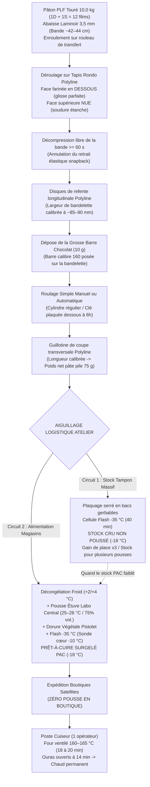

# Fiche Technique d'Atelier : Pain au Chocolat Équerré PAC (1 Barre 160)

* **Code Produit** : `V-PLF-02`
* **Famille** : Viennoiserie Feuilletée & Pâtes Tourées (Standard Artisanal Multi-Boutiques)
* **Architecture de Tourage** : **1 Tour Double + 1 Tour Simple (1D + 1S)** — Strictement unifié avec le croissant (12 films de beurre / 25 couches) pour simplicité en atelier, cadence rapide et zéro erreur humaine.
* **Modèle Logistique Laboratoire Central ("Hub & Spoke")** :
  * **Stock 1 (Cru Non Poussé Surgelé -18 °C)** : Stockage massif ultra-compact (densité maximale, gain de place $\times 3$). Permet de déclencher plusieurs pousses fractionnées au fil de la semaine avec une seule tournée de laminage.
  * **Stock 2 (Prêt-à-Cuire Poussé-Surgelé PAC -18 °C)** : Pousse menée exclusivement au laboratoire central (70–75% vol.) puis re-blocage flash à -35 °C. Expédition vers les boutiques satellites : **les boutiques n'ont aucune chambre de pousse à gérer**, enfournement direct congelé par le cuiseur.
* **Équipements Clés** : Pétrin spirale, Laminoir Rondo, Ligne Rondo Polyline, Guillotine transversale, Cellule flash -35 °C.
* **Format d'Atelier** : Double Page Vis-à-Vis (Page Gauche : Poste Pesée | Page Droite : Conduite Polyline, Roulage 1 Barre & Logistique Double Stock)
* **Statut** : 🟢 Validé Production — Doctrine Officielle Laboratoire Central Multi-Boutiques

---

## PAGE GAUCHE (1/2) • POSTE DE PESÉE (LECTURE À 1,5 MÈTRE)

### Repères Flash Poste de Pesée
| Repère | Paramètre Clé | Spécification Atelier | Justification Scientifique & Rhéologique |
| :--- | :--- | :--- | :--- |
| 🟢 **Détrempe / Bac** | **8,00 kg pile / bac** | Format Paneo pré-laminé sur **3 cm d'épaisseur** | Loi de Fourier ($t \propto e^2/\alpha$) : descente flash sous 6 °C en 30 min |
| 🟠 **Pâte Crue / Pièce** | **75 g de pâte nette** | Abaisse laminoir à **3,5 mm (± 0,1 mm)** | Calibre constant garantissant le ratio parfait mie/chocolat |
| 🍫 **Garniture Chocolat** | **1 Grosse Barre (10 g)** | Calibre standard **160 barres / boîte** | Roulage simple rapide, fondant généreux et centré |
| 🔴 **Poids Brut Total** | **85 g brut avec la barre** | Calibre cuit visé : **~75–76 g** | Poids équilibré d'atelier, excellente tenue commerciale |
| 🌀 **Tourage Unifié** | **1 Tour Double + 1 Tour Simple** | **12 films de matière grasse** | Zéro multiplication des programmes ; même pâton que le croissant |

### Tableau Chronologique des Pesées en 4 Phases
*Détrempe Étalon PLF Universelle (Base Farine 100,0 % : 70 % Gruau T45 + 30 % T65 Tradition pure) | Tolérance : ± 1 g ingrédients critiques.*

| Phase & Ordre | Ingrédient d'Atelier | % Meunier | Base 1 kg Farine | 1 Bac (8,0 kg) | 10 Bacs (80 kg) | 20 Bacs (160 kg) | Spécification & Rôle Biochimique |
| :---: | :--- | :---: | :---: | :---: | :---: | :---: | :--- |
| **`[1]` Bleu** | **Farine Gruau Rouge T45 (Moulin de Cadillac)** | **70,0 %** | **700 g** | **3 133 g** | **31,33 kg** | **62,65 kg** | $W > 330$, protéines ~14 %, armature cryorésistante pure |
| **`[1]` Bleu** | **Farine Tradition pure (Décret 93)** | **30,0 %** | **300 g** | **1 342 g** | **13,42 kg** | **26,85 kg** | Sans E300 au moulin ; extensibilité ($L$), $P/L \approx 0,60$ |
| **`[1]` Bleu** | **Eau glacée (+1 °C) / Glace** | **45,0 %** | **450 g** | **2 014 g** | **20,14 kg** | **40,28 kg** | $a_w$ maîtrisée, fraction d'eau libre minimisée |
| **`[1]` Bleu** | **Sucre cristal semoule** | **8,8 %** | **88 g** | **394 g** | **3,94 kg** | **7,88 kg** | Substrat fermentaire et réactions de Maillard |
| **`[1]` Bleu** | **Trimoline (Sucre inverti)** | **3,5 %** | **35 g** | **157 g** | **1,57 kg** | **3,13 kg** | $180\text{ g/mol}$ : abaisse $\Delta T_f$, cryoprotecteur naturel |
| **`[1]` Bleu** | **Levure fraîche L'Hirondelle Or** | **4,2 %** | **42 g** | **188 g** | **1,88 kg** | **3,76 kg** | Osmotolérante, 40 min de latence à 21 °C, anti-lyse GSH |
| **`[1]` Bleu** | **Poudre de lait entier 26 %** | **4,0 %** | **40 g** | **179 g** | **1,79 kg** | **3,58 kg** | Fixation de l'eau libre par les caséines, moelleux |
| **`[1]` Bleu** | **Améliorant S500 Kimo Short** | **2,0 %** | **20 g** | **90 g** | **0,90 kg** | **1,79 kg** | **Plafonné à 2,0 %** : compense le GSH sans sur-oxyder |
| **`[1]` Bleu** | **Sel fin d'atelier** | **2,0 %** | **20 g** | **90 g** | **0,90 kg** | **1,79 kg** | Ligne isolée : renforcement ionique du réseau |
| **`[1]` Bleu** | **Vinaigre blanc d'alcool 8°** | **0,8 %** | **8 g** | **36 g** | **0,36 kg** | **0,72 kg** | Tampon pH 5,1–5,3 : inhibe polyphénol oxydase (anti-grisement) |
| **`[2]` Ambre** | **Margarine Opal cuve (Michard 3825)** | **8,5 %** | **85 g** | **380 g** | **3,80 kg** | **7,60 kg** | Incorporé en V2 (pains 500 g) : plastifiant cryo et souplesse |
| **TOTAL** | **SOUS-TOTAL DÉTREMPE NET** | **178,8 %** | **1 788 g** | **8 003 g** | **80,03 kg** | **160,06 kg** | **Poids net calibré à 8,00 kg pile / bac Paneo** |
| **`[3]` Vert** | **Beurre Debic Croissant tourage (Michard 6191)** | **25,0 % dét.** | **447 g** | **2 000 g** | **20,00 kg** | **40,00 kg** | 1 plaque de 2,00 kg pile / bac (82% MG, PF 34–36 °C, **12 films**) |
| **TOTAL** | **POIDS TOTAL PÂTON TOURÉ** | **223,8 %** | **2 235 g** | **10 000 g** | **100,00 kg** | **200,00 kg** | **10,00 kg net de pâte prête au façonnage / bac** |
| **`[4]` Garniture**| **Barres chocolat 44 % (Calibre 160)**| **1 barre / pc** | **~29 barres** | **~130 barres** | **~1 300 barres**| **~2 600 barres**| 1 barre de 10 g / pièce (160 barres / boîte) |
| **`[4]` Finition** | **Dorure Végétale au pistolet** | PM | PM | 50 g / plaque | 500 g | 1 000 g | Pulvérisation fine uniforme à froid (+4 °C) |

### Cadences & Rendements Pains au Chocolat (Base 75 g pâte + 10 g barre = 85 g brut)
* **Rendement brut par bac (pâton 10 kg avec 2 % parage)** : **130 à 131 pains au chocolat**.
* **Besoin chocolat par bac (10 kg touré)** : **~130 barres** (soit un peu moins d'une boîte de 160 barres).
* **Rendement fournée 10 bacs (100 kg touré)** : **~1 300 pièces** (~8 boîtes de 160 barres).
* **Rendement plein pétrin 20 bacs (200 kg touré)** : **~2 600 pièces** (~16 boîtes et demie de 160 barres).

---

## PAGE DROITE (2/2) • CONDUITE POLYLINE, ROULAGE & LOGISTIQUE MULTI-BOUTIQUES

---

### Étape 1 : Préparation & Tourage Unifié (1D + 1S)
1. **Unification Stricte du Tourage en Atelier (Règle Anti-Erreur)** :
   * Les 3 touriers appliquent **exactement le même tourage que pour le croissant** : **1 Tour Double suivi de 1 Tour Simple (12 films de beurre)**.
   * **Avantages immédiats pour l'équipe :**
     * Pas de changement de programme sur le laminoir Rondo.
     * Gain de temps substantiel par rapport à un tourage à 3 tours.
     * Zéro risque de confusion entre pâtons croissants et pâtons chocolatines.
   * Amincissement progressif sur Rondo jusqu'à **3,5 mm (± 0,1 mm)**. Largeur de bande : ~42 à 44 cm.
2. **Déroulage Inversé sur Polyline** :
   * **Dérouler côté fariné en dessous (au contact du tapis)**.
   * **Face supérieure rigoureusement nue et sans farine volante** : permet au repli de pâte de coller et souder instantanément sur lui-même lors du roulage.
3. **Décompression Libre Anti-Snapback ($\ge 60\text{ secondes}$)** :
   * Laisser flotter la bande sur le tapis d'entrée pour neutraliser toute mémoire élastique. Température de bande : **10 °C à 12 °C**.

---

### Étape 2 : Refente, Dépose de la Barre & Roulage Simple
1. **Refente Longitudinale** : Les disques divisent la bande en **4 ou 5 bandes parallèles** de largeur constante (**85 à 90 mm**).
2. **Dépose de la Barre (Calibre 160 / 10 g)** : Poser 1 seule barre transversalement à 2–3 cm du bord d'attaque.
3. **Roulage Simple & Calage de la Clé** :
   * Rabattre le petit bord sur la barre, rouler la bande d'un mouvement franc.
   * **La soudure finale (la clé) doit impérativement terminer en dessous (à 6 heures)**, plaquée contre le support pour empêcher tout déroulement.
4. **Coupe Transversale Guillotine** : Coupe nette calibrée pour obtenir **75 g de pâte nette** (soit **85 g total avec la barre**).

---

### Étape 3 : Gestion du Double Stock (La Doctrine du Laboratoire Central)

#### CIRCUIT 1 : STOCK TAMPON CRU NON POUSSÉ (-18 °C) — LA RÉSERVE MASSIF
* **Pourquoi ce stock est capital pour vos 3 touriers ?** :
  * Un carton de 200 pains au chocolat crus non poussés prend **3 fois moins de place** en chambre négative que du prêt-à-cuire déjà poussé.
  * Vos 3 touriers peuvent fabriquer 2 600 pièces en une seule journée de pétrissage/façonnage sans encombrer les étuves.
  * Ce stock tampon se conserve **6 à 8 semaines à -18 °C** sous housse plastique hermétique.
  * **Fonctionnement :** Dès que le stock de prêt-à-cuire (PAC) commence à faiblir au laboratoire ou dans les boutiques, on sort le nombre exact de plaques de cru surgelé nécessaire pour déclencher une pousse. **Une seule tournée de non poussé permet ainsi d'alimenter 3 ou 4 pousses fractionnées dans la semaine.**

#### CIRCUIT 2 : RÉASSORT DU PRÊT-À-CUIRE POUSSÉ-SURGELÉ (PAC) — EXPÉDITION BOUTIQUES
1. **Décongélation Lente :** Placer les plaques de cru non poussé en chambre positive à +2 °C / +4 °C pendant 10 h à 12 h (ou départ chambre de pousse programmée).
2. **Pousse Contrôlée au Laboratoire Central :**
   * Étuve régulée à **25 °C – 26 °C et 75–80 % HR** pendant **2 h 15 à 2 h 30**.
   * **Arrêt impératif à 70–75 % du volume final** : Ne jamais pousser à 100% avant le 2e gel (préserve l'élasticité membranaire).
3. **Raffermissement & Dorure Végétale :** 15 minutes à +4 °C pour figer le beurre superficiel, puis pulvérisation d'un voile de dorure végétale au pistolet à 1,5 bar.
4. **2e Blocage Flash PAC :** Cellule rapide à -35 °C $\rightarrow$ **arrêt dès que la sonde à cœur affiche -10 °C**.
5. **Conditionnement & Expédition Magasins :** Conditionner en caisses carton étanches avec sachets bleus. Stocker à **-18 °C**. 
   * **Les boutiques satellites reçoivent exclusivement ces caisses de PAC.** Les employés des boutiques n'ont aucune chambre de pousse à surveiller : ils prennent les plaques et enfournent directement.

---

### Étape 4 : Poste Cuiseur (Cuisson Directe Congelé à Toute Heure)

* **Départ four** : Directement du congélateur négatif (-18 °C) sur plaques de cuisson revêtues de papier cuisson ou Silpain, sans aucune décongélation.
* **Préchauffage du Four ventilé** : Préchauffer à **185 °C – 190 °C**.
* **Enfournement & Buée** : Enfourner immédiatement la charge congelée et injecter **3 secondes de buée**.
* **Conduite de Cuisson** :
  * Réguler la consigne à **160 °C à 165 °C**.
  * Durée totale : **18 à 20 minutes**.
  * **Ouverture des ouras à 14 minutes** pour assécher la croûte, dorer les feuillets et éliminer l'affaissement au ressuage.
* **Ressuage** : Débarrasser sur grilles ajourées en zone tempérée sans courant d'air. Le cuiseur peut réitérer cette opération 4 à 6 fois par jour pour maintenir une vitrine chaude en permanence.

---
*Fiche d'atelier normalisée — Laboratoire R&D Tourage & Boulangerie — Usage exclusif opérateurs de production.*
