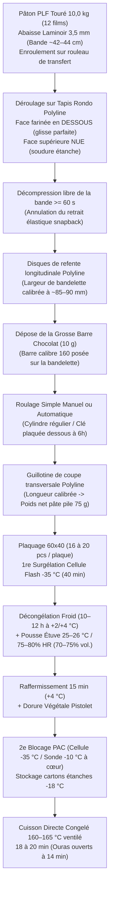

# Fiche Technique d'Atelier : Pain au Chocolat Équerré PAC (1 Barre 160)

* **Code Produit** : `V-PLF-02`
* **Famille** : Viennoiserie Feuilletée & Pâtes Tourées (PLF Semi-Industrielle)
* **Procédé** : Double Congélation PAC (Cru Surgelé -35 °C $\rightarrow$ Pousse Étuvée $\rightarrow$ Blocage PAC Sonde -10 °C à cœur)
* **Équipements Clés** : Pétrin spirale 160 kg (20 bacs), Laminoir Rondo Compas, Ligne Rondo Polyline, Guillotine de coupe transversale, Cellules flash -35 °C
* **Format d'Atelier** : Double Page Vis-à-Vis (Page Gauche : Poste Pesée | Page Droite : Conduite Polyline, Roulage 1 Barre & Cuisson)
* **Version** : `v1.0-STANDARD-USINE` | **Statut** : 🟢 Validé Production & Standard Atelier

---

## PAGE GAUCHE (1/2) • POSTE DE PESÉE

### Repères Flash Poste de Pesée
| Repère | Paramètre Clé | Spécification Atelier | Justification Scientifique & Rhéologique |
| :--- | :--- | :--- | :--- |
| 🟢 **Détrempe / Bac** | **8,00 kg pile / bac** | Format Paneo pré-laminé sur **3 cm d'épaisseur** | Loi de Fourier ($t \propto e^2/\alpha$) : descente flash sous 6 °C en 30 min |
| 🟠 **Pâte Crue / Pièce** | **75 g de pâte nette** | Abaisse laminoir à **3,5 mm (± 0,1 mm)** | Calibre constant garantissant le ratio parfait mie/chocolat |
| 🍫 **Garniture Chocolat** | **1 Grosse Barre (10 g)** | Calibre standard **160 barres / boîte** | Roulage simple rapide, fondant généreux et centré |
| 🔴 **Poids Brut Total** | **85 g brut avec la barre** | Calibre cuit visé : **~75–76 g** | Poids équilibré d'atelier, excellente tenue commerciale |

### Tableau Chronologique des Pesées en 4 Phases
*Détrempe Étalon PLF Universelle (Base Farine 100,0 % : 70 % Gruau T45 + 30 % T65 Tradition pure).*

| Phase & Ordre | Ingrédient d'Atelier | % Meunier | 1 Bac (8,0 kg) | 10 Bacs (80 kg) | 20 Bacs (160 kg) | Spécification & Rôle Biochimique |
| :---: | :--- | :---: | :---: | :---: | :---: | :--- |
| **`[1]` Bleu** | **Farine Gruau Rouge T45 (Moulin de Cadillac)** | **70,0 %** | **3 133 g** | **31,33 kg** | **62,65 kg** | $W > 330$, protéines ~14 %, armature cryorésistante pure sans additif |
| **`[1]` Bleu** | **Farine Tradition pure (Décret 93)** | **30,0 %** | **1 342 g** | **13,42 kg** | **26,85 kg** | Sans E300 au moulin ; extensibilité ($L$), $P/L \approx 0,60$ |
| **`[1]` Bleu** | **Eau glacée (+1 °C) / Glace** | **45,0 %** | **2 014 g** | **20,14 kg** | **40,28 kg** | $a_w$ maîtrisée, fraction d'eau libre minimisée |
| **`[1]` Bleu** | **Sucre cristal semoule** | **8,8 %** | **394 g** | **3,94 kg** | **7,88 kg** | Substrat fermentaire et réactions de Maillard |
| **`[1]` Bleu** | **Trimoline (Sucre inverti)** | **3,5 %** | **157 g** | **1,57 kg** | **3,13 kg** | $180\text{ g/mol}$ : abaisse $\Delta T_f$, anti-rétrogradation mie |
| **`[1]` Bleu** | **Levure fraîche L'Hirondelle Or** | **4,2 %** | **188 g** | **1,88 kg** | **3,76 kg** | Osmotolérante, 40 min de latence à 21 °C, anti-lyse GSH |
| **`[1]` Bleu** | **Poudre de lait entier 26 %** | **4,0 %** | **179 g** | **1,79 kg** | **3,58 kg** | Fixation de l'eau libre par les caséines, moelleux |
| **`[1]` Bleu** | **Améliorant S500 Kimo Short** | **2,0 %** | **90 g** | **0,90 kg** | **1,79 kg** | **Plafonné à 2,0 %** : compense le GSH sans sur-oxyder |
| **`[1]` Bleu** | **Sel fin d'atelier** | **2,0 %** | **90 g** | **0,90 kg** | **1,79 kg** | Ligne isolée : renforcement ionique du réseau |
| **`[1]` Bleu** | **Vinaigre blanc d'alcool 8°** | **0,8 %** | **36 g** | **0,36 kg** | **0,72 kg** | Tampon pH 5,1–5,3 : inhibe polyphénol oxydase (anti-grisement) |
| **`[2]` Ambre** | **Margarine Opal cuve (Michard 3825)** | **8,5 %** | **380 g** | **3,80 kg** | **7,60 kg** | Incorporé en V2 (pains 500 g) : plastifiant cryo et souplesse |
| **TOTAL** | **SOUS-TOTAL DÉTREMPE NET** | **178,8 %** | **8 003 g** | **80,03 kg** | **160,06 kg** | **Poids net calibré à 8,00 kg pile / bac Paneo** |
| **`[3]` Vert** | **Beurre Debic Croissant tourage (Michard 6191)** | **25,0 % dét.** | **2 000 g** | **20,00 kg** | **40,00 kg** | 1 plaque de 2,00 kg pile / bac (82% MG, PF 34–36 °C, 12 films) |
| **TOTAL** | **POIDS TOTAL PÂTON TOURÉ** | **223,8 %** | **10 000 g** | **100,00 kg** | **200,00 kg** | **10,00 kg net de pâte prête au façonnage / bac** |
| **`[4]` Garniture**| **Barres chocolat 44 % (Calibre 160)**| **1 barre / pc** | **~130 barres** | **~1 300 barres**| **~2 600 barres**| 1 barre de 10 g / pièce (160 barres / boîte) |
| **`[4]` Finition** | **Dorure Végétale au pistolet** | PM | 50 g / plaque | 500 g | 1 000 g | Pulvérisation fine uniforme à froid (+4 °C) |

### Cadences & Rendements Pains au Chocolat (Base 75 g pâte + 10 g barre = 85 g brut)
* **Rendement brut par bac (pâton 10 kg avec 2 % parage)** : **130 à 131 pains au chocolat**.
* **Besoin chocolat par bac (10 kg touré)** : **~130 barres** (soit un peu moins d'une boîte de 160 barres).
* **Rendement fournée 10 bacs (100 kg touré)** : **~1 300 pièces** (~8 boîtes de 160 barres = 1 280 barres).
* **Rendement plein pétrin 20 bacs (200 kg touré)** : **~2 600 pièces** (~16 boîtes et demie de 160 barres = 2 640 barres).

---

## PAGE DROITE (2/2) • CONDUITE POLYLINE, ROULAGE SIMPLE & CUISSON

---

### Étape 1 : Préparation & Déroulage sur la Ligne Rondo Polyline
1. **Laminage & Calibrage d'Épaisseur** :
   * Pâton PLF touré (12 films de beurre).
   * Amincissement progressif sur Rondo Compas jusqu'à **3,5 mm (± 0,1 mm)**. Largeur de bande : ~42 à 44 cm.
   * Enroulement automatique sur rouleau de transfert.
2. **Déroulage Inversé sur Polyline** :
   * **Dérouler impérativement côté fariné en dessous (au contact du tapis)**.
   * **La face supérieure est rigoureusement nue et sans farine volante** :
     * *Pourquoi c'est capital sur le pain au chocolat ?* : La face supérieure nue permet au repli de pâte de coller et souder instantanément sur lui-même lors du roulage, sans former de fente qui s'ouvrirait en étuve.
3. **Décompression Libre Anti-Snapback ($\ge 60\text{ secondes}$)** :
   * Laisser flotter la bande sur le tapis d'entrée avant l'engagement sous les couteaux de refente pour neutraliser toute mémoire élastique. Température idéale de bande : **10 °C à 12 °C**.

---

### Étape 2 : Refente, Dépose de la Barre & Roulage Simple 1 Barre
1. **Refente Longitudinale en Bandes Parallèles** :
   * Les disques de refente divisent la bande de 42–44 cm en **4 ou 5 bandes parallèles** de largeur constante (**85 à 90 mm**).
2. **Dépose de la Grosse Barre Chocolat (Calibre 160 / 10 g)** :
   * Poser 1 seule barre de chocolat transversalement sur chaque bandelette.
   * **Positionnement** : Déposer la barre à environ 2 à 3 cm du bord d'attaque.
3. **Technique du Roulage Simple (1 Barre)** :
   * Rabattre le petit bord de pâte sur la barre de chocolat pour l'emprisonner.
   * Rouler la bande sur elle-même d'un mouvement franc et continu pour former un cylindre plat régulier.
   * **Le point critique d'atelier : Calage de la Clé (La Soudure)** :
     * **La soudure finale doit terminer impérativement en dessous (à 6 heures)**, plaquée contre le tapis / la plaque de cuisson.
     * Le poids de la pièce reposant sur sa propre clé empêche tout déroulement spontané en chambre de pousse.
4. **Coupe Transversale à la Guillotine Polyline** :
   * La guillotine tranche net les rouleaux à la longueur exacte calibrée pour obtenir **75 g de pâte nette** (soit **85 g total avec la barre de 10 g**).
   * *Avantage mécanique du pain au chocolat par rapport au croissant* : Les deux extrémités latérales restent grandes ouvertes. Lors de la pousse et du premier coup de four, la pression de gaz et de vapeur d'eau s'évacue librement par les côtés, éliminant tout risque d'éclatement de la surface (zéro tension de Laplace).

---

### Étape 3 : Double Congélation PAC & Pousse Contrôlée
1. **1ʳᵉ Surgélation (Cru façonné)** :
   * Plaquage sur plaques 60×40 (4 rangées de 4 ou 5 pièces = 16 à 20 pains au chocolat par plaque).
   * Passage immédiat en cellule rapide à **-35 °C pendant 40 minutes**.
   * Cartonnage sous housse polyéthylène étanche et stockage tampon à **-18 °C**.
2. **Pousse Contrôlée (Après décongélation nocturne)** :
   * Décongélation lente en chambre positive à +2 °C / +4 °C pendant 10 h à 12 h.
   * Transfert en étuve régulée à **25 °C – 26 °C et 75–80 % HR** pendant **2 h 15 à 2 h 30**.
   * **Arrêt de pousse strict à 70–75 % du volume final** : Ne jamais laisser pousser à 100 %. Le pâton doit garder sa nervosité et sa fermeté élastique pour encaisser le second choc thermique négatif.
3. **Raffermissement & Dorure Végétale** :
   * Passer les chariots **15 minutes en chambre froide positive (+4 °C)** pour figer les graisses de surface.
   * Pulvériser la **Dorure Végétale au pistolet** en un voile ultra-fin et uniforme (ne perle pas grâce à la face supérieure nue sans farine).
4. **2ᵉ Blocage PAC (Arrêt Sonde à Cœur)** :
   * Piquer la sonde thermique d'un témoin à cœur.
   * Cellule rapide à -35 °C $\rightarrow$ **arrêt strict dès que la sonde atteint -10 °C à cœur**.
   * Conditionnement immédiat en cartons fermés et stockage définitif à **-18 °C**.

---

### Étape 4 : Barème de Cuisson Direct Congelé (Zéro Décongélation)
* **Départ four** : Directement du congélateur (-18 °C) sur les plaques de cuisson, sans aucun tempérage à l'air libre.
* **Préchauffage du Four ventilé** : Préchauffer à **185 °C – 190 °C**.
* **Enfournement & Buée** : Enfourner immédiatement la charge congelée et injecter **3 secondes de buée**.
* **Conduite de Cuisson** :
  * Température de consigne : **160 °C à 165 °C**.
  * Durée totale : **18 à 20 minutes** (temps légèrement supérieur au croissant car la pièce est plus dense et contient le bâton de chocolat).
  * **Ouverture des ouras à 14–15 minutes** de cuisson pour évacuer l'humidité, sécher le feuilletage et assurer le croustillant de l'enveloppe.
* **Ressuage** : Débarrasser immédiatement les plaques sur grilles à température ambiante pour éviter la condensation sous la sole.
