# Fiche Technique d'Atelier : Pain aux Raisins (Escargot) PAC (90 g)

* **Code Produit** : `V-PLF-03`
* **Famille** : Viennoiserie Feuilletée & Pâtes Tourées (PLF Semi-Industrielle)
* **Procédé** : Double Congélation PAC (Cru Surgelé -35 °C $\rightarrow$ Pousse Étuvée $\rightarrow$ Blocage PAC Sonde -10 °C à cœur)
* **Ligne de Façonnage** : Ligne Rondo Polyline 100 % automatisée (Doseuse de crème + Racleur égaliseur + Déversoir à raisins + Enrouleur boudin + Guillotine transversale)
* **Format d'Atelier** : Double Page Vis-à-Vis (Page Gauche : Poste Pesée & Préparation Crème | Page Droite : Conduite Polyline, PAC, Cuisson & Lustrage Sirop 44° Brix)
* **Version** : `v1.0-STANDARD-USINE` | **Statut** : 🟢 Validé Production & Standard Atelier

---

## PAGE GAUCHE (1/2) • POSTE DE PESÉE & PRÉPARATION GARNITURES

### Repères Flash Poste de Pesée
| Repère | Paramètre Clé | Spécification Atelier | Justification Scientifique & Rhéologique |
| :--- | :--- | :--- | :--- |
| 🟢 **Détrempe / Bac** | **8,00 kg pile / bac** | Format Paneo pré-laminé sur **3 cm d'épaisseur** | Loi de Fourier ($t \propto e^2/\alpha$) : descente flash sous 6 °C en 30 min |
| 🟡 **Pâte Crue Tourée / Pièce**| **55 g de pâte nette** | Abaisse laminoir à **3,0 mm (± 0,1 mm)** | Permet 3 à 4 spires régulières sans cœur dense pâteux |
| 🍮 **Crème Pâtissière à Froid**| **20 g / pièce** | **Staufim ou Finecrem Puratos** | Amidon modifié pré-gélatinisé thermorésistant et cryostable |
| 🍇 **Raisins Secs Bruts** | **15 g / pièce** | **Sultanines sèches (Zéro réhydratation)** | Règle d'or : absorption osmotique de l'eau de la crème, anti-synérèse |
| 🔴 **Poids Brut Total Pièce** | **90 g brut unitaire** | Tranche de boudin calibrée à **~18–20 mm** | Poids cuit final visé : **~80–82 g** |

---

### Tableau Chronologique des Pesées en 4 Phases
*Détrempe Étalon PLF Universelle (Base Farine 100,0 % : 70 % Gruau T45 + 30 % T65 Tradition pure) | Tolérance : ± 1 g ingrédients critiques.*

| Phase & Ordre | Ingrédient d'Atelier | % Meunier | Base 1 kg Farine | 1 Bac (8,0 kg) | 10 Bacs (80 kg) | 20 Bacs (160 kg) | Spécification & Rôle Biochimique |
| :---: | :--- | :---: | :---: | :---: | :---: | :---: | :--- |
| **`[1]` Bleu** | **Farine Gruau Rouge T45 (Moulin de Cadillac)** | **70,0 %** | **700 g** | **3 133 g** | **31,33 kg** | **62,65 kg** | $W > 330$, protéines ~14 %, armature cryorésistante pure sans additif |
| **`[1]` Bleu** | **Farine Tradition pure (Décret 93)** | **30,0 %** | **300 g** | **1 342 g** | **13,42 kg** | **26,85 kg** | Sans E300 au moulin ; extensibilité ($L$), $P/L \approx 0,60$ |
| **`[1]` Bleu** | **Eau glacée (+1 °C) / Glace** | **45,0 %** | **450 g** | **2 014 g** | **20,14 kg** | **40,28 kg** | $a_w$ maîtrisée, fraction d'eau libre minimisée |
| **`[1]` Bleu** | **Sucre cristal semoule** | **8,8 %** | **88 g** | **394 g** | **3,94 kg** | **7,88 kg** | Substrat fermentaire et réactions de Maillard |
| **`[1]` Bleu** | **Trimoline (Sucre inverti)** | **3,5 %** | **35 g** | **157 g** | **1,57 kg** | **3,13 kg** | $180\text{ g/mol}$ : abaisse $\Delta T_f$, anti-rétrogradation mie |
| **`[1]` Bleu** | **Levure fraîche L'Hirondelle Or** | **4,2 %** | **42 g** | **188 g** | **1,88 kg** | **3,76 kg** | Osmotolérante, 40 min de latence à 21 °C, anti-lyse GSH |
| **`[1]` Bleu** | **Poudre de lait entier 26 %** | **4,0 %** | **40 g** | **179 g** | **1,79 kg** | **3,58 kg** | Fixation de l'eau libre par les caséines, moelleux |
| **`[1]` Bleu** | **Améliorant S500 Kimo Short** | **2,0 %** | **20 g** | **90 g** | **0,90 kg** | **1,79 kg** | **Plafonné à 2,0 %** : compense le GSH sans sur-oxyder |
| **`[1]` Bleu** | **Sel fin d'atelier** | **2,0 %** | **20 g** | **90 g** | **0,90 kg** | **1,79 kg** | Ligne isolée : renforcement ionique du réseau |
| **`[1]` Bleu** | **Vinaigre blanc d'alcool 8°** | **0,8 %** | **8 g** | **36 g** | **0,36 kg** | **0,72 kg** | Tampon pH 5,1–5,3 : inhibe polyphénol oxydase (anti-grisement) |
| **`[2]` Ambre** | **Margarine Opal cuve (Michard 3825)** | **8,5 %** | **85 g** | **380 g** | **3,80 kg** | **7,60 kg** | Incorporé en V2 (pains 500 g) : plastifiant cryo et souplesse |
| **TOTAL** | **SOUS-TOTAL DÉTREMPE NET** | **178,8 %** | **1 788 g** | **8 003 g** | **80,03 kg** | **160,06 kg** | **Poids net calibré à 8,00 kg pile / bac Paneo** |
| **`[3]` Vert** | **Beurre Debic Croissant tourage (Michard 6191)** | **25,0 % dét.** | **447 g** | **2 000 g** | **20,00 kg** | **40,00 kg** | 1 plaque de 2,00 kg pile / bac (82% MG, PF 34–36 °C, 12 films) |
| **TOTAL** | **POIDS TOTAL PÂTON TOURÉ** | **223,8 %** | **2 235 g** | **10 000 g** | **100,00 kg** | **200,00 kg** | **10,00 kg net de pâte prête au façonnage / bac** |

---

### Préparation des Garnitures de Ligne (Par Fournée)

#### 1. Crème Pâtissière à Froid (Staufim ou Finecrem Puratos)
*Ratio standard : 350 g de poudre pour 1 000 g d'eau froide (+10 °C à +15 °C).*

| Composant Crème | Ratio | 1 Bac (175 pcs) | 10 Bacs (1 750 pcs) | 20 Bacs (3 500 pcs) | Protocole de Foisonnement |
| :--- | :---: | :---: | :---: | :---: | :--- |
| **Poudre Staufim / Finecrem Puratos** | 25,9 % | **910 g** | **9,10 kg** | **18,20 kg** | Verser l'eau froide dans la cuve du batteur, |
| **Eau froide tempérée (+12 °C)** | 74,1 % | **2 590 g** | **25,90 kg** | **51,80 kg** | ajouter la poudre en pluie. Mélanger 1 min V1, |
| **TOTAL CRÈME PRÊTE À L'EMPLOI** | **100 %** | **3 500 g (3,5 kg)**| **35,00 kg** | **70,00 kg** | **battre 3 min V3 (foisonnement)**. Repos 10 min. |

#### 2. Raisins Secs Sultanines Bruts (Zéro Trempage)
* **Spécification matière** : Sultanines petit calibre exemptes de rafles et de cristaux de sucre.
* **Besoin 1 bac (175 pcs)** : **2,63 kg** de raisins secs purs.
* **Besoin 10 bacs (1 750 pcs)** : **26,25 kg** de raisins secs purs.
* **Besoin 20 bacs (3 500 pcs)** : **52,50 kg** de raisins secs purs.

#### 3. Sirop de Lustrage 44° Brix (Finition post-cuisson)
* **Formule** : **1 000 g d'eau + 800 g de sucre semoule**.
* **Procédé** : Porter à franche ébullition pendant 1 minute. Laisser refroidir complètement à température ambiante ou à +4 °C avant utilisation.

---

### Cadences & Rendements Pains aux Raisins (Base 90 g brut : 55 g pâte + 20 g crème + 15 g raisins)
* **Rendement brut par bac (pâton 10 kg avec 2 % parage = 9,80 kg pâte utile)** : **~175 à 178 pièces**.
* **Rendement fournée 10 bacs (100 kg touré)** : **~1 750 à 1 780 pièces**.
* **Rendement plein pétrin 20 bacs (200 kg touré)** : **~3 500 à 3 560 pièces**.

---

## PAGE DROITE (2/2) • CONDUITE AUTOMATISÉE POLYLINE, PAC & CUISSON

```mermaid
flowchart TD
    A["Pâton PLF Touré 10,0 kg (12 films)\nAbaisse Laminoir 3,0 mm (Bande ~40–42 cm)\nEnroulement sur rouleau de transfert"] 
    --> B["Déroulage sur Tapis Rondo Polyline\nFace farinée en DESSOUS (glisse sans collage)\nFace supérieure NUE (soudure et étalement parfaits)"]
    --> C["Décompression libre de la bande >= 60 s\n(Annulation du retrait élastique snapback)"]
    --> D["Poste 1 : Doseuse Polyline\n(Dépose continue de la crème à froid Staufim/Finecrem)"]
    --> E["Poste 2 : Racleur / Égaliseur Polyline\n(Couche ~1,5 mm + RÉSERVE NUE 35 mm au bord de fuite)"]
    --> F["Poste 3 : Déversoir vibrant à raisins\n(Pluie de 15 g raisins secs bruts sans trempage)"]
    --> G["Poste 4 : Enrouleur automatique Polyline\n(Roulage boudin régulier diam. ~45–48 mm / Clé dessous)"]
    --> H["Poste 5 : Guillotine transversale Polyline\n(Dévêtisseur réglé haut / Tranches de 18–20 mm -> 90 g pile)"]
    --> I["Plaquage 60x40 espacé (12 à 15 pcs / plaque)\n1re Surgélation Cellule Flash -35 °C (45 min)"]
    --> J["Décongélation Froid (10–12 h à +2/+4 °C)\n+ Pousse Étuve 25–26 °C / 75–80% HR (70–75% vol.)"]
    --> K["Raffermissement 15 min (+4 °C)\n+ Dorure Végétale Pistolet (Couronne extérieure)"]
    --> L["2e Blocage PAC (Cellule -35 °C / Sonde -10 °C à cœur)\nStockage cartons étanches -18 °C"]
    --> M["Cuisson Directe Congelé 160–165 °C ventilé (16–18 min)\nLustrage immédiat Sirop 44° Brix froid sur pièces brûlantes"]
```

---

### Étape 1 : Laminage & Déroulage Inversé sur Polyline
1. **Laminage fin sur Rondo Compas** :
   * Abaisser progressivement le pâton touré jusqu'à **3,0 mm (± 0,1 mm)**.
   * *Raison technique* : Une pâte à 3,0 mm permet de former 3 à 4 spires nettes sans épaissir le cœur du boudin, garantissant une cuisson à cœur homogène.
   * Largeur de bande visée : **~40 à 42 cm**.
2. **Déroulage Inversé sur Polyline** :
   * **Côté fariné impérativement en dessous (contre le tapis convoyeur)**.
   * **Face supérieure rigoureusement nue, mate et sans farine volante** :
     * Permet à la crème pâtissière d'adhérer intimement à la pâte sans glisser ni cloquer.
     * Permet à la rive finale de se souder pâte-sur-pâte lors de l'enroulement.
3. **Décompression libre Anti-Snapback ($\ge 60\text{ s}$)** :
   * Laisser flotter la bande sur le tapis amont pour annuler toute tension longitudinale avant l'entrée sous les stations de dosage.

---

### Étape 2 : Conduite Automatisée sur la Ligne Rondo Polyline
1. **Poste 1 • Doseuse volumétrique de Crème Pâtissière** :
   * Charger la crème foisonnée et reposée dans la trémie.
   * Régler le débit de dépose pour assurer un cordon régulier alimentant le racleur.
2. **Poste 2 • Racleur / Égaliseur d'épaisseur** :
   * Calibrer la lame du racleur pour étaler un film uniforme de crème de **~1,5 mm d'épaisseur** (~20 g de crème par tranche de 90 g).
   * **RÈGLE CRITIQUE D'ATELIER : La Rive Nue de Soudure** :
     * Régler les déflecteurs latéraux pour laisser une bandelette de **35 à 40 mm totalement vierge de crème sur le bord de fuite latéral**.
     * *Pourquoi c'est vital ?* : Si la crème déborde sur la rive finale, la graisse et l'eau agissent comme un lubrifiant. Le boudin s'ouvre immédiatement sous la guillotine et se débobine totalement lors de la pousse en étuve.
3. **Poste 3 • Déversoir à Raisins Secs** :
   * Remplir la trémie d'alimentation avec les **raisins secs bruts (non réhydratés)**.
   * Régler la vibration / l'ouverture du déversoir pour projeter une pluie homogène de raisins sur la zone crémée.
   * *Rhéologie du raisin brut* : Le raisin sec brut tombe sur la crème, s'y ancre immédiatement et ne roule pas sur la bande. Il va pomper l'eau libre de la crème pendant la nuit de décongélation, prévenant la synérèse et intensifiant le goût de raisin confit.
4. **Poste 4 • Enrouleur automatique de boudin** :
   * Le filet/tablier d'enroulage attrape la rive crémée et roule la bande de manière continue et serrée.
   * **Résultat visé** : Un boudin cylindrique régulier de **45 à 48 mm de diamètre**, avec la rive nue fermement plaquée sous le dessous du boudin pour verrouiller la soudure.
5. **Poste 5 • Guillotine transversale Polyline** :
   * **Réglage du dévêtisseur** : Remonter la garde de la réglette de maintien pour l'adapter au diamètre du boudin (~48 mm) sans l'écraser.
   * **Cadence de coupe** : Ajuster l'avance tapis pour obtenir des tranches d'une épaisseur de **~18 à 20 mm**, correspondant exactement à **90 g brut** au peson.

---

### Étape 3 : Double Congélation PAC & Pousse Contrôlée
1. **Plaquage & 1ʳᵉ Surgélation Flash** :
   * Déposer les escargots à plat sur plaques 60×40 (3 rangées de 4 ou 4 rangées de 4 = **12 à 16 pièces par plaque**). Prévoir un espacement généreux car la pièce pousse radialement (à plat).
   * Passage immédiat en cellule flash à **-35 °C pendant 45 minutes**.
   * Stockage tampon en cartons hermétiques étanches à **-18 °C**.
2. **Pousse Contrôlée (Après décongélation)** :
   * Décongélation lente en chambre froide positive (+2 °C à +4 °C) pendant 10 h à 12 h.
   * *Effet biochimique* : C'est pendant cette étape que les raisins secs absorbent l'excédent d'humidité de la crème Staufim/Finecrem sans ramollir la pâte tourée.
   * Transfert en étuve à **25 °C – 26 °C et 75–80 % HR** pendant **2 h 15 à 2 h 30**.
   * **Arrêt de pousse strict à 70–75 % du volume** : Les escargots doivent garder leur tension de surface et ne pas être affaissés.
3. **Raffermissement & Dorure Végétale** :
   * Passage **15 minutes à +4 °C** pour figer les graisses de surface.
   * Pulvériser un voile fin de **Dorure Végétale au pistolet** sur la couronne extérieure de pâte tourée (éviter d'inonder le disque central de crème).
4. **2ᵉ Blocage PAC (Arrêt Sonde à Cœur)** :
   * Sonde thermique piquée dans le cœur d'un témoin.
   * Passage en cellule flash -35 °C $\rightarrow$ **arrêt strict dès que la sonde atteint -10 °C à cœur**.
   * Conditionnement immédiat en cartons étanches et stockage définitif à **-18 °C**.

---

### Étape 4 : Cuisson Directe Surgelée & Lustrage Sirop 44° Brix
* **Enfournement** : Directement du congélateur (-18 °C) sur plaques de cuisson, sans décongélation préalable.
* **Préchauffage four ventilé** : Préchauffer à **185 °C – 190 °C**.
* **Enfournement & Buée** : Enfourner la charge et injecter **3 secondes de buée**.
* **Conduite de Cuisson** :
  * Consigne de température : **160 °C à 165 °C**.
  * Durée : **16 à 18 minutes**.
  * **Ouverture des ouras à 13–14 minutes** pour sécher le feuilletage et stabiliser la gélification de la crème.
* **Lustrage Signature au Sirop 44° Brix (Étape Clé de Finition)** :
  * Dès la sortie immédiate du four (pièces bouillonnantes à > 95 °C) :
  * **Passer un coup de pinceau ou de pulvérisateur de Sirop 44° Brix froid sur toute la surface**.
  * *Effet physique* : Le choc thermique sur la pièce brûlante fait évaporer l'eau du sirop instantanément en laissant un film de sucre glacé ultra-brillant, non collant, qui protège les raisins de surface contre le dessèchement et donne un croustillant exceptionnel.