# Fiche Technique d'Atelier : Pain Suisse (Chocolatine Longue) PAC (120 g)

* **Code Produit** : `V-PLF-04`
* **Famille** : Viennoiserie Feuilletée & Pâtes Tourées (PLF Semi-Industrielle)
* **Procédé** : Double Congélation PAC (Cru Surgelé -35 °C $\rightarrow$ Pousse Étuvée $\rightarrow$ Blocage PAC Sonde -10 °C à cœur)
* **Ligne de Façonnage** : Ligne Rondo Polyline (Doseuse de crème + Racleur à mi-bande + Épandeur pépites + Plieuse portefeuille + Guillotine)
* **Format d'Atelier** : Double Page Vis-à-Vis (Page Gauche : Poste Pesée & Garnitures | Page Droite : Conduite Polyline, PAC & Cuisson)
* **Version** : `v1.0-STANDARD-USINE` | **Statut** : 🟢 Validé Production & Standard Atelier

---

## PAGE GAUCHE (1/2) • POSTE DE PESÉE & PRÉPARATION GARNITURES

### Repères Flash Poste de Pesée
| Repère | Paramètre Clé | Spécification Atelier | Justification Scientifique & Rhéologique |
| :--- | :--- | :--- | :--- |
| 🟢 **Détrempe / Bac** | **8,00 kg pile / bac** | Format Paneo pré-laminé sur **3 cm d'épaisseur** | Loi de Fourier ($t \propto e^2/\alpha$) : descente flash sous 6 °C en 30 min |
| 🟡 **Pâte Crue Tourée / Pièce**| **70 g de pâte nette** | Abaisse laminoir à **3,0 mm (± 0,1 mm)** | Équilibre parfait croustillant du feuilletage / fondant de crème |
| 🍮 **Crème Pâtissière à Froid**| **35 g / pièce** | **Staufim ou Finecrem Puratos** | Amidon modifié pré-gélatinisé thermorésistant, anti-cloquant |
| 🍫 **Pépites Chocolat 50 %** | **15 g / pièce** | **Pépites chocolat noir cuisson (calibre standard)** | Tenue mécanique à la cuisson, fondant sans couler |
| 🔴 **Poids Brut Total Pièce** | **120 g brut unitaire** | Rectangle calibré à **~12–13 cm x 4 cm** | Poids cuit final visé : **~108–110 g** |

---

### Tableau Chronologique des Pesées en 4 Phases
*Détrempe Étalon PLF Universelle (Base Farine 100,0 % : 70 % Gruau T45 + 30 % T65 Tradition pure) | Tolérance : ± 1 g ingrédients critiques.*

| Phase & Ordre | Ingrédient d'Atelier | % Meunier | Base 1 kg Farine | 1 Bac (8 000 g) | 10 Bacs (80 000 g) | 20 Bacs (160 000 g) | Spécification & Rôle Biochimique |
| :---: | :--- | :---: | :---: | :---: | :---: | :---: | :--- |
| **`[1]` Bleu** | **Farine Gruau Rouge T45 (Moulin de Cadillac)** | **70,0 %** | **700 g** | **3 130 g** | **31 300 g** | **62 600 g** | $W > 330$, protéines ~14 %, armature cryorésistante pure sans additif |
| **`[1]` Bleu** | **Farine Tradition pure (Décret 93)** | **30,0 %** | **300 g** | **1 340 g** | **13 400 g** | **26 800 g** | Sans E300 au moulin ; extensibilité ($L$), $P/L \approx 0,60$ |
| **`[1]` Bleu** | **Eau glacée (+1 °C) / Glace** | **45,0 %** | **450 g** | **2 015 g** | **20 150 g** | **40 300 g** | $a_w$ maîtrisée, fraction d'eau libre minimisée |
| **`[1]` Bleu** | **Sucre cristal semoule** | **8,8 %** | **88 g** | **394 g** | **3 940 g** | **7 880 g** | Substrat fermentaire et réactions de Maillard |
| **`[1]` Bleu** | **Trimoline (Sucre inverti)** | **3,5 %** | **35 g** | **157 g** | **1 570 g** | **3 140 g** | $180\text{ g/mol}$ : abaisse $\Delta T_f$, anti-rétrogradation mie |
| **`[1]` Bleu** | **Levure fraîche L'Hirondelle Or** | **4,2 %** | **42 g** | **188 g** | **1 880 g** | **3 760 g** | Osmotolérante, 40 min de latence à 21 °C, anti-lyse GSH |
| **`[1]` Bleu** | **Poudre de lait entier 26 %** | **4,0 %** | **40 g** | **180 g** | **1 800 g** | **3 600 g** | Fixation de l'eau libre par les caséines, moelleux |
| **`[1]` Bleu** | **Améliorant S500 Kimo Short** | **2,0 %** | **20 g** | **90 g** | **900 g** | **1 800 g** | **Plafonné à 2,0 %** : compense le GSH sans sur-oxyder |
| **`[1]` Bleu** | **Sel fin d'atelier** | **2,0 %** | **20 g** | **90 g** | **900 g** | **1 800 g** | Ligne isolée : renforcement ionique du réseau |
| **`[1]` Bleu** | **Vinaigre blanc d'alcool 8°** | **0,8 %** | **8 g** | **36 g** | **360 g** | **720 g** | Tampon pH 5,1–5,3 : inhibe polyphénol oxydase (anti-grisement) |
| **`[2]` Ambre** | **Margarine Opal cuve (Michard 3825)** | **8,5 %** | **85 g** | **380 g** | **3 800 g** | **7 600 g** | Incorporé en V2 (pains 500 g) : plastifiant cryo et souplesse |
| **TOTAL** | **SOUS-TOTAL DÉTREMPE NET** | **178,8 %** | **1 788 g** | **8 000 g pile** | **80 000 g pile** | **160 000 g pile** | **Poids net calibré à 8 000 g pile / bac Paneo** |
| **`[3]` Vert** | **Beurre Debic Croissant tourage (Michard 6191)** | **25,0 % dét.** | **447 g** | **2 000 g** | **20 000 g** | **40 000 g** | 1 plaque de 2 000 g pile / bac (82% MG, PF 34–36 °C, 12 films) |
| **TOTAL** | **POIDS TOTAL PÂTON TOURÉ** | **223,5 %** | **2 235 g** | **10 000 g pile** | **100 000 g pile** | **200 000 g pile** | **10 000 g net de pâte prête au façonnage / bac** |

---

### Préparation des Garnitures de Ligne (Par Fournée)

#### 1. Crème Pâtissière à Froid (Staufim ou Finecrem Puratos)
*Ratio standard : 350 g de poudre pour 1 000 g d'eau froide (+10 °C à +15 °C).*

| Composant Crème | Ratio | 1 Bac (140 pcs) | 10 Bacs (1 400 pcs) | 20 Bacs (2 800 pcs) | Protocole de Foisonnement |
| :--- | :---: | :---: | :---: | :---: | :--- |
| **Poudre Staufim / Finecrem Puratos** | 25,9 % | **1 270 g** | **12,70 kg** | **25,40 kg** | Verser l'eau froide dans la cuve, verser |
| **Eau froide tempérée (+12 °C)** | 74,1 % | **3 630 g** | **36,30 kg** | **72,60 kg** | la poudre en pluie. 1 min en V1, puis |
| **TOTAL CRÈME PRÊTE À L'EMPLOI** | **100 %** | **4 900 g (4,9 kg)**| **49,00 kg** | **98,00 kg** | **battre 3 min V3**. Repos 10 min à +4 °C. |

#### 2. Pépites de Chocolat Noir 50 %
* **Spécification matière** : Pépites stables à la cuisson (calibre standard 500 à 600 pcs / 100 g).
* **Besoin 1 bac (140 pcs)** : **2,10 kg** de pépites.
* **Besoin 10 bacs (1 400 pcs)** : **21,00 kg** de pépites.
* **Besoin 20 bacs (2 800 pcs)** : **42,00 kg** de pépites.

---

### Cadences & Rendements Pains Suisses (Base 120 g brut : 70 g pâte + 35 g crème + 15 g pépites)
* **Rendement brut par bac (pâton 10 kg avec 2 % parage = 9,80 kg pâte utile)** : **140 pièces**.
* **Rendement fournée 10 bacs (100 kg touré)** : **~1 400 pièces**.
* **Rendement plein pétrin 20 bacs (200 kg touré)** : **~2 800 pièces**.

---

## PAGE DROITE (2/2) • CONDUITE AUTOMATISÉE POLYLINE, PAC & CUISSON

```mermaid
flowchart TD
    A["Pâton PLF Touré 10,0 kg (12 films)\nAbaisse Laminoir 3,0 mm (Bande ~48 cm)\nEnroulement sur rouleau de transfert"] 
    --> B["Déroulage sur Tapis Rondo Polyline\nFace farinée en DESSOUS (glisse tapis)\nFace supérieure NUE (adhérence crème & soudure)"]
    --> C["Décompression libre de la bande >= 60 s\n(Annulation du retrait élastique snapback)"]
    --> D["POSTE 1 : Disques de refente longitudinaux\n(Calibrage de la bande continue à 28,0 cm de large)"]
    --> E["POSTE 2 : Doseuse Polyline (4 Douilles groupées)\n(Dépose continue de 4 cordons de crème sur 14 cm = 35 g/pièce)"]
    --> F["POSTE 3 : Épandeur de pépites canalisé\n(Pluie de 15 g pépites 50% strictement sur la zone crémée de 14 cm)"]
    --> G["POSTE 4 : Guillotine transversale à plat\n(Coupe nette tous les 4,8 cm -> Bandelette plate 28 x 4,8 cm de 120 g brut)"]
    --> H["POSTE 5 : Pliage Portefeuille 100% Manuel (Opérateurs)\n(Rabat de la moitié nue 14 cm sur la garniture -> Pièce 14 x 4,8 cm + Plaquage)"]
    --> I["Plaquage 60x40 (15 à 18 pcs / plaque Silpat)\n1re Surgélation Cellule Flash -35 °C (45 min)"]
    --> J["Décongélation Froid (10–12 h à +2/+4 °C)\n+ Pousse Étuve 25–26 °C / 75–80% HR (70–75% vol.)"]
    --> K["Raffermissement 15 min (+4 °C)\n+ Dorure Végétale Pistolet sur la face supérieure"]
    --> L["2e Blocage PAC (Cellule -35 °C / Sonde -10 °C à cœur)\nStockage cartons étanches -18 °C"]
    --> M["Cuisson Directe Congelé 160–165 °C ventilé (15–17 min)\n(Ouras ouverts à 13 min pour sécher le feuilletage)"]
```

---

### Étape 1 : Laminage & Déroulage Inversé sur Polyline
1. **Laminage fin sur Rondo Compas** :
   * Abaisser progressivement jusqu'à **3,0 mm (± 0,1 mm)**. Largeur de bande : **~46 à 48 cm**.
2. **Déroulage Inversé** :
   * **Côté fariné impérativement en dessous (contre le tapis)**.
   * **Face supérieure rigoureusement nue et sans farine volante** :
     * Permet à la crème d'adhérer directement sur la pâte sans glisser.
     * Permet aux deux volets de pâte nue de se souder instantanément au pliage manuel sans bulle d'air ni décollement en étuve.
3. **Décompression libre ($\ge 60\text{ s}$)** :
   * Annuler le retrait élastique avant engagement sous les outils.

---

### Étape 2 : Conduite Séquentielle sur la Ligne Rondo Polyline (Découpe à Plat & Pliage Manuel Final)
1. **Poste 1 • Disques de Refente Longitudinaux (Calibrage Bande 28 cm)** :
   * Les couteaux circulaires calibrent une **bande continue de 28,0 cm de large** (+ évacuation des deux chutes de rive).
2. **Poste 2 • Doseuse Polyline à 4 Douilles Groupées (Largeur 14 cm)** :
   * Les **4 douilles de dosage** sont montées côte à côte avec un espacement régulier d'environ **3,5 cm**.
   * Elles déposent en continu 4 cordons réguliers de crème Staufim/Finecrem sur une moitié de la bande (**zone crémée de 14,0 cm de large**).
   * L'autre moitié de 14,0 cm reste rigoureusement nue pour le rabat de fermeture.
   * Débit total des 4 douilles : **35 g de crème / tranche de 4,8 cm d'avancement** (~8,7 g par buse).
3. **Poste 3 • Épandeur de Pépites de Chocolat (Zone 14 cm)** :
   * Les déflecteurs métalliques latéraux canalisent la pluie de pépites **strictement sur la zone crémée de 14,0 cm**.
   * Débit calibré à **15 g de pépites 50 %** par tranche de 4,8 cm.
   * *Règle absolue* : Zéro pépite sur la moitié de pâte nue pour garantir l'adhérence au pliage.
4. **Poste 4 • Guillotine Transversale Polyline (Coupe à Plat à 4,8 cm)** :
   * La guillotine s'abat à plat sur la bande garnie ouverte (épaisseur simple ~3,0–3,2 mm).
   * **Pas d'avance du tapis entre chaque coupe** : **~4,8 cm** (réglable de 4,5 à 5,0 cm selon la pesée test).
   * **Produit délivré en sortie de guillotine** : Des bandelettes rectangulaires plates de **28,0 cm de long sur 4,8 cm de large**, pesant exactement **120 g brut à plat** (70 g pâte + 35 g crème + 15 g pépites).
   * *Réglage dévêtisseur (stripper POM)* : Plaque la bande à plat et descend 6 à 8 mm sous le tranchant pour empêcher la pâte crémée d'adhérer à la lame lors de la remontée.
5. **Poste 5 • Pliage Portefeuille 100 % Manuel & Plaquage (Opérateurs en Bout de Tapis)** :
   * *Aucun outil mécanique de pliage sur la machine* : le façonnage est entièrement manuel à la réception.
   * L'opérateur saisit la bandelette plate de 28 × 4,8 cm :
     * **Geste Option 1 (Flanc Ouvert - Photos 1 & 2)** : D'un coup sec, il rabat la moitié de pâte nue (14 cm) par-dessus la moitié crémée (14 cm). La pièce pliée mesure **14 cm de long sur 4,8 cm de large**. Le flanc ouvert laisse apparaître la crème dorée et les pépites de chocolat sur toute la longueur.
     * **Geste Option 2 (Double Rabat Central - Photo 3)** : Si l'on souhaite la fente centrale, replier les deux bords extérieurs vers le centre.
   * La pièce est immédiatement plaquée sur plaque 60×40 (Silpat ou papier sulfurisé).
   * *Avantage de la coupe à plat + pliage main* : Zéro bourrage machine, coupe guillotine ultra-nette sur pâte fine sans écraser de boudin épais, et contrôle visuel unitaire par l'opérateur.

---

### Étape 3 : Double Congélation PAC & Pousse Contrôlée
1. **Plaquage & 1ʳᵉ Surgélation Flash** :
   * Déposer sur plaques 60×40 (3 rangées de 5 ou 6 = **15 à 18 pièces par plaque**, sur Silpat ou papier siliconé).
   * Passage immédiat en cellule flash à **-35 °C pendant 45 minutes**.
   * Stockage tampon en cartons hermétiques étanches à **-18 °C**.
2. **Pousse Contrôlée (Après décongélation)** :
   * Décongélation lente en froid positif (+2 °C à +4 °C) pendant 10 h à 12 h.
   * Transfert en étuve régulée à **25 °C – 26 °C et 75–80 % HR** pendant **2 h 15 à 2 h 30**.
   * **Arrêt de pousse strict à 70–75 % du volume** : Les pavés doivent gonfler de manière compacte sans que la crème ne déborde par les tranches ouvertes.
3. **Raffermissement & Dorure Végétale** :
   * Passage **15 minutes à +4 °C** pour figer les graisses de surface.
   * Pulvériser un voile de **Dorure Végétale au pistolet** sur le dessus des pavés.
4. **2ᵉ Blocage PAC (Arrêt Sonde à Cœur)** :
   * Sonde thermique piquée à cœur dans la crème.
   * Passage en cellule flash -35 °C $\rightarrow$ **arrêt strict dès que la sonde atteint -10 °C à cœur**.
   * Conditionnement immédiat en cartons étanches et stockage à **-18 °C**.

---

### Étape 4 : Cuisson Directe Surgelée (Zéro Décongélation)
* **Départ four** : Directement du congélateur (-18 °C) sur plaques de cuisson.
* **Préchauffage four ventilé** : Préchauffer à **185 °C – 190 °C**.
* **Enfournement & Buée** : Enfourner la charge et injecter **3 secondes de buée**.
* **Conduite de Cuisson** :
  * Consigne de température : **160 °C à 165 °C**.
  * Durée : **15 à 17 minutes**.
  * **Ouverture des ouras à 13 minutes** pour sécher le feuilletage et donner une texture croustillante à la croûte supérieure.
* **Ressuage** : Débarrasser sur grilles à température ambiante. (Pas de sirop nécessaire sur le Pain Suisse standard, la dorure végétale apporte une brillance dorée naturelle).