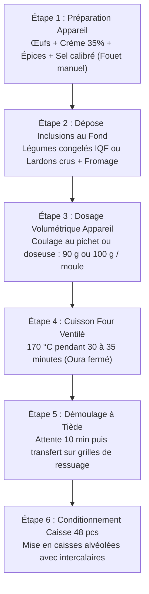

# GAMME QUICHES TRAITEUR (CAISSES DE 48 PIÈCES) — FORMAT DOUBLE-PAGE

**Codes Produits :** `T-QCH-01` (Quiche Lorraine Lardons & Emmental) • `T-QCH-02` (Quiche Chèvre & Épinards IQF) • `T-QCH-03` (Quiche Poireaux Fondants)  
**Destination :** Rayon Traiteur Boulanger, Snacking Chaud, Réceptions & Buffets Traiteur  
**Conditionnement :** Moules aluminium cannelés individuels Ø 100 mm (Cartons de 48 pièces conditionnées sur grille)  
**Socle de Fonçage :** Fonds de Pâte Brisée prêts à garnir *(Fournisseur Michard Bretagne)* en moules aluminium Ø 100 mm  
**Standardisation :** Formulation au Standard Appareil (Base 1 000 g Appareil / 100,0 %) & Paliers (10, 20 et 30 caisses de 48 pièces)  
**Statut de Validation :** 🟢 Validé Production — Conforme R&D & Sel Calibré Anti-Détrempe  

---

<!-- ===================================================================== -->
<!-- PAGE GAUCHE (1/2) : POSTE DE PESÉE & TABLEAUX HAUTE LISIBILITÉ        -->
<!-- ===================================================================== -->

# PAGE GAUCHE — POSTE DE PESÉE (LECTURE À 1,5 MÈTRE)

## 1. INDICATEURS FLASH DE CONDUITE

| PARAMÈTRE CLÉ | VALEUR DE CONSIGNE | TOLÉRANCE ATELIER | OBJECTIF TECHNIQUE |
| :--- | :--- | :--- | :--- |
| **Ratio Appareil Maître** | **50 % Œufs / 50 % Crème 35%** | $\pm 0,5\text{ \%}$ | Prise ferme, fondante et non aqueuse |
| **RÈGLE DU SEL LORRAINE** | **4 g sel / kg appareil** | Strict $\pm 0,2\text{ g}$ | Compense le relargage en sel des lardons |
| **RÈGLE DU SEL LÉGUMES** | **8 g sel / kg appareil** | Strict $\pm 0,2\text{ g}$ | Assaisonnement parfait des légumes neutres |
| **État des Légumes** | **IQF Directement Congelés** | Strict | Zéro décongélation préalable (anti-détrempe) |
| **Barème Cuisson** | **170 °C ventilé — 30 à 35 min** | $\pm 2\text{ min}$ | Oura fermé ; coloration dorée & cœur pris |

---

## 2. FORMULATION MAÎTRESSE & ÉCHELLES DE PESÉE (CHEF D'ATELIER)

### TABLEAU A : APPAREIL UNIVERSEL MAÎTRE (BASE 1 KG & VOLUMES)

| INGRÉDIENT | ÉTAPE | % APPAREIL | BASE 1 KG APPAREIL | CUVE 20 KG | CUVE 50 KG | CUVE 100 KG |
| :--- | :---: | :---: | :---: | :---: | :---: | :---: |
| **Œufs entiers liquides pasteurisés** | 1 | 50,0 % | 500 g | 10,0 kg | 25,0 kg | 50,0 kg |
| **Crème liquide entière 35 % MG** | 1 | 50,0 % | 500 g | 10,0 kg | 25,0 kg | 50,0 kg |
| **Poivre blanc moulu** | 1 | 0,15 % | 1,5 g | 30 g | 75 g | 150 g |
| **Noix de muscade râpée** | 1 | 0,05 % | 0,5 g | 10 g | 25 g | 50 g |
| **Sel fin (Selon tableau ci-dessous)** | 1 | *0,4% à 0,8%* | *4 g ou 8 g* | *80 g ou 160 g* | *200 g ou 400 g* | *400 g ou 800 g* |

---

### TABLEAU B : ÉCHELLES DE PRODUCTION PAR VARIÉTÉ (CAISSES DE 48 PIÈCES)

#### 1. QUICHE LORRAINE TRADITION — 140 g (RÉF. `T-QCH-01`)
*Sel appareil : 4 g/kg. Dosage : 100 g appareil + 30 g lardons crus fumés + 10 g emmental râpé.*

| COMPOSANT | PAR PIÈCE | 1 CAISSE (48 P.) | 10 CAISSES (480 P.) | 20 CAISSES (960 P.) | 30 CAISSES (1 440 P.) |
| :--- | :---: | :---: | :---: | :---: | :---: |
| **Appareil liquide assaisonné (4 g sel/kg)** | **100 g** | **4,80 kg** | **48,0 kg** | **96,0 kg** | **144,0 kg** |
| - *Œufs entiers liquides* | 50 g | 2,40 kg | 24,0 kg | 48,0 kg | 72,0 kg |
| - *Crème liquide 35 % MG* | 50 g | 2,40 kg | 24,0 kg | 48,0 kg | 72,0 kg |
| - *Sel fin purifié (4 g/kg)* | 0,4 g | 19 g | 192 g | 384 g | 576 g |
| - *Poivre blanc & Muscade* | 0,2 g | 10 g | 100 g | 200 g | 300 g |
| **Lardons fumés pur porc crus** | **30 g** | **1,44 kg** | **14,4 kg** | **28,8 kg** | **43,2 kg** |
| **Emmental râpé français 45%** | **10 g** | **0,48 kg** | **4,8 kg** | **9,6 kg** | **14,4 kg** |
| **POIDS TOTAL GARNITURE CRUE** | **140 g** | **6,72 kg** | **67,2 kg** | **134,4 kg** | **201,6 kg** |

---

#### 2. QUICHE CHÈVRE & ÉPINARDS IQF — 150 g (RÉF. `T-QCH-02`)
*Sel appareil : 8 g/kg. Dosage : 90 g appareil + 40 g épinards hachés IQF + 20 g fromage de chèvre.*

| COMPOSANT | PAR PIÈCE | 1 CAISSE (48 P.) | 10 CAISSES (480 P.) | 20 CAISSES (960 P.) | 30 CAISSES (1 440 P.) |
| :--- | :---: | :---: | :---: | :---: | :---: |
| **Appareil liquide assaisonné (8 g sel/kg)** | **90 g** | **4,32 kg** | **43,2 kg** | **86,4 kg** | **129,6 kg** |
| - *Œufs entiers liquides* | 45 g | 2,16 kg | 21,6 kg | 43,2 kg | 64,8 kg |
| - *Crème liquide 35 % MG* | 45 g | 2,16 kg | 21,6 kg | 43,2 kg | 64,8 kg |
| - *Sel fin purifié (8 g/kg)* | 0,72 g | 35 g | 345 g | 690 g | 1 035 g |
| - *Poivre blanc & Muscade* | 0,2 g | 10 g | 85 g | 170 g | 255 g |
| **Épinards en branches IQF (congelés)** | **40 g** | **1,92 kg** | **19,2 kg** | **38,4 kg** | **57,6 kg** |
| **Bûche de chèvre (rondelles / dés)** | **20 g** | **0,96 kg** | **9,6 kg** | **19,2 kg** | **28,8 kg** |
| **POIDS TOTAL GARNITURE CRUE** | **150 g** | **7,20 kg** | **72,0 kg** | **144,0 kg** | **216,0 kg** |

---

#### 3. QUICHE AUX POIREAUX FONDANTS — 160 g (RÉF. `T-QCH-03`)
*Sel appareil : 8 g/kg. Dosage : 100 g appareil + 50 g poireaux émincés IQF + 10 g emmental râpé.*

| COMPOSANT | PAR PIÈCE | 1 CAISSE (48 P.) | 10 CAISSES (480 P.) | 20 CAISSES (960 P.) | 30 CAISSES (1 440 P.) |
| :--- | :---: | :---: | :---: | :---: | :---: |
| **Appareil liquide assaisonné (8 g sel/kg)** | **100 g** | **4,80 kg** | **48,0 kg** | **96,0 kg** | **144,0 kg** |
| **Poireaux émincés IQF (congelés)** | **50 g** | **2,40 kg** | **24,0 kg** | **48,0 kg** | **72,0 kg** |
| **Emmental râpé français 45%** | **10 g** | **0,48 kg** | **4,8 kg** | **9,6 kg** | **14,4 kg** |
| **POIDS TOTAL GARNITURE CRUE** | **160 g** | **7,68 kg** | **76,8 kg** | **153,6 kg** | **230,4 kg** |

---

## 3. PRÉCAUTIONS INGRÉDIENTS & SÉCURITÉ MATIÈRE

1. **Règle d'or des Légumes Surgelés IQF (Zéro Décongélation) :**  
   Déposer les légumes directement congelés au fond des tartelettes. Si les légumes étaient décongelés au préalable, ils relargueraient jusqu'à 35% d'eau de végétation libre qui imbiberait la pâte crue du fond et provoquerait un détrempage immédiat (*soggy crust*). Enfournés congelés, la chaleur du four saisit l'appareil simultanément à la décongélation, capturant l'humidité dans le gel d'œufs.
2. **Différenciation stricte du sel :**  
   Ne jamais utiliser l'appareil à quiche salé à 8 g/kg pour les quiches aux lardons. Les lardons fumés industriels contiennent déjà 2,8 à 3,2 % de sel. Un appareil à 8 g/kg donnerait un produit fini immangeable et trop salé.
3. **Crème 35% MG vs Lait :**  
   L'absence totale de lait demi-écrémé au profit de la crème entière à 35% de matières grasses garantit une émulsion riche qui ne rend pas d'eau au ressuage.

---

<!-- ===================================================================== -->
<!-- PAGE DROITE (2/2) : PROTOCOLE PAS À PAS, CONDUITE & FOUR              -->
<!-- ===================================================================== -->

# PAGE DROITE — CONDUITE MACHINE, POSTE CUISSON & HACCP

## 1. PROTOCOLE CHRONOLOGIQUE D'ASSEMBLAGE & DRESSAGE

### DÉTAIL DES PHASES OPÉRATOIRES :
1. **Étape 1 — Préparation de l'appareil à quiche :** Dans une cuve inox propre, verser les œufs entiers liquides et la crème liquide 35%. Ajouter les épices (poivre blanc et muscade) et le sel pesé selon la recette. Fouetter doucement sans faire mousser (l'incorporation d'air ferait gonfler la quiche au four pour s'affaisser ensuite en creux).
2. **Étape 2 — Garnissage solide des fonds de pâte :**
   - Disposer les fonds de pâte brisée Michard crus en moules aluminium sur les plaques du four.
   - Répartir manuellement ou à la balance le poids précis de garniture solide au fond de chaque fond :
     * *Lorraine :* 30 g de lardons crus répartis uniformément + 10 g d'emmental râpé.
     * *Chèvre-Épinards :* 40 g d'épinards IQF encore durs + 20 g de rondelles de chèvre.
     * *Poireaux :* 50 g de poireaux IQF congelés + 10 g d'emmental râpé.
3. **Étape 3 — Coulage liquide :**
   - À l'aide de l'entonnoir à piston ou de la doseuse volumétrique, couler l'appareil liquide sur la garniture solide :
     * 90 g pour Chèvre-Épinards.
     * 100 g pour Lorraine et Poireaux.
   - L'appareil liquide doit affleurer à 2 mm en dessous du bord de la pâte.

---

## 2. BARÈME DE CUISSON, RESSUAGE & CONDITIONNEMENT

### BARÈME THERMIQUE
- **Type de Four :** Four à chariot ventilé rotatif ou four à soles de boulangerie.
- **Température de Consigne :** **170 °C régulée**.
- **Gestion des Ouras :** **Oura fermé**. La vapeur d'eau dégagée par les légumes et la crème maintient une atmosphère saturée qui empêche le dessèchement de surface.
- **Temps de Cuisson :** **30 à 35 minutes**.
- **Contrôle Visuel & Tactile :** L'appareil doit être uniformément doré avec une légère coloration blonde sur le fromage. Le centre de la quiche doit être ferme sous une pression douce du doigt (température cœur $\ge 85\text{ }^\circ\text{C}$).

### DÉMOULAGE & RESSUAGE
1. **Démoulage à Tiède :** Laisser reposer les plaques 10 minutes à la sortie du four. Démouler délicatement les quiches encore tièdes et les transférer sur des grilles inox ajourées. Ce ressuage immédiat évacue la condensation sous le fond en aluminium et préserve le croustillant de la pâte brisée.
2. **Refroidissement :** Refroidir sous flux d'air filtré jusqu'à température inférieure à +10 °C à cœur en moins de 2 heures (conforme réglementation HACCP chaîne du chaud/froid).
3. **Conditionnement :** Ranger en cartons de **48 pièces** (2 couches de 24 quiches séparées par un intercalaire carton sulfurisé).
4. **Conservation & Régénération :**
   - *Frais (+4 °C) :* DLC 4 jours.
   - *Surgelé (-18 °C) :* DLUO 6 mois.
   - *Régénération consommateur :* 10 à 12 minutes au four chaud à 180 °C (micro-ondes formellement proscrit pour préserver le croustillant).

---

## 3. CONTRÔLE QUALITÉ & POINTS CRITIQUES HACCP

| POINT DE CONTRÔLE | PARAMÈTRE MESURÉ | TOLÉRANCE CRITIQUE | ACTION CORRECTIVE IMMÉDIATE |
| :--- | :--- | :--- | :--- |
| **Pesée Sel Appareil** | Balance au gramme près | 4 g/kg (Lorraine) / 8 g/kg (Légumes) | Vérifier l'étiquette cuve avant coulage |
| **État Légumes** | Température au dosage | $\le -5\text{ }^\circ\text{C}$ (congelés) | Ne jamais utiliser de légumes décongelés mous |
| **Poids Pièce Cru** | Balance de contrôle | $\pm 3\text{ g}$ | Ajuster la course du piston doseur |
| **Cuisson à Cœur** | Thermomètre sonde | $\ge 85\text{ }^\circ\text{C}$ au centre | Si $< 85\text{ }^\circ\text{C}$, prolonger la cuisson par paliers de 3 min |
| **Refroidissement HACCP** | De 63 °C à 10 °C | Moins de 2 heures | Passage obligatoire en cellule de refroidissement rapide |

---
*Fiche d'atelier normalisée — Laboratoire R&D Tourage & Boulangerie — Usage exclusif opérateurs de production.*
