# Fiche Technique d'Atelier : Pain Viennois Nature PAC (Méthode Directe & Complexe Soft'r / Kimo)

* **Code Produit** : `V-VIE-01`
* **Famille** : Viennoiserie Générale & Pâtes Levées Mixtes (Procédé PAC)
* **Calibre Homologué** : **280 g cru** $\longrightarrow$ **~266 g cuit** (Perte de cuisson contrôlée = 14 g / 5,0 %)
* **Procédé Exclusif** : **Méthode Directe le Jour Même (Anti-Irrégularité Atelier & Zéro Cuisson de Roux)** : Pétrissage direct avec **Complexe Enzymatique Anti-Staling (Puratos Soft'r 1,5 % + S500 Kimo Short 1,5 %)** $\longrightarrow$ Pointage court en cuve (15–20 min) $\longrightarrow$ Division hydraulique 20 parts (Bacs 5 600 g) $\longrightarrow$ Façonnage mécanique sur façonneuse à tapis $\longrightarrow$ 1re Surgélation Flash -35 °C $\longrightarrow$ Pousse contrôlée étuve 26 °C (70 % vol.) $\longrightarrow$ 2e Blocage PAC (Sonde -10 °C à cœur) $\longrightarrow$ Cuisson directe 165 °C four ventilé
* **Équipements Clés** : Pétrin spirale (capacité 200 kg), Diviseuse hydraulique 20 parts (bacs 5 600 g), Façonneuse à tapis, Pistolet à dorure, Cellule flash -35 °C, Four ventilé
* **Format d'Atelier** : Double Page Vis-à-Vis (Page Gauche : Poste Pesée Tout en Grammes | Page Droite : Conduite Machine Directe, PAC & Cuisson)
* **Version** : `v3.2-DIRECT-SOFTR-GRAMMES` | **Statut** : 🟢 Validé Production & Standard Atelier

---

## PAGE GAUCHE (1/2) • POSTE DE PESÉE (EXCLUSIVEMENT EN GRAMMES)
*(Affichage Haute Visibilité — Gros Caractères Lisibles à 1,5 m — Zéro Décimale en kg)*

### Repères Flash Poste de Pesée
| Repère | Paramètre Clé | Spécification Atelier | Justification Scientifique & Rhéologique |
| :--- | :--- | :--- | :--- |
| 🧬 **Complexe Bio-Enzymatique**| **1,5 % Soft'r + 1,5 % Kimo** | Amylase maltogénique + DATEM/E300 | Zéro Tangzhong à cuire : clive l'amylopectine au four, moelleux 7 jours garanti |
| 🟢 **Détrempe / Bac Paneo** | **5 600 g pile / bac** | Diviseuse 20 parts hydraulique | Donne exactement **20 viennoises de 280 g cru** par bac |
| 🛢️ **Capacité Pétrin & Échelle** | **30 Bacs = 168 000 g net** | Pétrin spirale 200 kg (84 % charge) | Charge idéale : 600 grandes viennoises par pétrissée pleine cuve sans échauffement |
| 🟠 **Pétrissage & Sortie** | **Programme [VIENNOISE]** | Température sortie pétrin : **19 °C à 21 °C** | Pâte tenue, réseau développé sans échauffement pour passage immédiat sur tapis |
| 🔴 **Cryoprotection & Osmose** | **Levure Or 4,5 % / Kimo 1,5 %** | Trimoline 4,0 % + Lait 26 % 3,0 % | Accumulation de tréhalose intracellulaire et abaissement cryoscopique $\Delta T_f$ |
| 🧈 **Matière Grasse Cuve** | **Margarine OPALE cuve 18 %** | Incorp. en 2ᵉ vitesse (V2) | Margarine végétale plastique (PF 34–36 °C) assurant la tenue au façonnage tapis |

---

### Tableau Chronologique des Pesées en 4 Phases (Unités : GRAMMES)
*Base meunière : Farine Totale = 100,0 % (70 % Gruau Rouge T45 et 30 % T65 Tradition cuve) | Tolérance balance : ± 1 g ingrédients critiques / ± 5 g farines.*

| Phase & Ordre | Ingrédient d'Atelier | % Meunier | Base 1 000 g Farine | 1 Bac (20 pcs / 5 600 g) | 10 Bacs (200 pcs / 56 000 g) | 20 Bacs (400 pcs / 112 000 g) | 30 Bacs (600 pcs / 168 000 g) | Rôle Biochimique |
| :---: | :--- | :---: | :---: | :---: | :---: | :---: | :---: | :--- |
| **`[1]` Bleu** | **Farine Gruau Rouge T45** | **70,0 %** | **700 g** | **1 760 g** | **17 600 g** | **35 200 g** | **52 800 g** | $W > 330$, ossature cryogénique PAC |
| **`[1]` Bleu** | **Farine T65 Tradition pure** | **30,0 %** | **300 g** | **754 g** | **7 540 g** | **15 090 g** | **22 630 g** | Extensibilité ($L$), goût froment, zéro additif |
| **`[1]` Bleu** | **Eau très froide (+1 °C)** | **38,0 %** | **380 g** | **955 g** | **9 550 g** | **19 110 g** | **28 670 g** | Hydratation directe, solvant des protéines |
| **`[1]` Bleu** | **Œufs entiers liquides past.**| **18,0 %** | **180 g** | **453 g** | **4 530 g** | **9 050 g** | **13 580 g** | Lécithine, coloration dorée, mâche fine |
| **`[1]` Bleu** | **Pâte Fermentée Viennoise (PFV)**| **20,0 %** | **200 g** | **503 g** | **5 030 g** | **10 060 g** | **15 090 g** | Force, arôme, régulation acide (pH 5,2) |
| **`[1]` Bleu** | **Sucre cristal semoule** | **12,0 %** | **120 g** | **302 g** | **3 020 g** | **6 040 g** | **9 050 g** | Substrat levure, douceur viennoise |
| **`[1]` Bleu** | **Trimoline (Sucre inverti)** | **4,0 %** | **40 g** | **101 g** | **1 010 g** | **2 010 g** | **3 020 g** | Abaisseur cryoscopique $\Delta T_f$, anti-dessèchement |
| **`[1]` Bleu** | **Poudre de lait entier 26 %** | **3,0 %** | **30 g** | **75 g** | **750 g** | **1 510 g** | **2 260 g** | Fixation eau par caséines, finesse de mie |
| **`[1]` Bleu** | **Sel fin d'atelier** | **2,0 %** | **20 g** | **50 g** | **500 g** | **1 010 g** | **1 510 g** | Resserrement ionique des gluténines |
| **`[1]` Bleu** | **Levure fraîche L'Hirondelle Or**| **4,5 %** | **45 g** | **113 g** | **1 130 g** | **2 260 g** | **3 400 g** | Souche osmotolérante résistante au gel |
| **`[1]` Bleu** | **Améliorant S500 Kimo Short** | **1,5 %** | **15 g** | **38 g** | **380 g** | **750 g** | **1 130 g** | Ponts disulfures (E300) + DATEM (PAC) |
| **`[1]` Bleu** | **Améliorant Puratos Soft'r** | **1,5 %** | **15 g** | **38 g** | **380 g** | **750 g** | **1 130 g** | Amylase maltogénique : anti-rassis 7 jours |
| **`[1]` Bleu** | **Extrait de vanille liquide** | **0,2 %** | **2 g** | **5 g** | **50 g** | **100 g** | **150 g** | Signature aromatique authentique |
| **`[2]` Ambre** | **Margarine OPALE cuve** | **18,0 %** | **180 g** | **453 g** | **4 530 g** | **9 060 g** | **13 580 g** | Incorp. V2 : plasticité & tenue façonneuse tapis |
| **SOUS-TOTAL**| **PÂTE AU BAC (280 G CRU)** | **222,7 %** | **2 227 g** | **5 600 g pile** | **56 000 g pile** | **112 000 g pile** | **168 000 g pile** | **Calibré pile à 5 600 g net / bac (20 pièces)** |
| **`[3]` Finition** | **Dorure Végétale au pistolet** | Q.S. | PM | 50 g | 500 g | 1 000 g | 1 500 g | Pulvérisation fine buse 1,2 mm (1,5 bar) |

---

### Cadences & Rendements Viennoise Nature (Calibre 280 g cru $\longrightarrow$ ~266 g cuit)
* **Rendement par bac (5 600 g net)** : **20 grandes viennoises de 280 g** (calibre 22–24 cm).
* **Rendement 10 bacs (56 000 g pâte)** : **200 viennoises** (~20 plaques de 10 pièces).
* **Rendement 20 bacs (112 000 g pâte)** : **400 viennoises** (~40 plaques de 10 pièces).
* **Rendement 30 bacs (168 000 g pâte)** : **600 viennoises** (~60 plaques de 10 pièces) — *Pleine tournée pétrin 200 kg*.

---

## PAGE DROITE (2/2) • CONDUITE MACHINE DIRECTE, PAC & FOUR
*(Poste Conduite Thermomécanique & Cuisson)*

```mermaid
flowchart TD
    A["Pétrin Spirale 200 kg\nFarines + Eau glacée (+1 °C) + Œufs + PFV + Sucre + Lait + Sel\n+ Levure Or + Kimo Short (1,5%) + Soft'r Puratos (1,5%) [1]\nFrasage 5 min en 1re vitesse (V1)"]
    --> B["Passage en 2e vitesse (V2) :\nPétrir 4 min jusqu'à amorce de voile\nAjouter Margarine Opale [2] en dés froids\nPétrir 4 min jusqu'au VOILE PARFAIT et DÉCOLLEMENT NET\n(Température sortie stricte : 19 °C à 21 °C)"]
    --> C["MÉTHODE DIRECTE LE JOUR MÊME :\nPointage court en cuve 15 à 20 min chrono à 20–22 °C\n(Zéro passage 24 h au frigo, force 100 % homogène)"]
    --> D["Pesée des bacs à 5 600 g net pile\nDivision Hydraulique Immédiate 20 parts (20 x 280 g)"]
    --> E["Détente 8 à 10 min sur tour sous bâche étanche\nFaçonnage mécanique direct sur Façonneuse à Tapis\n(Boudins cylindriques 22–24 cm parfaitement rectilignes)"]
    --> F["Plaquage 10 pièces / plaque 60x40\n1re Dorure Végétale Pistolet (Voile fin) + 5 à 6 coups de lame nets\nCellule Flash -35 °C (35 min) ➔ Stock 1 Cru Compact (-18 °C)"]
    --> G["Décongélation lente (+4 °C, 8–10 h) + Pousse Étuve 26 °C / 80% HR\nArrêt strict de pousse à 70 % du volume (1 h 45 à 2 h 00)"]
    --> H["Raffermissement 10 min (+4 °C) + 2e voile dorure pistolet\nCellule Flash -35 °C sous sonde à cœur ➔ ARRÊT STRICT À -10 °C CŒUR\nStock 2 PAC Prêt-à-Cuire (-18 °C) livré aux boutiques"]
    --> I["Enfournement Direct Congelé en Boutique (Four Ventilé 165 °C)\nDurée 11 min pile, OURAS STRICTEMENT FERMÉS tout au long\n(Ressuage grille : mie filante, cotonneuse, fraîcheur 7 jours)"]
```

---

### Étape 1 : Pétrissage Haute Rétention & Conduite Thermique
1. **Frasage Biphasique avec Couple Kimo / Soft'r** :
   * Verser l'eau très froide (+1 °C), les farines (Gruau T45 et T65), la PFV, les œufs entiers liquides, le sucre, la Trimoline, la poudre de lait 26 %, le sel, la levure Or, le S500 Kimo Short (1,5 %), le Soft'r Puratos (1,5 %) et la vanille `[1]` Bleu dans la cuve.
   * Frasage pendant **5 minutes en 1ʳᵉ vitesse**.
2. **Développement du Réseau & Émulsion Lipidique** :
   * Passer en **2ᵉ vitesse pendant 4 minutes**.
   * Incorporer la margarine Opale `[2]` Ambre en dés froids (+10 °C à +12 °C).
   * Poursuivre en **2ᵉ vitesse pendant 3 à 4 minutes** jusqu'au **voile translucide complet** et décollement net.
   * **Consigne thermique absolue** : **19 °C à 21 °C maximum**.

---

### Étape 2 : Méthode Directe, Division & Façonnage Tapis
1. **Pointage Court en Cuve (15 à 20 min chrono)** :
   * Laisser reposer la masse en cuve sous film plastique pendant **15 à 20 minutes** à 20–22 °C.
2. **Division Hydraulique 20 Parts** :
   * Débarrasser la pâte par pâtons pesés à **5 600 g net pile** dans des bacs plats légèrement huilés.
   * Déposer dans la diviseuse 20 parts $\longrightarrow$ actionner le cycle : **20 pâtons de 280 g net**.
3. **Détente & Façonnage sur Façonneuse à Tapis** :
   * Détente de **8 à 10 minutes** sous bâche étanche sur le tour inox.
   * Passer dans la façonneuse à tapis réglée doux : rouler en cylindres réguliers de **22 à 24 cm de longueur**. 100 % des boudins sortent rectilignes.
4. **Plaquage, Dorure Pistolet & Lamage** :
   * Disposer **10 viennoises par plaque 60×40** (2 rangées de 5, clé en dessous).
   * Pulvériser un premier voile fin de **Dorure Végétale au pistolet** (1,5 bar, buse 1,2 mm).
   * Donner **5 à 6 coups de lame nets** en biseau transversal à 45°.

---

### Étape 3 : Standardisation des Deux Stocks PAC (Hub & Spoke)
1. **Stock 1 : Cru Non Poussé Compact (-18 °C)** :
   * Passer les plaques en cellule flash à **-35 °C pendant 35 minutes**.
   * Conditionner en cartons sous sache PE étanche fermée. Stocker à **-18 °C**.
2. **Pousse Contrôlée en Étuve PAC (Laboratoire Central)** :
   * Si départ Stock 1 : Décongélation lente à **+2 °C / +4 °C pendant 8 à 10 heures**.
   * Pousse en étuve à **26 °C et 80 % HR pendant 1 h 45 à 2 h 00**.
   * **Arrêt impératif de la pousse à 70 % du volume maximal**.
3. **2ᵉ Dorure & 2ᵉ Blocage PAC (Stock 2 Boutiques)** :
   * Sortir de l'étuve et passer **10 minutes en froid positif (+4 °C)**.
   * Pulvériser une seconde passe de **Dorure Végétale au pistolet**.
   * Piquer la sonde témoin au cœur thermique d'une viennoise.
   * Cellule flash à -35 °C $\longrightarrow$ **ARRÊT STRICT DÈS QUE LA SONDE ATTEINT -10 °C À CŒUR**.
   * Stocker à **-18 °C (Stock 2 PAC prêt-à-cuire)** pour expédition magasins.

---

### Étape 4 : Cuisson Directe Four Ventilé en Boutique (Sans Étuve)
* **Départ four** : Directement du congélateur (-18 °C) dans le four ventilé en boutique, **ZÉRO DÉCONGÉLATION PRÉALABLE**.
* **Préchauffage Four Ventilé** : **180 °C**.
* **Consigne de Cuisson Régulée** : **165 °C en continu**.
* **Durée de Cuisson** : **11 minutes pile**.
* **Gestion des Ouras** : **OURAS STRICTEMENT FERMÉS pendant les 11 minutes**.
* **Ressuage** : Sur grille inox. Poids net cuit mesuré : **266 g ($\pm 3\text{ g}$)**. Moelleux 7 jours garanti par le clivage enzymatique de Soft'r.
