# Fiche Technique d'Atelier : Pain Viennois Pépites Chocolat PAC (Méthode Directe & Complexe Soft'r / Kimo)

* **Code Produit** : `V-VIE-02`
* **Famille** : Viennoiserie Générale & Pâtes Levées Mixtes (Procédé PAC)
* **Calibre Homologué** : **140 g cru** $\longrightarrow$ **~133 g cuit** (Perte de cuisson contrôlée = 7 g / 5,0 %)
* **Procédé Exclusif** : **Méthode Directe le Jour Même (Anti-Marbrage & Zéro Cuisson de Roux)** : Pétrissage avec **Complexe Enzymatique Anti-Staling (Puratos Soft'r 1,5 % + S500 Kimo Short 1,5 %)** $\longrightarrow$ Incorporation pépites froides (+4 °C) en V1 (45–60 s) $\longrightarrow$ Pointage court cuve 15–20 min $\longrightarrow$ Division hydraulique 20 parts (Bacs 5 600 g) $\longrightarrow$ Recoupe en deux (Format 140 g) $\longrightarrow$ Façonnage mécanique sur façonneuse à tapis $\longrightarrow$ 1re Surgélation Flash -35 °C $\longrightarrow$ Pousse contrôlée en étuve 26 °C (70 % vol.) $\longrightarrow$ 2e Blocage PAC (Sonde -10 °C à cœur) $\longrightarrow$ Cuisson directe 165 °C four ventilé
* **Équipements Clés** : Pétrin spirale (capacité 200 kg), Diviseuse hydraulique 20 parts (bacs 5 600 g), Façonneuse à tapis, Pistolet à dorure, Cellule flash -35 °C, Four ventilé
* **Format d'Atelier** : Double Page Vis-à-Vis (Page Gauche : Poste Pesée Tout en Grammes | Page Droite : Conduite Machine Directe, PAC & Cuisson)
* **Version** : `v3.2-DIRECT-SOFTR-GRAMMES` | **Statut** : 🟢 Validé Production & Standard Atelier

---

## PAGE GAUCHE (1/2) • POSTE DE PESÉE (EXCLUSIVEMENT EN GRAMMES)
*(Affichage Haute Visibilité — Gros Caractères Lisibles à 1,5 m — Zéro Décimale en kg)*

### Repères Flash Poste de Pesée
| Repère | Paramètre Clé | Spécification Atelier | Justification Scientifique & Rhéologique |
| :--- | :--- | :--- | :--- |
| 🧬 **Complexe Bio-Enzymatique**| **1,5 % Soft'r + 1,5 % Kimo** | Amylase maltogénique + DATEM/E300 | Zéro Tangzhong à cuire : clive l'amylopectine au four, moelleux 7 jours |
| 🟢 **Détrempe Choc / Bac** | **5 600 g pile / bac** | Diviseuse 20 parts $\rightarrow$ recoupe $\times 2$ | Donne exactement **40 viennoises chocolat de 140 g cru** par bac |
| 🛢️ **Capacité Pétrin & Échelle** | **30 Bacs = 168 000 g net** | Pétrin spirale 200 kg (84 % charge) | Charge idéale : 1 200 viennoises individuelles par pétrissée pleine cuve |
| 🍫 **Pépites Chocolat 50 %** | **Froides (+4 °C) / Calibre 8 000** | 26 % rapport farine (585 g/bac) | Ajoutées en fin de V1 (45–60 s) : zéro fonte de beurre de cacao, zéro marbrage |
| 🟠 **Pétrissage & Sortie** | **Programme [VIENNOISE]** | Température sortie pétrin : **19 °C à 21 °C** | Pâte fraîche et plastique : tenue parfaite sur les tapis sans déchirure |
| 🔴 **Cryoprotection & PAC** | **Levure Or 4,5 % / Kimo 1,5 %** | Trimoline 4,0 % + Lait 26 % 3,0 % | Cryoprotection membranaire par tréhalose et résistance aux 2 cycles de gel |

---

### Tableau Chronologique des Pesées en 4 Phases (Unités : GRAMMES)
*Base meunière : Farine Totale = 100,0 % (70 % Gruau Rouge T45 et 30 % T65 cuve) | Tolérance balance : ± 1 g ingrédients critiques / ± 5 g farines.*

| Phase & Ordre | Ingrédient d'Atelier | % Meunier | Base 1 000 g Farine | 1 Bac (40 pcs / 5 600 g) | 10 Bacs (400 pcs / 56 000 g) | 20 Bacs (800 pcs / 112 000 g) | 30 Bacs (1200 pcs / 168 000 g) | Rôle Biochimique |
| :---: | :--- | :---: | :---: | :---: | :---: | :---: | :---: | :--- |
| **`[1]` Bleu** | **Farine Gruau Rouge T45** | **70,0 %** | **700 g** | **1 576 g** | **15 760 g** | **31 520 g** | **47 290 g** | $W > 330$, armure cryogénique PAC |
| **`[1]` Bleu** | **Farine T65 Tradition pure** | **30,0 %** | **300 g** | **676 g** | **6 760 g** | **13 510 g** | **20 270 g** | Extensibilité ($L$) pour étirement sur tapis |
| **`[1]` Bleu** | **Eau très froide (+1 °C)** | **38,0 %** | **380 g** | **856 g** | **8 560 g** | **17 110 g** | **25 670 g** | Solvant et modérateur thermique cuve |
| **`[1]` Bleu** | **Œufs entiers liquides past.**| **18,0 %** | **180 g** | **405 g** | **4 050 g** | **8 110 g** | **12 160 g** | Émulsion, finesse de texture, mie dorée |
| **`[1]` Bleu** | **Pâte Fermentée Viennoise (PFV)**| **20,0 %** | **200 g** | **450 g** | **4 500 g** | **9 010 g** | **13 510 g** | Arôme, force, tolérance fermentaire |
| **`[1]` Bleu** | **Sucre cristal semoule** | **12,0 %** | **120 g** | **270 g** | **2 700 g** | **5 400 g** | **8 110 g** | Carburant levure, abaissement $a_w$ |
| **`[1]` Bleu** | **Trimoline (Sucre inverti)** | **4,0 %** | **40 g** | **90 g** | **900 g** | **1 800 g** | **2 700 g** | Abaisseur cryoscopique $\Delta T_f$, anti-dessèchement |
| **`[1]` Bleu** | **Poudre de lait entier 26 %** | **3,0 %** | **30 g** | **68 g** | **680 g** | **1 350 g** | **2 030 g** | Fixation eau par caséines, finesse mie |
| **`[1]` Bleu** | **Sel fin d'atelier** | **2,0 %** | **20 g** | **45 g** | **450 g** | **900 g** | **1 350 g** | Resserrement ionique de la trame |
| **`[1]` Bleu** | **Levure fraîche L'Hirondelle Or**| **4,5 %** | **45 g** | **101 g** | **1 010 g** | **2 030 g** | **3 040 g** | Levure osmotolérante cryorésistante |
| **`[1]` Bleu** | **Améliorant S500 Kimo Short** | **1,5 %** | **15 g** | **34 g** | **340 g** | **670 g** | **1 010 g** | Acide ascorbique + DATEM pour tenue PAC |
| **`[1]` Bleu** | **Améliorant Puratos Soft'r** | **1,5 %** | **15 g** | **34 g** | **340 g** | **680 g** | **1 010 g** | Clivage enzymatique amylopectine |
| **`[1]` Bleu** | **Extrait de vanille liquide** | **0,2 %** | **2 g** | **5 g** | **50 g** | **90 g** | **130 g** | Signature aromatique complémentaire |
| **`[2]` Ambre** | **Margarine OPALE cuve** | **18,0 %** | **180 g** | **405 g** | **4 050 g** | **8 110 g** | **12 160 g** | Ajout V2 : plasticité et tenue boudins |
| **SOUS-TOTAL**| **PÂTE NATURE BASE** | **222,7 %** | **2 227 g** | **5 015 g** | **50 150 g** | **100 290 g** | **150 440 g** | **Pâte lisse parfaitement développée** |
| **`[3]` Choc** | **Pépites chocolat noir 50 % (+4 °C)**| **26,0 %** | **260 g** | **585 g** | **5 850 g** | **11 710 g** | **17 560 g** | Incorp. fin de V1 (45–60 s max) |
| **TOTAL** | **PÂTE CHOCOLATÉE AU BAC** | **248,7 %** | **2 487 g** | **5 600 g pile** | **56 000 g pile** | **112 000 g pile** | **168 000 g pile** | **5 600 g net pile / bac (40 pièces de 140 g)** |
| **`[4]` Finition** | **Dorure Végétale au pistolet** | Q.S. | PM | 50 g | 500 g | 1 000 g | 1 500 g | Pulvérisation fine buse 1,2 mm (1,5 bar) |

---

### Cadences & Rendements Viennoise Chocolat (Calibre 140 g cru $\longrightarrow$ ~133 g cuit)
* **Rendement par bac (5 600 g net)** : **40 viennoises chocolat de 140 g** (calibre 14–16 cm).
* **Rendement 10 bacs (56 000 g pâte)** : **400 viennoises individuelles** (~22 plaques de 18 pièces).
* **Rendement 20 bacs (112 000 g pâte)** : **800 viennoises individuelles** (~44 plaques de 18 pièces).
* **Rendement 30 bacs (168 000 g pâte)** : **1 200 viennoises individuelles** (~66 plaques de 18 pièces) — *Pleine tournée pétrin 200 kg*.

---

## PAGE DROITE (2/2) • CONDUITE MACHINE DIRECTE, PAC & FOUR
*(Poste Conduite Thermomécanique & Cuisson)*

```mermaid
flowchart TD
    A["Pétrin Spirale 200 kg\nFarines + Eau glacée (+1 °C) + Œufs + PFV + Sucre + Lait + Sel\n+ Levure Or + Kimo Short (1,5%) + Soft'r Puratos (1,5%) [1]\nFrasage 5 min en 1re vitesse (V1)"]
    --> B["Passage en 2e vitesse (V2) :\nPétrir 4 min jusqu'à amorce de voile\nAjouter Margarine Opale [2] en dés froids\nPétrir 4 min jusqu'au VOILE PARFAIT et DÉCOLLEMENT NET"]
    --> C["INCORPORATION ANTI-ÉCRASEMENT DES PÉPITES :\nRepasser impérativement en 1re vitesse (V1)\nVerser pépites chocolat noir 50 % froides (+4 °C) [3]\nTourner 45 à 60 secondes MAX (Arrêt dès dispersion homogène)\n(Température sortie stricte : 19 °C à 21 °C)"]
    --> D["MÉTHODE DIRECTE LE JOUR MÊME :\nPointage court en cuve 15 à 20 min chrono à 20–22 °C\n(Zéro passage 24 h au frigo, force 100 % homogène)"]
    --> E["Pesée des bacs à 5 600 g net pile\nDivision Hydraulique 20 parts (Pâtons 280 g)\nRecoupe immédiate en deux au coupe-pâte -> 40 pièces de 140 g"]
    --> F["Détente 8 à 10 min sur tour sous bâche étanche\nFaçonnage mécanique direct sur Façonneuse à Tapis\n(Boudins cylindriques 14–16 cm parfaitement rectilignes)"]
    --> G["Plaquage 16 à 18 pièces / plaque 60x40\n1re Dorure Végétale Pistolet + 3 coups de lame nets\nCellule Flash -35 °C (35 min) ➔ Stock 1 Cru Compact (-18 °C)"]
    --> H["Décongélation lente (+4 °C, 8–10 h) + Pousse Étuve 26 °C / 80% HR\nArrêt strict de pousse à 70 % du volume (1 h 30 à 1 h 45)"]
    --> I["Raffermissement 10 min (+4 °C) + 2e voile dorure pistolet\nCellule Flash -35 °C sous sonde à cœur ➔ ARRÊT STRICT À -10 °C CŒUR\nStock 2 PAC Prêt-à-Cuire (-18 °C) livré aux boutiques"]
    --> J["Enfournement Direct Congelé en Boutique (Four Ventilé 165 °C)\nDurée 9 min pile, OURAS STRICTEMENT FERMÉS tout au long\n(Ressuage grille : pépites fondantes non marbrées, moelleux 7 jours)"]
```

---

### Étape 1 : Pétrissage & Protocole Anti-Marbrage
1. **Frasage Biphasique avec Couple Kimo / Soft'r** :
   * Verser l'eau très froide (+1 °C), les farines (Gruau T45 et T65), la PFV, les œufs entiers liquides, le sucre, la Trimoline, la poudre de lait 26 %, le sel, la levure Or, le S500 Kimo Short (1,5 %), le Soft'r Puratos (1,5 %) et la vanille `[1]` Bleu dans la cuve.
   * Frasage pendant **5 minutes en 1ʳᵉ vitesse**.
2. **Développement du Réseau de Gluten & Émulsion** :
   * Passer en **2ᵉ vitesse pendant 4 minutes**.
   * Incorporer la margarine Opale `[2]` Ambre coupée en dés froids (ou huile de colza en filet).
   * Pétrir en **2ᵉ vitesse pendant 3 à 4 minutes** jusqu'à obtention du **voile translucide complet** et décollement net.
3. **Protocole Chirurgical d'Inclusion des Pépites (Zéro Marbrage)** :
   * **Règle absolue d'atelier** : Les pépites de chocolat noir 50 % doivent être stockées impérativement en chambre froide à **+4 °C** jusqu'à la seconde de leur introduction.
   * **Repasser obligatoirement en 1ʳᵉ vitesse (V1 lente)**.
   * Verser les **585 g de pépites de chocolat froides `[3]` par bac de 5 600 g** (soit 17 563 g pour la pétrissée de 30 bacs).
   * Laisser tourner pendant **45 à 60 secondes maximum**.
   * **Température de sortie pétrin** : **19 °C à 21 °C**.

---

### Étape 2 : Méthode Directe, Division 20x2 & Façonnage Tapis
1. **Pointage Court en Cuve (15 à 20 min chrono)** :
   * Laisser reposer la pâte chocolatée en cuve recouverte d'un film étanche pendant **15 à 20 minutes** à 20–22 °C.
2. **Division Hydraulique 20 Parts & Recoupe en Deux** :
   * Débarrasser la pâte dans des bacs plats pesés à **5 600 g net pile**.
   * Transférer dans la diviseuse hydraulique 20 parts $\longrightarrow$ délivre **20 pâtons de 280 g**.
   * D'un coup net de coupe-pâte inox, **recouper chaque pâton de 280 g en deux morceaux égaux de 140 g net** (soit **40 pièces de 140 g par bac**).
3. **Détente & Façonnage sur Façonneuse à Tapis** :
   * Détente de **8 à 10 minutes** sous bâche plastique étanche.
   * Passer dans la façonneuse à tapis avec réglage doux des cylindres : enrouler en boudins de **14 à 16 cm de longueur**.
4. **Plaquage, Dorure Pistolet & Lamage** :
   * Disposer **16 à 18 viennoises chocolat par plaque 60×40**.
   * Pulvériser un premier voile fin de **Dorure Végétale au pistolet** (buse 1,2 mm, 1,5 bar).
   * Donner **3 coups de lame nets** en biseau transversal.

---

### Étape 3 : Standardisation des Deux Stocks PAC (Hub & Spoke)
1. **Stock 1 : Cru Non Poussé Compact (-18 °C)** :
   * Cellule flash à **-35 °C pendant 35 minutes** $\longrightarrow$ stockage hermétique à **-18 °C**.
2. **Pousse Contrôlée en Étuve PAC (Laboratoire Central)** :
   * Pousse en étuve régulée à **26 °C et 80 % HR pendant 1 h 30 à 1 h 45**.
   * **Arrêt strict de la pousse à 70 % du volume maximal**.
3. **2ᵉ Dorure & 2ᵉ Blocage PAC (Stock 2 Boutiques)** :
   * 10 min en froid positif (+4 °C) $\rightarrow$ 2e passe légère de dorure pistolet $\rightarrow$ Cellule -35 °C sous sonde $\longrightarrow$ **ARRÊT STRICT DÈS QUE LA SONDE ATTEINT -10 °C À CŒUR**.
   * Stocker à **-18 °C (Stock 2 PAC prêt-à-cuire)** pour expédition boutiques.

---

### Étape 4 : Cuisson Directe Four Ventilé en Boutique (Sans Étuve)
* **Départ four** : Directement du congélateur (-18 °C), **ZÉRO DÉCONGÉLATION**.
* **Préchauffage Four Ventilé** : **180 °C**.
* **Consigne de Cuisson Régulée** : **165 °C en continu**.
* **Durée de Cuisson** : **9 minutes pile**.
* **Gestion des Ouras** : **OURAS STRICTEMENT FERMÉS pendant les 9 minutes**.
* **Ressuage** : Sur grille inox. Poids net cuit mesuré : **133 g ($\pm 2\text{ g}$)**.
