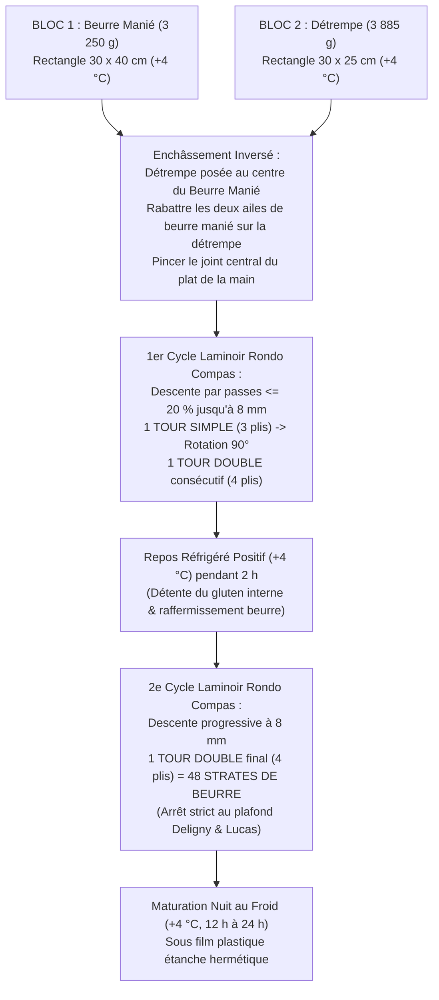

# CAHIER D'ATELIER • FICHE 08 : FEUILLETAGE INVERSÉ UNIVERSEL D'ATELIER
**Code Produit : `P-FEU-01` (Feuilletage Inversé Manié 48 Strates)**  
**Poste : Pesée, Batteur Feuille/Crochet, Laminoir Rondo Compas / Polyline & Détaillage Galettes**  
**Procédé : Tourage Inversé Manié (Détrempe enveloppée dans Beurre Manié $\rightarrow$ 1S + 2D = 48 Strates)**  
**Standard Pesée : TOUT EN GRAMMES (g) • ZÉRO VIRGULE • ARRONDIS NETS**

---

## PAGE GAUCHE (1/2) • POSTE DE PESÉE & CADENCES D'ATELIER

### 1. REPÈRES FLASH POSTE DE PESÉE & RÈGLES CRITIQUES
* 🧈 **Bloc 1 • Beurre Manié (Extérieur)** : **2 500 g Beurre Tourage Debic 82 % (Michard 6191) + 750 g Farine T55 (ou T45) = 3 250 g pile**. Homogénéisé à la feuille V1 sans battre en crème. Beurre tempéré à **+12 °C / +14 °C**. Cadré en rectangle 30 × 40 cm.
* 💧 **Bloc 2 • Détrempe (Intérieur)** : **2 500 g Farine T55 + 1 300 g Eau glacée + 65 g Sel + 20 g Vinaigre blanc = 3 885 g pile**. Frasage court 3 min au crochet (zéro corps). Cadré en rectangle 30 × 25 cm.
* 🥣 **Astuce Atelier Cuve Unique Batteur** : Malaxer le beurre manié `[1]` à la feuille en premier $\rightarrow$ Débarrasser sur plaque $\rightarrow$ **SANS LAVER LA CUVE**, mettre crochet et fraser la détrempe `[2]`. Zéro vaisselle intermédiaire !
* 🛡️ **Anti-Grisement Vinaigre Blanc 8°** : **20 g / pâton (6 g / kg de farine)**. Tamponne le pH à **5,1**, bloque l'oxydation de la polyphénol oxydase (PPO) lors du stockage froid/surgelé.
* 🧂 **Sel Fin d'Atelier** : **65 g / pâton (20 g / kg de farine, 2,0 %)**. Renforce la cohésion ionique du gluten et abaisse l'activité de l'eau ($a_w$).
* 🌀 **Architecture Tourage Fermée** : **1 Tour Simple + 2 Tours Doubles = 48 strates de beurre pile**. Plafond INRAE Deligny & Lucas (films de 25–30 µm). Sur-tourage interdit.
* 📏 **Épaisseur Nominale 3,0 mm Strict** : **Ne jamais descendre sous 3,0 mm**. En dessous (< 2,5 mm), les films de beurre se rompent, la semelle est détrempée par les fruits et le rayage éclate au four.
* ⏱️ **Relaxation Anti-Snapback** : **15 minutes libre sur tapis** du Rondo Compas à 3,0 mm avant emporte-pièce : retrait dimensionnel **$< 1\text{ à }2\text{ }\%$** au four.

---

### 2. TABLEAU CHRONOLOGIQUE DES PESÉES AU STANDARD BOULANGER (TOUT EN GRAMMES • ZÉRO VIRGULE)
> **Tolérances balance :** Farines & Eau à $\pm 10\text{ g}$ | Sel & Vinaigre blanc à **$\pm 1\text{ g}$ pile**.  
> **Base Meunière :** Farine Totale = 100,0 % (23,1 % Beurre Manié + 76,9 % Détrempe) | Pâton unifié prêt à laminer.

| Bloc & Ordre | Ingrédient d'Atelier | % Meunier | Base 1 000 g Farine | 1 Pâton (7 135 g net) | 2 Pâtons (14 270 g net) | 4 Pâtons • 1 CARTON DEBIC 10 KG | Consigne Opérateur Pesée |
| :---: | :--- | :---: | :---: | :---: | :---: | :---: | :--- |
| **`[1]` Manié** | **Beurre Tourage Debic 82 % (Michard 6191)** | **76,9 %** | **769 g** | **2 500 g** | **5 000 g** | **10 000 g (1 carton = 5 plaques)** | Sortie frigo +12 °C / +14 °C (zéro déchet). |
| **`[1]` Manié** | **Farine T55 pâtisserie (W 200)** | **23,1 %** | **231 g** | **750 g** | **1 500 g** | **3 000 g** | Farine T55 tamisée, incorporée au beurre. |
| **SOUS-BLOC** | **BLOC 1 • BEURRE MANIÉ (EXTÉRIEUR)** | **100,0 %** | **1 000 g** | **3 250 g pile** | **6 500 g pile** | **13 000 g pile** | **Batteur feuille V1 2 min, cadrer 30×40 cm à +4 °C** |
| **`[2]` Détrempe**| **Farine T55 standard (W 200, P/L 0,55)**| **76,9 %** | **769 g** | **2 500 g** | **5 000 g** | **10 000 g** | Base du réseau interne extensible. |
| **`[2]` Détrempe**| **Eau purifiée glacée (+2 °C)** | **40,0 %** | **400 g** | **1 300 g** | **2 600 g** | **5 200 g** | Hydratation 52,0 % rapport farine détrempe. |
| **`[2]` Détrempe**| **Sel fin d'atelier raffiné** | **2,0 %** | **20 g** | **65 g** | **130 g** | **260 g** | Dissous dans l'eau glacée (blindage ionique). |
| **`[2]` Détrempe**| **Vinaigre blanc d'alcool 8°** | **0,6 %** | **6 g** | **20 g** | **40 g** | **80 g** | Dissous dans l'eau (tampon pH 5,1 anti-PPO). |
| **SOUS-BLOC** | **BLOC 2 • DÉTREMPE (INTÉRIEUR)** | **119,5 %** | **1 195 g** | **3 885 g pile** | **7 770 g pile** | **15 540 g pile** | **Frasage court crochet V1 3 min (zéro corps), +4 °C** |
| **TOTAL** | **PÂTON FEUILLETÉ COMPLET** | **219,5 %** | **2 195 g** | **7 135 g pile** | **14 270 g pile** | **28 540 g pile** | **Pâton touré 48 strates net prêt à abaisser** |

> [!TIP]
> **Cadence Atelier • Standard 1 Carton Debic 10 kg (4 Pâtons) avec Margarine OPAL Cuve (Michard 3825) :**  
> * **Standard 1 Carton (10 kg Debic = 4 Pâtons de 7 285 g) :** 1 carton complet de 5 plaques (10 000 g) + 3 000 g T45 manié // Détrempe : 10 000 g T55 + **1 000 g Margarine Opal cuve (soit 2 pains de 500 g pile)** + 4 800 g eau glacée + 260 g sel + 80 g vinaigre $\longrightarrow$ **Rendement : ~104 galettes 6p (ou 145 galettes 4p)** par carton !  
> * **Incorporation Directe ZÉRO FONTE :** L'Opal cuve est une margarine végétale plastique (PF 34–36 °C). **Ne jamais la faire fondre**. L'incorporer directement en **dés souples froids (+16 °C à +18 °C)** dans le batteur pendant les **30 à 45 dernières secondes du frasage** au crochet V1.  
> * **Appellation Commerciale :** L'utilisation de l'Opal cuve dans la détrempe et la frangipane implique l'étiquetage *« Galette des Rois Maison à la Frangipane »* (mention « Pur Beurre » non applicable). Tenue à la cuisson et résistance cryogénique à -18 °C maximales.

---

### 3. RENDEMENTS D'ATELIER PAR FORMAT DE GALETTE (PÂTON DE 7 135 G)
*Épaisseur nominale d'abaisse calibrée à **3,0 mm régulier** au Rondo Compas :*
* **Galettes 4 Personnes (Ø 20 cm)** : 2 disques de 100 g = **200 g pâte / galette** $\longrightarrow$ **~32 galettes finies** par pâton (avec rognures).
* **Galettes 6 Personnes (Ø 24 cm)** : 2 disques de 140 g = **280 g pâte / galette** $\longrightarrow$ **~22 à 23 galettes finies** par pâton.
* **Galettes 8 Personnes (Ø 28 cm)** : 2 disques de 200 g = **400 g pâte / galette** $\longrightarrow$ **~16 galettes finies** par pâton.
* **Rognures Propres** : Empiler à plat en mille-feuille (ne jamais bouler) $\longrightarrow$ réincorporer à 15 % en détrempe neuve ou abaisser à 2,5 mm pour allumettes traiteur.

---

## PAGE DROITE (2/2) • CONDUITE MACHINE, TOURAGE INVERSÉ & LAMINOIR RONDO

### 1. PRÉPARATION J-1 DES DEUX BLOCS & ÉQUILIBRAGE THERMIQUE
1. **Bloc 1 • Beurre Manié (Extérieur)** :
   * Mettre le Beurre Tourage Debic 82 % (Michard 6191) coupé en morceaux tempérés à **+12 °C / +14 °C** et la farine `[1]` dans la cuve du batteur avec la **feuille**.
   * Tourner en **1ʳᵉ vitesse pendant 2 minutes** jusqu'à incorporation complète de la farine.
   * *Avertissement qualité :* Ne jamais fouetter ni battre en crème. Cadrer en un rectangle régulier de **30 × 40 cm** (épaisseur 25 mm).
   * Réserver en chambre froide à **+4 °C pendant 2 heures minimum**.
2. **Bloc 2 • Détrempe (Intérieur)** :
   * Dissoudre le sel et le vinaigre blanc dans l'eau glacée (+2 °C).
   * Verser dans la farine T55 `[2]` dans la cuve du batteur (sans lavage requis) avec le **crochet**.
   * **Fraser en 1ʳᵉ vitesse pendant 3 minutes chrono**.
   * *Règle absolue :* Arrêter dès formation de la boule. Zéro élasticité, zéro corsage.
   * Cadrer en rectangle de **30 × 25 cm** (largeur égale aux deux tiers du beurre manié).
   * Réserver à **+4 °C pendant 2 heures**.
3. **Contrôle Thermique d'Enchâssement :** Les deux blocs doivent avoir la même température : **$\Delta T \le 1\text{ }^\circ\text{C}$ strict** (beurre manié et détrempe à +4 °C).

---

### 2. CONDUITE DU TOURAGE INVERSÉ AU RONDO COMPAS

* **Enchâssement Inversé** : Poser le beurre manié sur le tapis fariné. Poser la détrempe au milieu. Rabattre les deux côtés du beurre manié par-dessus pour enfermer la détrempe. Pincer le joint.
* **1ᵉʳ Cycle (1 Tour Simple + 1 Tour Double consécutifs)** :
  - Allonger doucement au laminoir Rondo Compas par passes progressives ($\le 20-25\text{ }\%$ de réduction par passe) jusqu'à **8 mm**.
  - Donner **1 Tour Simple** (plier en 3 volets).
  - Tourner le pâton de 90° (un quart de tour).
  - Allonger à nouveau jusqu'à 8 mm et donner immédiatement **1 Tour Double** (plier en portefeuille, 4 volets).
  - Marquer 3 points au doigt. Filmer hermétiquement.
  - **Repos froid obligatoire : 2 heures en chambre froide à +4 °C**.
* **2ᵉ Cycle (1 Tour Double Final = 48 Strates)** :
  - Sortir le pâton raffermi. Tourner de 90°.
  - Allonger progressivement à 8 mm et donner le **second Tour Double** (4 volets).
  - Bilan : $3 \times 4 \times 4 = \mathbf{48\text{ films de beurre}}$.
  - **Plafond Deligny & Lucas (INRAE) : ARRÊT STRICT**. Tout tour supplémentaire détruit les feuillets.
  - Filmer étanche et placer en **maturation nocturne au froid à +4 °C pendant 12 h à 24 h**.

---

### 3. ABAISSE FINALE, RELAXATION DE BANDE & DÉTAILLAGE ANTI-RÉTRACTION
1. **Laminage Doux à 3,0 mm Régulier (Passage en Croix)** :
   * Prendre le pâton maturé à +4 °C.
   * Abaisser sur le Rondo Compas avec réduction progressive jusqu'à **3,0 mm régulier** (ne jamais descendre en dessous).
   * **Passage en croix obligatoire :** Effectuer une rotation à 90° pour la dernière passe de calibrage pour équilibrer les tensions du gluten dans les deux sens ($X-Y$).
2. **Protocole de Relaxation de Bande (Anti-Snapback)** :
   * À 3,0 mm, débrayer les tapis. Soulever la bande de feuilletage aux deux extrémités pour libérer toute adhérence avec la toile.
   * Laisser la bande flotter librement sur le tapis pendant **15 minutes**.
   * *Effet physique :* La résilience élastique du gluten interne se dissipe totalement. La galette ou le fond de flan cuira parfaitement rond sans se rétracter.
3. **Détaillage des Disques & Repos Critique** :
   * Détailler les disques (Ø 20 cm, Ø 24 cm, Ø 28 cm) à l'emporte-pièce inox affûté, sans rotation brusque.
   * Poser à plat sur plaques garnies de papier siliconé Silpat.
   * **Repos au froid positif (+4 °C) pendant 1 heure minimum** avant montage des galettes, et **2 heures minimum pour fonds de flan cuits à blanc entre deux plaques calées à 3,5 mm**.
