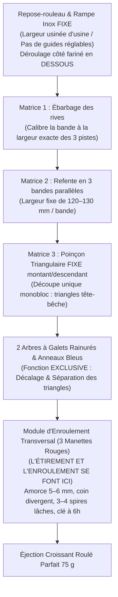

# Manuel Opérationnel d'Atelier : Rondo Croissomat SCM50
## Configuration Réelle d'Atelier : Machine Calibrée & Fixe

Ce manuel technique référence la configuration physique exacte de votre **Rondo Croissomat SCM50** : alimentation fixe sur rampe inox, découpe étagée par matrices fixes (ébarbage, refente 3 bandes, matrice triangulaire descendante/montante unique), séparation pure par deux arbres à galets bleus, et **étirement/enroulement réalisé exclusivement sous le tablier transversal** à 3 manettes rouges.

---

## 1. Schéma Cinématique Réel de votre SCM50

---

## 2. Clarifications Essentielles sur votre Machine

### 1. La Matrice de Découpe Triangulaire est FIXE et UNIQUE
* Vous disposez d'une **matrice triangulaire monobloc aux dimensions fixes d'usine**.
* La surface du triangle est donc totalement constante et non modifiable.
* **Comment pilote-t-on le poids cible de 75 g ?**
  * Le poids unitaire ne se règle pas sur la Croissomat, il se verrouille **au laminoir Rondo Compas** :
  * C'est **l'épaisseur finale d'abaisse (3,5 mm ± 0,1 mm)** qui donne rigoureusement les **75 g (± 1 g)** sur la surface de votre emporte-pièce fixe.
  * Si un jour vos croissants sortent à 78–80 g : vous baissez l'abaisse laminoir à 3,3–3,4 mm.
  * S'ils sortent à 70–72 g : vous montez l'abaisse à 3,6–3,7 mm.

### 2. Le Rôle des 2 Arbres à Galets au Milieu : Séparation Pure (Zéro Étirement)
* Ces deux arbres transversaux équipés de galets blancs et anneaux bleus ont une **fonction unique et exclusive : le déphasage / décalage (staggering)**.
* Comme les triangles sont découpés tête-bêche sans chute, ces galets servent uniquement à :
  * Pincer la première rangée (base en avant) pour qu'elle parte en premier sur le tapis aval.
  * Retenir la seconde rangée (pointe en avant) pour créer l'espace libre de 5 à 8 cm.
* **Ils ne servent pas à étirer la pâte**. Leur réglage doit rester neutre : les galets doivent juste être bien centrés sur la ligne médiane de chaque piste pour ne pas faire dévier les triangles.

### 3. L'Étirement Axial se Fait UNIQUEMENT à l'Enroulage sous le Tablier
* C'est au moment où la base du triangle s'engage sous la bande supérieure du module d'enrouleur transversal que **l'étirement et le roulage se produisent simultanément**.
* La friction différentielle entre le tapis inférieur qui avance et le tablier supérieur texturé entraîne la base tout en exerçant une traction progressive sur la pointe.
* **Ce qui détermine un bel étirement en 3 à 4 spires** :
  1. **La consistance et l'extensibilité de votre pâte** : Grâce à notre formule étalon à **30 % de Farine T65 Tradition**, le triangle s'étire avec souplesse sous le tablier sans aucune déchirure.
  2. **La Manette 1 (Hauteur d'amorce à 5–6 mm)** : L'amorce prend immédiatement sur les premiers millimètres de la base.
  3. **La Manette 2 (Pente divergente vers 28–32 mm)** : Laisse le rouleau prendre son diamètre tout en étirant le corps du triangle.
  4. **La Manette 3 (Réglage souple)** : Permet aux spires de glisser et de se développer sans écraser le cœur.

### 4. Rampe Amont & 3 Pistes : Tout est Fixe d'Usine
* La rampe inclinée en inox et le couloir de découpe sont usinés aux cotes exactes de la machine.
* Il n'y a **aucun guide à déplacer ni à régler** : la largeur de votre bande laminée (calibrée à ~42–44 cm) se positionne naturellement sur la rampe.
* La Matrice 1 ébarbe automatiquement les deux petites rives de pâte morte pour ajuster la bande pile au gabarit des 3 pistes fixes.

---

## 3. Le Triptyque Fondamental d'Atelier (Toujours Valable)

1. **Température Bande** : **10 °C à 12 °C (Sweet Spot 11 °C)** après décompression libre $\ge 60\text{ s}$ sur la rampe.
2. **Texture** : Test du pouce (remonte à 50 % en 5 s), peau mate, satinée, non poisseuse.
3. **Farinage Inversé** : Le laminoir farine le dessus, **vous déroulez impérativement face farinée en dessous (contre le tapis)**. La face supérieure reste vierge de farine volante pour garantir la soudure parfaite des spires sous l'enrouleur (zéro débobinage en étuve).

---

## 4. Synthèse Finale des Réglages Opérateur sur la SCM50

Puisque la matrice et la rampe sont fixes, l'opérateur n'a que **3 réglages physiques à surveiller** sur toute la machine :

| Organe Machine | Ce qu'il faut régler | Valeur / Consigne d'Atelier |
| :--- | :--- | :--- |
| **Laminoir Rondo Compas** | Épaisseur finale d'abaisse | **3,5 mm (± 0,1 mm)** $\rightarrow$ conditionne le poids fixe de 75 g cru |
| **Arbres à Galets Bleus** | Centrage latéral sur chaque piste | Bloquer les 3 galets sur l'axe médian de chaque piste (pression douce sans sillon) |
| **Poignée Supérieure DROITE (Entrée)** | Entrefait d'amorce amont | **Index sur 2,2 à 2,5** (bras vertical) $\rightarrow$ entrefait réel ~5,5–6,0 mm, accrochage doux de la base de 3,5 mm sans écrasement |
| **Poignée Supérieure GAUCHE (Sortie)**| Dégagement aval du rouleau | **Index sur 3,0 à 3,2** (bas d'arc supérieur) $\rightarrow$ couloir divergent libérant le croissant de 30 mm sans calandrage |
| **Poignée INFÉRIEURE (Galbe & Clé)**   | Cambrure tablier & Roulage | **Index sur 7,5 à 8,0** (en bas de coulisse horizontale) $\rightarrow$ cambrure souple (3–4 spires lâches, petit jour au cœur) + **dépose manuelle clé à 6h dessous** |
