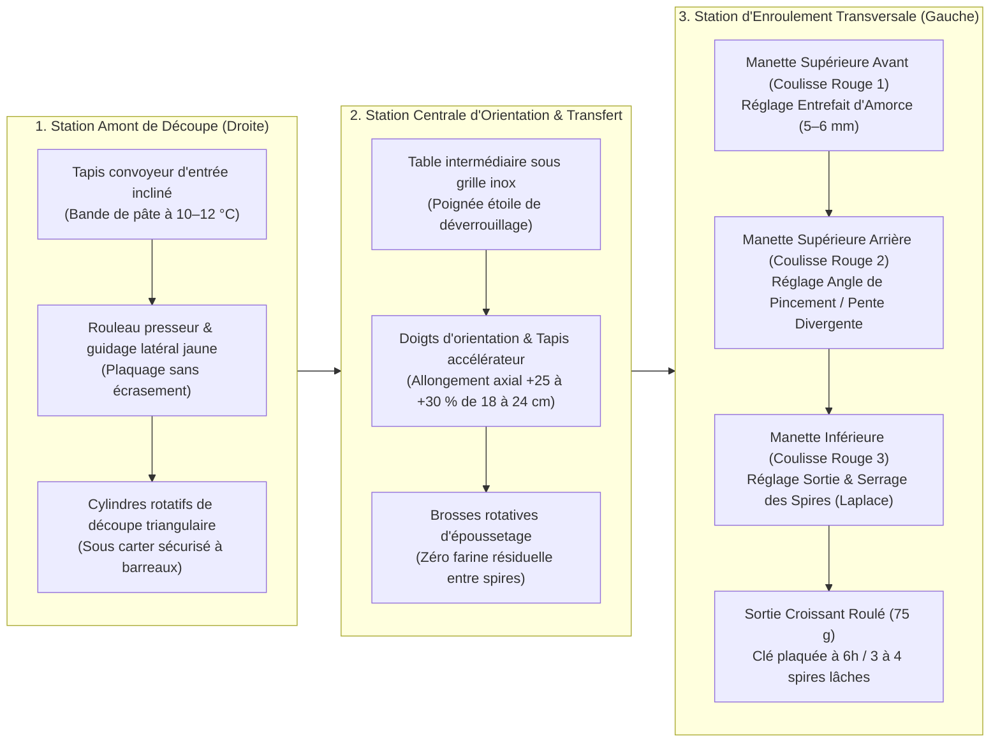

# Manuel Opérationnel d'Atelier : Rondo Croissomat SCM50
## Réglages d'Étirement, d'Amorce & d'Enroulement Parfaits (Croissant 75 g)

Ce guide technique est calibré directement pour votre modèle : la **Rondo Croissomat SCM50 (Seewer Rondo)** avec tapis amont incliné, rouleaux de découpe sous carter à barreaux et **module d'enroulement transversal à coulisses de réglage graduées rouges**.

---

## 1. Cartographie des Organes de la Machine



---

## 2. Le Triptyque Fondamental d'Atelier : Texture, Température & Farinage Idéaux

Pour que la Croissomat SCM50 délivre 100 % de sa précision sans bourrage ni déchirure, la matière doit répondre à un triptyque rhéologique rigoureux :

```
             ┌─────────────────────────────────────────────────────┐
             │            LE TRIPTYQUE IDÉAL SCM50                 │
             └─────────────────────────────────────────────────────┘
                         /                       \
                        /                         \
                       ▼                           ▼
        ┌────────────────────────┐      ┌─────────────────────────┐
        │  TEMPÉRATURE BANDE     │      │   TEXTURE / RHÉOLOGIE   │
        │  10 °C à 12 °C STRICT  │      │  Ferme, ductile, mate   │
        │ (Sweet spot à 11 °C)   │      │  Zéro suintement d'eau  │
        └────────────────────────┘      └─────────────────────────┘
                         \                         /
                          \                       /
                           ▼                     ▼
                        ┌───────────────────────────┐
                        │    FARINAGE / FLEUSAGE    │
                        │   "Voile fantôme" T45     │
                        │  Zéro farine entre spires │
                        └───────────────────────────┘
```

### 2.1 La Température Idéale : 10 °C à 12 °C (Sweet Spot strict à 11 °C)
* **Pourquoi 10 °C – 12 °C à cœur ?**
  * **Comportement du beurre (Courbe SFC - Solid Fat Content)** : À 11 °C, le beurre de tourage 84 % atteint sa zone de déformation plastique parfaite. Il est ferme mais malléable. Il plie et s'enroule sans casser ni fuser dans la détrempe.
  * **Comportement du réseau de gluten** : La pâte est suffisamment raffermie pour résister au cisaillement des couteaux sans s'affaisser, tout en gardant sa souplesse.
* **Les deux dérives thermiques mortelles** :
  * **Pâte trop froide ($< 9\text{ }^\circ\text{C}$)** : Le beurre est vitreux et cassant. La pâte est rigide : elle glisse sur le tapis incliné sans accrocher la Manette 1 d'amorce, ou se fracture en accordéon. Les couteaux rotatifs martèlent au lieu de trancher net.
  * **Pâte trop chaude ($> 13\text{ }^\circ\text{C}$)** : Le beurre atteint son point de ramollissement, pénètre la détrempe (perte de feuilletage). La pâte devient grasse et poisseuse, colle aux couteaux rotatifs, bourre sous les carters et s'écrase sous le tablier d'enroulement.
* **Gestion du flux atelier** : Dans un laboratoire à 20 °C, une bande abaissée à 3,5 mm gagne +1 °C toutes les 3 à 4 minutes sur les tapis inox. **Règle absolue : laminer et passer pâton par pâton** (ne jamais stocker 3 bandes d'avance à température ambiante).

### 2.2 La Texture Idéale : Ferme, Soyeuse, Élastique & Non Collante
* **Test tactile de l'opérateur (Le "Test du Pouce")** :
  * Appuyer fermement le pouce sur la bande abaissée à 3,5 mm : l'empreinte doit marquer nettement, puis remonter lentement à environ 50 % de sa profondeur en 5 secondes.
  * *Si elle remonte instantanément comme un élastique* : Pâte sous tension mécanique (manque de décompression libre). Les triangles vont se rétracter (*snapback*) après découpe.
  * *Si l'empreinte reste figée sans remonter* : Pâte sans ténacité (gluten dégradé par protéolyse ou excès d'eau libre).
* **Aspect visuel et état de surface** :
  * La surface doit avoir un **aspect satiné/mat**, doux comme du cuir fin, et **rigoureusement sèche au toucher**.
  * Si la surface brille ou poisse au doigt, c'est le signe d'un suintement d'eau libre provoqué par une fermentation précoce de nuit ou une lyse de levure (relargage de GSH).
* **Réserve d'extensibilité ($L$)** :
  * Saisir un triangle découpé par la base et la pointe : il doit s'allonger de 25 à 30 % sous une traction douce sans blanchir ni amorcer de micro-déchirure sur les chants.

### 2.3 Le Farinage (Fleusage) Idéal : La Règle du "Voile Fantôme"
Le farinage sur Croissomat est un exercice de haute précision. L'objectif est d'assurer le glissement sur les organes mécaniques sans jamais polluer l'intérieur du croissant.
* **Nature du fleusage** : Utiliser exclusivement de la **Farine de Gruau T45 très sèche et tamisée** (ou un mélange 80 % T45 tamisée / 20 % fécule ou farine de riz micronisée pour un glissement ultra-fluide). Proscrire toute farine humide ou grumeleuse.
* **Règle par zone machine** :
  1. **Sous la bande (Face inférieure contre tapis)** : Fleuser d'un **voile ultra-fin et régulier** (aspect poussière/talc). Il empêche la pâte d'adhérer au tapis incliné et à la table centrale.
  2. **Sur la bande (Face supérieure sous couteaux)** : **Zéro farine !** Les couteaux rotatifs tranchent avec une netteté chirurgicale sur une pâte nue. Une couche de farine supérieure encrasse les lames et crée des copeaux pâteux sous les racleurs.
  3. **Station d'étirement axial** : Les rouleaux et tapis étireurs ont besoin d'une friction contrôlée pour agripper la pâte. Si le triangle est fariné sur le dessus, il patine et ne s'étire pas.
  4. **Poste d'époussetage (Brosses avant enrouleur)** : Les brosses rotatives doivent être réglées en contact franc pour éliminer 100 % de la farine volante avant l'engagement sous le tablier à mailles inox.
* **Le danger mortel du sur-farinage intérieur** :
  * Si de la farine reste emprisonnée entre les spires lors de l'enroulement, elle forme une barrière physique anti-adhésive. Les couches ne fusionnent pas lors de la décongélation et de la pousse.
  * **Conséquence en étuve et au four** : Le croissant se "débobine", la pointe s'échappe et les spires s'ouvrent en accordéon ou en tire-bouchon.

---

## 3. Le Bloc d'Enroulement Transversal : Maîtrise des 3 Manettes à Coulisses Rouges

Le panneau latéral gauche est le centre nerveux du façonnage. Les trois manettes à poignée étoile noire coulissent dans des arcs de cercle munis de **réglettes graduées rouges**.

```
       [ENTRÉE DU TRIANGLE]
                 │
                 ▼
     ┌───────────────────────┐
     │  (Manette 1 - Haut/Av)│ ──> [HAUTEUR D'AMORCE] : 5 à 6 mm (1,5x épaisseur de pâte)
     │  (Manette 2 - Haut/Ar)│ ──> [ANGLE DU TABLIER] : Pente divergente d'accompagnement
     │                       │
     │  (Manette 3 - Bas)    │ ──> [SERRAGE DES SPIRES] : Calibrage 3 à 4 spires lâches + Clé à 6h
     └───────────────────────┘
                 │
                 ▼
     [ÉJECTION CROISSANT ROULÉ]
```

### Manette 1 • Coulisse Supérieure Avant (Entrefait d'Amorce)
* **Fonction** : Ajuste l'espacement entre le tapis convoyeur inférieur et la lèvre d'attaque de la bande supérieure d'enroulement.
* **Réglage étalon pour Croissant 75 g (Abaisse 3,5 mm)** :
  * Régler l'entrefait à **5,0 – 6,0 mm** (repère intermédiaire sur la réglette rouge).
  * **Si trop ouvert (graduation haute)** : La base du triangle ne trouve pas de résistance, elle glisse sur 5 à 8 cm avant de s'enrouler. Le croissant sort court, sans noyau serré, avec seulement 2 spires molles.
  * **Si trop fermé (graduation basse)** : La base heurte le tapis supérieur, plisse en accordéon et s'écrase. Le feuilletage est broyé, ce qui entraîne une fuite de beurre massive en cuisson.

### Manette 2 • Coulisse Supérieure Arrière (Angle de Convergence / Pente)
* **Fonction** : Définit la pente de la chambre d'enroulement entre l'entrée et la sortie.
* **Réglage étalon** :
  * Le canal doit former un **coin divergent progressif** s'ouvrant de 5–6 mm à l'entrée jusqu'à **28–32 mm** au centre.
  * Cette ouverture progressive permet d'accueillir le volume croissant du cylindre de pâte au fur et à mesure que les 3 à 4 spires s'enroulent sur elles-mêmes, sans comprimer le cœur.

### Manette 3 • Coulisse Inférieure (Pression Finale & Calage de la Clé)
* **Fonction** : Contrôle la pression d'éjection et la position angulaire de la pointe du croissant à la sortie.
* **Réglage étalon (Loi de Laplace $T = \Delta P \cdot r$)** :
  * Régler en position **légère / souple**.
  * **Test tactile impératif** : L'opérateur doit pouvoir glisser l'extrémité du petit doigt dans les cavités latérales du croissant cru sans forcer. Si le trou est complètement obturé ou écrasé, le croissant est trop serré.
  * **Calage de la pointe (La Clé)** : Faire coulisser cette manette de quelques millimètres pour ajuster le moment exact où le croissant quitte le tapis supérieur. **La pointe du triangle doit terminer impérativement plaquée sous le croissant (à 6 heures)** contre le tapis récepteur.

---

## 3. Le Dispositif d'Étirement Axial (L'Allongement du Triangle)

Sur la Rondo SCM50, l'obtention d'un croissant élancé dépend de l'élongation préalable du triangle entre la station de découpe et le module d'enroulement :

1. **Rapport Géométrique Idéal** :
   * **Dimensions brutes découpées** : Base = 120–130 mm | Hauteur = 180–200 mm.
   * **Dimensions après étirement axial** : Base = 120–130 mm | **Hauteur étirée = 240 à 260 mm** (Gain d'élongation de **+25 % à +30 %**).
2. **Mécanisme d'entraînement de la SCM50** :
   * Le tapis intermédiaire fonctionne à une vitesse légèrement supérieure ($V_2 > V_1$) pour étirer le triangle pendant qu'un rouleau/patin souple retient temporairement la pointe ou la base.
   * **Condition biochimique indispensable** : Ce taux d'allongement sans déchirure n'est possible que si la détrempe contient **30 % de Farine T65 Tradition** (extensibilité $L$, $P/L \le 0,62$) et que la bande a bénéficié de sa **décompression libre de 60 secondes** sur le tapis incliné.

---

## 4. Matrice de Dépannage Immédiat au Poste SCM50

| Constat Visuel sur le Croissant | Cause Mécanique sur la SCM50 | Correction Immédiate |
| :--- | :--- | :--- |
| **Croissant trapu, "boudiné", 2 spires** | Triangle pas assez étiré en hauteur | Augmenter l'écart de vitesse d'étirement ; vérifier que la bande est à 10–12 °C. |
| **Déchirure de la pâte à l'entrée de l'enrouleur** | Manette 1 trop basse (entrée trop étroite) | Remonter la Manette 1 de 2 à 3 mm sur la réglette rouge supérieure. |
| **Croissant qui se débobine en étuve** | Excès de farine de fleusage entre les spires | Régler les brosses rotatives d'époussetage pour balayer à sec les deux faces. |
| **Éclatement de la spire externe en étuve** | Manette 3 trop serrée (enroulement trop sous tension) | Ouvrir la Manette 3 (desserrer l'arc inférieur) pour aérer le noyau central. |
| **Pointe qui rebique vers le haut en cuisson** | Clé mal positionnée à l'éjection (pointe à midi au lieu de 6h) | Déplacer la Manette 3 de ± 5 mm jusqu'à ce que la pointe retombe sous le corps. |
| **Croissant asymétrique (forme en banane tordue)** | Triangle arrivant de biais sous l'enrouleur | Réaligner les guides latéraux et doigts d'orientation sur la table centrale. |
