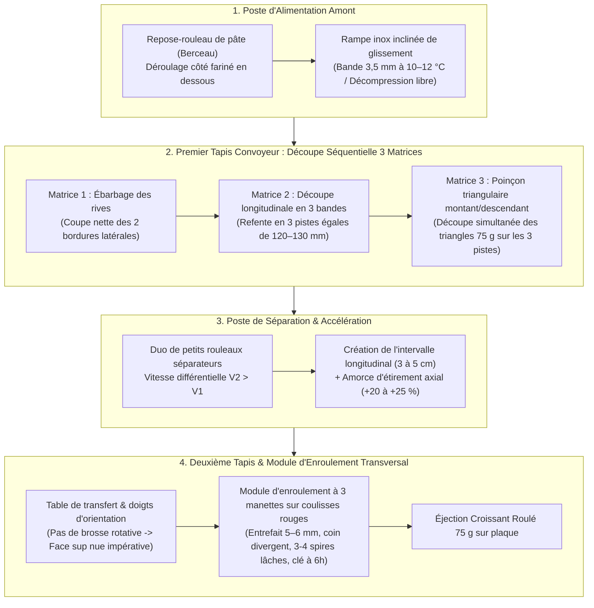

# Manuel Opérationnel d'Atelier : Rondo Croissomat SCM50
## Configuration Exacte d'Atelier : Découpe 3 Pistes & Enroulement Transversal

Ce manuel technique référence la configuration physique exacte de votre ligne **Rondo Croissomat SCM50** : alimentation sur rampe inclinée inox, découpe séquentielle en 3 matrices (ébarbage, refente 3 bandes, matrice triangulaire montante/descendante), séparation par rouleaux accélérateurs et enroulement transversal sous tablier à 3 manettes graduées.

---

## 1. Schéma Cinématique Réel de votre Croissomat SCM50

---

## 2. Analyse Technique de votre Séquence de Découpe en 3 Matrices

Contrairement aux systèmes rotatifs simples, votre machine utilise un découpage séquentiel étagé qui garantit une précision pondérale absolue ($\pm 1\text{ g}$ sur chaque croissant) :

### Matrice 1 • Ébarbage des Rives Latérales
* **Rôle** : Rogner les deux bordures extrêmes du pâton sur 5 à 10 mm.
* **Fonction atelier** : Supprime les rives irrégulières et les bourrelets de pâte morte pour calibrer la bande à la largeur utile exacte des 3 pistes. Les bandelettes de chutes tombent directement dans les bacs de récupération latéraux pour être recyclées.

### Matrice 2 • Refente Longitudinale en 3 Bandes Parallèles
* **Rôle** : Diviser la bande ébarbée en **3 pistes longitudinales strictement identiques**.
* **Calibrage** : Chaque bande mesure entre **120 et 130 mm de large** (correspondant exactement à la largeur de base du croissant 75 g).
* **Avantage rhéologique** : La refente en amont évite les contraintes de déchirement latéral lors de la frappe des triangles.

### Matrice 3 • Poinçon Triangulaire Montant & Descendant (Guillotine)
* **Rôle** : Découper les triangles en une seule frappe verticale simultanée sur les 3 bandes.
* **Fonctionnement** :
  * Le tapis marque un micro-arrêt indexé pendant la descente de la lame triangulaire biseautée.
  * Les **tampons éjecteurs à ressorts** maintiennent la pâte au tapis pendant la remontée de la lame (anti-soulèvement par effet ventouse).
* **Butée de hauteur** : Doit sectionner 100 % de l'épaisseur sans entailler la toile du tapis.

---

## 3. Le Duo de Rouleaux Séparateurs : Intervalle & Élongation Axiale

Situés entre le premier tapis de découpe et le second tapis de transfert, ces deux petits rouleaux motorisés jouent un rôle clé :

1. **Séparation Physique & Cadencement** :
   * En tournant à une vitesse légèrement supérieure au tapis de découpe ($V_2 > V_1$), ils pincent l'extrémité de chaque triangle et l'accélèrent vers l'avant.
   * Cette accélération crée un **espace libre de 3 à 5 cm entre deux triangles successifs**, empêchant tout chevauchement ou collage à l'entrée du module d'enrouleur.
2. **Premier Étirement Axial** :
   * Le pincement différentiel allonge naturellement le triangle de **180–200 mm à 230–250 mm**, amorçant la silhouette élancée du croissant.
3. **Consigne de Pression des Rouleaux** :
   * Le pincement doit être **doux et élastique**. S'il est trop serré, il écrase localement les 12 feuillets de beurre au centre du triangle.

---

## 4. Pourquoi l'Absence de Brosse Rotative Rend la Règle de Déroulage Cruciale

Votre machine ne possède pas de brosses rotatives d'époussetage pour balayer la pâte avant l'enrouleur. 

* **Si la face supérieure était farinée** :
  * Cette farine ne serait jamais éliminée.
  * Elle entrerait directement sous le tablier d'enroulement et se retrouverait **emprisonnée entre les spires**.
  * **Sanction immédiate** : Les couches ne peuvent pas fusionner, et le croissant **se débobine en étuve ou s'ouvre en ressort au four**.
* **La Solution Définitive** :
  * Le laminoir farine le dessus lors de l'abaisse.
  * **Vous déroulez impérativement côté fariné en dessous (contre le tapis)**.
  * **Résultat** : La face supérieure qui entre dans la SCM50 est **rigoureusement nue, mate et sans farine volante**. Les triangles s'enroulent sur eux-mêmes avec une adhérence parfaite, sans aucun risque de débobinage !

---

## 5. Synthèse des Réglages au Poste d'Enroulement (Panneau Latéral Gauche)

Une fois les triangles séparés par les rouleaux et orientés base en tête :
* **Manette Supérieure Avant (Coulisse 1)** : Entrefait d'amorce calé à **5–6 mm** pour que la base du triangle accroche instantanément sans plisser.
* **Manette Supérieure Arrière (Coulisse 2)** : Angle en **coin divergent montant vers 28–32 mm** pour accompagner le grossissement du cylindre sans comprimer la mie.
* **Manette Inférieure (Coulisse 3)** : Réglée **souple (3 à 4 spires lâches, loi de Laplace)** + calage pour que la pointe du triangle termine **plaquée sous le croissant (à 6 heures)** contre la plaque de cuisson.
