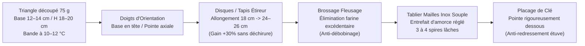

# Spécifications Équipements & Lignes de Mécanisation Rondo

Ce guide technique détaille les réglages cinématiques, calibres, équilibres rhéologiques et tolérances mécaniques pour l'ensemble du parc mécanisé : Laminoir Rondo Compas, Ligne de façonnage Rondo Polyline et Enrouleur automatique Rondo Croissomat (SCM50 / Croissant-o-mat).

---

## 1. Laminoir Automatique (Rondo Compas)

### Règle du Pas de Réduction Progressif
* **Principe mécanique** : Le gluten et les films lipidiques ne supportent pas de réduction brutale d'épaisseur sous peine de rupture d'émulsion et de laminage destructif du beurre dans la pâte.
* **Taux d'écrasement maximal** : **20 % à 25 % d'épaisseur par passe**.
* **Tableau d'amincissement étalon (Pâton de 10,0 kg / Détrempe 8 kg + Beurre 2 kg)** :
  * Épaisseur initiale après enchâssement : ~35 mm.
  * Passe 1 : 28 mm.
  * Passe 2 : 22 mm.
  * Passe 3 : 17 mm.
  * Passe 4 : 13 mm.
  * Passe 5 : 10 mm.
  * Passe 6 : 7,5 mm.
  * Passe 7 : 5,5 mm.
  * Passe 8 (Finale d'abaisse avant ligne) : **3,5 mm (± 0,1 mm)**.

### Séquence des Tours au Laminoir
1. **Équilibre thermique initial** : Détrempe sortie chambre froide à **+2 °C / +4 °C** + Plaque de beurre sec 84 % assouplie à **+12 °C / +14 °C** ($\Delta T \le 3\text{ }^\circ\text{C}$).
2. **1ᵉʳ Tour : Tour Double (en premier)** : Allongement jusqu'à 85–90 cm. Pliage en portefeuille (4 plis). Ce pliage sur pâte détendue verrouille l'équerrage initial à 90°.
3. **Détente 1** : 15 à 20 min au froid positif (+2 °C).
4. **2ᵉ Tour : Tour Simple (en second)** : Tourner d'un quart de tour, allongement modéré à 60–65 cm. Pliage en 3.
5. **Drossage obligatoire des chants** : Tranchage net au couteau de tour des 4 bordures fermées pour libérer les 12 films de beurre et supprimer les bourrelets de pâte morte.
6. **Détente finale** : **45 min à +2 °C** sous bâche étanche avant engagement sur la ligne Polyline.

---

## 2. Table de Découpe & Ligne Rondo Polyline

### Zone de Décompression Libre (Anti-Snapback)
* **Phénomène physique** : Lors du passage entre les rouleaux calibreurs, la bande de pâte accumule une déformation élastique réversible. Si la découpe intervient immédiatement, les triangles se rétractent instantanément de 15 à 25 % en longueur (*snapback*), faussant le calibre de coupe et réduisant la longueur développée du triangle.
* **Consigne machine impérative** : Former une boucle flottante (feston de décompression) sur le tapis d'entrée pendant **au moins 60 secondes libres** avant l'engagement sous les couteaux rotatifs.
* **Température de la bande** : Doit être stabilisée strictement entre **10 °C et 12 °C**.
  * En dessous de 10 °C : La bande est raide, le beurre casse sous le couteau.
  * Au-dessus de 13 °C : Le beurre suinte, colle aux carters et provoque des bavures de découpe.

---

## 3. Enrouleur Automatique Rondo Croissomat (SCM50) : Réglage d'Étirement et d'Enroulement Parfaits

Le façonnage du croissant sur la Croissomat repose sur la coordination de 4 étapes cinématiques critiques : l'orientation, l'étirement axial, l'amorce de roulage et l'enroulement sous tablier.

---

### 3.1 Géométrie & Calibrage du Triangle de Découpe (Croissant 75 g)
* **Épaisseur de bande** : **3,5 mm** (± 0,1 mm).
* **Base du triangle (largeur)** : **120 à 130 mm**.
* **Hauteur brute avant étirement** : **180 à 200 mm**.
* **Poids cru unitaire** : **75 g** (± 1 g).
* **Affûtage des couteaux rotatifs** : Les lames de découpe triangulaire doivent être tranchantes et exemptes de bavures. Tout écrasement de la rive crée une micro-fissure qui amorce la déchirure en étuve.

---

### 3.2 L'Étirement Axial (L'Allongement du Triangle)
Pour obtenir un croissant élancé doté de 3 à 4 spires visibles et de jolies ailettes latérales, le triangle doit être étiré dans le sens de sa hauteur avant d'entrer sous le tablier :
* **Cible d'élongation** : Passer de **180–200 mm bruts** à **240–260 mm étirés** (allongement de +25 % à +30 %).
* **Mécanisme sur Croissomat** :
  * Réalisé par le rouleau étireur supérieur associé au différentiel de vitesse des bandes transporteuses.
  * **Pression du rouleau étireur** : Réglée à une pression modérée. Si trop serré, il écrase le feuilletage et soude les couches de pâte entre elles (perte d'alvéolage). Si trop lâche, le triangle glisse et ne s'allonge pas.
* **Tolérance rhéologique** : Cet allongement n'est mécaniquement possible sans déchirement que grâce au coupage meunier **70 % Gruau / 30 % T65 Tradition** qui apporte l'extensibilité ($L$) nécessaire et maintient le $P/L$ sous 0,65.

---

### 3.3 Fleusage & Époussetage (Brosses Supérieures et Inférieures)
* **Règle d'or** : Le minimum absolu de farine.
* **Danger de la farine résiduelle** : Si une pellicule de farine reste piégée entre les spires lors de l'enroulement, les couches de pâte ne peuvent pas adhérer entre elles. Le croissant se "débobine" en étuve ou s'ouvre comme un ressort au four.
* **Réglage** : Les brosses rotatives doivent balayer énergiquement le dessus et le dessous du triangle immédiatement avant le contact avec le tablier d'enroulement.

---

### 3.4 Réglage du Tablier d'Enroulement (Mailles Inox Flexibles)
Le tablier supérieur à mailles inox assure la conversion du mouvement linéaire en mouvement rotatif d'enroulement :

1. **Hauteur d'Entrée (Entrefait d'Amorce)** :
   * L'espace entre le tapis transporteur et la lèvre d'entrée du tablier doit correspondre exactement à **1,5 fois l'épaisseur du triangle de pâte (~5 à 6 mm)**.
   * *Si l'entrée est trop haute (> 8 mm)* : La base du triangle ne trouve pas d'appui, glisse sous le tablier et ne commence à rouler qu'au tiers du triangle $\rightarrow$ croissant mou, court, avec seulement 1,5 spire et pointe non serrée.
   * *Si l'entrée est trop basse (< 4 mm)* : La base heurte violemment le tablier, se froisse en accordéon ou s'écrase $\rightarrow$ rupture du feuilletage, fuite de beurre en cuisson.
2. **Angle d'Élévation du Tablier (Forme en Coin Divergent)** :
   * Le tablier doit s'élever progressivement depuis l'entrée (5 mm) vers la sortie (**28 à 32 mm**) pour accompagner l'augmentation du diamètre du croissant au fur et à mesure que les spires s'enroulent.
3. **Lestage & Pression du Tablier (Loi de Laplace)** :
   * **Nombre de barres de lestage** : Régler le tablier en position **souple (légère)**.
   * *Principe physique ($T = \Delta P \cdot r$)* :
     * Un tablier trop lourd serre excessivement le cœur du croissant : pendant la pousse et le premier four, la pression des gaz et de la vapeur ne peut pas s'évacuer par le centre. Elle s'exerce radialement sur la spire externe, provoquant l'éclatement transversal du croissant.
     * Le croissant doit être enroulé en **3 à 4 spires lâches** (on doit pouvoir glisser l'extrémité du petit doigt dans les orifices latéraux du croissant cru sans résistance).
4. **Positionnement de la Clé (La Pointe du Triangle)** :
   * En sortie de tablier, **la pointe du triangle doit se trouver rigoureusement en dessous du croissant**, plaquée contre le tapis (clé à 6 heures).
   * *Réglage fin* : Si la pointe sort sur le dessus ou sur le flanc, ajuster la position longitudinale du tablier de ± 15 mm ou modifier légèrement la vitesse du tapis d'évacuation. Une pointe située sur le dessus se redresse inévitablement en étuve ("langue de chat") et dessèche à la cuisson.

---

## 4. Tableau Synthétique de Diagnostic Rapide au Poste Croissomat

| Symptôme Constaté | Cause Racine Mécanique / Rhéologique | Action Corrective Immédiate sur Machine |
| :--- | :--- | :--- |
| **Croissant court, trapu, seulement 2 spires** | Triangle insuffisamment étiré en amont du tablier | Augmenter la tension/pression du rouleau étireur ou vérifier la décompression $\ge 60\text{ s}$. |
| **Croissant qui se débobine en étuve** | Excès de farine de fleusage piégée entre les spires | Réduire le débit du farineur automatique ; vérifier le contact des brosses d'époussetage. |
| **Croissant écrasé / alvéolage serré et dense** | Tablier d'enroulement trop lourd / trop chargé en barres | Alléger les barres de lestage du tablier de mailles inox. |
| **Éclatement / déchirure de la peau en étuve** | Enroulement trop serré + sur-oxydation ($P/L > 0,80$) | Desserrer le tablier (3-4 spires lâches) ; vérifier que le Kimo Short est à 2,0 % et la T65 à 30 %. |
| **La base glisse sans s'enrouler** | Entrefait d'entrée trop haut ou bande de pâte trop froide ($< 8\text{ }^\circ\text{C}$) | Abaisser la lèvre d'entrée du tablier (5 mm) ; laisser tempérer la pâte à 10–12 °C. |
| **Pointe qui rebique / "langue de chat" à la cuisson** | Pointe non positionnée sous le croissant (clé mal orientée) | Déplacer le tablier en translation (± 10 mm) pour faire atterrir la pointe dessous à 6h. |
| **Bords cisaillés / pâte qui colle aux couteaux** | Couteaux encrassés ou pâte poisseuse suite à fermentation nuit | Nettoyer les couteaux à sec ; vérifier la cellule flash (-35 °C) et la chambre à 0 °C/+1,5 °C. |
| **Croissant en virgule / asymétrique** | Triangle mal centré ou doigts orienteurs désaxés | Réaligner les doigts de guidage amont pour que la base frappe le tablier parfaitement à 90°. |
